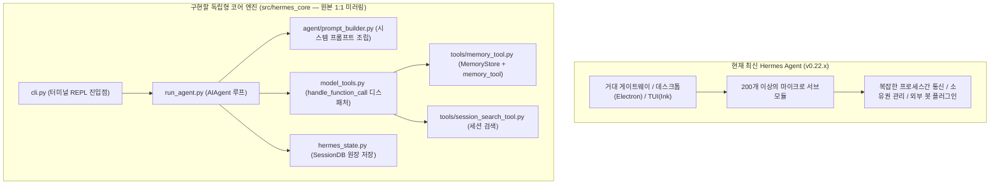

# [마스터 설계도] 01-헤르메스코어 예제 구축

> **상태**: `Draft`  
> **대시보드**: [01-README.md](file:///Users/<user>/Programming/hermes-agent-study/docs/로드맵/01-헤르메스코어-예제구축/README.md)  
> **기준 레퍼런스**: Hermes Agent 2026-02-21 코어 버전 (`6134939882`)

---

## 1. 배경 및 목적 (Why)

본 로드맵의 목적은 Hermes Agent의 가장 순수하고 응집도 높은 아키텍처(2026-02-21 `6134939882` 커밋)를 바탕으로, 외부 복잡한 부가기능(데스크톱 앱, 수많은 메시징 봇 어댑터, 방대한 플랫폼 인프라)을 걷어내고 **AI 코딩 에이전트의 3대 핵심 메커니즘을 온전히 구현한 독립형 코어 엔진(`src/hermes_core`)**을 구축하는 것이다.

### 핵심 학습 및 구현 3대 요소
1. **계층형 시스템 프롬프트 조립 (System Prompt Assembly)**: 에이전트 정체성 + 컨텍스트 파일(`AGENTS.md`, `SOUL.md`) + 메모리 스냅샷 주입 + 프롬프트 캐싱 최적화.
2. **자가 정리형 영구 메모리 (Curated Bounded Memory)**: 토큰 낭비와 환각을 막는 문자 수 제한(MEMORY.md / USER.md) 및 `§` 구분자 기반 동적 교체/삭제/추가.
3. **에피소딕 세션 저장소 (SQLite FTS5 Session Store)**: 대화 전체 히스토리와 도구 실행 결과를 전문 검색 가능한 형태로 보존하고, 컨텍스트 압축 시 세션 체인 분할.

---

## 2. As-Is vs To-Be 아키텍처 대조

| 비교 항목 | As-Is (최신 Hermes Agent) | To-Be (`hermes_core` 엔진) |
|---|---|---|
| **코드 규모** | 수만 줄, 200개 이상의 모듈 | 원본 핵심 6개 파일 모방, 총 ~1,500줄 내외 |
| **파일명/구조** | 분산된 마이크로 파일 구조 | **원본 1:1 미러링 (`run_agent.py`, `agent/`, `tools/`, `hermes_state.py`, `model_tools.py`, `cli.py`)** |
| **클래스/함수명** | 복잡한 믹스인 체인 | **원본 인터페이스 준수 (`AIAgent`, `SessionDB`, `MemoryStore`, `run_conversation`)** |
| **의존성** | Electron, Node.js, 수십 개 서드파티 라이브러리 | `httpx` 또는 `openai`, `pydantic` 등 표준 최소 의존성 |
| **실행 방식** | 데스크톱 앱 및 복합 게이트웨이 데몬 | `python -m hermes_core.cli` 단일 CLI 명령 |
| **검증 용이성** | 복잡한 E2E 환경 구축 필요 | Mock LLM을 통한 100% 로컬 독립 단위 테스트 가능 |

---

## 3. 파급 범위와 무영향 근거 (Blast Radius)

- **수정/생성 대상 경로**:
  - `src/hermes_core/**` (전체 신규 생성)
  - `tests/test_hermes_core/**` (신규 테스트)
  - `pyproject.toml` (루트 패키징 및 의존성 정의)
- **무영향 근거**:
  - `hermes-agent/` 디렉터리는 순수 읽기 전용으로 일체 변경되지 않는다.
  - 기존 `docs/` 내의 ADR, 작업자료, 대화록 문서 구조에 영향을 주지 않는다.
  - `src/hermes_core/` 내부에 로컬 상태 디렉터리(`.hermes/`)를 격리하여 호스트 머신의 `~/.hermes`를 일체 오염시키지 않는다.

---

## 4. 사전 점검 및 실패 위험 분석 (Pre-Mortem)

> *"만약 이 로드맵 구현이 실패하거나 불안정해진다면 무엇 때문인가?"*

| 실패 위험 요소 | 잠재 원인 | 선제 방어책 (설계 반영) |
|---|---|---|
| **1. 외부 LLM 의존성 및 API 비용/네트워크 실패** | 실시간 외부 API 호출 실패, API 키 부재 시 테스트 중단 | 기본 인터페이스에 `MockLLMClient`를 내장하여, API 키 없이도 도구 호출 시나리오 및 턴 루프가 100% 자동 검증되도록 구현 |
| **2. 메모리 파일 파싱 및 문자열 조작 손상** | `§` 구분자 누락, 특수문자 충돌, 바운디드 용량 초과 시 무한 루프 | 메모리 파서에 엄격한 정규식 및 폴백 파싱 가드를 적용하고, 용량 초과 시 자동 Truncate 및 명시적 에러 반환 로직 탑재 |
| **3. 세션 SQLite DB 락 및 동시성 충돌** | 테스트 러너 병렬 실행 시 SQLite WAL 락 충돌 | 단일 세션 전용 연결 격리 및 In-Memory SQLite 모드(`:memory:`)를 테스트 픽스처로 제공하여 테스트 간 상태 오염 원천 차단 |

---

## 5. 4층위 검증 범위 설계 (Validation Grid)

1. **1층위 (수동 반복 배제)**:
   - 사람이 직접 프롬프트를 입력하지 않고, 사전 정의된 대화 시나리오(도구 호출 ➔ 결과 수집 ➔ 최종 응답)를 Mock LLM 응답 시퀀스로 재생하여 자동 검증.
2. **2층위 (순수 도메인 단위 테스트)**:
   - `test_prompt_builder.py`: 컨텍스트 파일 우선순위, 문자 수 제한 자르기(Head/Tail), 메모리 블록 주입 포맷 검증.
   - `test_memory_tool.py`: `add`, `replace`, `remove` 액션의 정확성, 문자 수 한도 초과 방어 검증.
3. **3층위 (상태 및 정합성 검증)**:
   - `test_session_db.py`: SQLite FTS5 전문 검색 일치성, 세션 분기(`parent_session_id`) 체인 무결성, 턴 히스토리 원장 보존 검증.
4. **4층위 (E2E 통합 루프 검증)**:
   - `test_agent_e2e.py`: 에이전트 루프가 사용자 입력을 받아 도구(메모리 저장 + 계산/쉘)를 실행하고 최종 답변을 생성한 뒤 세션 DB에 영구 기록하는 전 과정 검증.
