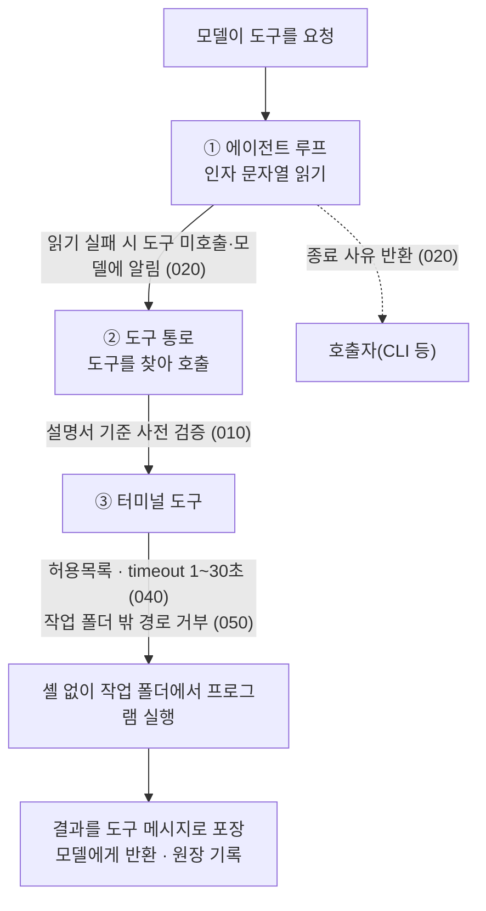

# [결과정리 및 리뷰] 02-코어-안전강화

> **로드맵 상태**: `Closed`  
> **마감 일시**: 2026-10-28  
> **기준 코드**: 시작 `6884617` (로드맵 01 마감 시점) → 완료 `0d6180a` (060 커밋)  
> **대시보드**: [README.md](README.md) | **마스터 설계도**: [ROADMAP.md](ROADMAP.md) | **근거 결정**: [ADR-0002](../../adr/0002-코어_안전_강화_범위와_터미널_가드_방식.md)  
> **개정 기록**: 마감 후 사용자 지시로 이 문서를 개정했다. 로드맵 해설서로 잘못 쓰였던 작동원리 02편(`git show 0517b11:docs/작동원리/02-코어-안전강화-작동원리.md`)의 내용을 병합해, "이 로드맵이 무엇을 왜 했는가"를 앞에 두었다. 마감 당시의 달성도·지표·성과·교훈·인계는 §7~§11에 보존했다.
>
> **다시 확인하는 법**
> ```bash
> git rev-parse --short HEAD
> # 1. 코어 회귀 테스트 (이 로드맵 마감 시점 87개, 현재는 이후 로드맵 03까지 포함해 182개)
> .venv/bin/pytest tests/test_hermes_core/ -v
> # 2. 터미널 도구의 허용목록·셸 미사용 (shell=True 결과가 없어야 함)
> grep -n "ALLOWED_COMMANDS =\|shell=" src/hermes_core/tools/terminal_tool.py
> # 3. 도구 통로의 인자 사전 검증
> grep -n "_validate_arguments" src/hermes_core/tools/dispatcher.py
> # 4. 종료 사유 반환
> grep -n "stopped_reason" src/hermes_core/agent/agent.py
> ```

---

## 1. 이 로드맵이 한 일 (한눈에)

**새 기능을 얹은 로드맵이 아니다. 01에서 만든 코어가 "약속한 것"을 실제로 지키게 만든 로드맵이다.**

01 마감 후 코드를 직접 점검했더니, 「돌아간다」와 「안전하다」 사이에 안전 장치의 이름과 설명은 있는데 실제로 연결되어 있지 않은 곳이 네 군데 있었다. 자동차에 새 옵션을 달기 전에, 브레이크 페달과 바퀴가 연결되어 있는지부터 확인한 것이다.

| 공백 | 로드맵 전 | 로드맵 후 |
|---|---|---|
| 터미널 명령 | 모델이 준 문장을 셸에 그대로 넘김 (시간·출력 제한만 있음) | 셸 없이, 허용된 8개 프로그램만, 작업 폴더에서 실행. 폴더 밖 경로 인자는 거부 |
| 도구 인자 | 도구의 「설명서」를 모델에게 보여 주기만 하고 검사하지 않음 | 호출 전에 설명서로 검증 |
| 루프 신호 | 인자를 읽지 못하면 조용히 빈 인자로 진행. 반복 상한(50회)에 닿으면 빈 응답을 반환할 뿐 정상 종료와 구별 불가 | 읽기 실패는 모델·원장·로그에 알리고, 상한 도달은 종료 사유로 구분 |
| CLI | `--mock` 없이 실행해도 가짜 모델을 조용히 사용 | 안내 후 종료 코드 2 |

---

## 2. 왜 필요했나: 코어를 맡은 사람의 네 가지 질문

01편까지로 에이전트는 돌아갔고 시험도 통과했으며 화면의 동작도 정상이었다. 그런데 시스템을 맡은 사람은 이렇게 묻게 된다.

- *"모델이 터미널 도구로 엉뚱한 명령을 내리면, 그게 그냥 실행되나?"*
- *"모델이 도구에 이상한 값을 넘기면 어디서 걸러지나? 아니면 도구가 알아서 터지나?"*
- *"50번 돌다 멈췄는데, 정상적으로 끝난 건지 중간에 잘린 건지 어떻게 아나?"*
- *"화면에 모델 이름이 나오는데, 사실 가짜 모델이면?"*

점검 결과 네 질문의 답은 모두 **「그렇다, 막는 장치가 없다」**였다. 위 표의 네 공백이 이 네 질문과 하나씩 대응한다.

---

## 3. 업계는 어떻게 하고, 우리는 무엇을 택하고 버렸나 (터미널 가드)

위험한 도구(터미널)를 다루는 업계의 일반적인 방법은 세 가지다(이 레포에서 실행·대조한 것은 아닌 일반론).

| 방법 | 내용 | 약점 |
|---|---|---|
| 차단목록 | 위험해 보이는 명령(`rm -rf`, `sudo` 등)을 막는다 | 셸의 파이프·치환·인용으로 우회할 수 있어 「막지 못한 명령」이 남는다 |
| 사람의 승인 | 위험한 명령마다 사람에게 물어본다 | 이 코어는 사람이 매번 붙어 있지 않은 자동 반복 루프를 전제한다 |
| OS 격리 | 컨테이너·OS 샌드박스로 프로세스를 통째로 가둔다 | 가장 강하지만 OS에 의존해 순수 파이썬 코어라는 목적과 맞지 않는다 |

**우리의 선택 ([ADR-0002](../../adr/0002-코어_안전_강화_범위와_터미널_가드_방식.md)): 허용목록 + 셸 미사용.**

- **왜**: 차단목록은 「막지 못한 것」이 남지만, 허용목록은 「허용한 것만 실행된다」를 코드와 시험으로 증명할 수 있다. 「안전하고 확실한 것을 택한다」는 원칙이다.
- **포기한 것**: 파이프(`|`)나 리디렉션(`>`) 같은 셸 기능, 그리고 `python`·`git`·`find` 같은 강력한 도구. 모델이 쓸 수 있는 명령이 8개 읽기·출력 명령으로 줄었다. 불편하지만, 편의를 위해 가드를 무력하게 만드는 쪽이 더 큰 손해라고 판단했다.
- **버리지 않은 것**: OS 격리. 필요해지면 후속 ADR로 다시 다룬다. 지금은 코드만으로 증명 가능한 범위를 먼저 확보했다.

---

## 4. 단계별로 무엇을 했고 왜 그랬나

### 010. 도구 인자 사전 검증 — 주문서를 주방에 넘기기 전에 서식부터 확인

- **무엇을**: 도구 통로([`dispatcher.py`](../../../src/hermes_core/tools/dispatcher.py))가 도구를 부르기 **전에** 설명서로 네 가지(필수 인자 유무, 정의되지 않은 인자, 타입, 선택지 목록)를 확인한다. 어기면 도구를 부르지 않고, 어떤 인자가 왜 문제인지 적은 실패 메시지를 모델에게 돌려주어 모델이 스스로 고쳐 다시 요청하게 한다. 숫자 자리에 참/거짓 값이 오는 것도 거부한다. 설명서가 비어 있는 도구는 검사하지 않는다(기존 호환).
- **왜**: 식당 주문서에 「필수: 메뉴 이름」이라고 인쇄돼 있는데 메뉴 이름 없이 들어온 주문을 주방에 그대로 넘기면 주방이 당황한다. 접수 창구가 서식을 먼저 확인해야 한다. 이전에는 설명서가 모델에게 보이기만 하고 창구는 확인 없이 넘겼으며, 도구 본체가 먼저 호출된 뒤 실패를 사후에 변환했다.
- **부수 효과**: 모델이 설명서에 없는 매개변수를 직접 넘겨도 「정의되지 않은 인자」로 창구에서 막힌다. 이 성질이 050의 작업 폴더 매개변수를 숨기는 근거가 된다.
- **결과**: 시나리오 10개를 테스트 14건으로 옮겨 통과.

### 020. 에이전트 루프 신호 개선 — 읽지 못한 편지를 「빈 편지」로 처리하지 않기

- **무엇을**: ([`agent.py`](../../../src/hermes_core/agent/agent.py))
  - (a) 인자를 읽지 못하거나 읽은 결과가 사전이 아니면 도구를 부르지 않고, 「인자를 읽을 수 없다」는 도구 메시지를 모델에게 돌려주고 원장에도 남기며 경고 로그를 찍는다. 도구 요청 하나당 도구 메시지가 정확히 하나라는 짝은 유지한다. 빈 문자열(공백 포함)과 `null`은 「인자 없음」으로 본다(인자 없는 도구를 그렇게 부르는 공급자가 있기 때문).
  - (b) 결과에 종료 사유(`completed` 또는 `max_iterations`)를 추가하고, 상한 도달 시 경고 로그를 남긴다. 기존 결과 항목 4개는 이름도 의미도 바꾸지 않았다.
- **왜**: 편지를 읽지 못했는데 「빈 편지」로 처리하고 넘어가면 보낸 사람도 받은 사람도 문제를 모른 채 일이 진행된다. 마찬가지로 시간이 다 돼서 끝난 것과 일을 마치고 끝난 것은 구별돼야 한다. 이전에는 인자 문자열이 JSON이 아니면 조용히 빈 인자로 도구를 불렀고, 반복 상한에 닿으면 빈 응답 문자열을 반환할 뿐이었다.
- **결과**: 시나리오 9개를 테스트 10건으로 통과.

### 030. CLI 가짜 모델 오표시 수정

- **무엇을**: `--mock` 없이 실행하면 가짜 모델을 조용히 쓰지 않고, 에이전트·세션 DB를 만들기 전에 안내 후 종료 코드 2로 끝낸다. `--mock` 동작은 그대로다. ([`cli.py`](../../../src/hermes_core/cli.py))
- **왜**: 화면에 모델 이름이 나오는데 실제로는 가짜 모델이면 사용자가 잘못된 가정으로 일을 진행한다. 실제 모델 클라이언트가 아직 없으므로, 모르고 쓰는 것을 막는 것이 정직한 처리다.
- **결과**: 시나리오 5개를 테스트 5건으로 통과.

### 040. 터미널 허용목록 가드 — 문 앞에서 명찰 확인하기

- **무엇을**: ([`terminal_tool.py`](../../../src/hermes_core/tools/terminal_tool.py)) 명령 문장을 낱말로 나누고, 첫 낱말(프로그램 이름)이 허용된 8개(`echo`, `pwd`, `ls`, `cat`, `head`, `tail`, `wc`, `grep`) 중 하나와 **글자 그대로 같을 때만** 실행한다. 경로가 붙은 이름(`/bin/ls`)도 거부한다. 셸이 없으므로 `;`, `|`, `$()`, `$HOME`은 해석되지 않고 그냥 글자로 전달된다. 표준 입력은 닫아서 입력을 기다리며 멈추는 일을 막는다. 따옴표가 닫히지 않은 명령은 실행하지 않고 「해석할 수 없다」는 실패 메시지를 돌려준다.
- **왜 셸을 버렸나**: 「문 앞에서 명찰을 확인하고 입장시킨다」와 「문을 열어 두고 안에서 나쁜 사람을 찾는다」의 차이다. 셸은 한 줄 안에 여러 명령을 이어 붙이고 변수·치환으로 문장을 바꿀 수 있어 「위험한 줄을 알아보기」가 본질적으로 어렵다.
- **왜 이 8개인가**: 옵션만으로 다른 프로그램을 실행하거나 파일을 쓰는 기능이 없는 읽기·출력 중심 명령만 넣었다. `python`·`bash`(임의 코드 실행), `find`(`-exec`), `sed`·`awk`(스크립트 안 명령 실행), `git`(설정으로 외부 프로그램 호출)은 의도적으로 뺐다.
- **`timeout`도 같은 단계에서 닫았다 (결정 D-08)**: 1~30초의 정수만 허용한다. 범위 밖(0, 31, 정수가 아닌 값)이면 값을 조용히 깎지 않고 프로그램을 실행하지 않은 채 오류로 알린다. 조용히 깎으면 모델은 자기 요청이 무시된 것을 모르기 때문이다. 이전에는 모델이 정하는 `timeout`에 상한이 없어 아주 큰 값을 넘기면 30초 제한이 사실상 없었고, 010의 인자 검사는 「정수인가」만 보므로 이 구멍을 막지 못했다. 「제한 시간은 30분」이라고 써 놓고 응시자가 시험지에서 직접 시간을 고칠 수 있게 두면 제한이 아니다.
- **결과**: 시나리오 20개를 테스트 20건으로 통과. `shell=True` 0건, 허용목록 정의 한 곳.

### 050. 터미널 작업 폴더 경로 제한 — 이 방 안의 책만 읽게 하기

- **무엇을**: 모든 인자를 실제 경로로 풀어(`..`·심볼릭 링크 해석 포함) 작업 폴더 안인지 검사하고, 밖이면 실행하지 않는다. 옵션 값도 검사한다(`--file=/etc/passwd`처럼 `=`로 붙은 값, `-f/etc/passwd`처럼 짧은 옵션에 붙은 값). 프로세스는 항상 작업 폴더에서 실행한다. `~`는 셸이 없어 홈 폴더로 바뀌지 않고 폴더 안의 이름으로 취급한다.
- **왜**: 심부름꾼이 가져온 책 목록의 주소를 하나하나 확인하는 방식이다. 목록에 적힌 주소는 확인할 수 있다.
- **일부러 보수적으로 판정한다**: 경로가 아닌 인자(`grep / a.txt`의 패턴 `/`)도 폴더 밖으로 풀리면 거부한다. 정상 사용이 가끔 막히더라도 새는 쪽보다 막히는 쪽이 낫다는 판단이며, 이 한계는 시험으로 고정했다.
- **막지 못하는 것**: `grep -S`처럼 프로그램이 폴더 **안**의 심볼릭 링크를 스스로 따라가는 동작은 명령줄을 검사하는 방식으로 막을 수 없다. 구현 중 실행으로 확인했다: 작업 폴더 안에 폴더 밖 디렉터리를 가리키는 링크를 두면 `grep -RS 검색어 .`가 통과해 폴더 밖 파일 내용을 읽었다(이 환경의 `grep`은 ugrep 7.8.4이며 `-R` 단독은 따라가지 않았다. 다른 구현은 옵션이 달라 미확인). 허용목록에 링크를 만드는 명령이 없어 새 링크가 생기지는 않지만 이미 있는 링크는 해당된다. 심부름꾼이 책장 틈새 비밀 통로를 스스로 따라가는 것까지는 명단 확인으로 알 수 없다.
- **결과**: 시나리오 18개를 테스트 18건으로 통과(`-f/etc/passwd` 형태 거부 포함). 모델이 작업 폴더 매개변수(`workspace`)를 직접 넘겨도 010의 창구에서 막힌다(시나리오 18).

### 060. 통합 E2E 검증 — 섞여도 정상 종료하는지만 확인

- **무엇을**: 코드를 바꾸지 않고, 차단된 명령·잘못된 인자·읽을 수 없는 인자·정상 명령이 한 대화에 섞여도 루프가 끝까지 정상 종료하는지만 확인했다. 5회 반복 순서, 도구 메시지 4개의 순서, 원장 10건을 확인했고, 01편의 재확인 명령 12개를 실행해 「지금은 없다」 항목을 코드와 대조했다.
- **결과**: 시험 1건(확인 5개) 첫 실행 통과, 코드 수정 없음. 한계: 가짜 모델의 응답 순서로만 시험했다.

**왜 6단계로 쪼개고 한 번에 하나씩 했나**: 한꺼번에 여섯 군데를 고치고 시험이 실패하면 어느 수리가 원인인지 알 수 없다. 하나 고치고 시험하고 기록하고 멈추면 마지막 한 단계만 의심하면 된다. 각 단계의 「입력 → 기대 결과」 시험표는 **구현보다 먼저** 지시서에 적혀 있었다. 구현하는 쪽이 자기 코드에 맞춰 시험을 짜는 「동어반복 시험」을 막기 위해서이며, 구현 중 시험표를 바꿔야 하면 임의로 바꾸지 않고 멈춰서 보고했다.

---

## 5. 왜 이 변경이 시스템의 다른 부분을 터뜨리지 않는가



1. **고친 곳이 4개 파일로 한정된다.** 도구 통로, 에이전트 루프, CLI, 터미널 도구뿐이다. 기억 도구, 대화 원장, 세션 검색, 지시문 조립, 상수는 수정하지 않았다. 도구 통로의 검증은 이들의 설명서를 **읽기만** 한다.
2. **기존 약속은 깨지 않았다.** 터미널 도구의 반환 형식(성공 여부, 종료 코드, 표준 출력·오류, 오류 문구)과 제한값(30초, 10,000자), 에이전트 결과의 기존 네 항목은 그대로이고, 새로 생긴 것은 실패 사유와 종료 사유 항목뿐이다.
3. **정상 호출이 막히지 않는지 확인했다.** 기억 도구의 정상 호출이 검증을 통과하는 회귀 시험이 있고(010 시나리오 9), 세션 검색·터미널 도구는 설명서와 도구 함수의 매개변수가 일치함을 코드로 확인했다.
4. **짝이 깨지지 않는다.** 인자 읽기 실패 때도 도구 요청마다 도구 메시지가 정확히 하나 있어서, 모델과의 대화 형식이 어긋나 공급자가 거절하는 일이 없다.
5. **어떤 실패도 프로그램을 멈추지 않는다.** 허용목록 거부, 경로 거부, 시간 범위 오류, 인자 검증 실패, 따옴표가 안 닫힌 명령 모두 예외가 아니라 「실패 메시지」로 모델에게 돌아간다.

---

## 6. 배척한 안티패턴

| 배척한 방식 | 이유 |
|---|---|
| 셸을 유지하고 위험 패턴만 차단 | 파이프·치환·인용으로 우회 가능. 막지 못한 명령이 남는다 |
| 허용목록에 편의상 `python`·`git`·`find`를 포함 | 한 개만 들어와도 임의 코드 실행이 가능해져 가드 전체가 무력해진다 |
| 범위 밖 `timeout`을 조용히 30초로 깎기 | 모델이 자기 요청이 무시된 것을 모른 채 잘못된 가정으로 진행한다. 투명하게 오류로 알린다 |
| 인자 읽기 실패를 빈 인자로 계속 진행 | 도구가 엉뚱한 기본값으로 실행될 수 있고 원인이 로그에도 남지 않는다 |
| 파일 읽기·쓰기 도구를 02에 함께 넣기 | 범위가 커져 한 번에 한 단계 원칙으로 추적하기 어렵다. 가드 위에 얹는 순서가 자연스러워 03으로 미뤘다 |
| 구현자가 시험을 자기 코드에서 도출 | 동어반복 시험이 된다. 시험표를 구현 전에 요구사항에서 먼저 적는다 |
| 지금 OS 샌드박스 도입 | OS 의존이 생기고 순수 파이썬 코어 원칙과 맞지 않는다. 필요해지면 후속 ADR로 |

**득과 실**: 득은 「허용한 것만 실행된다」를 시험으로 증명할 수 있다는 점이다. 실은 모델의 명령 선택지가 좁아지고, 보수적 경로 판정 때문에 가끔 정상 명령이 거부된다는 점이다.

---

## 7. 목표 달성도 대조표 (Goal vs Actual)

로드맵 01 마감 후 점검에서 확인된 「돌아간다」와 「안전하다」 사이의 공백 네 가지를 메우는 것이 목표였다.

| 구분 | 초기 목표 | 실제 구현 산출물 | 달성도 | 비고 / 검증 결과 |
|---|---|---|:---:|---|
| **010 도구 인자 사전 검증** | 도구 호출 전에 설명서 기준으로 필수·미정의·타입·선택지를 검사 | [`dispatcher.py`](../../../src/hermes_core/tools/dispatcher.py) | 100% | 시나리오 10개를 테스트 14건으로 옮겨 통과. 설명서가 빈 도구는 검사하지 않음(기존 호환) |
| **020 에이전트 루프 신호 개선** | 인자 읽기 실패를 모델에 알림, 반복 상한 도달을 호출자가 구분 | [`agent.py`](../../../src/hermes_core/agent/agent.py) | 100% | 시나리오 9개를 테스트 10건으로 통과. 결과에 `stopped_reason` 추가, 기존 4개 키 유지 |
| **030 CLI 가짜 모델 오표시 수정** | `--mock` 없이 실행하면 가짜 모델을 조용히 쓰지 않음 | [`cli.py`](../../../src/hermes_core/cli.py) | 100% | 시나리오 5개를 테스트 5건으로 통과. 에이전트·세션 DB 생성 전에 종료 코드 2 |
| **040 터미널 허용목록 가드** | 셸 없이 허용 프로그램만 실행 | [`terminal_tool.py`](../../../src/hermes_core/tools/terminal_tool.py) | 100% | 시나리오 20개를 테스트 20건으로 통과. `shell=True` 0건, 허용목록 정의 한 곳 |
| **050 터미널 작업 폴더 경로 제한** | 작업 폴더 밖 경로 인자를 거부 | 같은 파일 | 100% (한계 명시) | 시나리오 18개를 테스트 18건으로 통과. 링크를 따라가는 옵션은 막지 못함(§4 050 참조) |
| **060 통합 E2E 검증 및 문서 동기화** | 섞인 시나리오에서도 루프가 정상 종료, 01편 최종 대조 | [`test_agent_e2e.py`](../../../tests/test_hermes_core/test_agent_e2e.py) | 100% | 통합 시험 1건(확인 5개) 첫 실행 통과, 코드 변경 없음. 01편 재확인 명령 12개 실행 |

---

## 8. 정량 검증 지표 (Quantitative Metrics)

- **테스트 통과율**: 전체 **116 / 116 (100%)** — 코어(`tests/test_hermes_core`) 87건, 스크립트(`tests/test_scripts`) 29건.
- **코어 테스트 증가**: 19건 → 87건 (+68건, 파일 5개 → 9개).

| 단계 | 인수 시나리오 | 테스트 | 구현 전 실패 확인 |
|---|:---:|:---:|---|
| 010 | 10 | 14 (`test_dispatcher.py`) | 10건 실패 |
| 020 | 9 | 10 (`test_agent_loop_signals.py`) | 5건 실패 |
| 030 | 5 | 5 (`test_cli.py`) | 3건 실패 |
| 040 | 20 (17번은 기존 e2e) | 20 (`test_terminal_tool.py`) | 11건 실패 |
| 050 | 18 | 18 (같은 파일) | 16건 실패 (1건은 010으로 이미 통과) |
| 060 | 5 (한 시험의 확인 5개) | 1 (`test_agent_e2e.py`) | 해당 없음(통합 시험은 새 코드가 없어 처음부터 통과) |
| 합계 | 67 | 68 | |

- **4층위 검증 그리드 결과**:
  - **1층위 (수동 반복 배제)**: 68건 모두 가짜 모델의 응답 순서와 임시 폴더로 재생. 사람이 프롬프트를 입력하는 시험 없음.
  - **2층위 (단위·구조)**: 57건 (도구 통로 14, CLI 5, 터미널 38).
  - **3층위 (정합성)**: 10건 (`test_agent_loop_signals.py` — 도구 요청과 도구 메시지의 짝, 원장 일치).
  - **4층위 (통합)**: 1건 (차단·잘못된 인자·읽을 수 없는 인자·정상 명령이 섞인 5회 반복 대화).
- **코드 규모** (`6884617..0d6180a`): `src/hermes_core` 4개 파일 +169줄 −21줄, `tests/test_hermes_core` 5개 파일 +627줄. 외부 런타임 의존성은 여전히 0개.
- **실행 시간**: 전체 약 6초 (스크립트 테스트 포함).

---

## 9. 아키텍처 개선 성과 (Architecture Achievements)

1. **검증을 한 곳에 모은 도구 통로**: 인자 검증 코드는 [`dispatcher.py`](../../../src/hermes_core/tools/dispatcher.py) 한 파일 안에만 있고, 개별 도구는 수정하지 않았다. 새 도구는 설명서만 올바르게 쓰면 같은 검증을 받는다.
2. **「막는 곳」이 한 입구에 모임**: 터미널 도구는 빈 명령 → 시간 범위 → 파싱 → 허용목록 → 경로 검사 → 실행의 한 줄 흐름으로 정리되어, 어느 단계에서 거부되든 같은 형식의 실패 메시지로 모델에 돌아간다. 거부는 예외가 아니므로 01편의 「도구 오류는 프로그램을 죽이지 않는다」 성질이 유지된다.
3. **숨은 매개변수가 설명서를 통해 닫힘**: 터미널 도구에 작업 폴더 매개변수(`workspace`)를 추가했지만 모델에게 보이는 설명서에는 넣지 않았고, 010의 「정의되지 않은 인자 거부」가 이를 막는다. 두 단계의 의존을 시험(050 시나리오 18)으로 고정했다.
4. **실패가 침묵하지 않음**: 인자 읽기 실패와 반복 상한 도달이 모델 메시지·세션 원장·경고 로그·결과의 종료 사유로 남는다. 호출자(CLI 등)가 정상 종료와 구분할 수 있다.
5. **문서와 코드의 동기화 규칙을 실행으로 증명**: 단계 커밋마다 01편·02편의 해당 서술을 같은 작업에서 고쳤고, 060에서 01편의 재확인 명령 12개와 「지금은 없다」 항목을 코드와 대조했다.

---

## 10. 트러블슈팅과 교훈 (Troubleshooting & Lessons Learned)

1. **계획을 검토하면 설계 구멍이 나온다 (3단계 검토)**: 계획 완료 후 검토에서 7건을 찾아 구현 전에 반영했다 — 값이 붙은 짧은 옵션(`-f/etc/passwd`)의 경로 검사 누락, 모델이 정하는 `timeout`에 상한이 없음, `arguments: null` 처리 미정, `workspace` 주입 방어 시험 없음, 시험 환경 의존(표준 입력), 대시보드 경로 표기 불일치, 한계 서술 과장. 코드를 쓰기 전에 문서를 대조한 비용이 구현 중 재작업보다 작았다.
2. **한계 서술도 실행으로 확인해야 한다**: 계획 단계에서 「`grep -R`이 폴더 안 링크를 따라간다」고 추론으로 적었으나, 050 구현 중 임시 폴더에서 실행해 보니 이 환경에서는 `-R` 단독이 아니라 `-S`(링크 따라가기) 조합이 폴더 밖 파일을 읽었다. 문서 네 곳을 정정했다. 확인하지 않은 부정확한 한계는 사용자에게 잘못된 안전감을 준다.
3. **시험을 구현 전에 적고 먼저 실패시키는 방식이 작동했다**: 각 단계에서 시나리오를 시험 코드로 옮긴 뒤 구현 전에 실행해 실패 건수를 확인했다. 060 한 단계(새 코드 없는 통합 시험)만 이 확인이 불가능했고, 첫 실행 통과를 근거로 삼았다. 단, 시나리오 자체의 정확성(예: 허용 프로그램의 옵션별 위험)은 시험이 증명하지 못한다.
4. **기준 커밋 확인 명령의 범위**: 01편의 `git log -1 -- src tests`가 로드맵 외 작업(`tests/test_scripts`)에 걸려 오탐을 냈다. 확인 명령의 범위를 문서가 설명하는 코드(`src tests/test_hermes_core`)로 좁혔다.
5. **자기 해시를 쓸 수 없는 문제**: 커밋은 자기 해시를 담을 수 없어서 대시보드 커밋 칸과 작동원리의 기준 커밋이 항상 한 단계 뒤처졌다가 다음 커밋에서 채워졌다. 마감 커밋에서 마지막 해시(`0d6180a`)를 채워 맞췄다.
6. **미확정 결정의 승인 방식**: 허용목록(D-03), `stopped_reason`(D-05), CLI 종료(D-06), `timeout` 범위(D-08), `null` 인자(D-09)는 계획 작성 시 에이전트가 정한 안이었고, 해당 단계 「진행해라」 지시를 승인으로 보고 적용했다. 명시적 승인 절차가 별도로 있었던 것은 아니다.

---

## 11. 후속 인계 사항 (Handoff & Next Steps)

- **알려진 한계 (이 로드맵이 막지 못하는 것)**:
  - 프로그램이 스스로 작업 폴더 안의 심볼릭 링크를 따라가는 옵션(예: `grep -RS`)은 폴더 밖을 읽는다. 실행으로 확인했다. 다른 `grep` 구현(GNU 등)의 옵션 동작은 미확인이다.
  - 경로가 아닌 인자(예: 검색어 `/`)도 폴더 밖으로 풀리면 거부하는 보수적 판정이다.
  - 환경변수 정리, 메모리·프로세스 수 제한, OS 수준 격리는 범위 밖이다.
  - 실제 모델 클라이언트는 아직 없다. 실제 모델이 보내는 `arguments`의 형태는 확인하지 못했다.
- **정리 후보 (지시 시에만)**:
  - [`cli.py`](../../../src/hermes_core/cli.py)에서 `--mock` 없이 실행할 때를 위해 남아 있던, 지금은 도달하지 않는 분기 정리
  - [`agent.py`](../../../src/hermes_core/agent/agent.py) 도구 메시지 추가부의 인라인 주석에 남은 「Strict Role Alternation」 표현 정정
  - 링크를 따라가는 옵션을 거부하는 완화책
- **차기 로드맵 연계**: ADR-0002에서 미룬 **파일 조작 도구(`read_file` 등)** 는 이후 03번 로드맵으로 진행되어 마감되었다.
- **함께 갱신한 기록**: 마감 시 01편·02편 작동원리의 기준 커밋을 `0d6180a`로 맞추고 [`docs/인계.md`](../../인계.md)를 마감 상태로 갱신했다. (작동원리 02편은 이후 이 문서로 병합되어 폴더에서 제거되었다.)

---

## 12. 검증 범위와 확인하지 못한 것

확인한 것: 마감 시점(`0d6180a`)의 코드를 직접 읽고, (a) `tests/test_hermes_core` 87개 통과, (b) 기억·세션검색 도구 설명서의 매개변수가 각 도구 함수의 시그니처와 일치함(`store`·`db`는 설명서에 없음), (c) 010~050 구현 외에는 `6884617` 이후 `src/hermes_core`에 변경이 없고 060은 테스트만 추가함, (d) 작업 폴더 안 링크를 통한 폴더 밖 읽기를 임시 폴더에서 직접 실행해 확인, (e) 01편의 재확인 명령 12개가 모두 결과를 냄을 확인했다.

확인하지 못한 것(「미확인」):
- 실제 모델이 보내는 `arguments` 형태(문자열·`null`·객체). 모델이 연결돼 있지 않아 확인 불가이며, 인자가 이미 사전 객체로 오는 경우는 시험하지 않았다.
- `properties`가 없는 설명서는 미정의 인자를 검사하지 않는다(지시서에 없는 구현 판단).
- 시간 초과는 실제로 기다리지 않고 가짜 실행기로 시험했다. 허용 8개 프로그램 각각의 옵션별 위험은 개별 검증하지 않았다.
- 다른 `grep` 구현(GNU 등)의 옵션 동작과 macOS 외 환경.
- 터미널에서 직접 실행한 대화형 입력 경로(시험은 표준 입력을 가짜로 고정).
