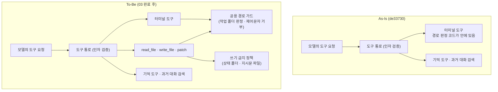

# [마스터 설계도] 03-파일 도구 추가

> **상태**: `Draft`  
> **대시보드**: [README.md](README.md)  
> **근거 결정**: [ADR-0003](../../adr/0003-파일_도구_범위와_쓰기_안전_정책.md) (바탕: [ADR-0002](../../adr/0002-코어_안전_강화_범위와_터미널_가드_방식.md))  
> **기준 코드**: 커밋 `de33730` (로드맵 02 마감 시점의 `src/hermes_core`, 코어 테스트 87건)  
> **계획 문서**: [계획 005](../../계획/005-03번로드맵_검토와_진행계획.md)

---

## 1. 배경 및 목적 (Why)

로드맵 02로 터미널 도구는 셸 없이 허용된 읽기·출력 프로그램만, 작업 폴더에서만 실행된다. 그 결과 지금 코어에는 **파일을 만들거나 고치는 수단이 없다**(기억 도구는 크기 상한이 있는 별도 기능이다). 에이전트가 코드를 다루려면 파일 읽기·생성·부분 수정이 필요하다.

이 로드맵의 목적은 **세 가지 파일 도구(`read_file`, `write_file`, `patch`)를 02에서 만든 경로 가드 위에 얹되, 쓰기 도구가 이 레포 구조 때문에 만드는 두 가지 새 위험을 처음부터 닫는 것**이다. 범위와 정책은 ADR-0003에서 확정되었다.

| 필요 | 지금의 동작 (확인됨) | 이 로드맵 후 |
|---|---|---|
| 파일 읽기 | 터미널의 `cat`·`head`·`tail`만 가능. 줄 번호·이어 읽기 없음 | `read_file`: 줄 번호, 구간 읽기, 출력 상한과 이어 읽을 위치 |
| 파일 생성 | 수단 없음 | `write_file`: 새 파일만, 원자적 쓰기, 크기 상한 |
| 파일 부분 수정 | 수단 없음 | `patch`: 정확히 일치하고 유일한 문자열만 교체 |
| 작업 폴더 판정 | `terminal_tool.py` 안의 비공개 함수 | 공용 모듈 한 곳. 터미널과 파일 도구가 같은 코드를 사용 |
| 쓰기 도구의 두 위험 | 해당 없음(쓰기 수단이 없어서) | 상태 폴더(기억 파일·`state.db`)와 지시문 주입 파일은 쓰기 거부 |

---

## 2. As-Is vs To-Be 아키텍처

---

## 3. 파급 범위와 무영향 근거 (Blast Radius)

- **수정 대상**
  - 신규 `src/hermes_core/tools/path_guard.py` (010, 020, 030)
  - 신규 `src/hermes_core/tools/file_tools.py` (020, 040, 050)
  - `src/hermes_core/tools/terminal_tool.py` (010: 비공개 함수 두 개를 공용 모듈 호출로 교체만)
  - `src/hermes_core/tools/dispatcher.py` (020, 040, 050: 기본 디스패처에 도구 등록)
  - `src/hermes_core/constants.py` (020, 030, 040: 상수 추가)
  - `src/hermes_core/agent/prompt_builder.py` (030: 지시문 파일 이름 리터럴을 상수로 교체, 동작 동일)
  - `tests/test_hermes_core/` 아래 신규 테스트 파일 2개(`test_path_guard.py`, `test_file_tools.py`)와 `test_agent_e2e.py` (060)
  - `docs/작동원리/01-…`, `02-…`, `03-…` 해당 서술 (각 단계), 03편 최종 대조 (060)
- **영향받지 않는 것과 근거**
  - `memory_tool.py`, `session_db.py`, `session_search_tool.py`, `agent/agent.py`, `cli.py`: 수정하지 않는다. 새 도구는 도구 통로의 등록 창구로만 붙는다.
  - 터미널 도구의 동작: 010은 순수 이동 리팩토링이다. 기존 터미널 테스트 38건이 **수정 없이** 통과해야 한다.
  - 지시문 조립의 동작: 030의 `prompt_builder.py` 변경은 리터럴을 상수로 바꾸는 것뿐이며 기존 프롬프트 테스트 5건이 수정 없이 통과해야 한다.
  - `hermes-agent/`: 읽기 전용이며 변경하지 않는다.
  - 기존 코어 테스트 87건은 모두 그대로 통과해야 한다.

---

## 4. 사전 점검 및 실패 위험 분석 (Pre-Mortem)

> *"만약 이 로드맵이 실패하거나 불안정해진다면 무엇 때문인가?"*

| 실패 위험 요소 | 잠재 원인 | 선제 방어책 (설계 반영) |
|---|---|---|
| **1. 도구 호출 파라미터 불일치·비정형 출력** | 모델이 `offset`에 문자열, `replace_all`에 문자열을 넘김. 범위를 벗어난 값 | 도구 통로의 타입 검사(02 010)에 더해, 범위(`offset ≥ 1`, `1 ≤ limit ≤ 2000`)는 도구 본체가 검사해 실패 메시지로 돌려준다. 읽기 출력은 줄·문자 상한이 있다 |
| **2. 루프 폭주·컨텍스트 오버플로우** | 큰 파일 통째 읽기로 모델 입력이 터짐 | `read_file`은 한 번에 최대 2,000줄·100,000자만 돌려주고 이어 읽을 위치를 알려준다. 1,000,000바이트를 넘는 파일은 읽기·수정을 거부한다 |
| **3. 비인가 쓰기·샌드박스 오염** | `..`·절대경로·링크로 작업 폴더 밖 쓰기 | 공용 경로 가드가 경로를 실제 경로로 풀어(링크 포함) 판정한다. 부모 폴더 생성은 판정 통과 뒤에만 한다 |
| **4. 기억 상한·원장 우회** | 작업 폴더가 레포 루트이면 `.hermes/`(기억 파일, `state.db`)가 그 안에 있어 쓰기 도구로 직접 수정 가능 | 030: 상태 폴더(`get_hermes_home()` 아래 전체) 쓰기·수정 거부 |
| **5. 지속적 프롬프트 주입** | 모델이 `AGENTS.md`·`SOUL.md`·`.cursorrules`를 고치면 다음 세션 지시문이 바뀜 | 030: 지시문 주입 파일 이름(대소문자 무시, 어느 폴더든)과, 그 파일이 가리키는 링크 대상 쓰기 거부. 이름 목록은 상수 한 곳에서 지시문 조립과 공유 |
| **6. 덮어쓰기 사고** | 오래된 내용으로 기존 파일을 통째로 교체 | 040: `write_file`은 새 파일만. 기존 파일은 `patch`(정확 일치·유일 일치)로만 수정 |
| **7. 쓰기 도중 중단으로 파일 손상** | 쓰는 중 프로세스 종료 | 040·050: 같은 폴더의 임시 파일에 쓴 뒤 교체한다. 실패 시 임시 파일을 지운다 |
| **8. 줄바꿈·인코딩 변질** | 텍스트 모드 쓰기가 `\r\n`을 바꿈 | 바이트로 읽고 쓴다(UTF-8). 줄바꿈을 변환하지 않는다. UTF-8이 아니거나 NUL 바이트가 있는 파일은 거부한다 |
| **9. 지시문 파일 이름 목록 불일치** | 지시문 조립과 쓰기 금지 목록이 따로 적혀 어긋남 | 030: 상수 한 곳(`constants.py`)에 두고 둘 다 사용. 목록의 각 이름이 실제로 지시문에 주입되는지 확인하는 시험을 둔다 |
| **10. 문서와 코드의 불일치 재발** | 코드를 고치고 01·02편을 안 고침 | 각 단계 변경 파일에 해당 서술을 포함하고, 060에서 「지금은 없다」 목록을 최종 대조한다 |

**알려진 한계 (구현 전에 미리 명시)**
- 쓰기 **횟수** 상한이 없다(크기 상한만). 모델이 작은 파일을 무한히 만들 수 있다.
- 경로 판정과 실제 열기 사이에 링크가 바뀌는 경우(TOCTOU)는 막지 않는다(단일 스레드 가정).
- 작업 폴더 안의 **하드링크**는 경로로 판정되지 않아, 읽기가 폴더 밖 파일의 내용을 드러낼 수 있다. 쓰기는 임시 파일 교체라 원본에 영향이 없다.
- `patch`는 정확히 일치하는 문자열만 찾는다. 줄바꿈(`\n`/`\r\n`)이나 들여쓰기가 다르면 찾지 못하고, 그때는 모델이 `read_file`로 다시 확인해야 한다.
- 파일을 통째로 교체하는 수단이 없다(`write_file`은 새 파일만).

---

## 5. 4층위 검증 범위 설계 (Validation Grid)

1. **1층위**: 사람이 프롬프트를 입력하지 않는다. 모든 시나리오는 임시 폴더, 링크 픽스처, 가짜 모델의 응답 순서로 재생한다.
2. **2층위**: 각 지시서의 인수 시나리오를 테스트로 옮긴다.
3. **3층위**: 040·050에서 쓰기 실패(교체 실패 주입) 시 원본이 그대로이고 임시 파일이 남지 않음을 확인한다. 060에서 도구 요청마다 대응하는 도구 메시지가 있음을 확인한다.
4. **4층위**: 060에서 생성→읽기→수정→금지 경로 거부→덮어쓰기 거부→읽을 수 없는 인자가 한 대화에 섞여도 루프가 정상 종료함을 확인한다.

---

## 6. 설계 결정 상세

### 6-1. 공용 경로 가드 `path_guard.py` (D3)

| 함수 | 역할 | 도입 단계 |
|---|---|---|
| `resolve_workspace(workspace)` | `None`이면 호출 시점의 현재 폴더, 아니면 주어진 폴더를 실제 경로로 풀어 반환 | 010 |
| `path_values(arg)` | 터미널 인자에서 경로로 검사할 값을 골라냄(옵션 값 포함). 02의 `_path_values`를 이름만 공개로 바꿔 이동 | 010 |
| `is_inside(value, workspace)` | 값을 작업 폴더 기준 실제 경로로 풀었을 때 폴더 안인가. 풀 수 없으면 거짓. 02의 `_is_inside`를 이동 | 010 |
| `check_path(path, workspace)` | 파일 도구용: 제어문자 거부 → 작업 폴더 밖 거부. `(풀린 경로, 오류 문구)` 반환 | 020 |
| `check_write_path(path, workspace)` | `check_path` + 쓰기 금지 정책(상태 폴더, 지시문 파일) | 030 |

- 터미널 도구는 `resolve_workspace`, `path_values`, `is_inside`만 사용한다. 동작은 02와 동일하다.
- 경로의 `~`는 확장하지 않는다(터미널과 같은 규칙). 상대경로는 작업 폴더 기준이다.
- 제어문자 거부 범위: `\x00`~`\x1f`, `\x7f`, `\x85`, `
`, `
`. 줄바꿈이 든 경로는 로그와 도구 메시지를 위조할 수 있다.

### 6-2. 읽기 형식과 제한 (020)

| 항목 | 값 |
|---|---|
| 출력 형식 | 각 줄을 `줄번호|내용`으로, 줄은 `\n`으로 잇는다(끝 줄바꿈 없음). 줄 끝의 `\r`은 표시에서 뺀다 |
| 기본 읽기 줄 수 | 2,000줄 (`limit` 최댓값도 2,000) |
| 문자 예산 | 형식이 붙은 출력 합계 100,000자. 넘기 직전 줄에서 멈추고 `truncated`와 `next_offset`을 돌려준다. 첫 줄 하나가 예산을 넘으면 그 줄을 예산까지 자르고 `truncated`를 참으로 한다(다음 줄이 없으면 `next_offset`은 `null`) |
| 파일 크기 상한 | 1,000,000바이트 초과는 읽기·수정 거부 |
| 거부 대상 | 폴더, 없는 파일, NUL 바이트가 든 파일(바이너리), UTF-8이 아닌 파일 |
| 결과 | `success`, `content`, `total_lines`, `offset`, `lines_returned`, `truncated`, `next_offset`(없으면 `null`) |

### 6-3. 쓰기 금지 정책 (030, D4)

- **상태 폴더**: 풀린 경로가 `get_hermes_home()`을 실제 경로로 푼 폴더 아래이면 거부.
- **지시문 파일**: 풀린 경로의 파일 이름이 `INSTRUCTION_FILE_NAMES`(`AGENTS.md`, `agents.md`, `SOUL.md`, `.cursorrules`)와 대소문자 무시로 같으면 거부. 또한 작업 폴더 바로 아래의 이 이름들이 (링크라면) 가리키는 대상 파일도 거부한다 — 지시문 조립이 링크를 따라 읽기 때문이다.
- **읽기는 막지 않는다.**
- 이름 목록의 단일 정본은 `constants.py`다. `prompt_builder.py`는 같은 상수로 파일을 찾는다.

### 6-4. 쓰기 방식 (040, 050)

- 같은 폴더에 임시 파일을 만들어 UTF-8 바이트를 쓰고(`fsync`), `os.replace`로 교체한다. 실패하면 임시 파일을 지우고 실패 메시지를 돌려준다. 기억 도구의 쓰기와 같은 패턴이다.
- `write_file`: 쓰기 직전에 대상이 없는지 다시 확인한다. 새 파일의 권한은 0o644. 내용 상한 100,000자.
- `patch`: 원본 파일의 권한을 유지한다. 결과가 1,000,000바이트를 넘으면 거부한다. 교체 횟수는 겹치지 않게 센다(`aaa`에서 `aa`는 1회).

### 6-5. 도구 등록과 숨은 매개변수

- 세 도구는 기본 디스패처에 등록한다. 도구 본체는 `workspace` 매개변수를 갖지만 **모델에게 보이는 설명서에는 넣지 않는다.** 모델이 넘기면 도구 통로가 거부한다(02에서 확인한 방어선). 각 도구 단계에서 시험으로 고정한다.

---

## 7. 문서 동기화 방식

[작동원리 README의 갱신 규칙](../../작동원리/README.md)에 따라 코드 변경과 같은 작업에서 01·02·03편의 해당 서술을 고친다.

- 각 단계 커밋에서 해당 서술(도구 목록, 「파일 도구는 지금은 없다」, 방어선, 대조표, 검증표)을 고친다.
- `기준 커밋`은 자기 해시를 같은 커밋에 쓸 수 없으므로 한 단계 뒤에 채운다(02의 D-07과 같은 방식). 마지막 단계(060)의 해시는 마감 커밋에서 채운다.
- **03편 작동원리**(이후 [결과정리및리뷰.md](결과정리및리뷰.md)로 병합됨)는 계획 단계에서 **구현 전 문서**로 먼저 만들었다(02편과 같은 방식). 사실과 `[계획]`을 표시로 구분하고, 각 단계 커밋에서 해당 `[계획]`을 사실로 고치며, 060에서 `[계획]`이 남지 않았는지 최종 대조한다.

---

## 8. 이 로드맵이 다루지 않는 것 (Non-Goals)

- `search_files`(파일 순회·검색, 링크 정책) — 04 후보
- 파일 삭제·이름 변경·폴더 생성 전용 도구
- 기존 파일 전체 덮어쓰기, 퍼지 일치, 여러 파일을 한 번에 고치는 패치
- 읽기 기록 상태 관리(읽기-후-쓰기 강제)
- 쓰기 횟수·총량 상한, 동시성 잠금, OS 수준 격리
- 실제 LLM 클라이언트 연결, 터미널 도구의 `grep -S` 링크 따라가기 완화
