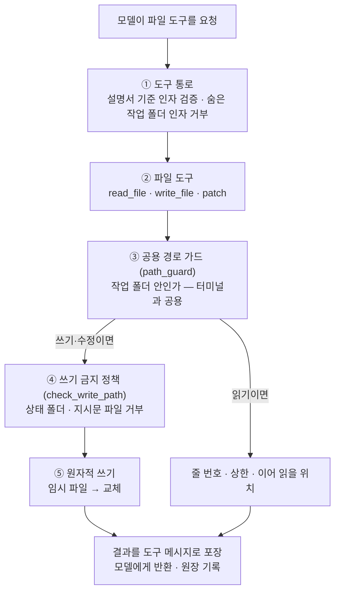

# [결과정리 및 리뷰] 03-파일도구-추가

> **로드맵 상태**: `Closed`  
> **마감 일시**: 2026-10-28  
> **기준 코드**: 시작 `0d6180a` (로드맵 02 마감 시점) → 완료 `61259b4` (060 커밋)  
> **대시보드**: [README.md](README.md) | **마스터 설계도**: [ROADMAP.md](ROADMAP.md) | **근거 결정**: [ADR-0003](../../adr/0003-파일_도구_범위와_쓰기_안전_정책.md)  
> **개정 기록**: 마감 후 사용자 지시로 이 문서를 개정했다. 로드맵 해설서로 잘못 쓰였던 작동원리 03편(`git show 0517b11:docs/작동원리/03-파일도구-작동원리.md`)의 내용을 병합해, "이 로드맵이 무엇을 왜 했는가"를 앞에 두었다. 마감 당시의 달성도·지표·교훈·인계는 §8~§11에 그대로 보존했다.
>
> **다시 확인하는 법**
> ```bash
> git rev-parse --short HEAD
> # 1. 코어 회귀 테스트 (182개)
> .venv/bin/pytest tests/test_hermes_core/ -v
> # 2. 등록된 도구는 6종(기억, 과거 검색, 터미널, read_file, write_file, patch)
> grep -n "register_tool(" src/hermes_core/tools/dispatcher.py
> # 3. 경로 판정·쓰기 검증이 공용 모듈에 있음
> grep -n "def is_inside\|def path_values\|def check_path\|def check_write_path" src/hermes_core/tools/path_guard.py
> # 4. 지시문으로 주입되는 파일 이름이 상수 한 곳에 있음
> grep -n "INSTRUCTION_FILE_NAMES" src/hermes_core/constants.py
> # 5. 상태 폴더의 기본 위치(레포 안 .hermes/)
> grep -n "DEFAULT_LOCAL_HERMES_HOME" src/hermes_core/constants.py
> ```

---

## 1. 이 로드맵이 한 일 (한눈에)

**읽기만 하던 에이전트에게 파일을 읽고(`read_file`), 새로 만들고(`write_file`), 한 곳만 고치는(`patch`) 능력을 주었다. 동시에, 이 능력이 이 레포의 구조에서 만들어 내는 두 가지 사고가 처음부터 일어나지 못하게 막았다.**

- **사고 ①: 에이전트가 자기 지시문 파일(`AGENTS.md` 등)을 고치는 것.** 이 파일들은 매 대화의 시스템 지시문에 자동으로 들어간다. 고쳐 두면 다음 대화부터 사용자가 모르는 규칙으로 움직인다.
- **사고 ②: 에이전트가 기억 파일·대화 기록 DB가 든 `.hermes/` 폴더를 고치는 것.** 기억 도구는 글자 수 상한(2,200자/1,375자)을 지키는데, 파일을 쓸 수 있으면 이 상한을 우회하고 대화 기록을 바꿀 수 있다.

| | 로드맵 전 (`0d6180a`) | 로드맵 후 (`61259b4`) |
|---|---|---|
| 파일 읽기 | 터미널의 `cat`·`head`·`tail`뿐. 줄 번호도, 이어 읽기도 없음 | `read_file`: 줄 번호가 붙고, 한 번에 2,000줄·100,000자까지, 남았으면 이어 읽을 위치를 알려 줌 |
| 파일 만들기 | 수단 없음 | `write_file`: **새 파일만**. 이미 있으면 거부하고 `patch`를 쓰라고 안내 |
| 파일 고치기 | 수단 없음 | `patch`: 찾는 문자열이 **정확히 일치하고 하나뿐일 때만** 교체 |
| 지시문 파일 쓰기 | (쓰기 수단이 없어서 문제 자체가 없었음) | 어느 폴더에 있든 쓰기·수정 거부 |
| 상태 폴더 쓰기 | 〃 | 쓰기·수정 거부 (읽기는 허용) |
| 작업 폴더 판정 | 터미널 도구 안의 비공개 함수 | 공용 모듈 `path_guard.py` 한 곳. 터미널과 파일 도구가 같은 코드를 사용 |
| 쓰다가 멈추면 | (기억 도구만 임시 파일 교체 방식) | 파일 도구도 임시 파일에 다 쓴 뒤 통째로 교체. 반쯤 쓰인 파일이 남지 않음 |

---

## 2. 왜 필요했나: 쓰기는 에이전트가 처음 갖는 "바깥을 바꾸는 능력"이다

02편까지의 에이전트는 파일을 읽을 수만 있었다. 코드를 다루는 에이전트가 읽기만으로는 아무것도 완성하지 못하므로 파일 도구를 주기로 했다. 그런데 이 시스템을 맡은 사람은 이렇게 묻게 된다.

- *"에이전트가 내 지시문 파일을 몰래 고쳐 두면, 다음 대화부터 나도 모르는 규칙으로 움직이는 것 아닌가?"*
- *"기억은 글자 수 상한을 두고 지키고 있는데, 기억 파일을 직접 고쳐서 상한을 우회하지 않을까?"*
- *"작업 폴더 바깥의 파일을 건드리지는 않을까?"*
- *"읽지도 않은 파일을 통째로 덮어써서 내 내용을 날리면?"*
- *"쓰다가 프로그램이 멈추면 파일이 반쯤 쓰인 채 남지 않을까?"*

읽기 실수는 모델이 잘못 알 뿐이지만, 쓰기 실수는 되돌리기 어려운 흔적을 남긴다. 그래서 이 로드맵은 "도구를 만드는 일"이 아니라 **"위 다섯 질문에 구조로 답하는 일"**이었다. 질문과 답의 대응은 다음과 같다.

| 불안 | 답 | 어느 단계에서 |
|---|---|---|
| 지시문 파일을 고치면? | 이름이 같은 파일은 어느 폴더에서든 쓰기 거부 | 030 |
| 기억 상한을 우회하면? | 상태 폴더 아래 쓰기 거부 | 030 |
| 폴더 밖을 건드리면? | 터미널과 같은 공용 판정으로 폴더 밖 거부 | 010 |
| 읽지 않고 덮어쓰면? | `write_file`은 새 파일만, 수정은 `patch`로 한 곳씩 | 040, 050 |
| 쓰다가 멈추면? | 임시 파일에 다 쓴 뒤 교체 | 040, 050 |

---

## 3. 업계와 원본은 어떻게 하고, 우리는 무엇을 택하고 버렸나

원본 `hermes-agent`가 파일 도구를 다루는 방식(이 레포에서 코드를 읽어 확인한 사실, 읽기 전용 참고):

| 항목 | 원본의 방식 | 비고 |
|---|---|---|
| 도구 구성 | 읽기, 쓰기, 수정(`patch`), 검색 4종 | 파일 도구 구현만 수천 줄 규모 |
| 기존 파일 덮어쓰기 | 이 세션에서 전체를 읽은 파일만 허용. 읽은 시각·범위를 세션 상태로 관리 | 오래된 내용으로 덮어쓰는 사고를 막으려는 장치 |
| 지시문 파일 쓰기 | `AGENTS.md`, `CLAUDE.md`, `SOUL.md` 등은 **항상 사람 승인** | 다음 세션의 행동을 바꾸는 지속적 주입 경로이기 때문 |
| 수정 방식 | 공백·들여쓰기 차이를 흡수하는 9가지 일치 전략, 여러 파일 한 번에 패치 | 편리하지만 「무엇이 바뀌는지」 증명이 어렵다 |
| 쓰기 방식 | 임시 파일에 쓴 뒤 교체(원자적) | |

(다른 업계 프레임워크가 비슷한 구성을 쓴다는 점은 이 레포에서 실행·대조하지 않은 일반론이라 적지 않는다.)

**우리의 선택** ([ADR-0003](../../adr/0003-파일_도구_범위와_쓰기_안전_정책.md))

| 결정 | 포기한 것 | 얻은 것 |
|---|---|---|
| 도구는 3종. 검색은 다음 로드맵 후보로 | 한 번에 다 갖춘 도구 세트 | 이번 로드맵이 파일 순회·링크 정책까지 떠안지 않음 |
| 쓰기는 **새 파일만** | 파일을 통째로 갈아끼우는 편의 | 「읽은 기록」 상태를 관리하지 않고도 「오래된 내용으로 덮어쓰기」가 없어짐 |
| 수정은 **정확히 일치하는 하나만** | 공백 차이를 알아서 맞춰 주는 너그러움, 다중 파일 패치 | 코드를 읽고 「무엇이 어떻게 바뀌는가」를 증명할 수 있음 |
| 사람 승인 대신 **구조적 금지** | 에이전트가 지시문 파일을 직접 개선하는 길 | 이 코어에는 사람이 매번 붙어 있는 승인 절차가 없으므로, 원본이 「항상 승인」으로 지키는 파일을 아예 쓸 수 없게 함 |

---

## 4. 단계별로 무엇을 했고 왜 그랬나

### 010. 경로 판정 공용 모듈 추출 — 두 개의 문이 같은 규정집을 쓰게 하기

- **무엇을**: 터미널 도구 안에 있던 「작업 폴더 안인가」 판정을 공용 모듈 [`path_guard.py`](../../../src/hermes_core/tools/path_guard.py)(`resolve_workspace`, `is_inside`, `path_values`)로 옮겼다. 판정 내용은 그대로다: `..`, 절대경로, 링크를 모두 실제 경로로 풀어 작업 폴더 안인지 보고, 풀 수 없는 경로는 밖으로 본다. `~`는 홈 폴더로 바꾸지 않고, 줄바꿈 같은 제어문자가 든 경로는 거부한다.
- **왜**: 건물 출입문이 두 개인데 한쪽은 신분증을 꼼꼼히 보고 다른 쪽은 대충 보면 사람들은 대충 보는 문으로 들어온다. 파일 도구가 경로 규칙을 따로 새로 만들면 같은 규칙이 두 곳에 생겨 어긋나고, 한쪽만 느슨해지면 그쪽이 뒷문이 된다.
- **왜 맨 처음인가**: 동작을 바꾸지 않는 이동 리팩토링이라, 기존 터미널 테스트 38건이 **수정 없이** 통과하는지로 「아무것도 안 바뀌었다」를 증명할 수 있다. 새 도구를 얹기 전에 바닥을 먼저 굳힌 것이다.
- **파일 도구는 02의 한계를 안고 가지 않는다**: 터미널은 프로그램(`grep -S`)이 스스로 링크를 따라가는 것을 막지 못했다. 파일 도구는 우리 코드가 경로를 한 번 풀어 판정한 뒤 **그 경로만 열기** 때문에 이 한계가 적용되지 않는다.
- **결과**: 터미널 테스트 38건 무수정 통과, 신규 15건.

### 020. `read_file` — 필요한 쪽만 펴서 보여 주기

- **무엇을**: 파일을 `줄번호|내용` 형태로 한 번에 최대 2,000줄·100,000자까지 돌려주고, 남았으면 다음 줄 번호(`next_offset`)를 알려 준다. 1,000,000바이트를 넘는 파일, NUL 바이트가 든 바이너리, UTF-8이 아닌 파일은 거부한다. ([`file_tools.py`](../../../src/hermes_core/tools/file_tools.py) `read_file_tool`)
- **왜**: 책 한 권을 통째로 복사해 달라는 요청은 필요한 쪽만 펴 보여 주는 것보다 훨씬 많은 종이(= 모델의 입력 용량)를 쓴다. 상한과 「여기부터 이어 읽으세요」 표시가 있어야 큰 파일도 입력을 터뜨리지 않고 읽는다. 줄 번호는 나중에 수정할 때 모델이 정확한 부분을 짚게 해 준다.
- **결과**: 시나리오 22건 통과. 이전에는 터미널 `cat`으로 큰 파일을 그대로 쏟아낼 수 있었다.

### 030. 쓰기 금지 정책 — 쓰기 도구보다 **먼저** 만든 방어벽

- **무엇을**: 지시문 파일과 상태 폴더는 쓰기·수정을 거부한다(`check_write_path`). 읽기는 허용한다.
  - 지시문 파일은 **어느 폴더에 있든, 대소문자가 달라도** 이름이 같으면 거부한다. 작업 폴더 바로 아래의 지시문 이름이 링크라면 **링크가 가리키는 파일**도 거부한다(지시문 조립이 링크를 따라 읽기 때문).
  - 이름 목록(`AGENTS.md`, `agents.md`, `SOUL.md`, `.cursorrules`)은 [`constants.py`](../../../src/hermes_core/constants.py)의 `INSTRUCTION_FILE_NAMES` 한 곳에만 적고, 지시문 조립([`prompt_builder.py`](../../../src/hermes_core/agent/prompt_builder.py))과 쓰기 금지가 같은 목록을 쓴다. 목록의 각 이름이 정말 지시문에 주입되는지 확인하는 시험도 있다.
- **왜**: 회사 취업규칙과 금고 장부를 직원이 마음대로 고칠 수 있게 두면 나머지 안전장치가 다 소용없다. 취업규칙(지시문)은 직원의 행동을 정하고, 장부(기억·대화 기록)는 직원이 한 일을 증명한다. 이 레포에는 구체적으로 두 개의 구멍이 있었다.
  1. **지시문**: 지시문 조립이 작업 폴더의 지시문 파일을 읽어 매 대화의 시스템 지시문에 넣는다. 모델이 이 파일을 고칠 수 있으면 **지속적 프롬프트 주입 경로**가 된다.
  2. **상태 폴더**: 기억 파일과 대화 기록 DB의 기본 위치가 레포 안 `.hermes/`다. 작업 폴더가 레포 루트이면 그 안에 있으므로, 쓰기 도구로 기억 파일을 직접 고치면 **글자 수 상한을 우회**하고 대화 기록을 변조할 수 있다.
- **왜 사람 승인이 아니라 구조적 금지인가**: 원본은 지시문 파일 쓰기를 항상 사람 승인으로 지킨다. 이 코어는 사람이 매번 붙어 있지 않은 자동 반복 루프이고, 승인 UI는 범위를 크게 넓히므로 **아예 쓸 수 없게** 했다.
- **왜 쓰기 도구(040)보다 먼저인가**: 쓰기 도구가 생기는 순간 이미 지시문과 상태 폴더가 보호되어 있게 하려는 것이다. 도구를 먼저 만들고 정책을 나중에 붙이면 그 사이에 열린 틈이 생긴다.
- **결과**: 시나리오(대소문자, 하위 폴더, 링크 대상, 상태 폴더, 읽기 허용) 17건 통과.

### 040. `write_file` — 빈 자리에만 쓰기

- **무엇을**: 대상이 이미 있으면 쓰지 않고 「수정하려면 `patch`를 쓰라」는 실패 메시지를 모델에게 돌려준다. 끊어진 링크 이름이나 폴더 이름도 「이미 있음」으로 본다. 내용 상한 100,000자, 줄바꿈을 변환하지 않는 UTF-8 바이트로 쓰고, 권한은 0o644다. 같은 폴더의 임시 파일에 쓴 뒤 `fsync`로 디스크에 확실히 기록하고 `os.replace`로 교체한다. 교체에 실패하면 임시 파일을 지우고 실패 메시지를 돌려준다.
- **왜 새 파일만인가**: 노트를 읽어 보지도 않고 새 종이로 통째로 바꿔 끼우면 내용이 날아간다. 한 줄만 고치는 도구(`patch`)를 따로 두고, 쓰기 도구는 빈 자리에만 쓰게 하면 「오래된 내용으로 덮어쓰기」가 구조적으로 불가능하다. 원본은 「읽은 파일이면 덮어써도 된다」를 허용하려고 읽기 기록 상태를 세션마다 관리하는데, 우리는 그 상태 관리를 두지 않는 대신 통째 교체의 편의를 포기했다.
- **왜 임시 파일 교체인가**: 새 서류를 임시 쟁반에서 다 쓴 다음 완성본을 통째로 서랍에 넣는 방식이라, 쓰는 중에 프로그램이 멈춰도 서랍 안은 건드려지지 않는다. 기억 도구가 이미 쓰던 방식이다.
- **결과**: 시나리오 18건 통과. 이전에는 파일을 만드는 수단이 없었다.

### 050. `patch` — 딱 하나일 때만 바꾸기

- **무엇을**: 파일을 바이트로 읽어 찾는 문자열의 등장 횟수를 센다. 0번이면 「찾지 못함」, 2번 이상인데 `replace_all` 표시가 없으면 「N번 나옴, 더 길게 적거나 전부 바꾸기를 켜라」고 돌려준다. 찾는 문자열이 비었거나 바꿀 문자열과 같으면 거부한다. 줄바꿈(`\n`/`\r\n`)은 바꾸지 않고 보존하며, 줄바꿈이나 들여쓰기가 다르면 찾지 못한다(이때 모델은 파일을 다시 읽어 확인한다). 교체는 `write_file`과 같은 원자적 방식이고 원본 파일의 권한을 그대로 이어받는다. 파일 상한 1,000,000바이트.
- **왜**: 문서에서 「철수」를 「영희」로 바꾸라는데 「철수」가 열 군데면, 어느 것인지 모른 채 다 바꾸면 사고다. 그래서 「딱 하나만 있을 때」만 바꾸고, 여러 곳이면 되돌려 보낸다. 비슷한 문장을 알아서 고르는 너그러움은 「무엇이 바뀌는지」 증명을 어렵게 하므로 일부러 두지 않았다. 정확 일치의 비용은 실패했을 때 다시 시도하는 것뿐이다.
- **결과**: 시나리오 22건 통과. 겹치는 패턴(`aaa`에서 `aa`)은 겹치지 않게 세어 1번 교체됨을 시험으로 고정했다.

### 060. 통합 E2E 검증 — 섞여도 괜찮은지 한 대화로 확인

- **무엇을**: 가짜 모델이 9번의 턴에 걸쳐 파일 생성·읽기·수정, 지시문 파일 쓰기 거부, 덮어쓰기 거부, 폴더 밖 탈출 거부, JSON 오류 복구를 한 대화에 섞어 요청하고, 순서와 원장 18건 기록을 확인했다([`test_agent_e2e.py`](../../../tests/test_hermes_core/test_agent_e2e.py)). 작동원리 01·02편의 서술도 코드와 최종 대조했다.
- **왜**: 단계별 시험은 각 도구를 따로 확인할 뿐이다. 거부와 성공이 섞인 대화에서도 도구 요청마다 도구 메시지가 하나씩 짝을 이루고 루프가 정상 종료하는지는 따로 확인해야 한다.
- **결과**: 시험 1건(확인 7개) 첫 실행 통과. 한계: 가짜 모델의 응답 순서로만 시험했다(실제 모델 없음).

**왜 6단계로 쪼갰나**: 세 가지 도구와 금지 정책을 한꺼번에 넣으면 사고가 났을 때 원인을 찾기 어렵다. 한 단계 끝나면 시험하고 기록하고 멈춘다. 각 단계의 「입력 → 기대 결과」 시험표는 구현보다 먼저 지시서에 적혀 있었다.

---

## 5. 왜 이 변경이 시스템의 다른 부분을 터뜨리지 않는가



1. **새 도구는 등록 창구로만 붙는다.** 에이전트 반복, 기억, 대화 기록, 세션 검색은 수정하지 않았다.
2. **기존 코드를 건드린 곳은 두 군데뿐이고, 둘 다 기존 시험이 지킨다.** 터미널 도구(경로 판정 코드를 옮길 뿐)는 기존 터미널 시험 38건이, 지시문 조립(이름 글자를 상수로 바꿀 뿐)은 기존 프롬프트 시험 5건이 수정 없이 통과했다.
3. **실패는 예외가 아니라 실패 메시지로 돌아간다.** 경로 거부, 금지 정책 거부, 이미 있는 파일, 찾지 못한 문자열, 크기 초과 모두 도구 통로의 「어떤 오류도 프로그램을 죽이지 않는다」 성질 위에서 모델에게 이유와 함께 돌아가 모델이 스스로 고친다.
4. **숨은 매개변수가 닫혀 있다.** 파일 도구도 작업 폴더를 지정하는 매개변수(`workspace`)를 갖지만 모델에게 보이는 설명서(`READ_FILE_SCHEMA`, `WRITE_FILE_SCHEMA`, `PATCH_SCHEMA`)에는 넣지 않았다. 모델이 넘기면 도구 통로의 「정의되지 않은 인자 거부」가 막는다. 도구마다 같은 시험을 두었다(10건).

---

## 6. 배척한 안티패턴

| 배척한 방식 | 이유 |
|---|---|
| 작업 폴더 안이면 아무 파일이나 쓰게 허용 | 지시문 파일과 기억·기록 파일이 그 안에 있어 지속적 주입과 기억 상한 우회가 열린다 |
| 읽기 기록 상태로 덮어쓰기를 관리 (원본 방식) | 세션 상태와 만료 규칙이 필요해 코드가 크게 늘어난다. 「새 파일만 + 정확 일치 수정」이 같은 사고를 구조적으로 막는다 |
| 퍼지 일치와 다중 파일 패치 | 무엇이 바뀌는지 증명하기 어렵고 구현이 크다 |
| 파일 검색까지 한 로드맵에 포함 | 지시서가 늘고 파일 순회·링크 정책이 별도 결정이 필요하다 |
| 파일 도구에 경로 규칙을 따로 새로 구현 | 같은 규칙이 두 곳에 생겨 어긋난다. 한쪽만 느슨해지면 그쪽이 뒷문이 된다 |
| 사람 승인 절차를 코어에 새로 도입 | 이 코어는 자동 반복 루프이고, 승인 UI는 범위를 크게 넓힌다 |
| 지시문 이름 목록을 두 곳에 따로 적기 | 조립은 새 이름을 읽는데 금지 목록에는 없는 사태가 생긴다. 상수 한 곳 + 일치 시험 |

**득과 실**: 득은 「어디에 무엇을 쓸 수 있고 없는가」가 코드 몇 줄과 시험으로 증명된다는 점이다. 실은 모델이 쓸 수 있는 방식이 좁아지고(통째 교체 불가, 줄바꿈 민감), 지시문 파일을 에이전트가 직접 개선할 수 없다는 점이다.

---

## 7. 이 로드맵이 막지 못하는 것 (알려진 한계)

- **쓰기 횟수 상한이 없다.** 크기 상한(100,000자, 1MB)만 있어서, 작은 파일을 계속 만들어 디스크를 채울 수 있다.
- **검사와 실제 쓰기 사이에 링크가 바뀌는 경우(경쟁 상태)는 막지 않는다.** 프로그램이 한 줄로 순서대로 도는 것을 전제로 한다.
- **작업 폴더 안의 하드링크는 경로로 판정되지 않아**, 읽기가 폴더 밖 파일의 내용을 드러낼 수 있다. 쓰기는 임시 파일 교체라 원본에 영향이 없다.
- **`patch`는 줄바꿈과 들여쓰기가 다르면 찾지 못한다.** 다시 읽고 시도해야 한다.
- **파일을 통째로 교체하는 수단이 없다.** 의도된 결과다.
- 02에서 남은 터미널의 링크 따라가기 옵션 문제는 이 로드맵 범위가 아니다.

---

## 8. 목표 달성도 대조표 (Goal vs Actual)

로드맵 02의 터미널 가드 및 인자 검증 기반 위에 안전한 파일 도구 세 가지(`read_file`, `write_file`, `patch`)를 추가하고, 파일 쓰기 기능이 레포 구조에 유발할 수 있는 두 가지 취약점(지시문 파일 변조를 통한 지속적 프롬프트 주입, 상태 폴더 변조를 통한 기억 상한 및 원장 우회)을 구조적으로 원천 차단하는 것이 목표였다.

| 구분 | 초기 목표 | 실제 구현 산출물 | 달성도 | 비고 / 검증 결과 |
|---|---|---|:---:|---|
| **010 경로 판정 공용 모듈 추출** | 터미널과 파일 도구가 공유할 작업 폴더 가드를 공용 모듈로 분리 | [`path_guard.py`](../../../src/hermes_core/tools/path_guard.py) | 100% | `resolve_workspace`, `is_inside`, `path_values` 추출. 기존 터미널 테스트 38건 무수정 통과 및 신규 테스트 15건 통과 |
| **020 `read_file` 도구** | 줄 번호 형식, 분할 조회, 크기 및 바이너리 차단 읽기 도구 | [`file_tools.py`](../../../src/hermes_core/tools/file_tools.py), [`dispatcher.py`](../../../src/hermes_core/tools/dispatcher.py) | 100% | 2,000줄/100,000자 상한, 1MB 초과 거부, NUL 바이트 및 비UTF-8 거부. 시나리오 22건 전수 통과 |
| **030 쓰기 금지 정책** | 지시문 파일 및 상태 폴더 쓰기·수정 차단 (읽기는 허용) | [`path_guard.py`](../../../src/hermes_core/tools/path_guard.py), [`constants.py`](../../../src/hermes_core/constants.py) | 100% | `INSTRUCTION_FILE_NAMES` 상수 단일 원천화, 대소문자 무시, 하위 폴더, 링크 대상 및 `.hermes/` 차단. 테스트 17건 통과 |
| **040 `write_file` 도구** | 새 파일 전용, 임시 파일 교체 원자적 쓰기 | [`file_tools.py`](../../../src/hermes_core/tools/file_tools.py) | 100% | 기존 파일 존재 시 거부(`patch` 안내), 100,000자 상한, 0o644 권한, `fsync` 원자적 교체. 시나리오 18건 전수 통과 |
| **050 `patch` 도구** | 정확 일치 단일/다중 교체, 원본 권한 보존 원자적 쓰기 | 같은 파일 | 100% | 유일 일치(기본) 및 `replace_all`, 바이트 UTF-8 디코딩 기반 `\r\n` 보존, 원본 권한 보존, 1MB 상한. 시나리오 22건 전수 통과 |
| **060 통합 E2E 검증 및 문서 동기화** | 파일 생성·읽기·수정·거부 순환 1회 대화 루프 검증 및 01·02·03편 동기화 | [`test_agent_e2e.py`](../../../tests/test_hermes_core/test_agent_e2e.py) | 100% | 통합 시험 1건(확인 7개) 첫 실행 통과. 작동원리 03편 `[계획]` 완전 제거 및 사실화 |

---

## 9. 정량 검증 지표 (Quantitative Metrics)

- **테스트 통과율**: 전체 **211 / 211 (100%)** — 코어(`tests/test_hermes_core`) 182건, 스크립트(`tests/test_scripts`) 29건.
- **코어 테스트 증가**: 87건 → 182건 (+95건, 파일 9개 → 11개).
  - 로드맵 01: 19건
  - 로드맵 02: 68건
  - 로드맵 03: 95건 (010 15건 + 020 22건 + 030 17건 + 040 18건 + 050 22건 + 060 1건)
- **4층위 검증 그리드 결과**:
  - **1층위 (수동 반복 배제)**: 95건 모두 가짜 모델(`MockLLMClient`) 및 `tmp_path` 임시 폴더로 재생. 수동 대화 테스트 0건.
  - **2층위 (단위·구조)**: 84건 (`path_guard.py` 27건, `file_tools.py` 57건).
  - **3층위 (정합성)**: 10건 (도구 스키마의 `workspace` 은닉, LLM 인자 주입 시 디스패처 수준의 `unexpected argument` 차단 검증).
  - **4층위 (통합)**: 1건 (9개 턴에 걸쳐 파일 생성·읽기·수정·지시문 거부·덮어쓰기 거부·외부 탈출 거부·JSON 오류 복구가 한 대화에 혼합된 E2E 시나리오).
- **코드 규모** (`0d6180a..61259b4`): `src/hermes_core` 4개 파일 +482줄 −16줄, `tests/test_hermes_core` 3개 파일 +994줄. 외부 런타임 의존성 0개 유지.
- **실행 시간**: 전체 회귀 테스트 약 6.6초.

---

## 10. 트러블슈팅과 교훈 (Troubleshooting & Lessons Learned)

1. **CRLF 줄바꿈 보존**: 텍스트를 `open(..., 'r')`로 읽으면 파이썬 universal newlines에 의해 `\r\n`이 `\n`으로 자동 변환되어 Windows 스타일 파일의 줄바꿈이 손상된다. `read_bytes()`로 읽어 바이트 레벨의 UTF-8 디코딩을 수행함으로써 원본 파일의 줄바꿈을 변조 없이 온전히 보존했다.
2. **`patch` 일치 횟수 카운팅**: 파이썬 `str.count()` 및 `str.replace()`가 모두 non-overlapping(겹치지 않는) 방식으로 일관되게 동작함을 확인하고, 시나리오 18(`aaa`에서 `aa` 교체 시 1회 교체)을 통해 겹치는 패턴 처리의 예측 가능성을 검증했다.
3. **선(先) 정책 구현 후(後) 도구 구현**: 030 쓰기 금지 정책을 040 쓰기 도구보다 먼저 구현함으로써, `write_file`과 `patch`가 추가되는 즉시 지시문 파일과 상태 폴더가 보호된 상태로 기동하도록 보장했다.
4. **테스트 실패 선행 확인의 가치**: 구현 전 지시서의 인수 테스트 시나리오를 먼저 테스트 코드로 옮기고 실패를 확인한 뒤 구현을 진행함으로써, 자기충족적(동어반복) 테스트를 방지하고 요구사항에 충실한 방어벽을 완성했다.

---

## 11. 후속 인계 사항 (Handoff & Next Steps)

- **차기 로드맵 후보 연계**: ADR-0003에서 미룬 **파일 검색 도구 (`search_files`)** 를 로드맵 04의 후보로 검토할 수 있다. 작업 폴더 순회 범위, 링크 처리 정책, 출력 상한에 대한 추가 설계가 필요하다.
- **함께 갱신한 기록**: 마감 시 작동원리 03편의 `기준 커밋`을 마감 시점 커밋으로 갱신하고, [`docs/로드맵/README.md`](../README.md) 및 [`docs/인계.md`](../../인계.md)를 마감 상태로 갱신했다. (작동원리 03편은 이후 이 문서로 병합되어 폴더에서 제거되었다.)

---

## 12. 검증 범위와 확인하지 못한 것

확인한 것: 마감 시점(`61259b4`)의 코드를 직접 읽고, (a) `tests/test_hermes_core` 182개 통과, (b) 등록 도구 6종, (c) 경로 판정·쓰기 검증이 공용 모듈로 분리되어 공유됨, (d) 지시문 이름 4개가 상수로 공유되어 프롬프트 조립에 모두 주입됨, (e) 상태 폴더 기본 위치가 레포 안 `.hermes/`임을 확인했다. 이 문서 개정 시점에도 (a)를 다시 실행해 182개 통과를 확인했다.

확인하지 못한 것(「미확인」):
- 대소문자를 구분하는 파일 시스템에서 `agents.md`와 `AGENTS.md`의 동작 차이.
- 환경변수로 상태 폴더를 지정했을 때의 동작(기존 시험 범위만 확인).
- 쓰기 도중 전원이 꺼질 때의 동작(기억 도구와 동일하게 시험하지 않음).
- 실제 모델이 보내는 인자 형태(가짜 모델의 응답 순서로만 시험).
- 원본의 읽기 중복 억제·문서 변환 세부, Windows·원격 백엔드는 조사하지 않았고, 업계 일반론은 이 레포에서 실행·대조하지 않았다.
