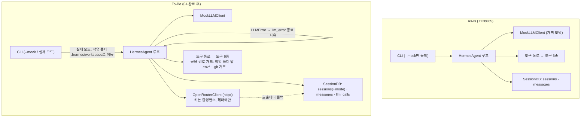

# [마스터 설계도] 04-실제 모델 연결 MVP

> **상태**: `Draft`  
> **대시보드**: [README.md](README.md)  
> **의도(Why)**: [WHY.md](WHY.md) · **승인된 계획**: [PLAN.md](PLAN.md) · **근거 결정**: [ADR-0004](../../adr/0004-실제_모델_연결_MVP_범위와_안전_정책.md) (바탕: [ADR-0002](../../adr/0002-코어_안전_강화_범위와_터미널_가드_방식.md), [ADR-0003](../../adr/0003-파일_도구_범위와_쓰기_안전_정책.md))  
> **기준 코드**: 커밋 `712b665` (로드맵 03 마감 이후 `src/hermes_core`, 코어 테스트 182건)

---

## 1. 배경 및 목적 (Why)

로드맵 03까지로 코어는 도구 6종과 안전 가드를 갖췄지만 **실제 모델과 통신하는 코드가 없다.** 모든 시험은 정해진 대사를 읽는 가짜 모델로만 이루어졌다. 이 로드맵의 목적은 **실제 모델을 한 번 연결해 「모델 → 도구 호출 → 결과 → 응답」이 돌아가는 최소 탈것(MVP)을 만들되, 연결하기 전에 키·깃 설정 노출 구멍을 먼저 닫고, 모든 모델 호출을 나중에 되짚을 수 있게 기록하는 것**이다. 왜 이 정도까지만 하는지는 [WHY.md](WHY.md)에 있다.

| 필요 | 지금의 동작 (확인됨) | 이 로드맵 후 |
|---|---|---|
| 실제 모델 호출 | 코드 없음. `--mock` 없이 실행하면 안내 후 종료 코드 2 | OpenRouter 클라이언트. 가짜 통신 장치로 시험, 마지막에 실제 키 1회 |
| 비밀 파일 보호 | 작업 폴더가 레포 루트이면 `.env` 읽기·쓰기 허용, `.git/hooks` 쓰기 허용 | 전용 작업 폴더 + `.env*`·`.git` 읽기·쓰기 거부(파일 도구와 터미널 모두) |
| 상태 폴더 규칙과 작업 폴더 | `.hermes/` 아래 쓰기 전부 거부 → 작업 폴더를 `.hermes/workspace`로 하면 모든 쓰기가 막힘 | 작업 폴더 자체가 상태 폴더 안이면 그 규칙을 건너뜀(기억 파일·`state.db`는 작업 폴더 밖이라 계속 보호) |
| 모델 호출 실패 | 예외가 프로그램 밖으로 나옴 | 실패로 기록하고 종료 사유 `llm_error`로 반환 |
| 토큰 | 집계 함수가 있으나 호출하지 않음 | 호출마다 세션에 누적 |
| 호출 기록 | 없음 | `llm_calls` 표: 요청·응답·토큰·소요 시간·오류 |
| 세션의 모델·모드 | `--mock`도 `gpt-4o`로 기록 | 가짜는 `mock`/`mock`, 실제는 모델 ID/`real` |

---

## 2. As-Is vs To-Be 아키텍처

---

## 3. 파급 범위와 무영향 근거 (Blast Radius)

- **수정 대상**
  - `src/hermes_core/constants.py` (010, 020, 040: 작업 폴더 이름, 보호 이름, 모델·통신 상수 추가)
  - `src/hermes_core/tools/path_guard.py` (010: `.env*`·`.git` 판정 추가, 상태 폴더 규칙 예외)
  - `src/hermes_core/tools/terminal_tool.py` (010: 경로 인자 검사에 보호 이름 판정 추가)
  - 신규 `src/hermes_core/llm_client.py` (020: 클라이언트, 오류, 응답)
  - `src/hermes_core/session_db.py` (030: 스키마 v3, `llm_calls` 표, `sessions.mode`)
  - `src/hermes_core/agent/agent.py` (030: 호출 실패 처리, 토큰 집계, 모델·모드 기록, 호출 기록 연결)
  - `src/hermes_core/cli.py` (040: 실제 모드)
  - `tests/test_hermes_core/` 신규·수정 테스트 (각 단계), `conftest.py` 신설(020: 환경변수 제거·실제 통신 차단)
  - `docs/작동원리/01-헤르메스코어-작동원리.md` (각 단계: 영구 사실만 반영)
  - 로드맵 문서(대시보드, 인계)
- **영향받지 않는 것과 근거**
  - `memory_tool.py`, `session_search_tool.py`, `file_tools.py`, `prompt_builder.py`, `dispatcher.py`: 수정하지 않는다. 경로 판정은 `path_guard.py` 한 곳에서 바뀌므로 파일 도구는 호출부 변경 없이 새 규칙을 받는다.
  - 기존 터미널 테스트 38건·경로 가드 테스트·파일 도구 테스트·에이전트 루프 테스트 등 **기존 코어 테스트 182건은 수정 없이 통과해야 한다.** 예외는 `test_cli.py`의 「키 없이 실행」 시나리오 3건에 환경변수 제거를 명시하는 것뿐이다(040). 의미는 바뀌지 않는다.
  - `hermes-agent/`: 읽기 전용이며 변경하지 않는다.
  - 모델의 인터페이스(`chat_completion(messages, tools)`, 응답의 `.content`·`.tool_calls`)는 유지한다. 에이전트는 응답에 `usage`가 있을 때만 사용한다.

---

## 4. 사전 점검 및 실패 위험 분석 (Pre-Mortem)

> **「이 로드맵이 실패한다면 무엇 때문일 가능성이 가장 높은가?」**

| # | 위험 | 가능성 | 방어책 |
|---|---|---|---|
| 1 | **키가 모델 입력·원장·로그로 샌다** | 높음 | 작업 폴더 격리(010), `.env*`·`.git` 거부(010, 터미널 포함), 키는 헤더에만(020), 호출 기록에서 키 문자열을 `***`로 치환(020), 050에서 모든 저장 위치 전수 검사 |
| 2 | **제공자가 보내는 `tool_calls` 형식이 현재 해석과 다름** (가정 C, 미확인) | 중간 | 가짜 응답으로는 이 위험을 못 잡는다. 060 스모크가 유일한 검증이며, 실패하면 변환 단계를 추가하는 후속으로 넘긴다 |
| 3 | 비용 폭주 | 낮음 | 반복 상한 50회 유지, 출력 토큰 상한(`max_tokens`) 설정, 스모크는 1회·사용자 지시 시에만 |
| 4 | 시험이 실수로 실제 통신을 함 | 중간 | 시험 전체에서 키 환경변수 제거와 실제 전송 차단(020 `conftest.py`). 시험은 `httpx.MockTransport`만 쓴다 |
| 5 | 통신 실패(429·시간 초과·이상한 응답)가 프로그램을 죽임 | 높음 | 클라이언트가 항상 `LLMError`로 변환(020), 에이전트가 잡아서 종료 사유로 반환(030) |
| 6 | 작업 폴더 규칙이 서로 충돌해 모델이 아무것도 쓰지 못함 | 중간(이미 확인된 충돌) | 상태 폴더 규칙 예외를 010 시나리오로 고정. 작업 폴더 == 상태 폴더인 경우는 예외 적용 안 함 |
| 7 | 스키마 변경이 기존 DB를 망가뜨림 | 중간 | `CREATE TABLE IF NOT EXISTS` + 버전 2→3 마이그레이션, 기존 DB로 시험(030) |
| 8 | 실제 모드 CLI가 상대경로 `HERMES_HOME`과 `chdir`로 상태 폴더 위치를 잃음 | 낮음 | 시작 시 절대경로로 고정(040 시나리오) |
| 9 | 보호 이름 판정이 정상 사용을 가로막음 (예: 검색어 `.env`) | 낮음 | 의도한 보수적 판정. 시험으로 고정하고 한계에 명시 |
| 10 | 모델이 작업 폴더 안에서 파일을 무한히 만들어 디스크를 채움 | 낮음 | 03의 알려진 한계(횟수 상한 없음). `.hermes/` 안이라 코드는 안전. 범위 밖으로 명시 |

---

## 5. 4층위 검증 범위 설계 (Validation Grid)

| 층위 | 대상 | 이 로드맵의 검증 |
|---|---|---|
| 1 (수동 반복 배제) | 사람이 대화를 입력하는 시험 없음 | 모든 시험은 `MockLLMClient`와 `httpx.MockTransport`, `tmp_path`로 재생. 실제 키는 060에서 1회만 |
| 2 (단위·구조) | 경로 판정, 클라이언트 변환·오류, 원장 표 | 010~030의 인수 시나리오 전부 |
| 3 (정합성) | 세션·메시지·호출 기록의 일치, 토큰 누적, 키 미저장, 스키마 마이그레이션 | 030, 050 |
| 4 (통합) | 에이전트 + 클라이언트(가짜 전송) + 도구 + 원장 | 050 한 대화 전체. 키가 저장소 어디에도 없음을 확인 |

---

## 6. 설계 결정 상세

### 6-1. 클라이언트 (020)
- 인터페이스: `OpenRouterClient(api_key, model, ..., transport=None, on_call=None)`와 `chat_completion(messages, tools=None) -> LLMResponse`.
- `LLMResponse`는 `content`, `tool_calls`(제공자가 보낸 사전 목록 그대로), `usage`, `finish_reason`을 가진다. 에이전트는 `.content`·`.tool_calls`만 필수로 쓴다.
- 모든 실패는 `LLMError(kind, message)`로 변환한다. `kind`: `rate_limited`, `timeout`, `network`, `http_error`, `bad_response`. 메시지에 키가 들어가지 않는다.
- 요청 본문: 모델, 메시지, 도구(있을 때만), `max_tokens`. 호출 기록 콜백에는 **인증 헤더를 넘기지 않는다.** 요청·응답·오류 문자열에서 키 값은 `***`로 치환한다.
- 한 번의 시도만 한다(재시도 없음).

### 6-2. 작업 폴더 격리 (010, 040)
- 작업 폴더: `<상태 폴더>/workspace`. 실제 모드 CLI가 시작 시 그 폴더로 이동한다.
- 상태 폴더 쓰기 금지 규칙은 작업 폴더가 상태 폴더 **안쪽**(같지 않음)일 때 건너뛴다.
- 보호 이름: 경로 구성요소가 `.env`로 시작하거나 `.git`과 같으면(대소문자 무시) 읽기·쓰기 모두 거부한다. 파일 도구(`check_path`)와 터미널 인자 검사가 같은 함수를 쓴다.

### 6-3. 호출 원장 (030)
- 표 `llm_calls`: `id`, `session_id`, `created_at`, `model`, `request_json`, `response_json`, `status_code`, `input_tokens`, `output_tokens`, `latency_ms`, `error_kind`, `error_message`. 성공·실패 모두 1행.
- `sessions`에 `mode`(`mock`/`real`) 열을 추가한다. 스키마 버전 3.
- 가짜 모델은 호출 기록을 남기지 않는다(세션·메시지 기록은 이전과 같다).

### 6-4. 모델 호출 실패 (030)
- 에이전트는 `LLMError`를 잡아 경고 로그를 남기고 루프를 종료한다. 결과: `stopped_reason: "llm_error"`, `error: {kind, message}`, `final_response: ""`. 기존 결과 항목은 그대로이고 `error`는 실패일 때만 추가된다.
- 도구 요청과 도구 메시지의 짝은 깨지지 않는다(실패는 모델 응답 전에 일어난다).

### 6-5. 실제 모드 CLI (040)
- 키는 환경변수 `OPENROUTER_API_KEY`에서만 읽는다(이름은 **미확인 가정**). 없거나 공백이면 에이전트·DB를 만들기 전에 안내 후 종료 코드 2.
- 기본 모델 `deepseek/deepseek-v4-flash-0731`, `--model`로 바꿀 수 있다.
- 시작 시 `HERMES_HOME`을 절대경로로 고정한 뒤 작업 폴더로 이동한다.

### 6-6. 값 (에이전트가 정한 안)
통신 시간 제한 60초, 출력 토큰 상한 4,096, 오류 본문 보관 길이 500자. 해당 단계 착수 시 승인으로 갈음하며 바꾸고 싶으면 착수 전에 알린다.

---

## 7. 문서 동기화 방식

- 코드를 바꾸는 단계는 같은 커밋에서 [작동원리 01편](../../작동원리/01-헤르메스코어-작동원리.md)의 **영구 사실**(작업 폴더 격리, 비밀 보호, 모델 호출 기록, 호출 실패 처리)만 고친다. 로드맵의 단계 서사는 작동원리에 쓰지 않는다([작동원리 README](../../작동원리/README.md)의 「로드맵 해설 금지」).
- 단계 결과의 서술은 마감 때 종합보고서(`결과정리및리뷰.md`, ROADMAP_정책 §5의 9항목)에 쓴다. [WHY.md](WHY.md)의 가정 A~G를 하나씩 대조한다.
- 기준 커밋은 한 단계 뒤에 채운다(커밋은 자기 해시를 담을 수 없다).

---

## 8. 이 로드맵이 다루지 않는 것 (Non-Goals)

서브에이전트(05 후보), 스트리밍, 파일 검색, OS 수준 샌드박스, `.env` 로더, 여러 제공자, 자동 재시도, 컨텍스트 압축, 실행 기록의 레포 보관. 이유는 [WHY.md §2](WHY.md)에 있다.
