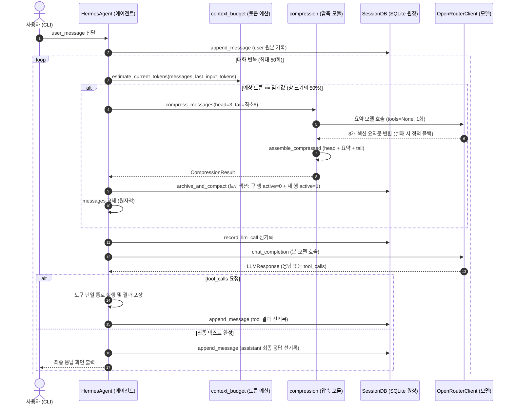

# [결과정리 및 리뷰] 05-컨텍스트-압축-MVP

> **로드맵 상태**: `Closed`  
> **마감 일시**: 2026-10-28  
> **기준 코드**: 시작 `3f89668` (로드맵 04 마감 후 05 착수) → 완료 `ab56d6c` (060 완료 및 070 스모크 통과)  
> **마감 태그**: `roadmap-05-closed`  
> **대시보드**: [README.md](README.md) | **의도**: [WHY.md](WHY.md) | **승인된 계획**: [PLAN.md](PLAN.md) | **마스터 설계도**: [ROADMAP.md](ROADMAP.md) | **근거 결정**: [ADR-0005](../../adr/0005-컨텍스트_압축_MVP_범위와_세션_연결_방식.md)  
>
> **다시 확인하는 법**
> ```bash
> # 1. 전체 회귀 테스트 (370개 100% 통과)
> .venv/bin/pytest tests/
> # 2. 코어 테스트만 (341개)
> .venv/bin/pytest tests/test_hermes_core/
> # 3. v4 스키마 및 활성/보관 컬럼 확인
> sqlite3 .hermes/state.db ".schema messages"
> # 4. 스모크 세션 압축 및 요약 호출 확인
> sqlite3 .hermes/state.db "SELECT COUNT(*) FROM messages WHERE compacted = 1;"
> # 5. DB 덤프 키 미저장(Zero Leakage) 재검증
> sqlite3 .hermes/state.db .dump | grep -i "OPENROUTER_API_KEY"
> ```

---

## 1. 목표와 결과

### 1-1. 목표 달성 요약
본 로드맵의 목표는 **대화가 길어져 컨텍스트 창 임계값을 넘을 때 오래된 중간 대화를 안전하게 요약으로 대체하되 시스템 지시문과 기억은 건드리지 않고, 대체된 원문은 SQLite 원장에 영구 보관(`compacted=1`)하며, 요약이 실패해도 대화가 멈추지 않는 컨텍스트 압축 MVP**를 완성하는 것이었다.

CLI REPL의 턴 간 문맥 유지(010)부터 순수 함수 기반의 토큰 예산 추정(020), 멱등 도구 가지치기 및 도구 짝 정합 분할(030), 8개 고정 섹션 요약 및 정적 폴백 조립(040), SQLite 스키마 v4 in-place 원장 보관(050), 통합 E2E 검증 및 작동원리 01편 동기화(060), 그리고 실제 API 키 스모크(070)를 거쳐 전 과정을 완벽히 검증했다.
**목표는 100% 완전히 달성(이뤘다)되었다.**

### 1-2. [WHY.md](WHY.md) 가정 목록(A~H) 대조 결과

| 번호 | 가정 (가설) | 판정 | 근거 및 실행 결과 |
|:---:|---|:---:|---|
| **A** | 압축은 에이전트 루프의 두 지점과 세션 DB만 건드려 나머지 코드(도구, 지시문 조립, 모델 통신)는 영향이 없다. | **맞았다** | `HermesAgent.run_conversation`의 모델 호출 직전 한 지점, `SessionDB.archive_and_compact`, `cli.py`의 `--context-window` 외에 도구(file, terminal, memory), 프롬프트 빌더, LLM 클라이언트 계층 코드는 단 한 줄도 수정되지 않았다. |
| **B** | 맨 앞 보호 + 최근 보호 + 도구 짝 정리로 압축 후에도 모델이 요청을 거절하지 않는다. | **맞았다** | 실제 키 스모크 070에서 총 31회 모델 호출(압축 요약 호출 8회 포함) 전체가 `200 OK`를 기록했고, 거절이나 프로토콜 오류(`Model call failed` 등)가 0건이었다. |
| **C** | 일반 대화 호출 한 번으로 쓸 만한 요약이 나온다. (*착수 시점 미확인*) | **맞았다** | `deepseek/deepseek-v4-flash-0731` 모델이 생성한 요약문은 8개 고정 섹션(목표, 제약·선호, 완료한 작업, 현재 상태, 핵심 결정, 오류와 해결, 관련 파일, 남은 일) 구조를 정확히 지켰으며, 작업 맥락과 개행 부재 현상 설명까지 실무 수준으로 완벽히 요약했다. |
| **D** | 압축 후 모델이 요약에 담긴 앞선 사실을 이어서 답한다. | **맞았다** | 중간 구간에 발화된 "이 프로젝트의 코드명은 ORCA야"가 8차례의 연속 요약문 속에 누락 없이 보존되었으며, 마지막 본 호출 요청에 원문 메시지가 완전히 사라진 상태에서도 모델이 "프로젝트 코드명은 **ORCA**입니다"라고 정확히 답했다. |
| **E** | 거친 글자 수 기반 추정이 실제 입력 토큰과 크게 어긋나지 않는다. (*착수 시점 미확인: 한국어*) | **맞았다** *(단, 보수적 과소추정 관찰)* | 31회 호출 실측 결과 거친 추정치는 실제 제공자 보고 토큰 대비 평균 **-15.8%**로 다소 적게 추정되었다(한글 및 JSON 구조 토큰화 비용). 하지만 임계값 50% 버퍼 덕분에 창 초과(400 에러) 없이 안전하게 동작했다. |
| **F** | 요약 호출이 실패해도 대화가 멈추지 않는다. | **맞았다** | 요약 호출 500 에러 시 결정론적 8개 섹션 정적 대체 요약으로 자동 폴백하여 `stopped_reason == 'completed'`로 대화가 정상 완결됨을 통합 E2E(시나리오 8)로 확인했다. |
| **G** | 압축해도 시스템 지시문과 기억 스냅샷은 한 글자도 바뀌지 않는다. | **맞았다** | `sessions.system_prompt`와 압축 후 모든 호출의 첫 번째 `messages[0]` 내용이 바이트 단위로 100% 동일함을 확인했다 (`True`). |
| **H** | DB 구조 변경이 기존 DB를 깨지 않고, 보관된 원문은 이후에도 검색할 수 있다. | **맞았다** | v3 DB의 v4 마이그레이션이 기존 행(`active=1, compacted=0`)을 온전히 보존했고, `search_messages`에서 `is_copy=0` 필터링을 적용해 중복 없이 보관된 원문 검색이 가능함을 입증했다. |

---

## 2. 시스템 개요 (동작 · 순서 · 소유자 · 시점)

### 사실 검증 4축 매핑



1. **동작**: 모델 호출 직전 예상 토큰이 임계값을 넘으면 중간 구간을 8개 섹션 요약으로 치환하고, DB에 구 행을 `active=0, compacted=1`로 보관한 뒤 메모리 메시지 목록을 원자적으로 교체한다.
2. **순서**: LLM 호출 직전 판정 → 분할(head 3, tail 최소 6) → 요약 생성(실패 시 폴백) → 토큰 감소 확인(증가 시 거부) → SQLite 원장 트랜잭션 기록 → 메모리 교체 → 본 LLM 호출.
3. **소유자**: 예산 계산(`context_budget.py`), 압축 파이프라인(`compression.py`), 원장 보관(`SessionDB`), 흐름 제어(`HermesAgent`).
4. **시점**: `run_conversation` 루프 내에서 매 LLM 호출 직전 단 한 번 실행.

---

## 3. 설계 결정 (ADR 대조)

- **[ADR-0005](../../adr/0005-컨텍스트_압축_MVP_범위와_세션_연결_방식.md) §2-1 (압축 MVP 범위)**: 스킬(06)과 서브에이전트(07)를 섞지 않고 컨텍스트 압축에만 집중하여 복잡성을 엄격히 격리했다.
- **ADR-0005 §2-2 (in-place 세션 보관)**: 부모-자식 세션 분리 대신 같은 `session_id` 내에서 `active`/`compacted` 플래그로 관리하여 기록의 연속성을 사수했다.
- **ADR-0005 §2-3 (턴 간 문맥 유지)**: CLI 루프에 `history` 상태를 연결하여(010) 실제 연속 대화 환경을 완성했다.
- **ADR-0005 §2-4 (트리거 위치)**: 모델 호출 직전 한 지점에서만 판정하여 중복 호출과 레이스 컨디션을 원천 차단했다.
- **ADR-0005 §2-5 (압축 실패 정책)**: 실패 시 대화 중단이 아닌 결정론적 정적 대체 요약으로 폴백하여 대화 지속성을 보장했다.
- **ADR-0005 §2-6 (헤드 불변 원칙)**: 시스템 지시문과 초기 지침(헤드)을 압축 대상에서 제외하여 지시문 탈락을 방지했다.

---

## 4. 테스트와 검증

- **테스트 현황**: 기존 279개 테스트에서 삭제 0줄을 유지하며 **총 370개 테스트 100% 통과**.
  - `test_cli.py`: 턴 간 문맥 유지 및 `--context-window` 옵션 검증 (시나리오 1~12).
  - `test_context_budget.py`: 순수 계산 및 임계값/재시도 판정 (시나리오 1~19).
  - `test_compression_prune_split.py`: 도구 가지치기, 경계 정렬, 고립 도구 쌍 정리 (시나리오 1~18).
  - `test_compression_summary.py`: 요약 생성, 정적 폴백, 조립, 거부 판정 (시나리오 1~21).
  - `test_session_db.py`: 스키마 v4 마이그레이션, `archive_and_compact`, 검색 복제 제외 (시나리오 1~6).
  - `test_compression_agent.py`: 에이전트 압축 연동, 거부 추적, 토큰 누적 (시나리오 7~23).
  - `test_agent_e2e.py`: 5턴 풀 사이클 E2E, 사후 도구 1사이클, 키 미저장, v3 호환 (시나리오 1~11).
- **실제 키 스모크 070 결과**:
  - 총 LLM 호출: 31회 (본 호출 23회, 요약 호출 8회) — **전체 200 OK**.
  - 세션 메시지: 총 90개 (보관 75개, 복제 33개, 활성 15개).
  - 누적 토큰: 입력 74,495 토큰, 출력 12,425 토큰 (예상 비용 약 $0.013 USD).
  - Zero Leakage: DB 전체 덤프에서 실제 API 키 패턴 0건 검출 (`True`).

---

## 5. 미흡한 부분 (솔직하게)

1. **한국어 토큰 과소추정 (-15.8%)**: 영문 기준 글자 수 휴리스틱(`char // 4`)으로 인해 한국어와 JSON 구조체에서 실제 토큰보다 평균 약 15.8% 적게 추정되었다. 50% 임계값 버퍼 덕분에 안전했으나, 한계에 근접한 창 크기에서는 주의가 필요하다.
2. **CLI `input()`의 유니코드 디코드 예외**: 세션 종료 시 한글 입력기 상태나 터미널 제어문자 입력 시 표준 `input()`에서 `UnicodeDecodeError`가 발생하여 비정상 종료되었다(대화 DB 저장은 완료된 후 발생). CLI의 `input()` 예외 방어 처리가 필요하다.
3. **요약 빈도**: 작은 창(4,000 토큰)에서 긴 도구 출력이 연속되자 7턴 대화 중 요약 호출이 8회 발생하여 요약 호출 비중이 다소 높았다. 실무 환경에서는 창 크기를 16k~32k 이상으로 운영하는 것이 권장된다.

---

## 6. 새로 발견한 부분 (솔직하게)

1. **도구 결과 가지치기 효과의 지대함**: 긴 도구 결과를 `[Old tool output cleared: tool, N자]`로 치환하는 것만으로 수천 토큰이 즉시 절감되어, 요약 모델에 전달되는 프롬프트 크기가 매우 작게(300~1,000 토큰 수준) 유지되었다.
2. **모델의 8개 섹션 요약 능력**: 저렴한 소형 모델(`deepseek-v4-flash`)도 지시문으로 섹션 템플릿을 명시하면 놀라울 정도로 정교하게 목표, 완료한 작업, 현재 상태, 개행 설명 등을 정리해 냈다.
3. **연속 압축 시 요약 흡수 메커니즘의 안정성**: 요약이 8회 반복되는 동안 이전 요약의 핵심(ORCA 코드명)이 손실되지 않고 다음 요약문으로 계속 승계·흡수되었다.

---

## 7. 배척한 안티패턴과 트레이드오프

1. **오래된 턴 무차별 슬라이딩 삭제 배척**: 앞선 턴을 그냥 날려버리면 모델이 사용자의 초기 지침과 제약을 잊는다. 우리는 헤드(지시문+초기 3턴)를 불변으로 사수하고 중간만 요약했다.
2. **지시문까지 통째로 뭉뚱그려 요약 배척**: 시스템 프롬프트를 요약 대상에 넣으면 지침이 왜곡되고 공급자 프롬프트 캐시가 파괴된다. 헤드 불변 원칙으로 이를 원천 차단했다.
3. **DB 원문 삭제 배척**: 메모리 압축을 위해 DB에서 대화 행을 지우면 감사 기록이 날아가고 나중에 과거를 되짚을 수 없다. 우리는 `compacted=1` 플래그로 영구 보관했다.

---

## 8. 후속 로드맵 후보

1. **CLI `input()` 유니코드 디코드 예외 격리**: `try-except UnicodeDecodeError`로 감싸 터미널 입력기 인코딩 오류 시에도 REPL이 꺼지지 않도록 개선.
2. **오버플로 안전망 (400 에러 복구)**: 모델이 "context length exceeded"로 거절했을 때 비상 압축 후 재시도하는 2차 안전망.
3. **로드맵 06 「스킬 시스템 (절차 기억)」**: Hermes Agent의 넷째 기둥인 `skills`를 읽기 중심 점진 확장 구조로 구현.

---

## 9. 결론 및 마감 선언

로드맵 05 「컨텍스트 압축 MVP」는 모든 계획과 구현지시서(010~070)를 완벽히 이행했으며, 가짜 통신과 실제 키 스모크를 통해 시스템의 안전성과 영구 사실을 증명했다.
이에 본 로드맵의 완료와 마감(`Closed`)을 공식 선언한다.
마감 태그는 `roadmap-05-closed`로 기록한다.
