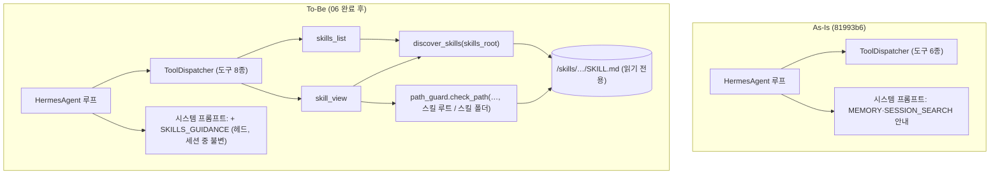

# [마스터 설계도] 06-스킬 시스템 MVP

> **상태**: `Draft`  
> **대시보드**: [README.md](README.md)  
> **의도(Why)**: [WHY.md](WHY.md) · **승인된 계획**: [PLAN.md](PLAN.md) · **근거 결정**: [ADR-0006](../../adr/0006-스킬_시스템_MVP_범위와_로딩_방식.md) (바탕: [ADR-0005](../../adr/0005-컨텍스트_압축_MVP_범위와_세션_연결_방식.md))  
> **기준 코드**: 커밋 `81993b6` (로드맵 05 마감, 태그 `roadmap-05-closed`) · **원본 기준**: 커밋 `6134939882`의 `tools/skills_tool.py`

---

## 1. 배경 및 목적 (Why)

원본 Hermes의 기억 중 **절차 기억(스킬)** 이 우리 코어에 없다. 이 로드맵의 목적은 **(1) 사용자가 파일로 둔 스킬의 이름·설명을 모델이 도구로 훑어보고, (2) 필요한 스킬의 본문과 부속 파일을 도구로 읽으며(점진 공개), (3) 그 도구들이 스킬 폴더 밖이나 비밀 파일을 읽을 수 없고 스킬 폴더를 바꾸지도 않으며, (4) 시스템 지시문은 안내문 한 덩어리만 늘어난 채 세션 동안 변하지 않게 하는 것**이다. 왜 이 정도까지만 하는지는 [WHY.md](WHY.md)에 있다.

| 필요 | 지금의 동작 (확인됨) | 이 로드맵 후 |
|---|---|---|
| 절차를 파일로 두기 | 해당 개념 없음. `src/`에 스킬 코드 없음 | `<HERMES_HOME>/skills/<분류>/<스킬>/SKILL.md` 규약을 읽는다 |
| 스킬 목록 | 없음 | `skills_list` 도구: 이름·설명·분류·경로 |
| 스킬 본문 | 없음 | `skill_view` 도구: 본문(상한 있음), 부속 파일, 연결 파일 목록 |
| 스킬 폴더 안전 | 작업 폴더 도구는 스킬 폴더에 닿지 못함(밖) | 스킬 도구가 같은 경로 안전 기준으로 스킬 폴더 안으로 한정 |
| 모델이 스킬을 알기 | 없음 | 시스템 지시문에 `SKILLS_GUIDANCE` 안내문 한 덩어리 |

---

## 2. As-Is vs To-Be 아키텍처



점진 공개의 3단계:

```text
1단계  skills_list()                      → 이름·설명·분류·path          (수십 토큰/스킬)
2단계  skill_view(name)                   → SKILL.md 본문(상한) + linked_files 목록
3단계  skill_view(name, file_path=…)      → references/api.md 같은 부속 파일 하나
```

폴더 배치(작업 폴더와 형제):

```text
<HERMES_HOME>/            # 기본 프로젝트 내부 .hermes/
  workspace/              # 파일 도구·터미널이 닿는 영역 (스킬 도구는 닿지 않음)
  skills/                 # 스킬 도구만 읽음. 쓰는 도구 없음 (사용자가 파일로 둔다)
    devops/deploy/SKILL.md, references/…
    hello/SKILL.md
```

---

## 3. 파급 범위와 무영향 근거 (Blast Radius)

- **수정 대상**
  - 신규 `src/hermes_core/tools/skills_tool.py` (010·020·030)
  - `src/hermes_core/constants.py` (010: 이름 상한 상수와 `get_skills_dir()`, 030: 본문·연결 파일 상한 상수)
  - `src/hermes_core/tools/dispatcher.py` (020·030: 등록 각 1줄, import)
  - `src/hermes_core/agent/prompt_builder.py` (040: `SKILLS_GUIDANCE` 상수)
  - `src/hermes_core/agent/agent.py` (040: `tools_guidance` 목록에 한 항목)
  - `tests/test_hermes_core/test_skills_*.py` 신규, `test_agent_e2e.py` 시나리오 추가(050)
  - `docs/작동원리/01-헤르메스코어-작동원리.md` (050: 영구 사실만), 로드맵 문서(대시보드, 색인, 인계)
- **영향받지 않는 것과 근거**
  - `path_guard.py`: **재사용만** 하고 수정하지 않는다(`check_path(path, root)`의 두 번째 인자에 스킬 루트를 넘김). 기존 파일 도구·터미널의 판정이 바뀌지 않는다.
  - `session_db.py`, `compression.py`, `context_budget.py`, `llm_client.py`, `cli.py`, `memory_tool.py`, `session_search_tool.py`, `file_tools.py`, `terminal_tool.py`: 수정하지 않는다. 스킬 도구는 문자열 JSON을 돌려주는 일반 도구라 에이전트 루프·DB·압축은 도구 결과를 다른 도구와 똑같이 취급한다(05의 도구 출력 가지치기 포함).
  - 기존 코어 테스트 370건(05 마감 시점)은 **수정 없이** 통과해야 한다. 도구 개수를 단언하는 기존 시험은 없음을 확인했다(`get_tools_schema` 사용 시험은 이름 존재만 검사). 단 040의 안내문 추가가 시스템 프롬프트를 바꾸므로 프롬프트 문자열을 직접 비교하는 기존 시험이 있는지 040 착수 때 먼저 확인하고, 깨지면 임의로 고치지 않고 멈춰서 보고한다.
  - `hermes-agent/`: 읽기 전용, 변경하지 않는다.

---

## 4. 사전 점검 및 실패 위험 분석 (Pre-Mortem)

> **「이 로드맵이 실패한다면 무엇 때문일 가능성이 가장 높은가?」**

| # | 위험 | 가능성 | 방어책 |
|---|---|---|---|
| 1 | **`name`/`file_path`로 스킬 폴더 밖을 읽음** (`../`, 절대경로, 심볼릭 링크). 원본 `skill_view(file_path)`에 실제로 있던 구멍 | 높음 | `check_path`를 스킬 루트(이름)와 스킬 폴더(부속 파일) 두 기준으로 적용, 읽기 전 실제 경로 재확인. 030에서 원본 구멍과 같은 입력을 시험으로 고정(가정 C) |
| 2 | **스킬 폴더 안의 `.env*`·`.git`이 읽힘** (사용자가 스킬 폴더에 비밀 파일을 둔 경우 포함) | 중간 | `check_path`의 보호 이름 판정 재사용, 발견 단계에서도 보호 이름 경로 제외(010·030) |
| 3 | **스킬 도구로 상태 폴더의 다른 파일(`state.db`, 기억 파일)이 읽힘** | 낮음 | 이름/경로는 스킬 루트 기준이라 형제 경로는 이탈로 거부됨. 시험으로 고정(가정 G) |
| 4 | **큰 스킬·큰 부속 파일이 문맥을 폭증시킴** | 중간 | `SKILL_VIEW_MAX_CHARS`(20,000)와 파일 크기 한도(`FILE_MAX_BYTES`), `truncated` 표시. 원본 번들 스킬 47개 실측: 중앙값 9,807자, 90% 지점 15,894자, 최대 159,244자, 20,000자 초과 2개(가정 E) |
| 5 | **스킬 본문 속 문장이 지시처럼 읽혀 모델이 엉뚱한 일을 함** (프롬프트 주입) | 중간 | 06은 검사하지 않는다. 사용자가 직접 둔 스킬만 읽는다는 가정으로 수용하고 WHY에 위험으로 명시. 외부 스킬 수입은 Non-Goal |
| 6 | **모델이 `skills_list`를 안 부름** | 중간 | `SKILLS_GUIDANCE`. 060 스모크에서 관찰만(가정 B) |
| 7 | **최소 파서가 이름·설명을 잘못 읽어 목록이 빈약·오표시** | 중간 | 중첩/들여쓴 줄은 최상위 키로 읽지 않음을 시험으로 고정, 원본 번들 47개 중 44개가 중첩 항목을 가짐(최상위 `name`/`description`은 한 줄). 읽지 못하면 폴더 이름·본문 첫 줄로 대체(010, 가정 A) |
| 8 | **안내문 추가가 기존 프롬프트 시험·헤드 불변·캐시를 깨뜨림** | 낮음 | 040 착수 전 기존 시험 점검, 동일 세션 캐시 동일·압축 후 헤드 동일 시험(가정 D) |
| 9 | **읽기 도구가 부수 효과를 가짐** (폴더 생성, 파일 갱신) | 낮음 | 호출 전후 스킬 폴더·부모 폴더 상태 불변 시험(010·030·050). 원본은 `skills_list`가 폴더를 만들었음 |
| 10 | **목록 이름으로 조회가 실패**(원본의 불일치) 또는 중복 이름을 조용히 하나로 고름 | 중간 | 목록이 `path`를 함께 주고 조회는 `path` → 이름 순, 중복이면 오류+후보. 020·030에서 목록→조회 왕복 시험 |
| 11 | **깨진 SKILL.md 하나가 목록 전체를 죽임** | 중간 | 읽기/해석 실패 스킬만 건너뜀(010) |
| 12 | **연결 파일이 수천 개라 `linked_files`가 폭증** | 낮음 | 종류별 개수 상한(`SKILL_LINKED_FILES_MAX_PER_KIND`) 초과분은 생략 표시(030) |
| 13 | **스킬이 많아 `skills_list` 결과가 커짐** | 낮음(수용) | 06은 개수 상한을 두지 않는다. 원본 번들 47개를 같은 필드로 직렬화하면 약 16,800자, 설명 최대 696자(실측). 수백 개로 늘면 `category` 필터로 좁히며, 오래된 도구 출력은 05의 가지치기 대상이다. 상한은 스킬 수가 문제가 될 때의 후속(WHY §2) |

---

## 5. 4층위 검증 범위 설계 (Validation Grid)

| 층위 | 대상 | 이 로드맵의 검증 |
|---|---|---|
| 1 (수동 반복 배제) | 사람이 스킬을 일일이 불러보는 시험 없음 | 임시 폴더(`tmp_path`)에 스킬 파일을 만들어 도구 함수와 디스패처를 자동으로 호출. 실제 키는 060에서 1회만 |
| 2 (단위·구조) | 머리말 파서, 스킬 발견, 이름 해석, 목록/조회 JSON 계약, 스키마(인자 검증) | 010~030의 인수 시나리오 (모델·DB 없음) |
| 3 (정합성·안전) | 경로 이탈·심볼릭 링크·보호 이름, 상한, 읽기 전용(파일·폴더 불변), 안내문과 헤드 불변·캐시·압축 | 030, 040, 050 |
| 4 (통합) | 에이전트 + 가짜 모델 + 실제 디스패처 + 임시 스킬 폴더의 대화 전체 | 050 (목록 → 본문 → 답, 이탈 시도 거부 후 루프 지속). 키가 저장소 어디에도 없음을 확인 |

---

## 6. 설계 결정 상세

### 6-1. 스킬 폴더 규약과 발견 (010)
- **루트**: `get_skills_dir()` = `get_hermes_home() / "skills"` (폴더를 만들지 않는다). 도구는 호출 시점에 이 값을 읽는다(`skills_root=None`이면). 시험은 `skills_root`를 직접 넘기거나 `HERMES_HOME`을 임시 폴더로 바꾼다.
- **스킬 = `SKILL.md`를 가진 폴더**: `root.rglob("SKILL.md")`. 루트 바로 아래의 `SKILL.md`(폴더가 루트 자신)는 스킬로 보지 않는다.
- **제외**: 상대경로 구성요소가 `.git`·`.github`·`.hub`이거나 보호 이름(`.env*`, `.git`)인 경로, `SKILL.md`의 실제 경로(`resolve()`)가 루트 밖인 것, 읽거나 해석하다 실패한 것.
- **필드**: `name`(머리말 `name` 문자열, 없거나 문자열이 아니면 폴더 이름; 64자 상한), `description`(머리말 `description` 문자열, 없으면 본문 첫 비어있지 않은 비제목 줄, 1,024자 초과 시 1,021자 + `...`), `category`(루트 기준 상대경로 구성요소가 3개 이상이면 첫 요소, 아니면 `None`), `path`(스킬 폴더의 루트 기준 상대경로, 항상 `/` 구분).
- **정렬**: `(category 또는 "", name, path)`. 결과가 파일시스템 순서에 의존하지 않는다.
- **최소 머리말 파서**: 문서가 `---` 줄로 시작하고 그 뒤 첫 `---` 줄이 있을 때만 머리말. 최상위(들여쓰기 없는) `key: value` 줄만 읽고, 값의 양끝 따옴표를 벗기며, `[a, b]` 형태는 문자열 목록으로. 들여쓴 줄·`-` 목록 줄·주석(`#`)·콜론 없는 줄은 건너뛴다. 닫는 `---`가 없으면 머리말 없음으로 보고 본문 전체. 반환은 `(머리말 사전, 본문)`.

### 6-2. `skills_list` (020)
- 인자: `category`(선택, 문자열). 반환 JSON: `{"success": true, "skills": [{name, description, category, path}], "categories": [...], "count": N}`. 스킬이 없거나 폴더가 없으면 `success: true`, 빈 목록, `message`. `category` 필터는 정확히 일치. 폴더를 만들지 않는다.
- 스키마: `skills_list`, `parameters.properties`에 `category`만(`skills_root` 비노출), `required` 없음.

### 6-3. `skill_view` (030)
- 인자: `name`(필수), `file_path`(선택). 스키마에 `skills_root` 비노출.
- **이름 해석**: ① `check_path(name, root)` 통과 못 하면 오류(제어문자·이탈·보호 이름) ② 발견된 스킬 중 `path == name`이면 그것 ③ 아니면 폴더 이름 또는 머리말 `name`이 `name`과 같은 스킬 전부 ④ 0개면 오류 + `available_skills`(처음 20개의 `path`) ⑤ 2개 이상이면 오류 + `candidates`(그 `path`들).
- **본문**(`file_path` 없음): `{"success": true, "name", "description", "category", "path", "content", "truncated", "total_chars", "linked_files"?}`. `content`는 `SKILL.md` 전문(머리말 포함, 원본과 같음)을 `SKILL_VIEW_MAX_CHARS`(20,000자)로 자른 것, 자르면 `truncated: true`. `linked_files`는 스킬 폴더 아래 `references/`·`templates/`·`assets/`·`scripts/`의 파일(상대경로, 정렬, 종류별 최대 `SKILL_LINKED_FILES_MAX_PER_KIND` = 100, 실제 경로가 스킬 폴더 밖이거나 보호 이름인 것 제외), 비면 키 없음. 크기가 `FILE_MAX_BYTES`를 넘는 `SKILL.md`는 오류.
- **부속 파일**(`file_path` 있음): `check_path(file_path, 스킬 폴더)` 통과 → 존재·파일 여부 → 본문과 같은 공통 읽기 절차(`FILE_MAX_BYTES` 초과 오류, NUL 포함이면 이진 파일 오류, `utf-8-sig` 디코드 실패 오류, 문자 수 기준 자르기) → `{"success": true, "name", "path", "file", "content", "truncated", "total_chars"}`. 스킬 폴더 안의 어떤 파일이든 읽을 수 있고(보호 이름 제외), 목록만 4개 폴더로 한정한다. 없으면 `available_files`(종류별, 상한 적용) 포함 오류.
- **읽기 전용**: 파일을 열 때 읽기만. 어떤 경우에도 쓰기·생성·삭제를 하지 않는다.
- 오류 형식은 파일 도구와 같은 `{"success": false, "error": "…"}` (추가 키 허용).

### 6-4. 안내문과 연동 (040)
- `prompt_builder.py`에 `SKILLS_GUIDANCE`(영어 한두 문장, 기존 안내문과 같은 문체): 반복되는 절차가 있을 수 있으니 작업 전에 `skills_list`로 이름과 설명을 보고, 맞는 것이 있으면 `skill_view`로 읽고 따르라. 스킬은 읽기 전용 참고 문서다.
- `agent.py`의 `tools_guidance`를 `[MEMORY_GUIDANCE, SESSION_SEARCH_GUIDANCE, SKILLS_GUIDANCE]`로. 조립 위치·캐시·압축 헤드 보존 경로는 그대로.

### 6-5. 값 (에이전트가 정한 안)
`SKILLS_DIR_NAME = "skills"`, `SKILL_FILE_NAME = "SKILL.md"`, `SKILL_NAME_MAX_CHARS = 64`, `SKILL_DESCRIPTION_MAX_CHARS = 1024`, `SKILL_VIEW_MAX_CHARS = 20_000`, `SKILL_LINKED_FILES_MAX_PER_KIND = 100`, `SKILL_LINKED_DIRS = ("references", "templates", "assets", "scripts")`, 목록 오류 시 `available_skills` 최대 20개. 파일 크기 한도는 기존 `FILE_MAX_BYTES`(1,000,000)를 재사용한다. 해당 단계 착수 시 승인으로 갈음하며 바꾸고 싶으면 착수 전에 알린다.

### 6-6. 원본과 다른 점 (의도적)
| 항목 | 원본 (기준 커밋) | 06 |
|---|---|---|
| `skill_view(file_path)` 경로 검사 | 없음 (`../` 이탈 가능) | `check_path` 적용, 이탈 거부 |
| 스킬 폴더 없음 | `skills_list`가 폴더를 만듦 | 만들지 않음, 빈 목록 |
| 이름 조회 | 폴더 이름만 (목록의 머리말 이름과 불일치 가능) | `path` → 폴더/머리말 이름, 중복은 오류+후보 |
| 평평한 `legacy.md` 스킬 | 지원 | 제외 |
| 머리말 해석 | `yaml.safe_load` (중첩·태그 등) | 최소 파서 (`tags`·`related_skills`·`metadata`·`compatibility` 제외) |
| 본문 크기 | 상한 확인 안 됨 | 20,000자 상한 + `truncated` |
| 이진 부속 파일 | 성공 응답에 안내 문자열 | NUL 포함이면 오류 (03의 `read_file`과 같은 계약) |
| 연결 파일 목록 | 종류별 glob, 상한 없음 | 4개 폴더, 종류별 100개 상한 |
| `skills_categories` | 함수만 있음(도구 아님) | 만들지 않음 |

---

## 7. 문서 동기화 방식

- 코드를 바꾸는 단계는 같은 커밋에서 [작동원리 01편](../../작동원리/01-헤르메스코어-작동원리.md)을 고치지 않는다. **영구 사실의 일괄 반영은 050에서** 한다(스킬 도구의 위치와 읽기 전용, 점진 공개 3단계, 스킬 폴더의 위치와 경로 안전, 안내문이 헤드에 있다는 사실). 도구와 안내문이 모두 연동(040)된 뒤에야 사실이 되기 때문이다.
- 단계 결과의 서술은 마감 때 종합보고서(`결과정리및리뷰.md`, ROADMAP_정책 §5의 9항목)에 쓴다. [WHY.md](WHY.md)의 가정 A~G를 하나씩 대조한다.
- 기준 커밋은 한 단계 뒤에 채운다(커밋은 자기 해시를 담을 수 없다).

---

## 8. 이 로드맵이 다루지 않는 것 (Non-Goals)

스킬 생성·수정·삭제(`skill_manage`), 허브·설치·동기화, 스킬 보안 검사, 슬래시 커맨드(`/스킬이름`), 시스템 프롬프트 스킬 인덱스 주입, 머리말 중첩 항목(태그·관련 스킬·호환성·메타데이터), 플랫폼·조건부 활성화, 사용 통계·린터, `skills_categories` 도구, 평평한 `.md` 레거시 스킬, 본문 부분 읽기(오프셋), 스킬 변경의 실시간 감지. 이유는 [WHY.md §2](WHY.md)에 있다. 이어지는 로드맵: 07 서브에이전트(직전 로드맵 마감 후에 계획).
