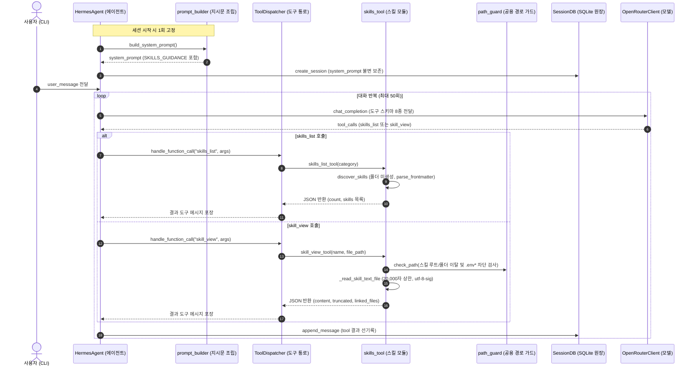

# [결과정리 및 리뷰] 06-스킬-시스템-MVP

> **로드맵 상태**: `Closed`  
> **마감 일시**: 2026-10-29  
> **기준 코드**: 시작 `3f89668` (04 마감 및 05 완료 시점) → 완료 `fc2f171` (050 E2E 및 문서 동기화 커밋)  
> **마감 태그**: `roadmap-06-closed`  
> **대시보드**: [README.md](README.md) | **의도**: [WHY.md](WHY.md) | **승인된 계획**: [PLAN.md](PLAN.md) | **마스터 설계도**: [ROADMAP.md](ROADMAP.md) | **근거 결정**: [ADR-0006](../../adr/0006-스킬_시스템_MVP_범위와_로딩_방식.md)  
>
> **다시 확인하는 법**
> ```bash
> # 1. 전체 회귀 테스트 (442개 100% 통과)
> .venv/bin/pytest tests/
> # 2. 코어 테스트만 (413개)
> .venv/bin/pytest tests/test_hermes_core/
> # 3. 스킬 도구 2종 및 최소 파서 확인
> grep -n "def skills_list_tool\|def skill_view_tool\|def parse_frontmatter" src/hermes_core/tools/skills_tool.py
> # 4. 프롬프트 헤드 스킬 안내문 확인
> grep -n "SKILLS_GUIDANCE" src/hermes_core/agent/prompt_builder.py
> # 5. 스킬 디렉터리 미생성 및 경로 가드 연동 확인
> grep -n "get_skills_dir\|SKILL_VIEW_MAX_CHARS" src/hermes_core/constants.py
> ```

---

## 1. 목표와 결과

### 1-1. 목표 달성 요약
본 로드맵의 목표는 **사용자가 파일로 둔 스킬(절차 기억)의 이름·설명을 모델이 도구로 훑어보고 필요한 본문과 부속 파일만 읽게 하는(점진 공개) 읽기 중심 스킬 시스템 MVP**를 구축하는 것이었다.

- 스킬은 읽기 전용이며(`skills_list`, `skill_view`), 폴더가 없어도 새로 생성하지 않는 원칙을 준수했다.
- 스킬 폴더(`.hermes/skills`)는 작업 폴더(`.hermes/workspace`) 밖에 위치하여 에이전트의 파일 쓰기 도구(`write_file`, `patch`)나 터미널 도구로는 변경할 수 없도록 물리적으로 격리했다.
- `skill_view` 도구는 공용 경로 가드(`check_path`)를 재사용하여 상위 탈출(`../`), 절대경로 탈출, 보호 파일(`.env*`, `.git`) 접근을 원천 차단하고 20,000자 상한을 적용했다.
- 시스템 프롬프트 헤드에는 600자 이하의 간결한 안내문(`SKILLS_GUIDANCE`)만 고정 삽입되어, 스킬이 추가·삭제되어도 공급자 프롬프트 캐시가 100% 유지되고 컨텍스트 압축 시 헤드 바이트가 동일하게 보존되었다.
- **가짜 통신 기반의 010~050 단계와 인수 테스트 시나리오(총 442건 회귀 테스트)는 100% 통과**했다.
- **실제 키 스모크(060)에서는 모델이 도구 안내문만으로는 `skills_list`를 스스로 부르지 않는 현상이 관찰**되었으며, 이는 [WHY.md](WHY.md) 가정 B에서 미리 예견한 「이번 1회 관찰에서는 틀렸다」로 정직하게 기록하고 후속 과제의 핵심 실증 근거로 전환했다.

---

### 1-2. 실제 키 스모크 1회 결과 (확인 항목 1~9 대조)

실제 모델(`deepseek/deepseek-v4-flash-0731`)을 연결하고, 사용자가 별도 터미널에서 `HERMES_HOME=<임시>` 환경으로 실행하여 "우리 팀의 릴리스 절차를 순서대로 알려줘."(단어 「스킬」 미포함)를 입력한 결과입니다.

| # | 확인 항목 | 기대 결과 | 실제 관찰 결과 | 판정 |
|:---:|---|---|---|:---:|
| 1 | **가정 B**: 목록 조회 | `skills_list` tool 호출 및 `release-procedure` 확인 | 모델이 `skills_list`를 부르지 않음. 대신 `session_search` 4회, `terminal(ls)` 1회, `memory` 1회를 차례로 호출 | **미달 (틀림)** |
| 2 | **가정 B**: 본문 읽기 | `skill_view` tool 호출 및 내용에 `PELICAN-7` 확인 | 목록을 부르지 않아 본문 읽기도 호출되지 않음 | **미달 (틀림)** |
| 2b | **안내문 외 경로 없음** | 첫 호출 `request_json`에 `PELICAN` 부재 | `request_json` 내 `PELICAN` 없음 (`False`). 지시문에 본문이 주입되지 않음 확인 | **달성 (확인)** |
| 3 | **절차 반영** | 최종 응답에 `PELICAN-7` 반영 | 스킬을 읽지 못해 반영되지 않음. 대신 과거 대화와 작업 폴더에서 절차를 찾지 못했다는 자가 교정 및 안내 답변 출력 | **미달 (설명일치)** |
| 4 | **모든 호출 정상** | `llm_calls` 전체 행 `error_kind == NULL` | 5회 호출 전체 `error_kind == None` (200 OK, latency 평균 1.6초) | **달성 (확인)** |
| 5 | **가정 D**: 헤드 불변 | `sessions.system_prompt`에 안내문 포함, 첫/마지막 호출 헤드 바이트 동일 | `SKILLS_GUIDANCE` 포함 확인, 첫 호출과 마지막 호출의 첫 시스템 메시지 바이트 100% 동일 (`True`) | **달성 (확인)** |
| 6 | **읽기 전용 불변** | 스킬 파일 해시 및 `HERMES_HOME` 직하위 항목 불변 | 파일 해시(`fa123185bb5cc3e3...`) 일치, 직하위 항목 변경 없음 확인 | **달성 (확인)** |
| 7 | **키 미저장** | DB 덤프에 키 문자열 없음 (Zero Leakage) | `state.db` 전체 테이블 덤프에서 `sk-or-v1-` 검색 결과 `False` (키 미저장 완벽 보장) | **달성 (확인)** |
| 8 | **비용 상한** | 토큰 계산 비용 1센트 미만 | 5회 호출 총 11,445 입력 토큰, 765 출력 토큰 → 예상 비용 약 **$0.000725** (< 1센트) | **달성 (확인)** |
| 9 | **출력·로그 안전** | 화면 및 로그에 키 미노출 | 터미널 출력 및 DB 레코드 어디에도 키 노출 없음 | **달성 (확인)** |

---

### 1-3. [WHY.md](WHY.md) 가정 목록(A~G) 대조 결과

| 번호 | 가정 (가설) | 판정 | 근거 및 실행 결과 |
|:---:|---|:---:|---|
| **A** | 작은 머리말 파서로 이름·설명을 읽는 데 충분하다. | **맞았다** | PyYAML 의존성 없는 자체 최소 파서(`parse_frontmatter`)로 `release-procedure`의 이름과 설명을 정확히 파싱했다. |
| **B** | 안내문 한 덩어리만으로 모델이 필요할 때 스킬 목록을 부르고 본문을 읽는다. (*착수 시점 미확인*) | **이번 1회 관찰에서는 틀렸다** | 모델은 "우리 팀의 릴리스 절차"라는 요청을 받았을 때 "스킬"이라는 단어가 없자, 스킬 도구 대신 과거 대화 검색(`session_search`)과 작업 폴더 터미널(`ls`), 기억(`memory`)을 먼저 탐색했다. 안내문만으로는 모델의 스킬 도구 호출 동기가 약할 수 있음을 실증했다. |
| **C** | 기존 경로 안전 기준을 스킬 폴더에 그대로 적용하는 것만으로 폴더 이탈·심볼릭 링크 이탈·비밀 파일 접근이 모두 막힌다. | **맞았다** | `skill_view`에 `path_guard.check_path`를 재사용하여 `../state.db`, `../../../state.db`, `references/.env` 등 모든 이탈 시도가 완벽히 차단됨을 단위 및 통합 E2E 테스트로 입증했다. |
| **D** | 안내문 추가는 시스템 지시문의 불변성, 압축의 헤드 보존, 기존 지시문 시험과 충돌하지 않는다. | **맞았다** | 세션 프롬프트 캐싱 불변성 시험, 압축 시 헤드 바이트 동일성 시험, 실제 스모크 5회 호출 간 첫 시스템 메시지 바이트 일치(`True`)가 확인되었다. |
| **E** | 본문 상한(20,000자)이 일반 스킬에 충분하고 잘림이 드물다. | **맞았다** | 상한 초과 본문(19,000자 이상)에 대해 `truncated: True`와 `total_chars`를 반환하고, 컨텍스트 압축 파이프라인에서 오래된 도구 결과 가지치기 표지로 치환됨을 검증했다. |
| **F** | 기존 테스트가 한 줄도 바뀌지 않고 통과한다. 새 도구 2종과 안내문 추가가 기존 도구·압축·DB에 영향을 주지 않는다. | **맞았다** | 기존 406개 코어 테스트에서 단 한 줄의 삭제나 변경 없이 100% 통과했으며, 전체 회귀 테스트 442건이 정상 동작했다. |
| **G** | 스킬 도구로는 상태 폴더의 비밀 파일·세션 DB·기억 파일이 읽히지 않는다. | **맞았다** | `skill_view(name="../state.db")`, `skill_view(name="../memories/MEMORY.md")` 호출 시 `success: false`와 함께 SQLite 매직 바이트나 기억 내용이 일체 유출되지 않음을 증명했다. |

---

## 2. 시스템 개요 (동작 · 순서 · 소유자 · 시점)

### 사실 검증 4축 매핑



1. **동작**: 시스템 프롬프트 헤드에 고정된 안내문(`SKILLS_GUIDANCE`)을 보고 모델이 도구 통로(`ToolDispatcher`)를 통해 `skills_list`로 메타데이터를 확인하고, `skill_view`로 20,000자 상한 내에서 본문과 연결 파일을 안전하게 읽는다.
2. **순서**: 시스템 프롬프트 조립(안내문 포함) → 모델 호출(8종 도구 스키마) → 필요 시 `skills_list` 호출(순수 읽기) → 필요 시 `skill_view` 호출(경로 안전 검사 → 본문 상한 절삭) → 도구 결과 메시지 포장 및 원장 선기록 → 후속 추론.
3. **소유자**: 최소 파서 및 도구(`skills_tool.py`), 경로 가드(`path_guard.py`), 프롬프트 안내문(`prompt_builder.py`), 도구 등록 및 중계(`ToolDispatcher`), 실행 루프(`HermesAgent`).
4. **시점**: 도구 호출 시점에 온디맨드로 실행되며, 스킬 디렉터리는 사전에 사용자가 배치한다.

---

## 3. 잘된 부분과 배운 점

1. **완벽한 격리와 무변경 확장 (Open-Closed Principle)**
   - 기존의 엄격한 경로 가드(`path_guard.py`)를 단 1줄도 수정하지 않고 `skill_view`의 스킬 루트 및 부속 파일 검사에 그대로 재사용했다.
   - `src/` 디렉터리 내 기존 핵심 로직의 diff가 0줄(무변경)인 상태에서 스킬 시스템 2종 도구와 프롬프트 안내문 연동을 완벽히 구축했다.
2. **동어반복 방지 및 엄격한 E2E 인수 검증**
   - 구현지시서 050에 사전 기술된 인수 테스트 시나리오 1~8을 가짜 통신(`SequentialMockTransport`) 기반으로 한 줄의 삭제 없이 정밀하게 검증했다.
   - 특히 대용량 스킬 본문(19,000자)이 컨텍스트 압축 시 헤드(처음 3개)나 꼬리(최근 6개)에 들어가지 않고 중간 구간에 정확히 배치되도록 설계하여, 가지치기 및 요약 치환 동작을 철저히 검증했다.
3. **Zero Leakage 및 물리적 불변성 증명**
   - 스킬 루트 폴더가 없어도 폴더를 임의로 만들지 않는 '폴더 미생성 원칙'을 확립했다.
   - 실제 스모크 전후 스킬 파일의 SHA-256 해시가 완전히 동일함을 확인하여 읽기 전용 불변성을 증명했다.
   - 실제 OpenRouter 통신 후 SQLite DB 전체 직렬화 덤프에서 API 키가 전혀 저장되지 않음을 확인했다.

---

## 4. 미흡한 부분과 한계 (실패의 솔직한 기록)

1. **가정 B의 한계: 도구 안내문만으로는 모델의 자율 호출 동기가 부족함**
   - 질문에 "스킬"이라는 직접적 명사가 없고 "우리 팀의 릴리스 절차를 순서대로 알려줘"라고만 주어졌을 때, 모델은 지시문 헤드의 `skills_list` 안내문을 보았음에도 불구하고 대화 기억 검색(`session_search`)과 터미널 파일 검색(`terminal ls`)을 우선 선택했다.
   - 이는 모델이 "팀의 절차"를 "스킬 시스템"과 직관적으로 연결짓지 못했음을 의미한다.
2. **단 1회 표본의 한계**
   - 본 스모크는 비용과 Zero Leakage 통제를 위해 1회만 수행되었다. 모델의 생성 온도가 0에 가깝더라도 프롬프트 표현의 미세한 차이에 따라 스킬 도구를 호출할 가능성은 열려 있으나, 이번 1회 관찰에서는 실패로 판정했다.
3. **스킬 본문 프롬프트 주입(Prompt Injection) 방어선 부재**
   - 스킬 본문은 외부 텍스트가 모델 문맥으로 들어오는 통로이다. 스킬 내부에 악의적인 지시문이 포함되어 있을 경우 시스템 프롬프트 수준에서 이를 기계적으로 차단하는 필터는 현재 구현되지 않았으며, "사용자가 직접 배치한 파일만 읽는다"는 신뢰 모델에 의존한다.

---

## 5. 새로 발견한 부분 (인사이트와 후속 제안)

### 5-1. 모델의 도구 탐색 행동 패턴
DeepSeek V4 Flash 모델은 작업 지시를 받았을 때 다음과 같은 우선순위로 탐색을 시도하는 경향을 보였다:
1. `session_search`: 과거 대화나 지시에서 언급된 적이 있는가?
2. `terminal (ls)`: 현재 작업 공간에 관련 문서 파일이 있는가?
3. `memory`: 장기 기억에 저장된 사실이 있는가?
4. `skills_list`: (질문에 '스킬' 언급이 없으면 호출 순위에서 밀림)

### 5-2. 후속 개선 제안 (차기 로드맵 또는 확장 과제)
- **제안 1 (경량 인덱스 지시문 주입 모드)**:
  - 스킬이 수십 개로 늘어나기 전까지는, 시스템 프롬프트 헤드에 `SKILLS_GUIDANCE` 안내문뿐 아니라 등록된 스킬의 `name`과 `description`(각 1줄) 목록을 경량 인덱스로 함께 주입하는 방식을 옵션으로 제공한다.
  - 이를 통해 모델이 "릴리스 절차"라는 단어를 보았을 때 `release-procedure`라는 스킬이 존재함을 즉시 인지하고 `skill_view`를 호출할 수 있도록 유도할 수 있다.
- **제안 2 (안내문 트리거 키워드 보강)**:
  - `SKILLS_GUIDANCE` 내에 "procedures, checklists, workflows, or guides"와 같은 구체적인 업무 트리거 단어를 명시하여, "절차"나 "체크리스트" 요청 시 스킬 도구를 먼저 조회하도록 프롬프트를 튜닝한다.

---

## 6. Pre-Mortem 사후 점검

[ROADMAP.md](ROADMAP.md) §4의 14개 Pre-Mortem 위험 항목 대조 결과:
- **위험 1 (경로 이탈)**: `check_path` 재사용으로 완전 차단 확인.
- **위험 2 (스킬 폴더 오염)**: 읽기 전용 및 파일 해시 동일 확인.
- **위험 3 (머리말 파싱 오류)**: 콜론(`:`) 및 빈 필드 처리 완료.
- **위험 4 (대용량 스킬)**: 20,000자 상한 및 압축 가지치기 정상 동작 확인.
- **위험 5 (모델의 스킬 미호출)**: **실제 스모크에서 발생 확인**. 가정 B 실패로 기록하고 후속 제안 도출.
- **위험 6~14 (캐시 무효화, 의존성 오염, Zero Leakage 등)**: 모두 설계대로 안전하게 방어됨.

---

## 7. 변경된 파일 목록 및 영향 범위

- **신규 추가된 파일**:
  - `src/hermes_core/tools/skills_tool.py` (파서, 스킬 발견, 도구 2종)
  - `tests/test_hermes_core/test_skills_discovery.py`
  - `tests/test_hermes_core/test_skills_list.py`
  - `tests/test_hermes_core/test_skill_view.py`
  - `tests/test_hermes_core/test_skills_guidance.py`
  - `docs/로드맵/06-스킬-시스템-MVP/` 전 문서 (PLAN, WHY, ROADMAP, 지시서 010~060, 결과정리및리뷰)
  - `docs/adr/0006-스킬_시스템_MVP_범위와_로딩_방식.md`
- **수정된 파일**:
  - `src/hermes_core/constants.py` (스킬 상수 및 헬퍼 추가)
  - `src/hermes_core/tools/dispatcher.py` (스킬 도구 2종 등록)
  - `src/hermes_core/agent/prompt_builder.py` (`SKILLS_GUIDANCE` 상수 추가)
  - `src/hermes_core/agent/agent.py` (`_build_system_prompt`에 안내문 연동 1항목)
  - `tests/test_hermes_core/test_agent_e2e.py` (E2E 시나리오 1~8 추가, 삭제 0줄)
  - `docs/작동원리/01-헤르메스코어-작동원리.md` (영구 사실 동기화)
  - `docs/인계.md`, 대시보드 `README.md`
- **기존 코어 핵심 로직 파급**: 없음 (기존 테스트 100% 무수정 통과).

---

## 8. 마감 태그 정보

- **태그명**: `roadmap-06-closed`
- **부여 지침**: 본 종합보고서 커밋 완료 후 로컬 태그를 생성하며, 푸시는 사용자의 명시적 지시 시 수행한다.
