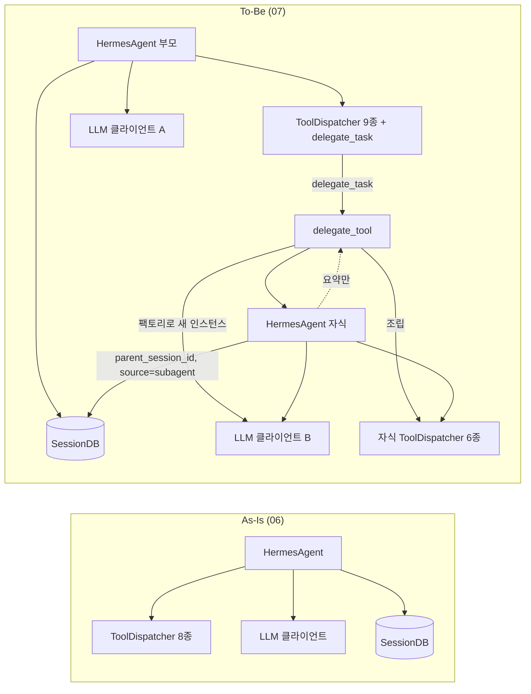
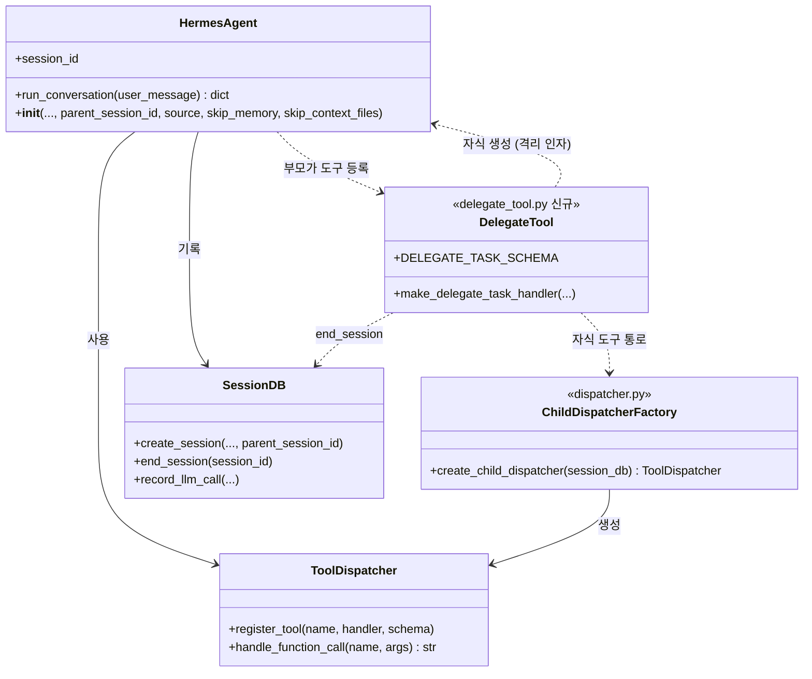
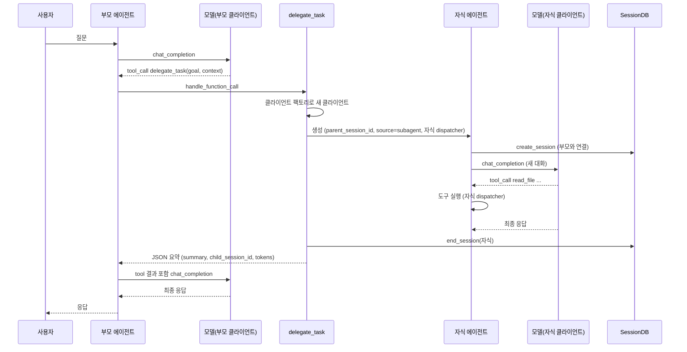
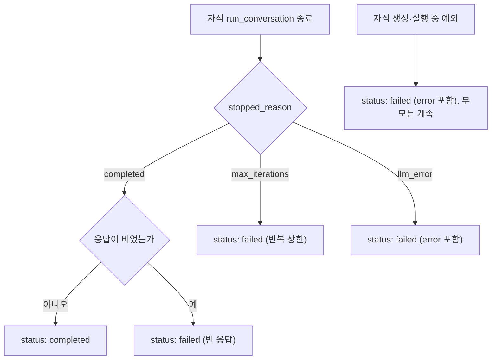

# [마스터 설계도] 07-서브에이전트 MVP

> **상태**: `Draft`  
> **대시보드**: [README.md](README.md)  
> **의도(Why)**: [WHY.md](WHY.md) · **승인된 계획**: [PLAN.md](PLAN.md) · **근거 결정**: [ADR-0007](../../adr/0007-서브에이전트_MVP_범위와_격리_방식.md) (바탕: [ADR-0005](../../adr/0005-컨텍스트_압축_MVP_범위와_세션_연결_방식.md))  
> **기준 코드**: 커밋 `2f43932` (로드맵 06 마감 이후, 태그 `roadmap-06-closed` 포함) · **원본 기준**: 커밋 `6134939882`의 `tools/delegate_tool.py`
>
> **표기**: 아래 그림의 `[신규]`·`[변경]` 이름 중 코드에 아직 없는 것은 **지시서에서 확정할 이름**이다. 구현 때 달라지면 이 문서를 정정한다 (ROADMAP_정책 §3-3).

---

## 1. 배경 및 목적 (Why)

원본 Hermes의 **서브에이전트 위임**이 우리 코어에 없다. 이 로드맵의 목적은 **(1) 부모가 `delegate_task`로 일을 넘기면 자식이 부모와 분리된 새 대화에서 도구를 써서 일을 하고, (2) 자식은 위임·기억·과거 검색 도구를 구조적으로 갖지 못하며, (3) 자식의 호출 기록과 세션은 부모와 분리되어 `parent_session_id`로만 이어지고, (4) 부모에게는 길이 상한이 있는 요약만 돌아오게 하는 것**이다. 왜 이 정도까지만 하는지는 [WHY.md](WHY.md)에 있다.

---

## 2. As-Is vs To-Be 아키텍처

### 2-1. 폴더 구조 (신규·변경)

```text
src/hermes_core/
  constants.py                      [변경] DELEGATE_* 상수, SUBAGENT_SOURCE            (010)
  agent/
    agent.py                        [변경] 자식용 인자, 위임 도구 등록, 안내문 연동    (020, 030, 040)
    prompt_builder.py               [변경] SUBAGENT_GUIDANCE, 자식 포커스 프롬프트     (040)
  tools/
    dispatcher.py                   [변경] create_child_dispatcher                    (010)
    delegate_tool.py                [신규] delegate_task 도구, 스키마, 결과 직렬화     (030)
tests/test_hermes_core/
  test_child_dispatcher.py          [신규]                                           (010)
  test_agent_child_args.py          [신규]                                           (020)
  test_delegate_tool.py             [신규]                                           (030)
  test_subagent_guidance.py         [신규]                                           (040)
  test_agent_e2e.py                 [변경] 위임 E2E 시나리오 추가 (기존 삭제 0줄)    (050)
docs/작동원리/01-헤르메스코어-작동원리.md  [변경] 위임 영구 사실 동기화                (050)
```

`session_db.py`, `llm_client.py`, `path_guard.py`, `file_tools.py`, 압축 모듈은 **무변경**이 목표다(가정 H). 단, 자식 클라이언트 복제를 위해 `OpenRouterClient`에 복제 수단이 필요하면 030에서 판단해 그 시점에 이 표를 정정한다(**미확인**).

### 2-2. 구성요소 흐름 (As-Is → To-Be)



자식 dispatcher의 6종은 `terminal`, `read_file`, `write_file`, `patch`, `skills_list`, `skill_view`다. 제외는 `delegate_task`, `memory`, `session_search`.

### 2-3. 클래스·모듈 관계



### 2-4. 실행 순서 (대표 시나리오: 한 번의 위임)



### 2-5. 분기 (선택): 자식 종료 이유 → 결과 상태



---

## 3. 파급 범위와 무영향 근거 (Blast Radius)

| 대상 | 영향 | 근거 |
|---|---|---|
| `HermesAgent` 생성자 | 인자 4개 추가(모두 기본값) | 기존 호출부는 바뀌지 않는다. 가정 C를 020 시험으로 확인한다. |
| `ToolDispatcher` 클래스 | 무변경 | 자식 통로는 조립 함수가 새 인스턴스를 만들 뿐이다. |
| `create_default_dispatcher` | 무변경 목표 | 부모의 위임 도구는 에이전트 생성 시 `register_tool`로 추가한다(030에서 확정). 기존 도구 목록 시험은 06에서 8종을 단언한다 → 9종 변경이 불가피하면 030에서 해당 시험의 의도를 확인하고 사용자에게 보고한다. |
| `SessionDB` 스키마 | 무변경 | `parent_session_id`와 `source`는 기존 컬럼이다. |
| 압축 | 무영향 | 위임 결과는 일반 tool 메시지다. 05의 가지치기 대상이 된다(050에서 확인). |
| 시스템 프롬프트 | 안내문 한 덩어리 추가(040) | 06의 `SKILLS_GUIDANCE`와 같은 방식. 세션 중 불변. |
| 실제 클라이언트 | 복제 수단 필요 시 한정 변경(**미확인**) | 030에서 코드로 확인. |
| `path_guard`, 파일 도구, 터미널 | 무변경 | 자식도 같은 가드를 통과한다. |

---

## 4. 사전 점검 및 실패 위험 분석 (Pre-Mortem)

「이 로드맵이 실패한다면 무엇 때문일까」를 에이전트 3대 위험과 대조했다.

| # | 위험 | 분류 | 방어 |
|---|---|---|---|
| 1 | 자식 호출이 부모 원장에 섞임 | 상태 오염 | 자식마다 새 클라이언트(D-04). 010~030 시험에서 부모·자식 `llm_calls` 건수 분리 |
| 2 | 재귀·무한 위임 | 루프 폭주 | 자식 통로에 `delegate_task`가 없음. 스키마 목록과 실제 호출 거부 둘 다 시험 |
| 3 | 자식이 기억·과거 이력을 건드림 | 격리 누수 | `memory`·`session_search` 제외, 시스템 프롬프트에 부모 메모리 비주입, `source="subagent"` |
| 4 | 자식 요약이 부모 문맥을 폭주시킴 | 컨텍스트 오버플로우 | 요약 길이 상한 + `truncated` |
| 5 | 자식의 쓰기가 작업 폴더·보호 파일을 망침 | 샌드박스 오염 | 자식도 같은 `path_guard`·쓰기 금지 정책. `.env`·`.git`·지시문 파일 차단을 자식 경로에서 재시험 |
| 6 | 자식 도구 인자 스키마 불일치·파싱 실패 | 비정형 출력 | 기존 `ToolDispatcher` 인자 검증·`_parse_tool_arguments` 복구가 자식에도 동일 적용 |
| 7 | 자식이 예외로 부모를 죽임 | 안정성 | 생성·실행 예외를 결과 `status: failed`로 변환 |
| 8 | 위임이 비용을 곱함 | 비용 | 자식 반복 상한 25, 부모 반복 상한 50. 060에서 호출 수 관찰 |
| 9 | 자식 세션이 닫히지 않고 남음 | 정합성 | 성공·실패 모두 `end_session`(finally) |
| 10 | 클라이언트 복제 방법이 없음 | 설계 불확실 | 030 지시서 작성 때 코드로 확정, 안 되면 계획 변경으로 보고 |

---

## 5. 4층위 검증 범위 설계 (Validation Grid)

| 층위 | 내용 | 단계 |
|---|---|---|
| 1 수동 반복 배제 | 모든 검증은 가짜 통신(`SequentialMockTransport`, `MockLLMClient`)으로 자동화. 실제 키는 060 한 번 | 전체 |
| 2 단위·구조 | 자식 도구 집합, 위임 스키마, 결과 직렬화, 인자 검증, 상한 절삭 | 010, 030 |
| 3 상태·정합성 | `parent_session_id` 체인, `source`, 세션 종료, 원장 분리, 부모 대화 비오염, 기존 호출부 불변 | 020, 030, 050 |
| 4 통합 E2E | 위임 전체 순환, 재귀·`memory` 차단, 압축 시 위임 결과 가지치기, Zero Leakage | 050, 060 |

각 구현지시서의 인수 시나리오는 구현 전에 적고 구현 중 임의로 바꾸지 않는다.

---

## 6. 설계 결정 상세

### 6-1. 자식 도구 통로 (010)
`create_child_dispatcher`가 새 `ToolDispatcher`를 만들어 6종을 등록한다. 제외 목록은 상수 `DELEGATE_BLOCKED_TOOLS = {"delegate_task", "memory", "session_search"}`로 두어 시험이 이 상수와 실제 등록 결과를 대조하게 한다. 자식의 `skills_*`는 읽기 전용이라 허용한다.

### 6-2. 에이전트 자식용 인자 (020)
`parent_session_id`와 `source`는 `create_session`에 전달한다. `skip_memory`가 참이면 메모리 블록을 시스템 프롬프트에 넣지 않고 `memory_store`를 읽지 않는다. `skip_context_files`가 참이면 지시문 파일 블록을 넣지 않는다. 기본값은 모두 현재 동작과 같다.

### 6-3. 위임 도구 (030)
핸들러는 `goal`, `context`를 받아 ① 입력 검증 ② 클라이언트 팩토리로 새 클라이언트 ③ 자식 생성 ④ `run_conversation(goal)` ⑤ `end_session` ⑥ 결과 JSON을 만든다. 스키마 설명에 「자식은 당신의 대화를 모른다. 필요한 정보를 goal·context에 모두 담아라」를 쓴다. 부모 세션 id·세션 DB 연결 방식(클로저로 `self` 참조 vs 인자)은 030 지시서에서 코드로 확정한다.

### 6-4. 안내문과 자식 프롬프트 (040)
`SUBAGENT_GUIDANCE`는 영어 간결 안내문(600자 이하)으로, 위임이 맞는 경우(탐색·반복 수정)와 `goal`·`context`를 자족적으로 쓰라는 지시를 담는다. 자식 프롬프트는 「집중된 하위 작업자」임을 알리고 `context`를 배경으로 넣고 요약 형식을 안내한다. `goal`은 시스템 프롬프트가 아니라 첫 사용자 메시지다(ADR-0007 §2-2).

### 6-5. 값 (에이전트가 정한 안)
`DELEGATE_CHILD_MAX_ITERATIONS = 25`(기준 커밋과 동일), `DELEGATE_SUMMARY_MAX_CHARS = 8,000`(후보. 일반 요약 규모 대비 보수적인 값이며 060 관찰로 가정 F를 판정), `SUBAGENT_SOURCE = "subagent"`. 해당 단계 착수 시 승인으로 갈음한다.

### 6-6. 원본과 다른 점 (의도적)
| 항목 | 원본 기준 커밋 | 07 |
|---|---|---|
| 자식 수 | 최대 3(병렬 배치) | 1, 순차 |
| 깊이 | 2(규칙으로 거부) | 1(자식 통로에 도구가 없음 — 구조) |
| 제외 도구 | delegate_task, clarify, memory, send_message, execute_code | delegate_task, memory, **session_search**(+우리에 없는 도구는 해당 없음) |
| 자식 세션 | 부모 세션 DB 공유, 부모 연결 없음 | `parent_session_id`, `source="subagent"`로 연결 |
| 원장 | 기준 코드에서 분리 여부 확인 안 됨(**미확인**) | 자식 클라이언트로 분리 |
| 실패 판정 | 완료 + 비어 있지 않은 응답이면 completed | 동일 + `stopped_reason` 포함 |
| 요약 길이 | 상한 없음 | 상한 + `truncated` |
| goal 위치 | 시스템 프롬프트와 사용자 메시지 둘 다 | 첫 사용자 메시지 한 곳 |

---

## 7. 문서 동기화 방식

- 단계 완료 때 해당 단계의 대시보드 행, `docs/인계.md`를 같은 커밋에서 갱신한다 (ROADMAP_정책 §4).
- 050에서 작동원리 01편에 영구 사실(위임 도구, 격리 네 겹, 재귀 차단 구조, 원장 분리)을 사실 검증 4축으로 반영하고 기준 커밋을 갱신한다.
- 코드가 이 문서의 그림과 어긋나면 이 문서를 정정한다.

---

## 8. 이 로드맵이 다루지 않는 것 (Non-Goals)

병렬 배치, 중첩 위임, 역할, 백그라운드 실행, steer/stop/list, 중단 전파, 타임아웃·하트비트, `output_schema`, 이미지, 작업 폴더 분리(worktree), 자식 모델 별도 지정, 자식 비용 합산, 토큰의 부모 합계 합산, 위임 평가·벤치마크. 이유와 이월 조건은 [WHY.md](WHY.md) §2.
