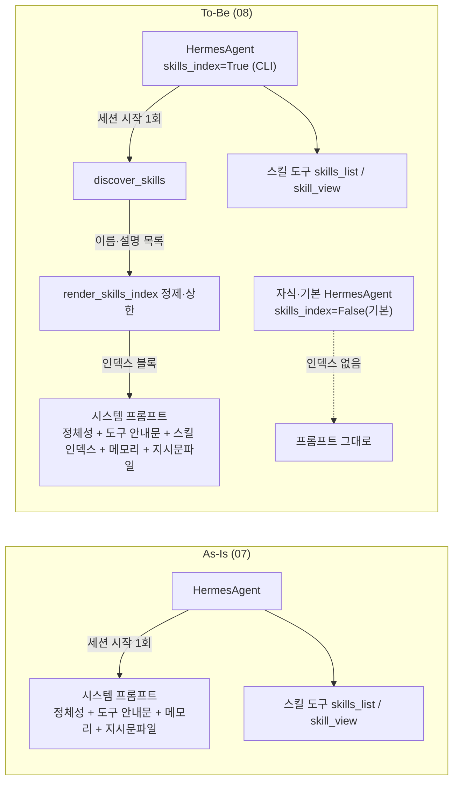
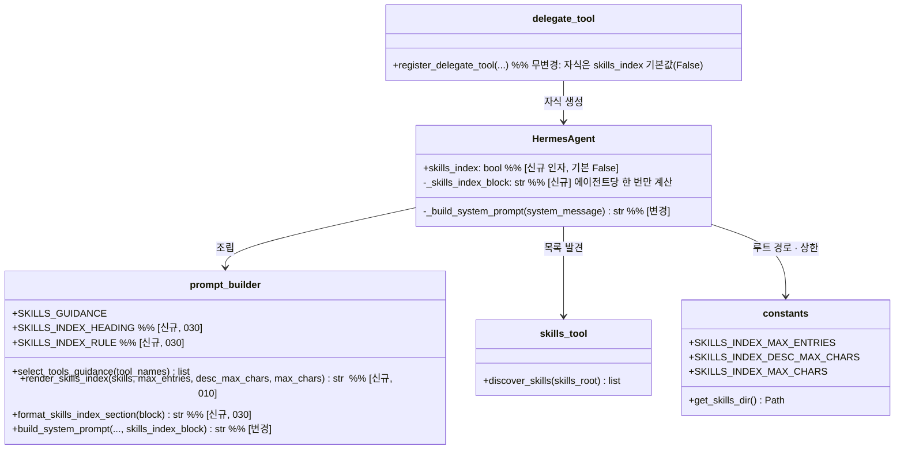
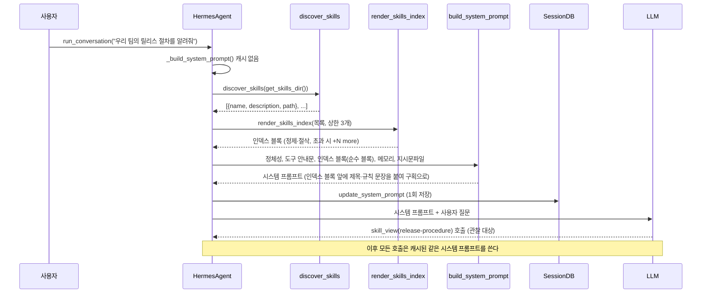
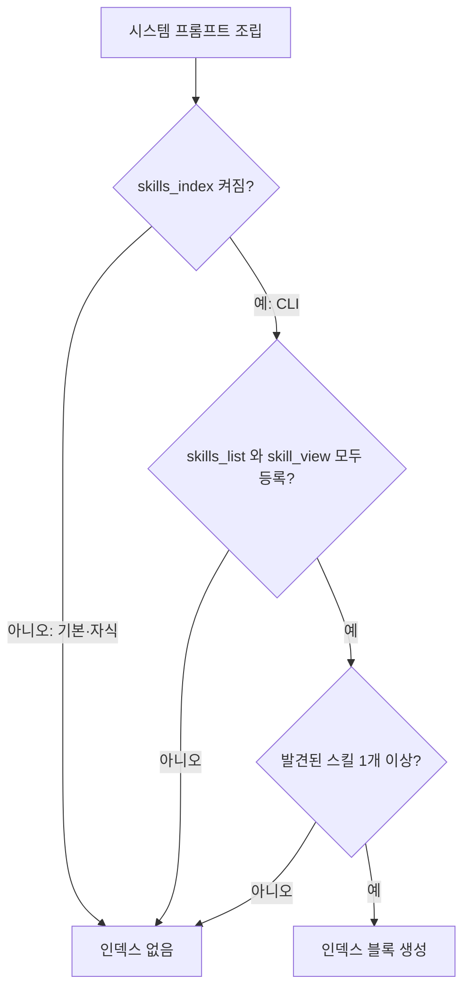

# [마스터 설계도] 08-스킬 인덱스 주입 MVP

> **상태**: `Draft`  
> **대시보드**: [README.md](README.md)  
> **의도(Why)**: [WHY.md](WHY.md) · **승인된 계획**: [PLAN.md](PLAN.md) · **근거 결정**: [ADR-0008](../../adr/0008-스킬_인덱스_주입_범위와_신뢰_경계.md) (바탕: [ADR-0006](../../adr/0006-스킬_시스템_MVP_범위와_로딩_방식.md), [ADR-0007](../../adr/0007-서브에이전트_MVP_범위와_격리_방식.md))  
> **기준 코드**: 커밋 `16e44ce` (로드맵 07 마감 이후, 태그 `roadmap-07-closed` 포함) · **원본 참고**: 현행 HEAD `f974134f36`의 `agent/prompt_builder.py` `build_skills_system_prompt` (기준 시점 `6134939882`에는 없음)
>
> **표기**: 아래 그림의 `[신규]`·`[변경]` 이름 중 코드에 아직 없는 것은 **지시서에서 확정할 이름**이다. 구현 때 달라지면 이 문서를 정정한다 (ROADMAP_정책 §3-3).

---

## 1. 배경 및 목적 (Why)

스킬(절차 기억)은 도구(`skills_list`·`skill_view`)로만 꺼내 읽고, 시스템 지시문에는 사용 안내문만 있다. 실제 모델 관찰에서 한 모델(deepseek)은 스킬을 부르지 않았고 다른 모델(Gemini Flash)은 불렀다. 이 로드맵의 목적은 **(1) 세션 시작 시 스킬의 이름과 한 줄 설명을 시스템 지시문에 한 번 넣어 모델이 스킬의 존재를 첫 호출부터 알게 하고, (2) 그 글이 세션 내내 바뀌지 않아 캐시·압축의 헤드 불변을 지키며, (3) 스킬 설명이라는 사용자 파일의 글이 지시문 구조를 깨지 못하게 정제·상한으로 가두고, (4) 자식과 스킬 도구 없는 구성에는 영향이 없게 하는 것**이다. 왜 이 정도까지만 하는지는 [WHY.md](WHY.md).

---

## 2. As-Is vs To-Be 아키텍처

### 2-1. 폴더 구조 (신규·변경)

```text
src/hermes_core/
  constants.py                      [변경] SKILLS_INDEX_* 상수 3개                        (010)
  agent/
    prompt_builder.py               [변경] render_skills_index(010), build_system_prompt 인자(020),
                                           SKILLS_INDEX_HEADING/RULE, format_skills_index_section (030)
    agent.py                        [변경] skills_index 인자(기본 False), 인덱스 조립·주입  (020)
  cli.py                            [변경] --no-skills-index 플래그, 기본으로 skills_index 켜기 (025)
tests/test_hermes_core/
  test_skills_index.py              [신규] 렌더링·정제·상한                               (010)
  test_agent_skills_index.py        [신규] 연동·고정·꺼짐 기본값·바이트 동일             (020)
  test_cli_skills_index.py          [신규] CLI 플래그·두 모드·위임 자식 제외              (025)
  test_skills_index_section.py      [신규] 제목·규칙 문장·구획 위조 방어                  (030)
  test_skills_guidance.py           [무변경] 기존 600자·목록 미포함 시험 그대로 통과
  test_agent_e2e.py                 [변경] 인덱스 E2E 시나리오 추가 (기존 삭제 0줄)       (040)
docs/작동원리/01-헤르메스코어-작동원리.md  [변경] 인덱스 영구 사실 동기화                   (040)
```

`tools/skills_tool.py`, `tools/delegate_tool.py`, `dispatcher.py`, `session_db.py`, `llm_client.py`, `path_guard.py`, 압축 모듈은 **무변경**이 목표다(가정 H). 스킬 발견은 기존 `discover_skills`를 그대로 쓴다.

### 2-2. 구성요소 흐름 (As-Is → To-Be)



인덱스를 켜지 않았거나(라이브러리 기본값. 앱은 025에서 켠다), 스킬 도구가 등록되지 않았거나(`skills_list`·`skill_view` 둘 중 하나라도 없음), 스킬이 하나도 없으면 인덱스 블록은 만들지 않고, 지시문은 To-Be에서도 As-Is와 바이트 단위로 같다.

### 2-3. 클래스·모듈 관계



`render_skills_index`는 **순수 함수**다(디스크·시계·환경에 접근하지 않음). 디스크 접근(`discover_skills`)은 에이전트의 조립부에서만 한다. `prompt_builder.py`가 `tools/`를 import하지 않으므로 의존 방향이 바뀌지 않는다.

### 2-4. 실행 순서 (대표 시나리오: 스킬이 있는 세션의 첫 턴)



### 2-5. 분기 (선택): 인덱스 블록을 만들지 말지



---

## 3. 파급 범위와 무영향 근거 (Blast Radius)

| 대상 | 영향 | 근거 |
|---|---|---|
| `HermesAgent` 생성자 | 키워드 인자 1개 추가(`skills_index`, 기본 `False`) | 기본이 꺼짐이라 기존 호출부·기존 시험(스킬 이름이 프롬프트에 없다고 단언하는 `test_scenario_05_skills_list_not_injected_into_prompt` 포함)은 한 글자도 바뀌지 않는다. 가정 H를 020 시험으로 확인한다. |
| `build_system_prompt` | 선택 인자 1개 추가(`skills_index_block`, 기본 없음) | 인자를 주지 않으면 출력이 이전과 바이트 단위로 같다(가정 C). |
| `_build_system_prompt` | 인덱스 조립 한 곳 추가 | 세션당 1회 조립·캐시·DB 저장 구조는 그대로다. 인덱스가 캐시 안에 들어가므로 세션 중 불변(가정 B). |
| `SKILLS_GUIDANCE`와 기존 시험 | 무변경 | 인덱스는 **별도 블록**이다. 600자 이하·목록 미포함 시험이 그대로 통과한다. |
| 자식 에이전트 | 무변경 | 자식은 `skills_index` 기본값(False)이라 프롬프트에 인덱스가 없다(가정 F). `delegate_tool.py`는 바뀌지 않는다. 자식의 스킬 도구는 그대로다. |
| `cli.py` | 모의·실제 두 모드 모두 기본으로 `skills_index=True`, `--no-skills-index`로 끔(025) | 앱이 켜는 방식(07 `--delegate`와 달리 기본 켜짐). 스킬 폴더가 없거나 비면 프롬프트는 이전과 같아(020) 기존 시험·스킬을 안 쓰는 사용자에게 영향이 없다. |
| 스킬 도구·디스패처 | 무변경 | `discover_skills`를 읽기만 한다. 스킬 폴더를 만들지 않는다. |
| 압축 | 무영향 | 시스템 프롬프트는 압축 대상이 아니다(ADR-0005). 인덱스가 헤드에 있어도 압축 전후 헤드가 같다(가정 B, 040에서 확인). |
| 스키마·DB | 무변경 | `sessions.system_prompt`에 조립된 문자열이 들어갈 뿐이다. |

---

## 4. 사전 점검 및 실패 위험 분석 (Pre-Mortem)

「이 로드맵이 실패한다면 무엇 때문일까」를 에이전트 3대 위험과 대조했다.

| # | 위험 | 분류 | 방어 |
|---|---|---|---|
| 1 | 설명 텍스트의 줄바꿈·`</available_skills>` 위조로 지시문 구조가 깨짐 | 비정형 입력 / 지시문 오염 | 줄바꿈·제어문자를 공백으로 접고 `<`·`>` 제거 (010 시험: 위조 입력 → 한 줄, 닫는 태그 하나) |
| 2 | 설명 속 자연어 지시(「이전 지시를 무시하라」) | 지시문 오염 | **막지 못한다.** 신뢰 전제(사용자 본인의 폴더)와 한계를 ADR-0008·WHY에 명시. 외부 출처 스킬은 범위 밖 |
| 3 | 스킬이 수백 개여서 지시문이 부풀음 | 컨텍스트 오버플로우 | 항목 수·줄 길이·전체 길이 3중 상한 + `(+N more)` 안내 |
| 4 | 세션 중 스킬 폴더가 바뀌어 지시문이 달라짐 | 캐시·정합성 | 세션 시작 1회 조립, 캐시 안에 고정. 두 번째 호출의 첫 system 메시지 동일 시험 |
| 5 | 스킬이 없는데 빈 블록이나 제목만 남음 | 회귀 | 발견 0개면 블록 자체를 만들지 않음. 바이트 동일 시험 |
| 6 | 스킬 폴더를 조회하다 폴더를 만들거나 쓰기 발생 | 샌드박스 오염 | `discover_skills`는 읽기 전용(06 시험). 인덱스 시험에서 폴더 미생성 재확인 |
| 7 | 자식 프롬프트에 인덱스가 섞임 | 격리 누수 | `skills_index` 기본 꺼짐(자식은 켜지 않음), 자식 시험 |
| 8 | 인덱스를 넣어도 모델이 스킬을 부르지 않음 | 효과 불확실 | 구조 시험과 별개로 050 스모크에서 관찰. 실패해도 구조를 되돌리지 않고 기록 후 멈춤(가정 A) |
| 9 | 규칙 문장이 너무 강해 불필요한 로딩이 늘어남 | 비용 | 약한 문장으로 시작(ADR-0008 §2-6), 050에서 호출 수 관찰 |
| 10 | 스킬 이름·설명에 비ASCII(한글) 포함 시 글자 수 계산 오류 | 안정성 | 파이썬 문자열 길이(코드포인트) 기준, 시험에 한글 포함 |

---

## 5. 4층위 검증 범위 설계 (Validation Grid)

| 층위 | 내용 | 단계 |
|---|---|---|
| 1 수동 반복 배제 | 모든 검증은 가짜 통신으로 자동화. 실제 키는 050 한 번 | 전체 |
| 2 단위·구조 | 렌더링 순수 함수: 정렬, 정제, 절삭, 상한 초과 문구, 빈 입력, 한글 | 010 |
| 3 상태·정합성 | 세션 1회 고정, DB 저장 값 일치, 바이트 동일(스킬 없음/도구 없음), 자식 제외, 폴더 미생성, 기존 시험 불변 | 020, 030 |
| 4 통합 E2E | 목록이 실린 시스템 프롬프트로 도구 순환, 압축 후 헤드 불변, Zero Leakage, 실제 모델 관찰 | 040, 050 |

각 구현지시서의 인수 시나리오는 구현 전에 적고 구현 중 임의로 바꾸지 않는다.

---

## 6. 설계 결정 상세

### 6-1. 렌더링 순수 함수 (010)
`render_skills_index(skills, max_entries, desc_max_chars, max_chars)`는 `discover_skills`가 준 사전 목록을 받아 문자열을 돌려준다. 입력 순서를 유지하고(정렬은 `discover_skills`가 이미 결정적으로 한다), 설명이 없으면 이름만 쓴다. 정제 규칙(ADR-0008 §2-4)을 이 함수 하나에 모아 다른 곳에 흩뿌리지 않는다. 상한 판정은 실을 개수 `k`를 `min(유효 항목 수, 항목 수 상한)`부터 1까지 내려오며 `len(블록) <= 전체 길이 상한`인 첫 후보를 고른다(초과 안내 줄이 붙은 후보가 줄이 사라지는 마지막 후보보다 길 수 있어 앞에서부터 채우다 멈추면 전부 들어가는데도 잘린다). 입력이 비거나 하나도 들어맞지 않으면 빈 문자열을 돌려주며 호출부가 블록을 만들지 않는다. 사전이 아니거나 이름이 비는 항목은 건너뛴다.

### 6-2. 에이전트 연동 (020)
조립부는 ① `skills_index`가 켜져 있고 ② 등록된 도구에 `skills_list`·`skill_view`가 모두 있으며(`select_tools_guidance`와 같은 규칙) ③ `discover_skills(get_skills_dir())` 결과로 `render_skills_index`가 빈 문자열이 아닐 때만 인덱스를 `build_system_prompt`의 새 선택 인자로 넘긴다. 블록은 도구 안내문 바로 뒤, 호출자 지시 앞에 놓는다(배치는 020에서 확정). 계산은 **에이전트당 한 번**이다: 첫 조립 때 얻은 블록을 `_skills_index_block`에 보관해, `system_message`를 넘겨 다시 조립해도 같은 블록을 쓴다(세션 중 고정, D-02). 에이전트는 `_build_system_prompt`를 첫 `run_conversation`에서 부르므로 「세션 시작」은 첫 턴 시작이다. 기본이 꺼짐이라 켜지 않은 구성은 이전과 바이트 동일하다. 앱에서 켜는 연결은 025다.

### 6-3. 제목과 규칙 문장 (030)
배치는 020에서 이미 정했다(도구 안내문 바로 뒤, 호출자 지시 앞). 030은 `build_system_prompt` 안에서 인덱스 블록 앞에 제목 `## Available Skills`와 규칙 문장 한 문단(258자)을 붙여 하나의 구획으로 만든다. 에이전트는 계속 순수한 블록만 넘긴다(`agent.py` 무변경). 규칙 문장은 「답하기 전에 아래 스킬을 훑고, 관련 있으면 `skill_view(name)`으로 읽어 따르고, 없으면 읽지 말고 진행하라. 이 목록은 세션 시작 때 찍은 것이고 현재 목록은 `skills_list`로 본다」이다. 「반드시(MUST)」는 쓰지 않는다. 기존 `SKILLS_GUIDANCE`는 바꾸지 않으므로 인덱스가 있으면 두 안내가 겹친다(알려진 트레이드오프). 문장이 모델의 행동을 바꾸는지는 050에서 관찰한다.

### 6-4. 값 (에이전트가 정한 안)
`SKILLS_INDEX_MAX_ENTRIES = 50`, `SKILLS_INDEX_DESC_MAX_CHARS = 120`, `SKILLS_INDEX_MAX_CHARS = 4,000`. 근거: 줄 하나는 이름(최대 64자)과 설명(최대 120자)을 합쳐 길어야 190자 안팎이다. 평균 80자 안팎이면 50개가 4,000자에 들어오고, 줄이 길면 항목 수보다 전체 길이 상한이 먼저 걸린다. 어느 쪽이든 잘리면 `(+N more)` 줄이 붙는다. 이 값이 실제 사용에서 충분한지는 **미확인**이며 050 스모크와 사용 경험으로 조정한다. 해당 단계 착수 시 승인으로 갈음한다.

### 6-5. 원본과 다른 점 (의도적)
| 항목 | 원본 현행 HEAD | 08 |
|---|---|---|
| 형식 | `<available_skills>` 안에 카테고리별 묶음, 카테고리 설명 | 평평한 한 줄 목록(카테고리 없음) |
| 규칙 문장 | 「반드시(MUST) 읽어라. 과하게 읽는 편이 낫다」 | 「훑고 관련 있으면 읽어라」 약한 규칙 |
| 갱신 | 스냅샷 파일·디스크 변경 감지 | 세션 시작 1회, 이후 고정 |
| 경로 | 다중 디렉터리 우선순위 | 단일 스킬 루트 |
| 정제 | 확인하지 못함(**미확인**) | 줄바꿈·제어문자·`<>` 제거, 3중 길이 상한 |
| 자식 | 확인하지 못함(**미확인**) | 자식에는 인덱스 없음 |

---

## 7. 문서 동기화 방식

- 단계 완료 때 해당 단계의 대시보드 행, `docs/인계.md`를 같은 커밋에서 갱신한다 (ROADMAP_정책 §4).
- 040에서 작동원리 01편의 스킬 절(Q11, 3부 10번 방어선, 1부 표, 정본 색인)에 인덱스 영구 사실을 사실 검증 4축으로 반영하고 기준 커밋을 갱신한다. 06 당시의 「시스템 프롬프트에 스킬 목록을 넣지 않는다」 서술은 ADR-0008이 대체한 부분에 맞춰 정정한다.
- 코드가 이 문서의 그림과 어긋나면 이 문서를 정정한다.

---

## 8. 이 로드맵이 다루지 않는 것 (Non-Goals)

위임 안내문·동작 변경(관찰만), 스킬 본문 주입, 질문-스킬 자동 매칭, 세션 중 목록 갱신, 스킬 생성·수정·삭제, 외부 출처 스킬(hub, 동기화), 카테고리 축약, 슬래시 커맨드, 다른 제공자·모델의 폭넓은 비교. 이유와 이월 조건은 [WHY.md](WHY.md) §2.
