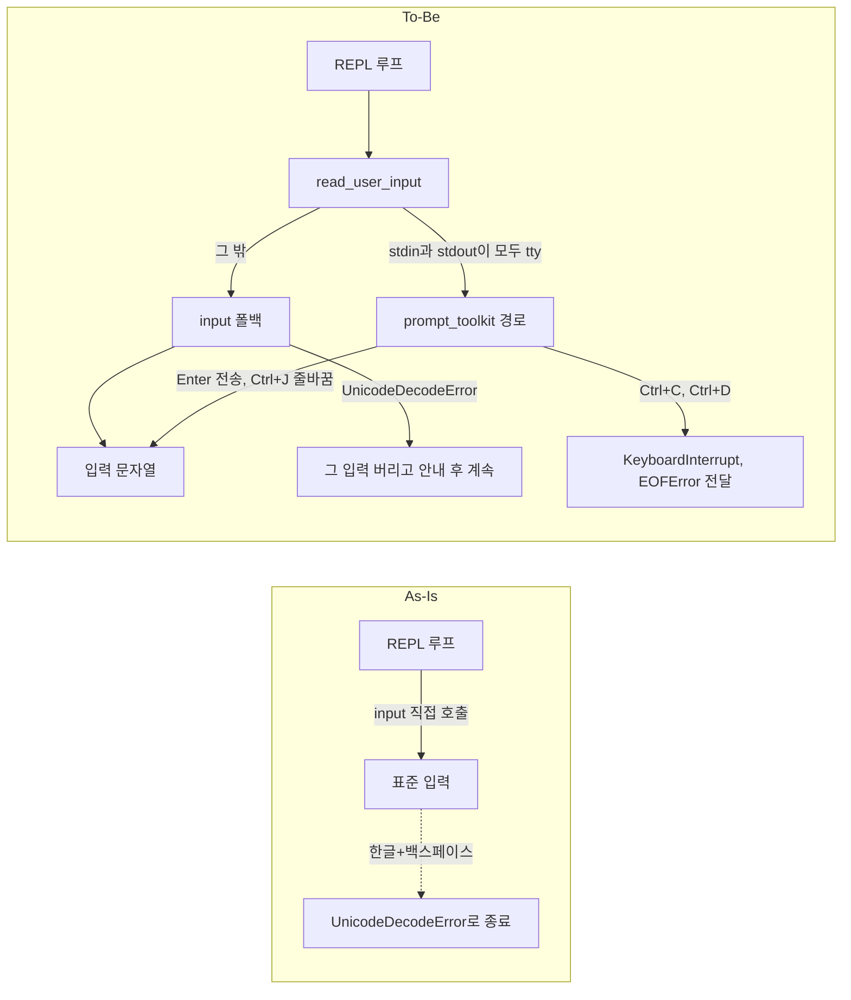

# [마스터 설계도] 09-CLI 입력 안정화

> **상태**: `Draft`  
> **대시보드**: [README.md](README.md)  
> **의도(Why)**: [WHY.md](WHY.md) · **승인된 계획**: [PLAN.md](PLAN.md) · **근거 결정**: [ADR-0009](../../adr/0009-CLI_입력_안정화_범위와_prompt_toolkit_도입.md)  
> **기준 코드**: 커밋 `f41fd94` (로드맵 08 마감 이후, 태그 `roadmap-08-closed` 포함) · **원본 참고**: `hermes-agent/hermes_cli/cli_terminal_input.py`의 키 바인딩(416~476행)까지만 읽음. 나머지는 미확인
>
> **표기**: 아래 그림의 `[신규]`·`[변경]` 이름 중 코드에 아직 없는 것은 **지시서에서 확정할 이름**이다. 구현 때 달라지면 이 문서를 정정한다 (ROADMAP_정책 §3-3).

---

## 1. 배경 및 목적 (Why)

대화형 CLI는 `input("\nUser > ")` 한 줄로 사용자 입력을 받는다. 이 방식은 (1) 터미널 설정에 따라 한글을 쓰다 지우면 `UnicodeDecodeError`로 프로그램이 꺼지고(pty 실험으로 재현), (2) 여러 줄 입력을 받을 수단이 없으며, (3) 사용자가 본 `User >` 사라짐은 원인을 모른다. 05·07·08번 보고서가 같은 문제를 후속 과제로 올렸다. 이 로드맵은 입력을 읽는 일을 한 함수로 모으고, 진짜 터미널에서는 `prompt_toolkit`으로, 그 밖에서는 기존 `input()`으로 읽으며, 디코드 예외로 꺼지지 않게 한다. 출력은 건드리지 않는다. (왜 이 정도까지만인지는 [WHY.md](WHY.md))

---

## 2. As-Is vs To-Be 아키텍처

### 2-1. 폴더 구조 (신규·변경)

```text
src/hermes_core/
  cli.py                 # [변경] REPL이 input() 대신 read_user_input을 부른다
  cli_input.py           # [신규] read_user_input, 터미널 판정, prompt_toolkit 경로, input() 폴백, 디코드 예외 처리
pyproject.toml           # [변경] prompt_toolkit>=3.0.52,<4 추가
tests/test_hermes_core/
  test_cli_input.py      # [신규] 폴백·예외·터미널 판정·키 동작 (prompt_toolkit 파이프 입력)
  test_cli_input_pty.py  # [신규] 가상 터미널(pty) 시험: IUTF8 끈 터미널의 한글+백스페이스
  test_cli.py            # [무변경] 기존 시험 그대로 통과해야 함
```

모듈 이름 `cli_input.py`는 후보다. 010 지시서에서 코드와 대조해 확정한다.

### 2-2. 구성요소 흐름 (As-Is → To-Be)



### 2-3. 실행 순서 (대표 시나리오: 한글을 치다 지운 뒤 전송)

1. REPL 루프가 `read_user_input`을 부른다. 앞의 빈 줄은 프롬프트 밖의 별도 출력으로 먼저 낸다.
2. 터미널 판정(stdin과 stdout이 모두 tty)이 참이면 `prompt_toolkit` 경로로 읽는다.
3. 사용자가 한글을 쓰고 백스페이스로 지운 뒤 Enter를 누르면 한 문자열이 돌아온다.
4. 돌아온 문자열은 기존과 같이 `strip` 후 빈 입력 건너뛰기·`exit`/`quit` 판정·`run_conversation`으로 이어진다. 이 이후는 바뀌지 않는다.

### 2-4. 분기: 어느 경로로 읽을 것인가

| 조건 | 경로 | 이유 |
|---|---|---|
| stdin과 stdout이 모두 tty | `prompt_toolkit` | 한글 폭 처리, 여러 줄, 붙여넣기 |
| 그 밖 (가짜 입력 `io.StringIO`, 파이프, 출력 리다이렉션) | `input()` 폴백 | 기존 시험 무수정, 파이프 사용에서 동작 불변 |

---

## 3. 파급 범위와 무영향 근거 (Blast Radius)

| 대상 | 영향 | 근거 |
|---|---|---|
| `cli.py` REPL 루프 | `input` 호출 한 곳이 `read_user_input` 호출로 바뀜, 프롬프트 앞 `\n` 분리 | 이후 흐름(`strip`, 빈 입력, `exit`/`quit`, `run_conversation`, 오류 출력)은 그대로 |
| `HermesAgent`·도구·DB·압축·위임 | 무변경 | 입력 문자열 하나가 같은 형태로 전달될 뿐이다(가정 G, 040에서 `src/` diff로 확인) |
| 기존 CLI 시험 | 무수정 통과 | 시험은 `sys.stdin`을 `io.StringIO`로 바꾸는데 이는 tty가 아니므로 폴백 경로를 탄다(가정 C) |
| 단발 실행 분기 (`--mock`이고 stdin이 tty가 아닐 때 1턴 후 종료) | 무변경 | REPL 진입 전에 처리됨 |
| 의존성 | `prompt_toolkit`(및 `wcwidth`) 추가 | 설치 파일 메타데이터상 Python ≥3.10, 우리 `requires-python`과 같다 |
| 출력 | 무변경 | 사용자가 입력만 하기로 정함(ADR-0009 §2-1). 배너에 줄바꿈 키 안내 한 줄만 추가(030) |

---

## 4. 사전 점검 및 실패 위험 분석 (Pre-Mortem)

| # | 위험 | 분류 | 방어 |
|---|---|---|---|
| 1 | 터미널 경로에서 새 입력 방식이 한글/긴 줄에서도 이상하게 동작 | 신규 부품 | pty 시험(040)과 사용자의 실제 터미널 확인(050). 실패 시 기록하고 멈춤(가정 A) |
| 2 | 시험 환경이 우연히 tty라서 터미널 경로를 타 기존 시험이 흔들림 | 환경 의존 | 판정을 함수로 분리해 시험에서 주입 가능하게 하고, 기존 시험은 `StringIO`로 고정 |
| 3 | 디코드 예외 처리가 같은 입력을 무한히 반복해 읽음 | 무한 루프 | 예외가 난 읽기는 입력을 소비해 다음 읽기가 앞으로 나아감을 시험(입력 끝에서 정상 종료). 파이프·가짜 입력은 같은 덩어리의 정상 줄도 함께 버려짐(실험 확인)을 알려진 한계로 시험에 고정 |
| 4 | 잘못된 바이트 입력이 대화 기록에 섞여 들어감 | 데이터 오염 | 예외 시 기록·DB에 손대지 않는 것을 시험(가정 B) |
| 5 | Ctrl+C·Ctrl+D 의미가 바뀌어 종료 경로가 달라짐 | 회귀 | 두 예외를 그대로 전달하는지 시험(가정 D) |
| 6 | 새 의존성이 설치되지 않은 환경에서 import 오류로 CLI가 못 뜸 | 환경 | 의존성 선언에 추가. 라이브러리 없을 때 폴백 여부는 020 지시서에서 코드와 대조해 결정 (**미확인**, 열린 항목) |
| 7 | 흉내 낸 터미널(pty)과 실제 앱의 차이로 시험이 거짓 안심을 줌 | 검증 한계 | pty 시험은 결함 재현의 회귀 시험으로만 쓰고, 화면 모양은 050 사용자 확인으로 |
| 8 | 프롬프트 앞 `\n` 분리가 출력 순서를 바꿈 | 표시 | 출력 순서 시험(캡처 문자열 대조) |
| 9 | 한글 입력 시험이 인코딩 환경에 따라 달라짐 | 환경 | 입력 바이트를 시험에서 명시(UTF-8) |

---

## 5. 4층위 검증 범위 설계 (Validation Grid)

| 층위 | 내용 | 단계 |
|---|---|---|
| 1 수동 반복 배제 | 모든 검증은 가짜 입력·파이프 입력·pty로 자동화. 사람 확인은 050 한 번 | 전체 |
| 2 단위·구조 | 터미널 판정, 폴백, 디코드 예외 처리, 키 동작 | 010, 020 |
| 3 상태·정합성 | 기존 시험 불변, 기록·DB 불변, 종료 예외 전달 | 010, 020, 030 |
| 4 통합 E2E | pty에서 IUTF8 끈 터미널의 한글+백스페이스, `--mock` REPL 한 바퀴, 사용자 실제 터미널 확인 | 040, 050 |

각 구현지시서의 인수 시나리오는 구현 전에 적고 구현 중 임의로 바꾸지 않는다.

---

## 6. 설계 결정 상세

### 6-1. 입력 함수와 폴백 (010)
`read_user_input(prompt)`는 문자열을 돌려주거나 `EOFError`·`KeyboardInterrupt`를 그대로 올린다. 폴백 경로에서 `UnicodeDecodeError`가 나면 안내 한 줄을 출력하고 다시 읽는다(터미널은 그 줄만, 파이프·가짜 입력은 같은 덩어리가 버려짐).

### 6-2. 터미널 경로 (020)
키 설정: Enter 전송, Ctrl+J 줄바꿈. 붙여넣기는 한 입력으로 처리. 터미널 판정은 stdin과 stdout이 모두 tty인지 보는 함수로 분리한다. 라이브러리의 구체 호출은 지시서에서 코드와 대조해 확정한다.

### 6-3. 앱 연동 (030)
REPL이 `read_user_input`을 쓰고, 배너에 줄바꿈 키 안내 한 줄을 낸다. 모의·실제 모드 동일.

### 6-4. 값 (에이전트가 정한 안)
의존성 `prompt_toolkit>=3.0.52,<4`(원본의 Python 3.14 고정 버전 이상). 안내 문구는 030에서 확정. 해당 단계 착수(「진행해라」) 시 승인으로 갈음한다.

### 6-5. 원본과 다른 점 (의도적)
원본은 에이전트가 일하는 중에도 입력을 받고, 설정으로 키를 바꾸며, 줄 끝 `\` 이어쓰기를 지원한다. 우리는 Enter/Ctrl+J와 폴백, 예외 방어만 한다. 원본의 전체 입력 처리는 읽지 않아 비교가 불완전하다(**미확인**).

---

## 7. 문서 동기화 방식

- 040에서 작동원리 01편에 입력 경로(터미널/폴백)와 예외 처리를 사실로 반영하고 기준 커밋을 갱신한다.
- 각 단계 커밋에서 대시보드 실행 기록과 [인계](../../인계.md)를 함께 갱신한다 (ROADMAP_정책 §4).
- 구현 중 이 문서와 달라진 이름·구조는 정정하고 [WHY.md](WHY.md) 끝 변경 기록에 이유를 남긴다.

---

## 8. 이 로드맵이 다루지 않는 것 (Non-Goals)

출력 표시·스트리밍·색 변경, 입력 히스토리(방향키)·자동 완성·슬래시 명령, Ctrl+Enter 전송, 원본 입력 처리 전체 이식, 일시 오류 재시도와 컨텍스트 초과 복구, 승인 흐름(10번).
