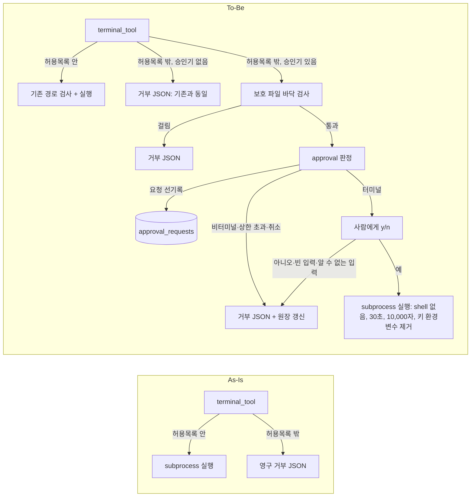
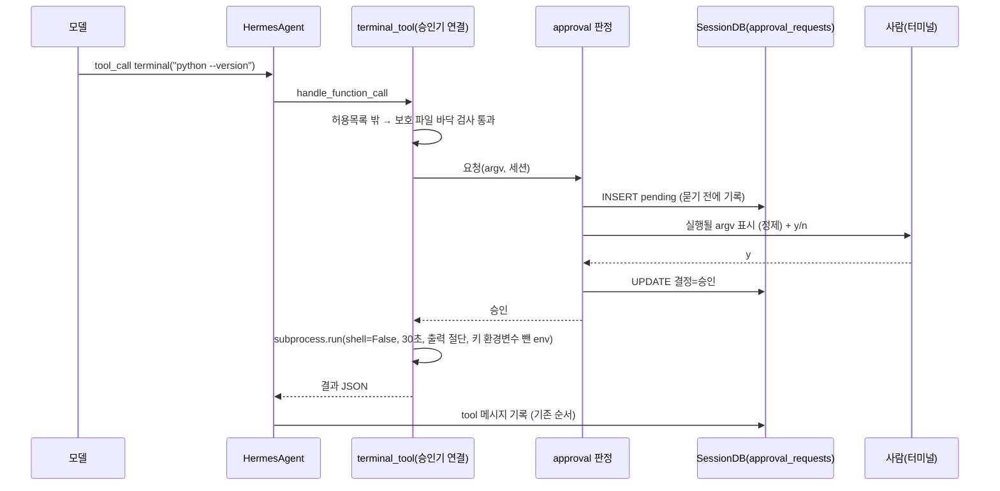

# [마스터 설계도] 10-승인 흐름 MVP

> **상태**: `In progress`  
> **대시보드**: [README.md](README.md)  
> **의도(Why)**: [WHY.md](WHY.md) · **승인된 계획**: [PLAN.md](PLAN.md) · **근거 결정**: [ADR-0010](../../adr/0010-승인_흐름_MVP_범위와_결정.md)  
> **기준 코드**: 09 마감 이후 `main` (태그 `roadmap-09-closed`와 그 뒤 정정 커밋 포함) · **원본 참고**: `hermes-agent/tools/approval*.py`의 구조와 함정만 읽음(읽기 전용). 시험 케이스 각각은 일부만 읽음

---

## 1. 배경 및 목적 (Why)

터미널 도구는 허용목록 8개 밖의 명령을 무조건 거부한다. 안전하지만 에이전트가 할 수 있는 일이 읽기에 묶이고, 목록을 넓히면 임의 코드 실행의 문이 열린다. 이 로드맵은 **허용목록 밖의 명령을 사람이 한 번씩 보고 허락하는 문**을 만든다. 승인 요청은 사람에게 묻기 전에 상태 DB에 남기고, 결정이 나오면 같은 행을 갱신한다. 승인기가 없는 구성(라이브러리 기본, 위임 자식, 비터미널 입력)은 지금처럼 거부한다. (왜 이 정도까지만인지는 [WHY.md](WHY.md))

---

## 2. As-Is vs To-Be 아키텍처

### 2-1. 폴더 구조 (신규·변경)

```text
src/hermes_core/
  session_db.py            # [변경] approval_requests 표(스키마 v5), 기록·결정 갱신·조회 메서드
  tools/
    approval.py            # [신규] 승인 요청 객체, 표시 정제, 요청 상한, 판정(fail-closed)
    terminal_tool.py       # [변경] 선택 인자 approver, 허용목록 거부 지점 분기, 보호 파일 바닥, 승인된 실행의 키 환경변수 제거
    dispatcher.py          # [변경] create_default_dispatcher(..., approver=None)로 terminal 핸들러에 승인기 주입. ToolDispatcher 클래스·create_child_dispatcher 무변경
  cli.py                   # [변경] 터미널일 때 승인기 연결, --no-approval, 배너
  constants.py             # [변경] 요청 상한, 프롬프트·거부 문구, 승인된 실행에서 뺄 키 환경변수 이름 목록
tests/test_hermes_core/
  test_approval_ledger.py          # [신규] 010
  test_approval.py                 # [신규] 020
  test_terminal_approval.py        # [신규] 030
  test_cli_approval.py             # [신규] 040
  test_cli_approval_pty.py         # [신규] 050
  test_agent_e2e.py                # [추가] 050 (대본형 가짜 모델 E2E)
```

### 2-2. 구성요소 흐름 (As-Is → To-Be)



### 2-3. 실행 순서 (대표 시나리오: 모델이 `python --version`을 요청하고 사람이 승인)



### 2-4. 분기: 어떻게 판정할 것인가

| 조건 | 결과 | 원장 결정값(후보) | 이유 |
|---|---|---|---|
| 허용목록 안 | 기존 경로(묻지 않음) | 기록 없음 | 기존 동작 불변 |
| 허용목록 밖, 승인기 없음 | 기존 거부 JSON | 기록 없음 | 라이브러리 기본·위임 자식·`--no-approval` |
| 허용목록 밖, 인자가 보호 파일 | 거부 JSON, 묻지 않음 | 기록 없음 | 승인해도 유지되는 바닥 |
| 허용목록 밖, 승인기 있음, 요청 상한 초과 | 묻지 않고 거부 | `limit_exceeded` | 프롬프트 폭주 방지 |
| 허용목록 밖, 승인기 있음, 비터미널 | 묻지 않고 거부 | `auto_denied` | 응답할 사람이 없음 |
| 허용목록 밖, 승인기 있음, 터미널, 사람이 예 | 실행 | `approved` | 사람이 본 명령만 |
| 〃 아니오 / 빈 입력 / 알 수 없는 입력 | 거부 | `denied` | fail-closed |
| 〃 EOF / Ctrl+C / 입력 예외 | 거부 | `cancelled` | 취소를 승인으로 읽지 않음 |

---

## 3. 파급 범위와 무영향 근거 (Blast Radius)

| 대상 | 영향 | 근거 |
|---|---|---|
| `terminal_tool` | 선택 인자 하나 추가, 허용목록 거부 지점에 분기, 승인된 실행에 키 환경변수를 뺀 `env` 전달 | 인자가 `None`이면 지금과 동일한 경로. 스키마 `properties`는 `command`·`timeout`뿐이라 인자 검증 불변(생성 함수의 핸들러 클로저로 주입). 허용목록 안 명령에도 같은 `env`를 쓸지는 030에서 확정 |
| `create_default_dispatcher` | 선택 인자 `approver` 하나 추가 | 기본값 `None`이면 지금과 같은 등록. `ToolDispatcher` 클래스·`include` 검사·`create_child_dispatcher`(인자를 넘기지 않음) 불변. 이미 등록된 도구를 같은 이름으로 다시 등록해 바꾸는 방식은 쓰지 않는다(ADR-0010 대안 H) |
| `HermesAgent` 루프 | 무변경 | 승인은 도구 안에서 일어나고 결과는 기존과 같은 JSON 문자열. 도구 메시지 포장·원장 순서 불변 |
| `SessionDB` | 새 표 하나 추가(스키마 v5) | `llm_calls` 때와 같은 방식. 기존 표·열 불변 |
| 기존 시험 | 5곳 단언 완화 | `test_agent_e2e.py:1085` 및 `test_session_db.py` 4곳의 `schema_version == 4` 단언을 `>= 4`로 완화 (010 사전 점검) |
| 위임 자식 | 무변경 | `create_child_dispatcher()` 불변, 승인기 인자를 넘기지 않으므로 자식 `terminal`은 승인기 없음 = 기존 거부 |
| 압축·스킬·서브에이전트·입력(09) | 무변경 | 이 로드맵은 터미널 도구와 CLI 연결, 새 표만 건드림. 입력은 `read_user_input` 호출만 재사용 |
| 의존성 | 없음 | 표준 라이브러리만 |
| 출력 | 배너 한 줄(승인 켜짐 안내)과 승인 질문 | 040에서 확정 |

---

## 4. 사전 점검 및 실패 위험 분석 (Pre-Mortem)

| # | 위험 | 분류 | 방어 |
|---|---|---|---|
| 1 | 승인기가 없는데 허용목록 밖 명령이 실행됨 | 비인가 실행 | 승인기 없음 = 기존 거부 경로 한 곳. 시험: 라이브러리 기본·자식·`--no-approval`·비터미널 (가정 A) |
| 2 | 취소·빈 입력·EOF·Ctrl+C가 승인으로 읽힘 | fail-open | 판정 함수에서 「정확히 예로 해석되는 입력만 승인」, 나머지는 모두 거부. 순수 함수 시험 (가정 B) |
| 3 | 묻기 전에 죽어 기록이 없음 | 선기록 위반 | 요청 행을 먼저 INSERT(`pending`) 후 질문. 중간 종료 시 `pending`이 남아 흔적이 됨 (가정 C) |
| 4 | 모델이 만든 명령 문자열의 제어문자·ANSI·줄바꿈이 질문을 위장함 | 프롬프트 주입 | 표시는 `argv` 리스트 repr 기반으로 제어문자 제거. 정제 시험 (가정 E) |
| 5 | 보호 파일 접근이 승인으로 풀림 | 비밀 노출 | 승인 질문 **전에** `is_protected_path` 판정으로 막음 (가정 D) |
| 6 | 거부된 명령의 반복 요청으로 프롬프트 폭주·루프 소모 | 무한 루프 | 요청 상한. 거부 문구는 우회 금지 (가정 F) |
| 7 | 도구 실행 중 `KeyboardInterrupt`가 감싸이지 않아 REPL이 죽음 | 종료 경로 | 승인 프롬프트 함수 안에서 직접 잡아 `cancelled`로 처리하고 전체를 종료하지 않음. 시험 |
| 8 | 위임 자식의 `terminal`이 부모 stdin을 잡음 | 격리 파괴 | `create_child_dispatcher` 불변, 승인기 인자 미전달. 시험: 자식 dispatcher의 `terminal`에 승인기 없음 |
| 9 | 비터미널에서 입력 대기로 멈춤(파이프에서 y/n 대기) | 데드락 | 비터미널은 묻지 않고 즉시 거부. 시험 |
| 10 | 스키마 v5 마이그레이션이 기존 DB를 깨뜨림 | 데이터 | `CREATE TABLE IF NOT EXISTS`만 사용, v3·v4 DB 열기 시험. `schema_version == 4` 단언 한 줄은 지시서에서 처리 방식 확정 |
| 11 | 시험이 실제 터미널을 흉내 내는 pty와 실제 앱의 차이로 거짓 안심 | 검증 한계 | pty는 회귀 시험으로만 쓰고 060에서 사람이 확인 (가정 G) |
| 12 | 승인한 프로그램이 `.env` 같은 비밀을 인자 외 경로(상대 링크, 스크립트 안의 경로)로 읽음 | 비밀 노출 | 완전히 막지 못함. 한계로 문서화하고 사람이 판단. **미확인** (환경변수로 물려받는 경우는 14번) |
| 13 | 모델이 거부 뒤 다른 허용목록 명령으로 같은 효과를 시도 | 우회 | 허용목록 도구 자체의 한계. 원장·표시로 사람이 확인. 이 로드맵 범위 밖 |
| 14 | 승인한 `env`·`printenv`·`python -c` 등이 물려받은 `OPENROUTER_API_KEY`를 출력해 모델 요청과 `state.db`로 샘 | 비밀 노출 | 승인된 실행의 `env`에서 키 환경변수 이름 목록을 뺀다(ADR-0010 §2-6). 시험: 가짜 키를 환경에 두고 환경변수를 출력하는 명령을 승인 → 도구 결과·원장에 키 문자열 없음 (가정 J). 다른 비밀 환경변수는 막지 않음(한계) |
| 15 | 승인기 연결이 도구 이름 덮어쓰기에 기대 등록 순서에 따라 승인 없이 실행되는 `terminal`이 남음 | 숨은 결합 | 디스패처 생성 시 명시 주입만 사용(ADR-0010 §2-10). 시험: 승인기를 넘긴 디스패처의 `terminal`만 승인을 묻고, 넘기지 않은 기본·자식 디스패처는 기존 거부 |

---

## 5. 4층위 검증 범위 설계 (Validation Grid)

| 층위 | 내용 | 단계 |
|---|---|---|
| 1 수동 반복 배제 | 모든 검증은 가짜 입력·가짜 승인기·대본형 가짜 모델·pty로 자동화. 사람 확인은 060 한 번 | 전체 |
| 2 단위·구조 | 판정 함수(예/아니오/취소/상한/비터미널), 표시 정제, 원장 메서드, 스키마 마이그레이션 | 010, 020 |
| 3 상태·정합성 | 요청 선기록, 결정 갱신, 보호 파일 바닥, 승인된 실행의 키 환경변수 미상속, 승인기 없음 = 기존 거부, 자식 격리, 기존 시험 불변 | 010~040 |
| 4 통합 E2E | 대본형 가짜 모델이 허용목록 밖 명령을 요청 → 승인/거부/취소/상한 → 원장 대조, pty에서 승인 프롬프트, 실제 모델·터미널 스모크 | 050, 060 |

각 구현지시서의 인수 시나리오는 구현 전에 적고 구현 중 임의로 바꾸지 않는다.

---

## 6. 설계 결정 상세

### 6-1. 원장 (010)
`approval_requests` 표: 열 `id`, `session_id`(FK), `argv_json`, `created_at`, `decision`, `decided_at`, `reason`. `tool_call_id`는 터미널 도구가 호출 ID를 알지 못하므로 열에 두지 않고 `session_id`와 시간으로 대응하도록 확정(010 지시서 7항). 메서드: 요청 기록(`pending`) → 결정 갱신 → 세션별 조회. 한 번 정해진 결정은 다시 바꾸지 않는다(멱등/불변 여부 시험).

### 6-2. 승인 판정 (020)
요청 객체(argv, 세션), 승인기 호출 규약(결정값 반환), 표시 문자열 생성(제어문자 제거), 요청 상한 카운터, 입력 해석(정확히 `y`/`yes`만 예, 나머지 거부). 부작용(출력·입력)은 승인기 쪽에 두고 판정과 정제는 순수 함수로 둔다. 상한 값과 입력 허용 표기는 지시서에서 확정한다(에이전트가 정한 안).

### 6-3. 터미널 도구 연동 (030)
허용목록 거부 지점(현재 `terminal_tool.py:83-84`)에서 승인기가 있으면 보호 파일 바닥 검사 → 판정 → 실행한다. 승인된 명령은 「작업 폴더 밖 경로 인자」 검사를 건너뛰되 `shell=False`·시간·출력 상한·`cwd`는 같다. 030에서 실행 경로를 단일 함수(`_execute`)로 통합하고 허용목록 안팎 모두 동일하게 키 환경변수가 제거된 `_child_env` 사본을 `env`로 넘기도록 확정(ADR-0010 §2-6).

승인기는 `create_default_dispatcher(..., approver=None)`의 선택 인자로 받아 `terminal` 핸들러 클로저에 넘긴다(ADR-0010 §2-10). 이미 등록된 `terminal`을 같은 이름으로 다시 등록하는 방식은 쓰지 않는다. 승인기는 원장 기록에 세션 ID가 필요하므로, CLI가 session_id를 선발급하고 SessionDB·Approver·디스패처를 사전 조립해 HermesAgent에 주입하는 방식으로 확정(030·040).

### 6-4. CLI 연동 (040)
stdin·stdout이 모두 터미널(`is_interactive_terminal`)이면 승인기를 기본 연결하고 `--no-approval`로 끈다. 프롬프트는 `read_user_input`에 별도 프롬프트 문자열을 넘겨 재사용한다(REPL의 `User >`와 구분). 배너에 안내 한 줄(문구는 040에서 확정).

### 6-5. 값 (확정)
요청 상한 10(`APPROVAL_REQUEST_LIMIT`), 승인 입력은 정확히 `y`/`yes`(대소문자 무시)만 예, 거부 문구 `APPROVAL_DENIED_MESSAGE` (020~040에서 확정).

### 6-6. 원본과 다른 점 (의도적)
원본은 위험 패턴 감지, once/session/always, 영구 allowlist, smart 모드, 게이트웨이 대기, 타임아웃, 서브에이전트 설정 승인 모드를 가진다. 우리는 허용목록 밖 전부 묻기·예/아니오·원장 선기록·자식 거부만 한다. 원본의 판정 순서와 fail-closed 원칙을 따른다. 원본의 승인 시험 케이스는 일부만 읽어 비교가 불완전하다(**미확인**).

---

## 7. 문서 동기화 방식

- 050에서 작동원리 01편에 승인 흐름을 사실로 반영한다. 특히 「사람 승인은 자동 반복 루프와 맞지 않는다」는 서술(표의 해당 행, 5부 기각 목록)을 새 사실에 맞춰 고치고 기준 커밋을 갱신한다.
- 각 단계 커밋에서 대시보드 실행 기록과 [인계](../../인계.md)를 함께 갱신한다 (ROADMAP_정책 §4).
- 구현 중 이 문서와 달라진 이름·구조는 정정하고 [WHY.md](WHY.md) 끝 변경 기록에 이유를 남긴다.

---

## 8. 이 로드맵이 다루지 않는 것 (Non-Goals)

세션 캐시·영구 허용목록·once/session/always, 위험 패턴 감지·hardline 목록, LLM 판정(smart)·yolo, 위임 자식 승인, 파일 도구 승인, 승인 타임아웃, 게이트웨이/웹훅 대기, 비밀 마스킹 표시, 모델 키 외 비밀 환경변수 차단, 체크포인트·롤백(11번).
