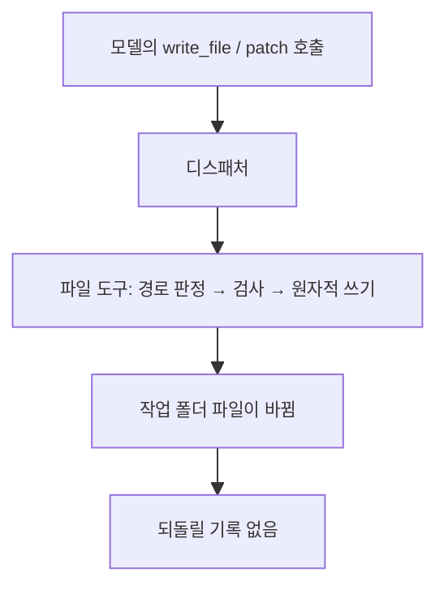
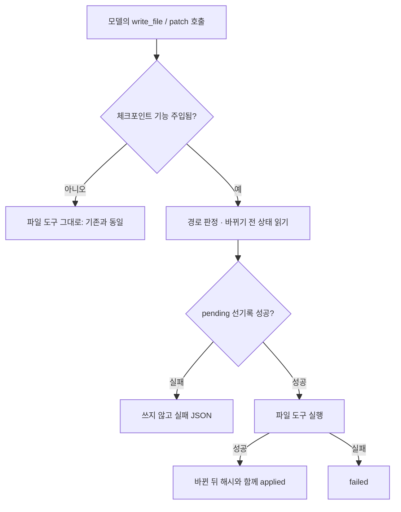
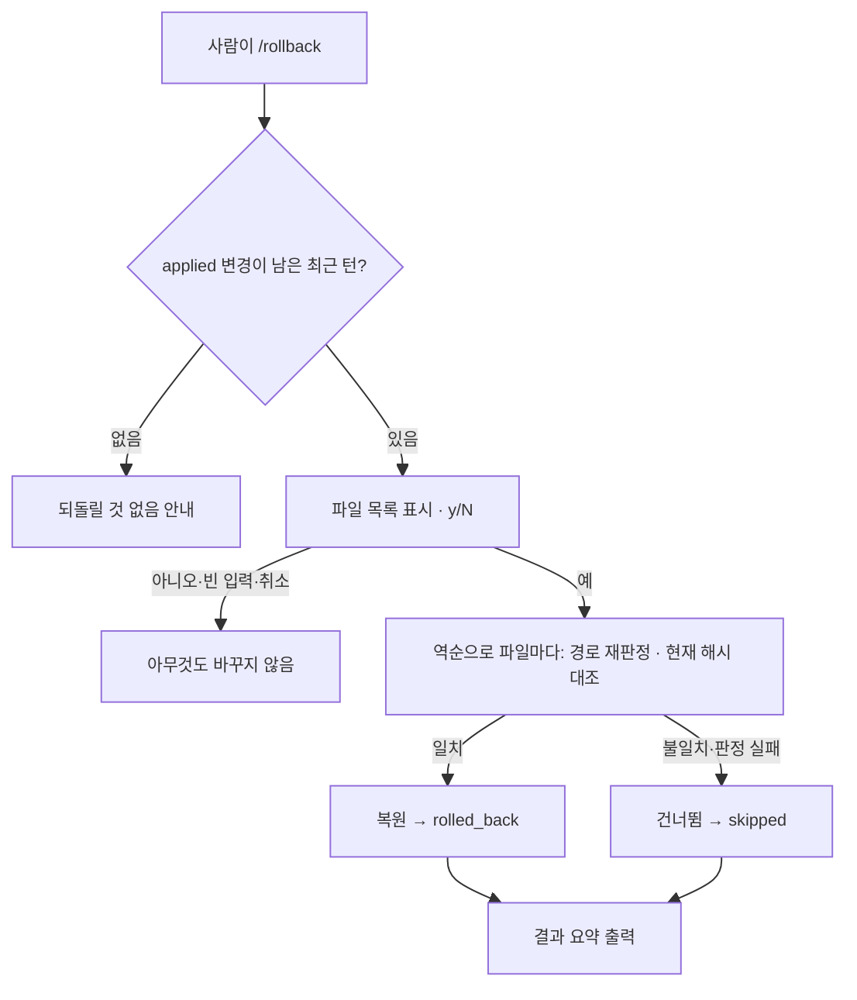
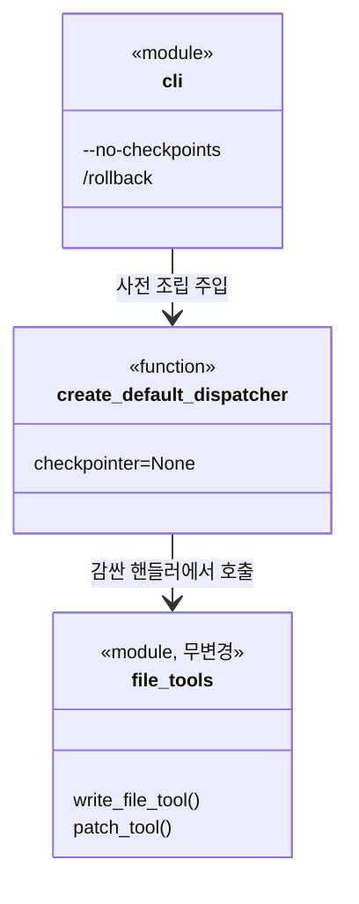
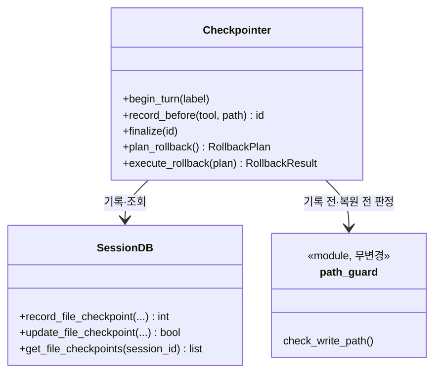
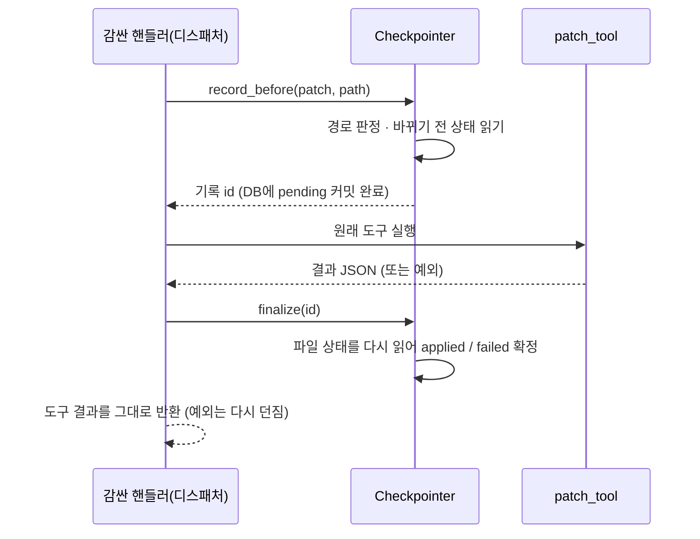
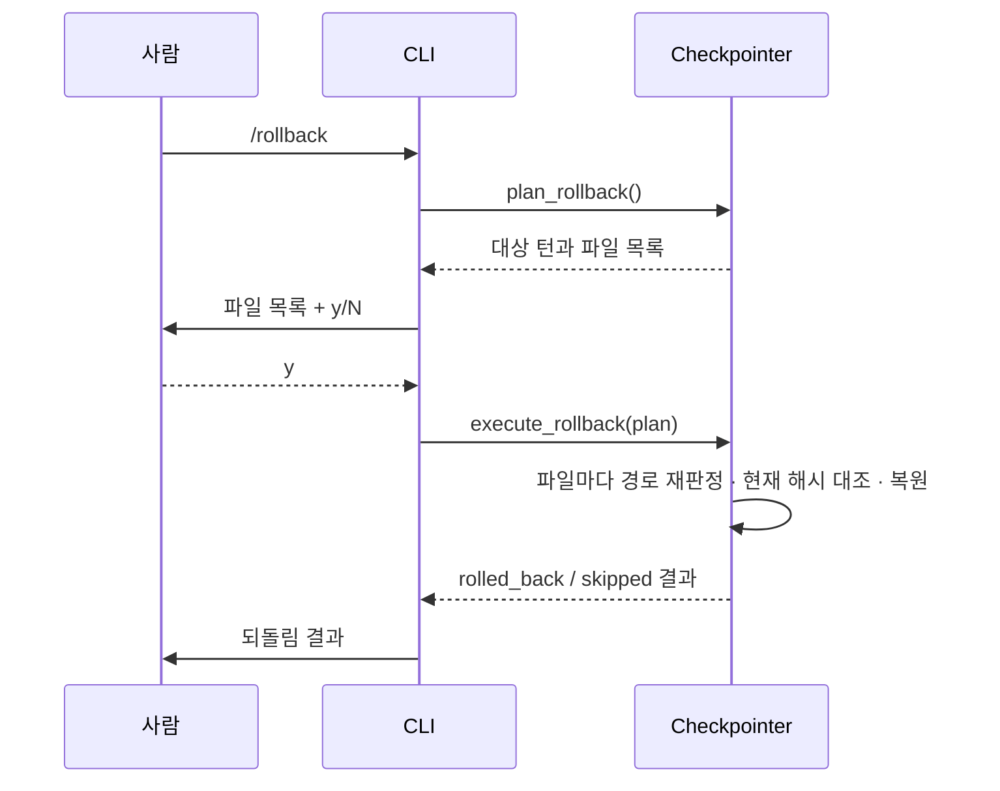
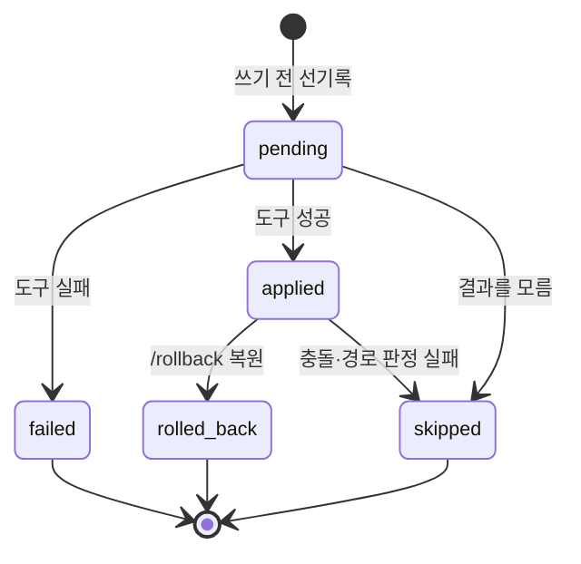

# [마스터 설계도] 11-체크포인트·롤백 MVP

> **상태**: `Draft`  
> **대시보드**: [README.md](README.md)  
> **의도(Why)**: [WHY.md](WHY.md) · **승인된 계획**: [PLAN.md](PLAN.md) · **근거 결정**: [ADR-0011](../../adr/0011-체크포인트_롤백_MVP_범위와_결정.md)  
> **기준 코드**: 10 마감 이후 `main` (`36d6a14`, 태그 `roadmap-10-closed` 이후) · **원본 참고**: `hermes-agent/tools/checkpoint_manager.py`, `agent/tool_executor.py`의 호출 자리와 safe 복원 원칙만 읽음(읽기 전용). `/rollback` 화면 절차는 읽지 않음

---

## 1. 배경 및 목적 (Why)

파일 도구(`write_file`·`patch`)는 작업 폴더 안에서 파일을 만들고 고칠 수 있지만, 바뀐 것을 되돌릴 수단이 없다. 10번은 이 도구들의 승인을 미뤘다(ADR-0010 대안 E). 이 로드맵은 **파일 도구가 바꾸기 전 모습을 상태 DB에 먼저 적어 두고, 사람이 CLI `/rollback`으로 최근 턴부터 차례로 되돌리는 장치**를 만든다. 그사이 다른 손이 고친 파일은 건너뛰고 알린다. 체크포인트 기능이 없는 구성(라이브러리 기본, 위임 자식, `--no-checkpoints`)은 지금과 똑같이 동작한다. (왜 이 정도까지만인지는 [WHY.md](WHY.md))

---

## 2. As-Is vs To-Be 아키텍처

이름(`tools/checkpoint.py`, `Checkpointer`, `file_checkpoints`, `begin_turn`, `--no-checkpoints`)은 계획 단계의 안이다. 해당 지시서를 쓸 때 코드와 대조해 확정하고, 바뀌면 이 문서를 정정한다.

### 2-1. 폴더 구조 (신규·변경)

```text
src/hermes_core/
  session_db.py            # [변경] file_checkpoints 표(스키마 v6), 선기록·결과 갱신·턴별 조회 메서드 (010)
  constants.py             # [변경] 체크포인트 상태값, 문구, 상한 (010~040)
  tools/
    checkpoint.py          # [신규] Checkpointer: 턴 경계, 쓰기 전 기록·쓰기 후 확정, 되돌리기 계획·실행 (020)
    dispatcher.py          # [변경] create_default_dispatcher(..., checkpointer=None)로 write_file·patch 감싸기.
                           #        ToolDispatcher 클래스·create_child_dispatcher 무변경 (030)
    file_tools.py          # 무변경 (write_file_tool·patch_tool 그대로)
  cli.py                   # [변경] 기본 켜짐·--no-checkpoints, 턴 경계 알림, /rollback 명령, 배너 (040)
tests/test_hermes_core/
  test_checkpoint_ledger.py        # [신규] 010
  test_checkpoint.py               # [신규] 020
  test_file_tools_checkpoint.py    # [신규] 030
  test_cli_rollback.py             # [신규] 040
  test_cli_rollback_pty.py         # [신규] 050
  test_agent_e2e.py                # [추가] 050 (대본형 가짜 모델 E2E)
  test_approval_ledger.py          # [단언 완화 예정] schema_version == 5 세 곳 (010에서 처리 방식 확정)
```

### 2-2. 구성요소 흐름: As-Is



### 2-3. 구성요소 흐름: To-Be (쓰기)



### 2-4. 구성요소 흐름: To-Be (되돌리기)



### 2-5. 클래스·모듈 관계

한 그림에 3개씩 두 그림으로 나눈다(가로 한 줄 3개 규칙). 위는 「쓰기를 감싸는 쪽」, 아래는 「기록과 되돌리기를 하는 쪽」이다.





두 그림의 연결: `cli`가 `Checkpointer`를 만들어 `create_default_dispatcher`에 넘기고(감싼 핸들러가 `record_before`·`finalize`를 부름), 턴 경계(`begin_turn`)와 `/rollback`(`plan_rollback`·`execute_rollback`)은 `cli`가 직접 부른다. 메서드 이름과 반환 모양은 020·030 지시서에서 확정한다(`finalize`는 §6-3의 「파일 상태로 결과 확정」을 맡는 자리의 안이다).

### 2-6. 실행 순서 (대표 시나리오: 한 턴에서 `patch` 한 번, 다음 입력으로 `/rollback`)

한 그림에 참여자 3개씩, 쓰기와 되돌리기 두 그림으로 나눈다.

**① 쓰기** (CLI가 턴 경계를 알린 뒤 `run_conversation`을 부르고, 에이전트가 모델의 `patch` 호출을 디스패처에 넘긴 다음부터. CLI·에이전트·모델 부분은 생략)



DB 기록(`pending` 선기록, `applied`/`failed` 갱신)은 `Checkpointer`가 `SessionDB`를 불러서 한다(그림 생략). 선기록이 실패하면 `W`는 도구를 부르지 않고 실패 JSON을 돌려준다.

**② 되돌리기** (다음 입력으로 `/rollback`. 모델은 부르지 않는다)



### 2-7. 기록 행의 상태



허용 전이는 위 다섯 개뿐이다([010 지시서](instructions/010_체크포인트_원장.md) §1-2). `pending`이 남은 행(기록 뒤 프로세스 종료)은 쓰기가 일어났는지 알 수 없어 되돌리지 않고 `skipped`로만 넘길 수 있다. 언제 그렇게 할지와 `failed` 행의 표시는 020 지시서에서 정한다(WHY 가정 F).

---

## 3. 파급 범위와 무영향 근거 (Blast Radius)

| 대상 | 영향 | 근거 |
|---|---|---|
| `write_file_tool`·`patch_tool` | 무변경 | 감싸기는 디스패처 생성 함수의 클로저에서 한다. 두 함수의 검사·쓰기 순서와 반환 JSON 그대로 |
| `create_default_dispatcher` | 선택 인자 `checkpointer` 하나 추가 | 기본값 `None`이면 지금과 같은 등록. `ToolDispatcher` 클래스·`include` 검사·`approver` 경로 불변. `create_child_dispatcher`는 인자를 넘기지 않음 |
| `HermesAgent` 루프 | 무변경(예정) | 기록은 도구 핸들러 안에서 일어나고 결과는 같은 JSON 문자열. 턴 경계 알림 자리는 040에서 확정(CLI에서 알리면 에이전트 무변경) |
| `SessionDB` | 새 표 하나(스키마 v6) | `approval_requests` 때와 같은 방식. 기존 표·열 불변 |
| 기존 시험 | `schema_version == 5` 단언 3곳 | `test_approval_ledger.py:19,104,176`. 10번 선례(`== 4` → `>= 4`)처럼 처리하되 010 지시서에 예고된 예외로 적는다 |
| 위임 자식 | 무변경 | 자식 디스패처에 체크포인트 기능 없음 = 기존 쓰기. 자식의 쓰기는 되돌리기 대상이 아님을 문서·배너 안내에 적는다 |
| 터미널·승인(10) | 무변경 | 터미널 변경은 대상이 아니다. `/rollback` 확인 질문은 승인과 같은 입력 함수(`read_user_input`)를 재사용 |
| 압축·스킬·입력(09) | 무변경 | `/rollback`은 대화 기록에 넣지 않고 모델을 부르지 않는다 |
| 의존성 | 없음 | 표준 라이브러리(`hashlib`, `sqlite3`)만 |
| 출력 | 배너 한 줄, `/rollback` 목록·확인·결과 | 040에서 문구 확정 |

---

## 4. 사전 점검 및 실패 위험 분석 (Pre-Mortem)

| # | 위험 | 분류 | 방어 |
|---|---|---|---|
| 1 | 체크포인트 기능이 없는 구성에서 파일 도구 동작이 바뀜 | 기존 동작 파괴 | 주입 없음 = 기존 핸들러 그대로. 시험: 라이브러리 기본·자식·`--no-checkpoints` (가정 A) |
| 2 | 기록 없이 파일이 바뀜 | 선기록 위반 | 선기록이 예외·실패면 도구를 부르지 않고 실패 JSON. 시험: 기록 실패를 흉내 내 파일 불변 확인 (가정 B) |
| 3 | 도구 실패인데 `applied`로 남아 되돌리기가 엉뚱한 파일을 지움, 또는 도구 성공인데 `failed`로 남아 되돌리기 대상에서 빠짐 | 원장 오염 | 결과는 도구가 돌려준 글이 아니라 **실행 뒤 파일 상태**로 확정한다(§6-3). 되돌리기는 `applied`만 대상 (가정 B·C) |
| 4 | 기록 뒤·쓰기 전에 프로세스가 끝나 `pending`이 남음 | 원장과 파일 어긋남 | 되돌리기에서 `pending`은 현재 파일 상태와 대조하는 규칙을 020에서 정함 (가정 F, **미확인**) |
| 5 | 사람이 나중에 고친 파일을 되돌리기가 덮음 | 데이터 손실 | 복원 직전 현재 해시(또는 존재 여부)를 `applied` 때 해시와 대조, 다르면 `skipped` (가정 D) |
| 6 | 되돌리기가 작업 폴더 밖·보호 파일·쓰기 금지 파일을 건드림 | 샌드박스 오염 | 복원 직전 `check_write_path` 재판정, 실패면 `skipped` (가정 E) |
| 7 | 같은 파일을 한 턴에 여러 번 고친 경우 순서가 꼬임 | 복원 오류 | 같은 턴 안에서 기록 id의 역순으로 복원. 각 행의 해시 대조가 앞 행의 결과와 맞물림 (가정 C) |
| 8 | 만든 파일을 지운 뒤 빈 부모 폴더가 남음 | 흔적 | MVP는 폴더를 지우지 않는다(사람의 폴더일 수 있다). 한계로 문서화. 020에서 확정 |
| 9 | 복원 쓰기 도중 실패해 파일이 반쯤 바뀜 | 데이터 | 쓰기 도구와 같은 임시 파일 + `os.replace` 원자적 쓰기, 권한 보존 |
| 10 | 바뀌기 전 내용이 DB에 쌓여 커짐 | 비대화 | 파일당 1MB(`FILE_MAX_BYTES`) 상한은 도구가 이미 보장. 세션당 상한은 020에서 정함 (가정 J, **미확인**) |
| 11 | 되돌린 뒤 모델이 옛 내용을 믿고 반복 실패 | 루프 소모 | 비목표. `patch`의 `old_string not found` 실패와 기존 반복 상한에 맡기고 060에서 관찰 (가정 H) |
| 12 | `/rollback` 확인 중 Ctrl+C·EOF가 REPL을 끝내거나 「예」로 읽힘 | fail-open | 확인 해석은 승인과 같은 규칙(정확히 예만 예). 확인 단계의 취소는 그 명령만 취소 (가정 G) |
| 13 | `/rollback`이 모델 입력으로 넘어감 | 오작동 | REPL에서 모델 호출 전에 가로챔. 시험: `/rollback` 입력 뒤 모델 호출 횟수 불변 |
| 14 | 비밀이 기록됨 | 비밀 노출 | 보호 파일(`.env*`·`.git`)·지시문·상태 폴더는 쓰기 도구가 이미 거부하므로 기록 대상이 아님. 기록 전 판정도 같은 함수 (가정 E) |
| 15 | 스키마 v6 마이그레이션이 기존 DB를 깨뜨림 | 데이터 | `CREATE TABLE IF NOT EXISTS`만 사용, v3·v4·v5 DB 열기 시험 |
| 16 | 도구 결과 JSON이 깨졌거나 `success`가 불(bool)이 아니거나, 도구가 예외를 던져 결과를 해석할 수 없음 | 비정형 출력 파싱 실패 | 확정에 결과 JSON을 쓰지 않는다. 예외도 `try/finally`로 확정을 거친 뒤 다시 던져 디스패처의 기존 예외 처리에 맡긴다. 결과 JSON과 파일 상태가 어긋나면 파일 상태를 따르고 `reason`에 어긋남을 남긴다. 시험: 깨진 JSON·`success` 없음·예외를 내는 가짜 도구 (가정 B) |
| 17 | 실행 뒤 파일을 다시 읽지 못해 결과를 확정할 수 없음 | 원장과 파일 어긋남 | `skipped`(사유 「결과 확인 실패」)로 남겨 되돌리기 대상에서 빼고, 도구 결과는 그대로 모델에게 돌려준다. 되돌릴 수 없는 변경이 생길 수 있음을 한계로 문서화 (가정 F) |
| 18 | 감싼 핸들러의 인자 모양이 도구와 달라 호출이 어긋남, 또는 인자 검증에 실패할 호출이 기록부터 남김 | 도구 호출 파라미터 스키마 불일치 | 감싼 핸들러는 받은 인자를 그대로 넘기고 모델에게 보이는 스키마는 바꾸지 않는다. 디스패처는 핸들러를 부르기 **전에** 인자를 검증하므로(`_validate_arguments`), 검증에 실패한 호출은 기록되지 않는다. 시험: 스키마 동일성, 잘못된 인자 호출 뒤 원장 0행 (가정 A·B) |

---

## 5. 4층위 검증 범위 설계 (Validation Grid)

| 층위 | 내용 | 단계 |
|---|---|---|
| 1 수동 반복 배제 | 모든 검증은 임시 작업 폴더·임시 DB·가짜 입력·대본형 가짜 모델·pty로 자동화. 사람 확인은 060 한 번 | 전체 |
| 2 단위·구조 | 원장 메서드·상태값 닫힌 목록·마이그레이션, 바뀌기 전 상태 읽기, 해시 대조, 되돌리기 계획(턴 고르기·역순) | 010, 020 |
| 3 상태·정합성 | 선기록 후 쓰기, 기록 실패 시 쓰지 않음, 도구 실패 시 `failed`, 충돌 건너뜀, 경로 재판정, 주입 없음 = 기존 동작, 자식 격리 | 020~040 |
| 4 통합 E2E | 대본형 가짜 모델이 파일을 만들고 고침 → `/rollback` → 파일·원장 대조, 2턴 연속 되돌리기, 사람이 고친 파일 건너뜀, pty `/rollback`, 실제 모델·터미널 스모크 | 050, 060 |

각 구현지시서의 인수 시나리오는 구현 전에 적고 구현 중 임의로 바꾸지 않는다.

---

## 6. 설계 결정 상세

### 6-1. 원장 (010)
표 `file_checkpoints`(010 지시서에서 확정). 열: `id`, `session_id`(FK), `turn_index`, `tool_name`, `workspace`, `rel_path`, `before_exists`, `before_content`, `after_sha256`, `status`, `created_at`, `updated_at`, `reason`. `workspace`는 되돌릴 때 같은 작업 폴더인지 대조하려고 둔다. 상태값은 닫힌 목록(`pending`·`applied`·`failed`·`rolled_back`·`skipped`)이고 허용된 전이만 갱신한다(10번 「`pending`만 갱신」 선례). 저장소도 바뀌기 전 내용의 크기(`FILE_MAX_BYTES`)와 해시 형식을 검사한다. 메서드는 `record_file_checkpoint`·`update_file_checkpoint`·`get_file_checkpoints`.

### 6-2. 체크포인트 모듈 (020)
턴 번호는 체크포인트 기능이 세션 안에서 센다. 바뀌기 전 상태 읽기는 쓰기 도구와 같은 경로 판정을 쓰고, 판정 실패면 기록하지 않고 도구에 넘긴다(도구가 같은 이유로 거부). 되돌리기는 「계획 세우기」(대상 턴과 파일 목록, 파일마다 예상 결과)와 「실행」을 나눠, CLI가 계획을 보이고 확인받은 뒤 실행한다. 계획과 실행 사이에 파일이 바뀌어도 실행 때 다시 대조한다.

### 6-3. 디스패처 연동 (030)
`create_default_dispatcher(..., checkpointer=None)`가 `write_file`·`patch` 핸들러를 클로저로 감싼다. 감싼 핸들러는 기록 → 원래 도구 → 결과 확정 순서다. 모델에게 보이는 스키마는 바뀌지 않는다.

**결과는 도구가 돌려준 글이 아니라 실행 뒤 파일 상태로 확정한다.** 지금의 두 도구는 성공하면 반드시 파일을 바꾼다. `write_file`은 없던 파일을 만들고, `patch`는 `old_string`과 `new_string`이 같으면 거부하므로 성공하면 내용이 달라진다(`file_tools.py`). 그래서 「바뀌기 전 상태와 같으면 `failed`, 다르면 `applied`(그 내용의 해시)」로 판정할 수 있고, 결과 JSON이 깨지거나 도구가 예외를 던져도 판정이 흔들리지 않는다. 결과 JSON의 `success`는 교차 확인에만 쓰고, 어긋나면 `reason`에 남긴다. 해시는 파일의 원시 바이트로 계산해 디코드 실패가 끼어들지 않게 한다. 실행 뒤 파일을 읽지 못하면 `skipped`(사유 「결과 확인 실패」)로 둔다. 확정은 `try/finally`로 예외 경로에서도 거치고, 예외는 다시 던져 디스패처의 기존 처리(실패 JSON으로 감쌈)에 맡긴다. 이 판정 규칙의 세부와 메서드 이름은 020·030 지시서에서 확정한다.

### 6-4. CLI 연동 (040)
`--no-checkpoints`가 없으면 체크포인트 기능을 만들어 디스패처에 넣는다(승인기와 같은 사전 조립). `run_conversation` 직전에 턴 경계를 알린다. `/rollback`은 REPL에서 모델 호출 전에 가로챈다. 확인 질문은 `read_user_input`을 재사용한다. 배너에 켜짐 안내와 「파일 도구 변경만 대상」 한 줄.

### 6-5. 원본과 다른 점 (의도적)
원본은 그림자 git 저장소에 작업 폴더 전체를 스냅샷하고, 터미널의 파괴적 명령 전에도 뜨며, 기록 실패를 무시하고, 기본 꺼짐이다. 우리는 파일 도구 두 개의 바뀌기 전 상태만 상태 DB에 적고, 기록 실패면 쓰지 않으며, CLI 기본 켜짐이다. 「에이전트가 쓴 뒤 사람이 고친 파일은 건너뛴다」는 원본 safe 복원 원칙을 따른다. 원본 `/rollback`의 화면 절차는 읽지 않았다(**미확인**).

---

## 7. 문서 동기화 방식

- 050에서 작동원리 01편에 체크포인트·되돌리기를 사실로 반영하고 기준 커밋을 갱신한다. 작동원리 문서는 [작동원리/README.md](../../작동원리/README.md) 「설명의 기준」(RULE-008)을 따른다. 01~03편 재작성 계획([계획 010](../../계획/010-작동원리_재작성계획.md))과 겹치는 부분은 050 지시서를 쓸 때 그 시점의 상태와 대조해 정한다.
- 각 단계 커밋에서 대시보드 실행 기록과 [인계](../../인계.md)를 함께 갱신한다 (ROADMAP_정책 §4).
- 구현 중 이 문서와 달라진 이름·구조는 정정하고 [WHY.md](WHY.md) 끝 변경 기록에 이유를 남긴다.

---

## 8. 이 로드맵이 다루지 않는 것 (Non-Goals)

터미널 변경 스냅샷, 그림자 git 저장소, 위임 자식 쓰기 기록, 모델에게 되돌림 알리기, 변경 목록·차이 보기·특정 턴 지정, 기록 정리·용량 관리, 세션을 넘는 되돌리기, 파일 도구 승인, 빈 폴더 정리.
