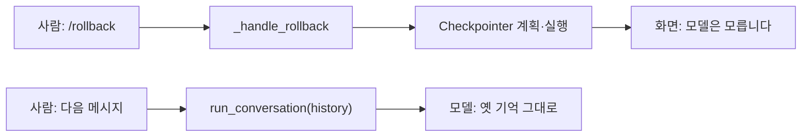
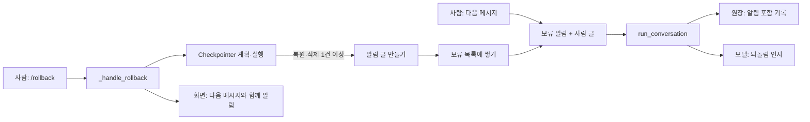
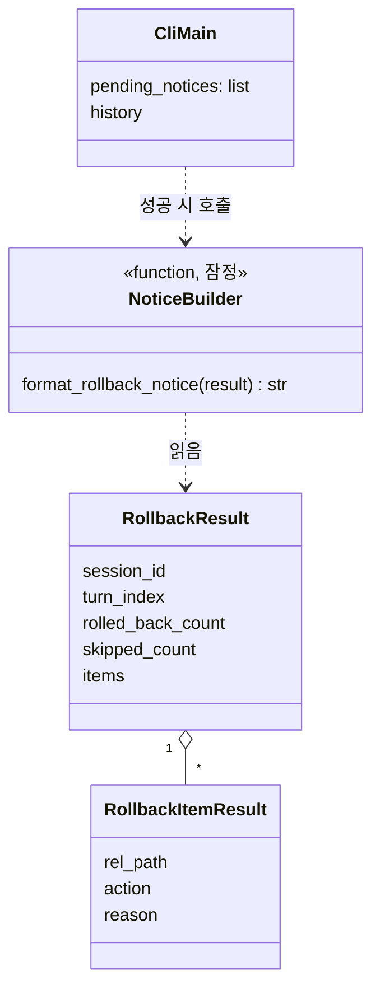
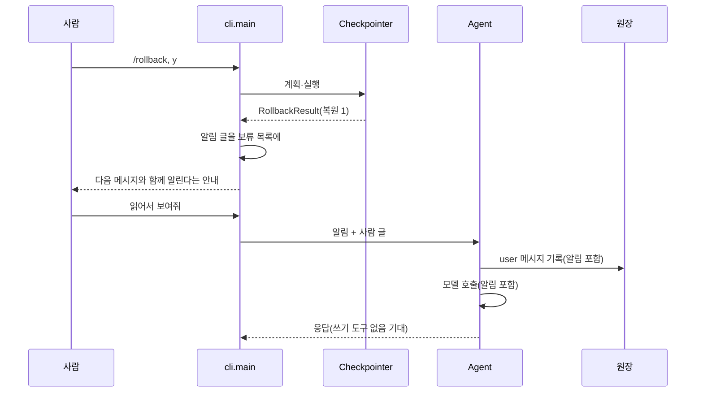

# [마스터 설계도] 12-롤백 모델 알림 MVP

> **상태**: `Draft`  
> **대시보드**: [README.md](README.md)  
> **의도(Why)**: [WHY.md](WHY.md) · **승인된 계획**: [PLAN.md](PLAN.md) · **근거 결정**: [ADR-0012](../../adr/0012-롤백_모델알림_MVP_범위와_결정.md)  
> **기준 코드**: `main` `a85ee91` (11 `Closed`, 계획 013·014 완료, 계획 015 진행중) · **원본 참고**: `hermes_cli/cli_commands_mixin.py`의 `/rollback` 뒤 `undo_last`, `cli_chat_turn_mixin.py`의 다음 메시지 앞 메모 붙이기(읽기 전용)  
> **이름에 대해**: 아래 함수·상수 이름은 **잠정**이다. 010·020 지시서에서 코드와 대조해 확정한다.

---

## 1. 배경 및 목적 (Why)

11번 060 스모크에서 되돌린 직후 모델이 읽기 요청을 받고도 `patch`를 다시 불러 되돌리기를 무력화했다(자가 치유 함정). 원인은 모델의 대화 기록에 「바꿨다」만 있고 「사람이 되돌렸다」가 없었기 때문이다. 이 로드맵은 **되돌리기가 성공하면 그 사실을 고정 형식의 알림으로 만들어 두었다가, 사람이 보내는 다음 메시지 앞에 붙여 모델에게 전하고 원장에 남긴다.** `/rollback` 자체는 계속 모델을 부르지 않는다.

## 2. As-Is vs To-Be 아키텍처

### 2-1. 폴더 구조 (신규·변경)

```text
src/hermes_core/
  constants.py          # 변경: 알림 표지·문구·경로 상한 상수, 화면 안내 문구 교체 (010·020)
  tools/checkpoint.py   # 변경(잠정): RollbackResult → 알림 글 (010)
  cli.py                # 변경: 보류 알림 목록, 다음 메시지 앞에 붙이기, exit 때 버리기 (020)
tests/test_hermes_core/
  test_checkpoint_module.py  # 변경: 알림 글 단위 시험 (010)
  test_cli_rollback.py       # 변경: CLI 배선 시험 (020)
  test_agent_e2e.py          # 변경: 대본 E2E, 다음 요청에 알림이 실렸는지 (020·030)
docs/작동원리/01-헤르메스코어-작동원리.md  # 변경: Q11-6 「모델은 되돌림을 모름」 (030)
```

### 2-2. 구성요소 흐름: As-Is



### 2-3. 구성요소 흐름: To-Be



### 2-4. 클래스·모듈 관계



### 2-5. 실행 순서 (대표 시나리오: 만들기 → 고치기 → 되돌리기 → 읽기 요청)



## 3. 파급 범위와 무영향 근거 (Blast Radius)

| 대상 | 영향 | 근거 |
|---|---|---|
| `cli.py` 메인 루프 | 변경 | 보류 목록과 붙이기. 기존 `exit`·`/rollback`·빈 줄 처리 순서는 유지한다 |
| `checkpoint.py` | 추가만 | 알림 글을 만드는 순수 함수. 계획·실행 로직은 무변경 |
| `agent.py`·압축·시스템 프롬프트 | 무변경 | 알림은 사람 메시지의 일부로 들어간다. 시스템 프롬프트와 과거 대화를 바꾸지 않는다 |
| 원장 스키마 | 무변경 | 새 표·열이 없다. 알림은 기존 `messages.content`에 들어간다 |
| 라이브러리 사용, 위임 자식 | 무변경 | `/rollback`은 CLI에만 있다 |
| 승인·미리 친 입력(계획 014) | 무변경 | 입력 읽기 경로를 바꾸지 않는다. 붙이기는 읽은 뒤에 한다 |

## 4. 사전 점검 및 실패 위험 분석 (Pre-Mortem)

| # | 위험 | 분류 | 방어 |
|---|---|---|---|
| 1 | 알림이 압축 요약으로 오인되어 압축이 꼬인다 | 비정형 출력 | 표지를 `SUMMARY_PREFIX`·`END_MARKER`와 분리하고, 시험에서 압축 경로와 함께 확인 |
| 2 | 알림이 길어져 문맥을 낭비한다 | 컨텍스트 | 경로 수 상한, 넘치면 개수만 |
| 3 | 모델이 알림을 사람의 지시로 오해한다 | 비인가 실행 | 문구는 「사실 + 금지」 위주로. 040에서 관찰(가정 B) |
| 4 | 알림이 사라지거나 두 번 간다 | 상태 정합 | 보류 목록은 모델로 넘어가는 메시지에 붙인 직후 비운다. `/rollback`·빈 줄·exit에는 붙이지 않는다. 시험으로 고정 |
| 5 | `exit` 판정이 알림 때문에 깨진다 | 상태 정합 | 붙이기는 `exit`·`/rollback` 판정 **뒤**, 모델에 넘기기 직전에 한다 |
| 6 | 사람이 친 글에 표지와 같은 문자열이 들어 있다 | 비정형 출력 | 사람 글은 손대지 않는다. 표지는 알림 블록 앞뒤에만 쓴다. 영향은 표시뿐이라 막지 않는다(기록) |
| 7 | 되돌린 뒤 모델이 여전히 다시 고친다 | 비인가 실행 | 040 스모크로 확인(가정 A). 실패하면 기록하고 후속 후보로 올린다 |

## 5. 4층위 검증 범위 설계 (Validation Grid)

| 층위 | 내용 | 단계 |
|---|---|---|
| 1 Mock·픽스처 | 가짜 `RollbackResult`, 대본형 가짜 모델 | 010·020 |
| 2 단위·구조 | 알림 글 형식(표지, 경로, 사유, 상한), 0건일 때 없음 | 010 |
| 3 상태·정합 | 보류 목록의 누적·비우기·버리기, 원장 `messages`·`llm_calls.request_json`에 알림 포함, 압축 표지 비충돌 | 020 |
| 4 E2E | 대본 모델로 만들기 → 고치기 → `/rollback` → 다음 메시지. 실제 모델 060 시나리오 3회 | 020·030·040 |

새 pty 시험은 만들지 않는다(D-12).

## 6. 설계 결정 상세

### 6-1. 알림 글 (010)
- 순수 함수다. 같은 입력이면 같은 글을 낸다. 복원·삭제가 0건이면 빈 값을 돌려준다.
- 담는 내용:
  - 표지와 턴 번호
  - 복원한 경로와 삭제한 경로
  - 건너뛴 경로와 사유. 그 파일엔 모델의 변경이 남아 있음을 밝힌다.
  - 금지 문장
- 경로 수 상한과 문구는 상수로 둔다.

### 6-2. CLI 배선 (020)
- `main`이 보류 알림 목록을 가진다.
- `_handle_rollback`이 실행 결과를 돌려주도록 바뀐다(잠정). 알림이 있으면 목록에 넣는다.
- 다음 입력이 일반 메시지라 모델에 넘길 때만 「알림들 + 빈 줄 + 사람 글」로 합치고, 목록을 비운다.
- 화면 안내 상수를 교체한다.

### 6-3. 원본과 다른 점 (의도적)
| 원본 | 우리 | 이유 |
|---|---|---|
| 마지막 사용자 턴 1개를 기록에서 잘라냄, 시스템 프롬프트 무효화 | 잘라내지 않고 알림만 붙임 | 대상이 중간 턴일 수 있음, 캐시 규칙, 턴·메시지 연결 키 없음 |
| 메모는 전송용으로만 붙이고 저장 안 함 | 원장에 그대로 저장 | 받은 글과 기록이 같아야 함 |

## 7. 문서 동기화 방식

030에서 작동원리 01편을 고친다. Q11-6 「모델은 되돌림을 모름」, 5부 ①의 「잘못 고친 파일 되돌리기」 행, ③의 Q11 미확인 항목이 대상이다. ADR-0011 본문은 고치지 않는다. ADR-0012가 대체 관계를 밝힌다.

## 8. 이 로드맵이 다루지 않는 것 (Non-Goals)

- 대화 기록에서 되돌린 턴 지우기
- `/rollback` 직후 모델 호출
- 압축 뒤 알림 보존
- 처리 중 Ctrl+C와 `end_reason`(13번 후보)
- 다른 세션의 되돌리기
- 새 pty 시험
- 차이 보기와 선택 되돌리기
