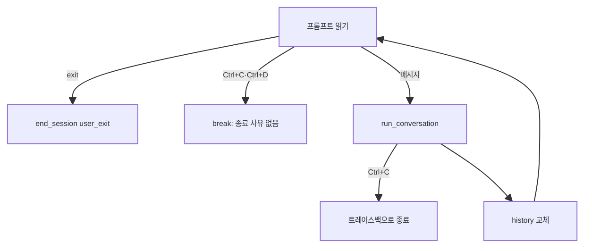
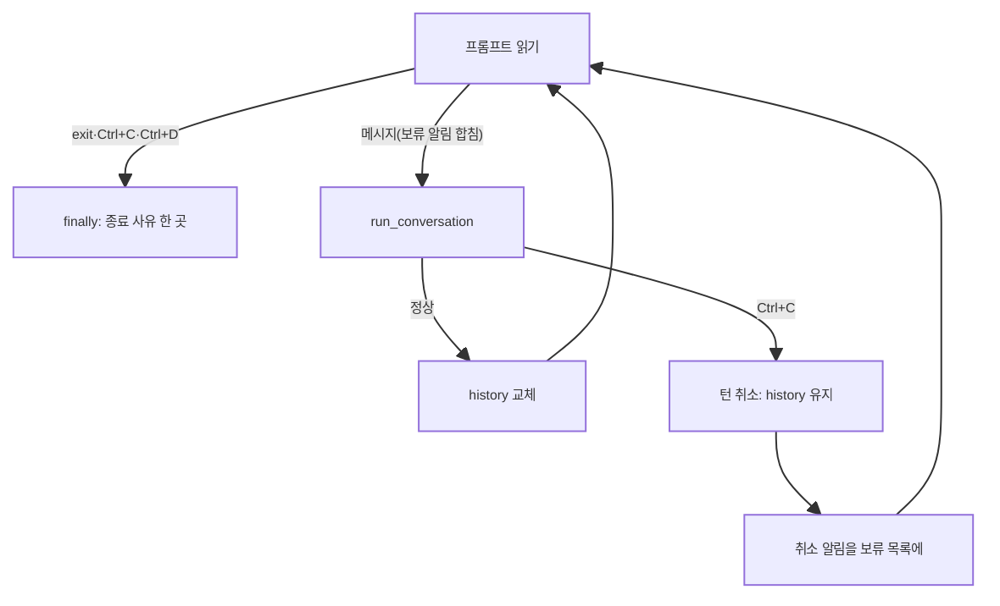
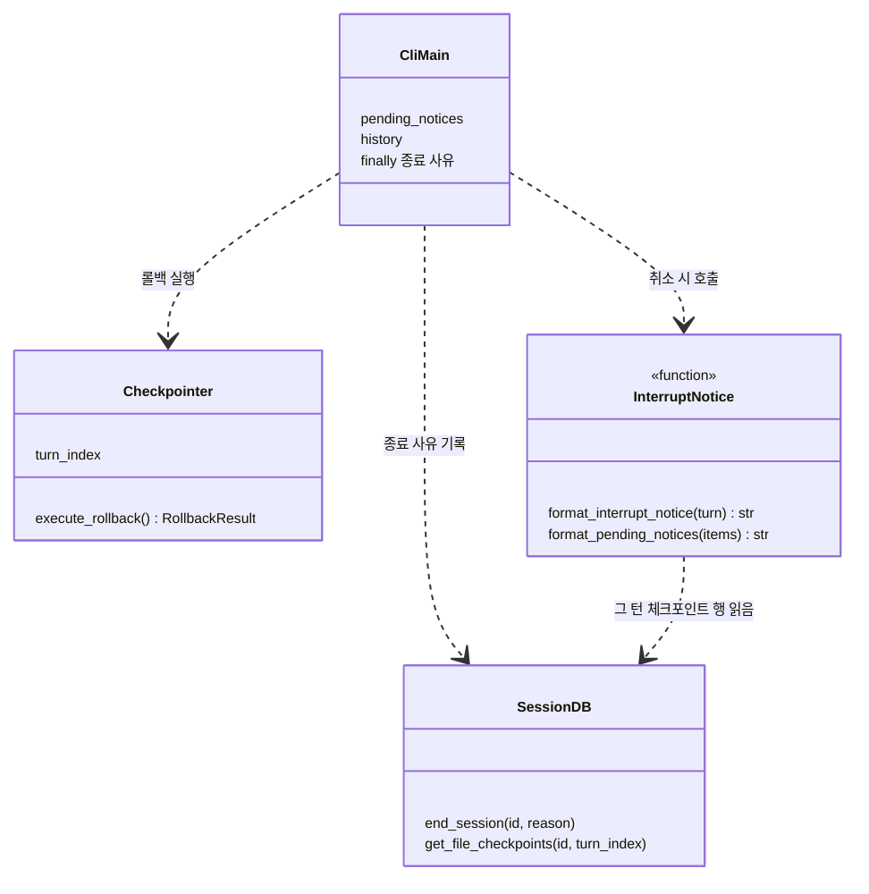
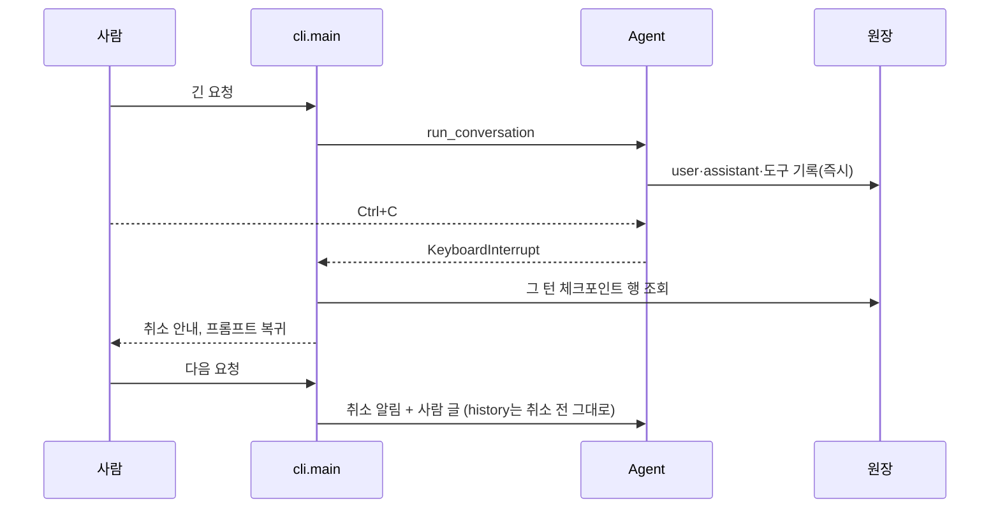
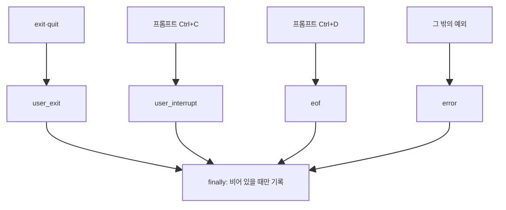

# [마스터 설계도] 13-중단·종료 정합 MVP

> **상태**: `Draft`  
> **대시보드**: [README.md](README.md)  
> **의도(Why)**: [WHY.md](WHY.md) · **승인된 계획**: [PLAN.md](PLAN.md) · **근거 결정**: [ADR-0013](../../adr/0013-중단_종료_정합_MVP_범위와_결정.md)  
> **기준 코드**: `main` `edfa894` (12 `Closed`)  
> **이름에 대해**: 010~040을 거치며 `_close_session`, `InterruptedTurn`, `format_pending_notices`, `RollbackResult.error`, `CLI_*` 상수가 정본 코드로 확정되었다.

---

## 1. 배경 및 목적 (Why)

12번까지는 정상 경로만 다뤘다. 처리 중 `Ctrl+C`는 트레이스백으로 끝나고, 프롬프트의 `Ctrl+C`·`Ctrl+D`는 종료 사유를 남기지 않으며, 중단된 턴에서 이미 바뀐 파일을 모델이 모른다. 12번의 한계 둘(알림 전에 종료, 롤백 도중 예외)도 같은 「정상이 아닌 끝」에서 나온다. 이 로드맵은 **세션이 어떻게 끝나든 사유를 남기고, 처리 중 `Ctrl+C`는 그 턴만 취소하며, 취소된 턴의 변경을 다음 사람 메시지 앞 알림으로 모델에게 전한다.**

## 2. As-Is vs To-Be 아키텍처

### 2-1. 폴더 구조 (신규·변경)

```text
src/hermes_core/
  constants.py          # 변경: 종료 사유 상수, 취소 알림 표지·문구, 화면 안내 (010·030·040)
  tools/checkpoint.py   # 변경: 취소 알림 글 만들기, execute_rollback 부분 결과 (030·040)
  cli.py                # 변경: finally 단일 종료 지점 `_close_session`, 처리 중 Ctrl+C 취소, 보류 알림 합침 (010·020·030·040)
tests/test_hermes_core/
  test_cli_interrupt.py        # 신규(잠정): 종료 사유·Ctrl+C 취소 (010·020)
  test_checkpoint_module.py    # 변경: 취소 알림 글, 부분 결과 (030·040)
  test_cli_rollback.py         # 변경: 보류 알림 합침 (030·040)
  test_cli_interrupt_e2e.py    # 신규(잠정): 실제 클라이언트 경로 E2E (050)
docs/작동원리/01-헤르메스코어-작동원리.md  # 변경: 종료·중단 동작 (050)
```

### 2-2. 구성요소 흐름: As-Is



### 2-3. 구성요소 흐름: To-Be



### 2-4. 클래스·모듈 관계



`format_rollback_notice`(12)와 `format_interrupt_notice`는 같은 보류 목록에서 일어난 순서대로 합쳐 붙인다. 보류 목록의 정확한 모양(결과 객체 목록 하나인지 글 목록인지)은 030에서 코드와 대조해 확정한다(미확인).

### 2-5. 실행 순서 (대표 시나리오: 파일을 고치는 도중 Ctrl+C → 다음 요청)



### 2-6. 세션 종료 경로 (선택: 분기)



## 3. 파급 범위와 무영향 근거 (Blast Radius)

| 대상 | 영향 | 근거 |
|---|---|---|
| `cli.py` 메인 루프 | 변경 | 종료 지점, 처리 구간의 `KeyboardInterrupt`, 보류 알림. 기존 `exit`·`/rollback`·빈 줄 처리 순서는 유지 |
| `session_db.py` `end_session` | 무변경 | 위임 자식도 호출한다(`delegate_tool.py:144`). 덮어쓰기 방지는 `cli.py`의 `_close_session`(010 확정)에 두어 자식 경로에 영향이 없다 |
| `checkpoint.py` | 추가·변경 | 취소 알림 글(순수 함수 추가), `execute_rollback`의 `try/except`와 `RollbackResult.error`(040, 기본값 있는 필드라 기존 생성 코드 영향 없음). 계획·`finalize` 로직은 무변경 |
| `dispatcher.py` `finalize` | 무변경 | 도구 실행 중 `Ctrl+C`는 이미 확정한다. 시험으로 고정만 한다 |
| `agent.py`·압축·시스템 프롬프트 | 무변경 | 취소 처리는 CLI 쪽에서 한다 |
| 원장 스키마·체크포인트 전이표·승인 결정 어휘 | 무변경 | 새 표·상태 없음. `end_reason`은 기존 자유 텍스트 칸 |
| 라이브러리 사용, 위임 자식 | 무변경 | 처리 중 취소는 CLI에만 있다 |
| 입력 읽기·미리 친 입력(09·14) | 무변경 | 입력 경로를 바꾸지 않는다. `hold_typeahead`가 예외에서도 풀리는지는 020에서 확인(미확인) |

## 4. 사전 점검 및 실패 위험 분석 (Pre-Mortem)

| # | 위험 | 분류 | 방어 |
|---|---|---|---|
| 1 | 취소 후 `history`와 원장이 어긋나 다음 호출 메시지 짝이 깨진다 | 비정형 출력·상태 정합 | `history`는 턴 시작 시점 그대로 둔다(복사본에만 이어 붙는 구조, `agent.py:330`). 시험으로 고정(가정 B) |
| 2 | 취소된 턴 도중 압축이 일어나 원장과 `history`가 달라진다 | 컨텍스트 | 코드로 확인(020 작성): 압축은 지역 목록만 교체하고 원장은 한 트랜잭션으로 활성 행을 새 압축본으로 바꾼다(`agent.py:396-440`, `session_db.py:408`). 취소하면 `history`는 압축 전이라 다음 턴에 한 번 더 압축될 뿐 원장은 일관된다. 시험 없음, 060에서 관찰 |
| 3 | 취소 연타로 트레이스백이 다시 나온다 | 상태 정합 | 보호 범위는 `run_conversation` 호출 구간뿐(020 확정). 취소 직후 프롬프트의 `Ctrl+C`는 종료(시나리오 7). 안내 출력 중 두 번째 `Ctrl+C`는 막지 않고 한계로 기록 |
| 4 | 취소 알림이 두 번 가거나 사라진다 | 상태 정합 | 롤백 알림과 같은 규칙(붙인 직후 비움, `/rollback`·빈 줄·exit에는 붙이지 않음) |
| 5 | 모델이 알림을 지시로 오해해 중단된 일을 이어서 한다 | 비인가 실행 | 문구를 「사실 + 금지」 위주로, 060에서 관찰(가정 A) |
| 6 | 터미널 자식 프로세스가 `Ctrl+C` 뒤에도 남는다 | 샌드박스 오염 | 표준 라이브러리 동작이라 코드는 만들지 않고 시험·스모크로 확인(가정 F, 미확인) |
| 7 | 종료 사유 덮어쓰기 방지가 위임 자식 세션 기록을 바꾼다 | 상태 정합 | 010에서 자식 호출 경로를 대조하고 기존 시험을 그대로 통과시킨다 |
| 8 | 강제 종료 시 사유가 비고 `pending`이 남는다 | 상태 정합 | 비목표로 명시. 롤백은 `pending`을 「결과 모름」으로 건너뛰며 경고(11번) |

## 5. 4층위 검증 범위 설계 (Validation Grid)

| 층위 | 내용 | 단계 |
|---|---|---|
| 1 Mock·픽스처 | 대본형 가짜 모델·도구가 `KeyboardInterrupt`를 일으킴, 가짜 입력 | 010·020 |
| 2 단위·구조 | 종료 사유 어휘, 취소 알림 글(표지·경로·`pending` 표기·상한), 0건일 때 없음, 부분 롤백 결과 | 010·030·040 |
| 3 상태·정합 | 모든 종료 경로의 `end_reason`, 취소 뒤 `history` 불변·원장 보존, 보류 알림의 누적·비우기, 도구 실행 중 취소 뒤 체크포인트 행 | 010~040 |
| 4 E2E | 실제 `OpenRouterClient`+`MockTransport` 경로로 취소 뒤 다음 요청의 `llm_calls.request_json`에 알림이 실렸는지, 실제 모델 스모크 3회 | 050·060 |

새 pty 시험은 만들지 않는다(D-11).

## 6. 설계 결정 상세

### 6-1. 종료 사유 단일 지점 (010)
- 종료 경로가 어디든 `main`의 `finally`가 `_close_session`을 통해 마지막에 한 번 처리한다. 이미 사유가 적힌 세션은 덮지 않는다. 사유 기본값은 `error`이고 깨끗한 종료 경로가 덮어쓴다.
- 어휘: `user_exit`·`user_interrupt`·`eof`·`error`. mock 단발 실행의 `completed`는 유지한다.

### 6-2. 처리 중 `Ctrl+C` 취소 (020)
- `agent.run_conversation` 호출 구간의 `KeyboardInterrupt`만 잡는다. 에이전트 코드는 바꾸지 않는다.
- 잡으면 안내 한 줄을 보이고 `history`를 건드리지 않은 채 프롬프트로 돌아온다. 원장은 지우지 않는다.
- 취소된 턴의 메시지에 붙었던 롤백 알림은 `history`에서 빠지므로, 취소 시 보류 목록 앞에 되돌려 놓는다(12번 규칙은 호출 전 비우기).

### 6-3. 취소 알림 (030)
- 그 턴의 `file_checkpoints` 행(`applied`·`pending`·`failed`)이 1건 이상이면 알림 글을 만들어 보류 목록에 넣는다.
- 터미널 명령은 추적하지 않는다. 표지는 12번 롤백 알림, `SUMMARY_PREFIX`와 겹치지 않는다.
- 롤백 알림과 취소 알림은 일어난 순서대로 한 번에 붙인다. 보류 목록은 `RollbackResult`와 `InterruptedTurn`을 섞어 담고(030 확정), `format_pending_notices`가 연속한 롤백 결과끼리 묶어 기존 `format_rollback_notice`에 넘긴다(12 함수는 수정하지 않음).
- 취소 알림 글에는 턴 번호를 쓰지 않는다(모델이 턴 번호를 모른다).

### 6-4. 12번 한계 처리 (040)
- 한계 4: 항목별 오류는 이미 `skipped`로 잡힌다(`checkpoint.py:530-600`). 새는 것은 복원 뒤 원장 갱신 실패 같은 그 밖의 예외다. 이때 `execute_rollback`이 루프 전체를 `try/except Exception`으로 감싸 여기까지의 결과 + 남은 항목 `skipped`(원장 행은 갱신하지 않아 재시도 가능)를 돌려주고 `RollbackResult.error`에 사유를 담는다(040 확정). 복원 0건이면 알림이 없고, 롤백 실행 도중 `Ctrl+C`는 범위 밖이다.
- 한계 2: 보류 알림이 남은 채 종료하면 `finally`에서 화면에 한 줄 안내만 한다(알림이 실제로 만들어질 때만). 원장은 늘리지 않는다.

### 6-5. 원본과 다른 점 (의도적, 원본은 읽기 전용 조사)

| 원본 (`hermes-agent/`) | 우리 | 이유 |
|---|---|---|
| 에이전트를 별도 스레드에서 돌리고, 처리 중 새 메시지를 치면 `agent.interrupt()`로 협조적 중단 신호를 보낸다 (`hermes_cli/cli_chat_turn_mixin.py:398-411`) | 에이전트를 같은 스레드에서 동기 호출하고, `Ctrl+C`의 `KeyboardInterrupt`만 잡는다 | 우리 CLI는 처리 중 입력을 받지 않는다(09·14). 스레드와 신호 플래그를 들이면 구조가 커진다 |
| 결과에 `interrupted`·`interrupt_message`가 실리고, 중단된 응답 뒤에 중단 표지를 출력한다 (`cli_chat_turn_mixin.py:519`, `:593-598`) | 결과가 없다. 안내 한 줄만 출력 | 중단 시점에 결과 객체가 없는 동기 구조다 |
| 중단 때 끼어든 새 메시지를 다음 턴으로 이어 보낸다 (`cli_chat_turn_mixin.py:600-608`) | 해당 없음(처리 중 입력 없음) | 위와 같음 |
| 중단된 턴의 메시지를 문맥에서 어떻게 다루는지: **미확인**(읽지 않음) | `history`에서 제외하고 030에서 알림 | ADR-0013 §2-4 |

## 7. 문서 동기화 방식

050에서 작동원리 01편의 종료·중단 관련 서술(`Ctrl+C`로 꺼진다, `end_reason`은 exit만)을 고친다. ADR-0012 본문은 고치지 않는다. ADR-0013이 이행 관계를 밝힌다.

## 8. 이 로드맵이 다루지 않는 것 (Non-Goals)

- 세션 간 롤백, 세션 이어받기
- 압축 뒤 알림 경로 보존
- 위임 자식의 중단 전파
- `SIGTERM`·`SIGKILL` 등 강제 종료 처리
- 터미널 명령 변경 추적과 알림
- 알림 전 종료를 위한 원장 추가 기록
- 새 pty 시험
