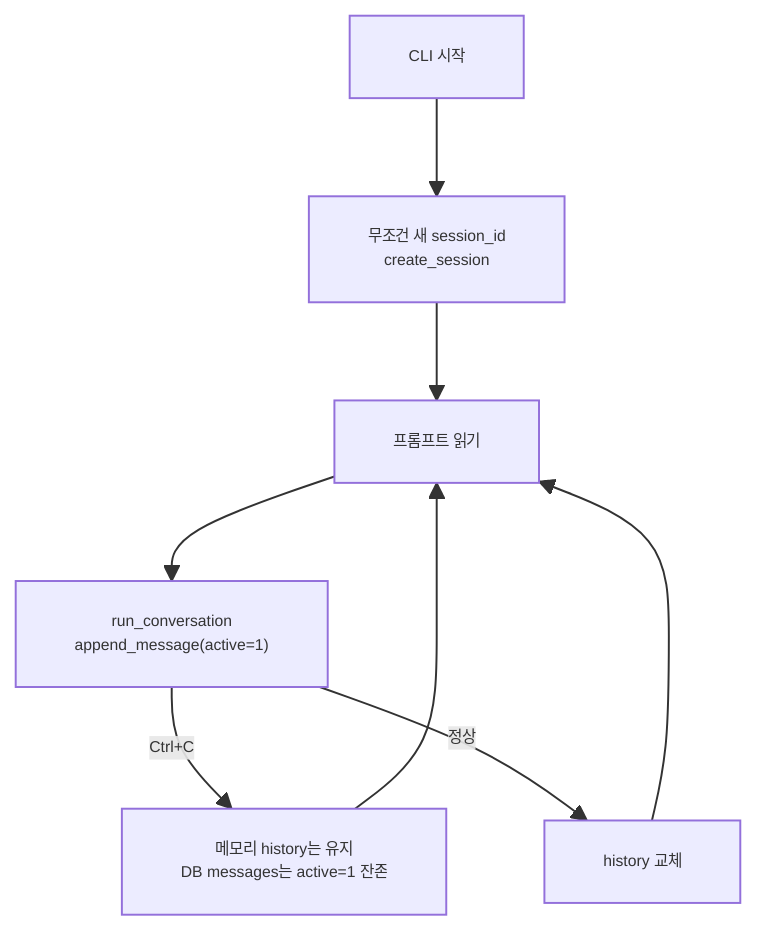
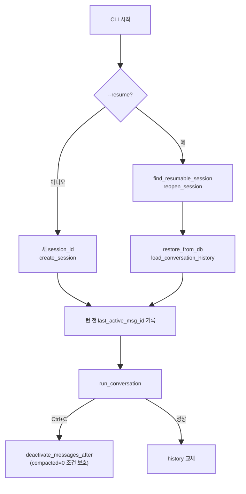
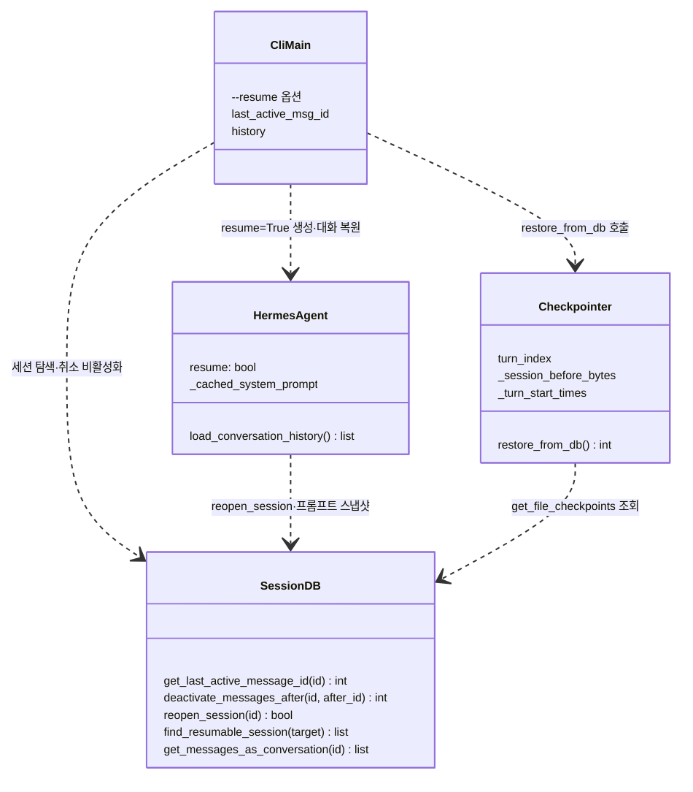
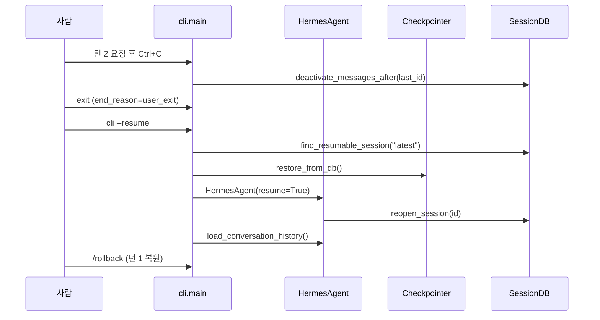

# [마스터 설계도] 14-세션 재개·원장 정합 MVP

> **상태**: `Draft`  
> **대시보드**: [README.md](README.md)  
> **의도(Why)**: [WHY.md](WHY.md) · **승인된 계획**: [PLAN.md](PLAN.md) · **근거 결정**: [ADR-0014](../../adr/0014-세션_재개_원장_정합_MVP_범위와_결정.md)  
> **기준 코드**: `main` `1aa5447` (13 `Closed`)

---

## 1. 배경 및 목적 (Why)

13번까지로 단일 실행 내에서의 대화·압축·승인·롤백·중단·종료는 모두 갖춰졌다. 그러나 (1) 처리 중 `Ctrl+C`로 취소된 턴의 미완성 메시지들이 DB `messages` 표에는 `active=1`로 남아 메모리 `history`와 원장 활성 대화가 어긋나고, (2) 세션을 다시 열어(`--resume`) 시스템 프롬프트 스냅샷·대화 이력·체크포인터 상태를 복원하는 읽기 경로(Read/Resume Path)가 없어 매번 기억상실로 시작하며 지난 실행의 변경도 `/rollback`할 수 없다(12번 한계 1).

이 로드맵은 **취소된 턴의 원장 메시지를 `active=0`으로 비활성화해 메모리 `history`와 DB `active=1`을 일치시키고, `--resume`으로 기존 세션을 다시 열어 대화와 `/rollback`을 이어 달리는 영속 상태 머신 폐루프**를 완성한다.

---

## 2. As-Is vs To-Be 아키텍처

### 2-1. 폴더 구조 (신규·변경)

```text
src/hermes_core/
  session_db.py         # 변경: get_last_active_message_id, deactivate_messages_after, reopen_session, find_resumable_session (010)
  tools/checkpoint.py   # 변경: Checkpointer.restore_from_db (020)
  agent/agent.py        # 변경: HermesAgent(resume=False), load_conversation_history (020)
  constants.py          # 변경: CLI_RESUME_* 상수 4종 (030)
  cli.py                # 변경: --resume 인자·탐색·복원 배선, Ctrl+C 시 deactivate_messages_after 호출 (030)
tests/test_hermes_core/
  test_session_resume.py     # 신규: 010·020 단위 및 정합성 시험
  test_cli_resume.py         # 신규: 030 CLI --resume 및 취소 정합 시험
  test_cli_resume_e2e.py     # 신규: 040 실제 클라이언트 경로 E2E 시험
docs/작동원리/
  01-헤르메스코어-작동원리.md  # 변경: 세션 재개 및 취소 원장 정합 반영 (040)
  04-기억-작동원리.md          # 변경: 에피소딕 원장 재개(reopen)·복원 반영 (040)
```

### 2-2. 구성요소 흐름: As-Is



### 2-3. 구성요소 흐름: To-Be



### 2-4. 클래스·모듈 관계



### 2-5. 실행 순서 (대표 시나리오: 세션 1 취소·종료 후 세션 2 `--resume` 및 `/rollback`)



---

## 3. 파급 범위와 무영향 근거 (Blast Radius)

| 대상 | 영향 | 근거 |
|---|---|---|
| `session_db.py` | 메서드 4개 추가 | 기존 메서드(`create_session`, `append_message`, `get_messages_as_conversation`, `archive_and_compact`)와 스키마 v6는 한 줄도 바꾸지 않는다 |
| `checkpoint.py` | `restore_from_db` 추가 | `__init__` 기본 동작은 그대로이며, 명시적으로 `restore_from_db()`를 부를 때만 DB에서 상태를 읽어 복원한다 |
| `agent.py` | `resume: bool = False`, `load_conversation_history` 추가 | 기본값이 `False`이므로 기존 모든 테스트·위임 자식(`delegate_tool.py`)은 기존 경로 그대로 동작한다 |
| `cli.py` | `--resume` 분기 및 취소 시 `deactivate_messages_after` 1줄 | `--resume`을 주지 않으면 새 세션 생성 흐름이 지금과 똑같다 |
| `dispatcher.py`·도구 모듈·`compression.py`·`llm_client.py` | 무변경 | 도구 실행, 압축 알고리즘, HTTP 호출 계층과 무관하다 |

---

## 4. 사전 점검 및 실패 위험 분석 (Pre-Mortem)

| # | 위험 | 분류 | 방어 |
|---|---|---|---|
| 1 | **취소된 턴 도중 컨텍스트 압축(`archive_and_compact`)이 이미 일어난 뒤 `Ctrl+C`가 들어오는 경우**: 턴 시작 전 `last_active_msg_id`보다 압축 때 삽입된 요약·꼬리 복사본 행의 `id`가 더 커서, 단순 `id > last_id`로 내리면 압축본 전체가 `active=0`이 되어 대화가 증발할 수 있다 | 컨텍스트·상태 정합 | **핵심 방어**: `archive_and_compact`가 삽입하는 행들은 요약 행(`content LIKE '[대화 요약:%'`)이거나 복사본 행(`is_copy = 1`)이다. 더 직접적으로는 압축이 일어나면 그 시점 직전의 미압축 행들이 모두 `compacted = 1`이 된다. 따라서 `deactivate_messages_after`는 ① 해당 세션에서 `compacted = 1`인 행의 최대 `id`(있으면 그 직후에 같은 타임스탬프 묶음으로 들어간 압축본의 마지막 행 `id`, 즉 요약·`is_copy=1` 행들의 최대 `id`)와 `after_id` 중 **더 큰 값(`effective_after_id`)** 이후의 행만 `active=0`으로 내린다! 이렇게 하면 턴 도중 압축이 일어났더라도 압축본(요약 + 보호 꼬리)은 100% `active=1`로 살아남고, 압축 **이후**에 그 턴에서 새로 추가된 미완성 어시스턴트·도구 행만 정확히 `active=0`이 된다 (가정 B, 010 시나리오로 고정) |
| 2 | `--resume %`나 `--resume _`처럼 SQL `LIKE` 와일드카드가 들어와 의도치 않은 세션이 전부 매칭된다 | 비정형 입력 | `find_resumable_session`에서 `\`, `%`, `_`를 `\`로 이스케이프하고 `id LIKE ? ESCAPE '\'`를 사용한다 (010 시나리오 고정) |
| 3 | 위임 자식(`source='subagent'` 또는 `parent_session_id IS NOT NULL`) 세션이 `--resume` 최신 세션으로 잘못 선택된다 | 상태 정합 | `WHERE source = 'cli' AND parent_session_id IS NULL` 조건을 고정한다 (010 시나리오 고정) |
| 4 | 재개된 세션이 끝날 때 이전 실행의 `end_reason` 때문에 새 종료 사유가 무시된다 | 상태 정합 | `HermesAgent(resume=True)` 초기화 시 `reopen_session`이 `ended_at = NULL, end_reason = NULL`로 비운다 (가정 F, 010·020·030 고정) |
| 5 | 재개 전 첫 실행에서 한 마디도 안 하고 종료해 `system_prompt`가 `NULL`이고 `active=1` 메시지가 0건인 빈 세션을 재개한다 | 상태 정합 | `_cached_system_prompt`는 `None`으로 두어 첫 턴에 정상 조립되게 하고, `load_conversation_history()`는 활성 메시지가 0건이면 `None`을 반환해 새 세션 첫 턴과 동일하게 동작시킨다 (020·030 시나리오 고정) |
| 6 | 재개 후 새 턴에서 파일을 고칠 때 `turn_index`가 1부터 시작해 이전 실행의 체크포인트 턴 번호와 섞인다 | 샌드박스·상태 정합 | `Checkpointer.restore_from_db()`가 DB의 `MAX(turn_index)`를 복원하므로 다음 `begin_turn()`은 `MAX + 1`이 된다 (가정 E, 020 시나리오 고정) |

---

## 5. 4층위 검증 범위 설계 (Validation Grid)

| 층위 | 내용 | 단계 |
|---|---|---|
| 1 Mock·픽스처 | 메모리/임시 SQLite DB, 대본형 `InterruptingClient`, 가짜 입력 | 010~030 |
| 2 단위·구조 | `get_last_active_message_id`, `deactivate_messages_after`(일반·압축 후), `reopen_session`, `find_resumable_session`(latest·접두사·와일드카드·자식 제외), `restore_from_db`, `HermesAgent(resume=True)` | 010·020 |
| 3 상태·정합 | CLI 처리 중 `Ctrl+C` 뒤 `get_messages_as_conversation`과 메모리 `history` 일치, `--resume` 후 대화 이어가기·이전 세션 `/rollback`·종료 사유 재기록 | 030 |
| 4 E2E | 실제 `OpenRouterClient`+`MockTransport`로 세션 1(파일 생성·취소·종료) → 세션 2(`--resume`·`/rollback`·다음 질문) 전체 검증, 실제 모델 터미널 스모크 | 040·050 |

---

## 6. 설계 결정 상세

### 6-1. 원장 정합 및 세션 재개 DB 계약 (010)
- `get_last_active_message_id(session_id: str) -> int`:
  - `SELECT COALESCE(MAX(id), 0) FROM messages WHERE session_id = ? AND active = 1`
- `deactivate_messages_after(session_id: str, after_id: int) -> int`:
  - 압축 보호 기준점 계산: 해당 세션에서 압축(`archive_and_compact`)이 삽입한 행(`is_copy = 1` 또는 요약 행 `role IN ('user', 'assistant') AND content LIKE ?`(SUMMARY_PREFIX + '%'))의 `MAX(id)`를 구해 `compaction_max_id`라 할 때, `effective_after_id = max(after_id, compaction_max_id)`.
  - `UPDATE messages SET active = 0 WHERE session_id = ? AND active = 1 AND id > ?` (`(session_id, effective_after_id)`).
  - 변경된 행 수(`cursor.rowcount`)를 반환하고 커밋한다.
- `reopen_session(session_id: str) -> bool`:
  - `UPDATE sessions SET ended_at = NULL, end_reason = NULL WHERE id = ?`
  - `cursor.rowcount > 0` 반환.
- `find_resumable_session(target: Optional[str] = None) -> list[dict[str, Any]]`:
  - 기본 필터: `source = 'cli' AND parent_session_id IS NULL`.
  - `target is None` 또는 `target.strip().lower() == "latest"`:
    - `SELECT * FROM sessions WHERE source = 'cli' AND parent_session_id IS NULL ORDER BY started_at DESC, rowid DESC LIMIT 1`
  - 그 외: `prefix = target.strip()`. 빈 문자열이면 `[]` 반환. `escaped = prefix.replace("\\", "\\\\").replace("%", "\\%").replace("_", "\\_")`.
    - `SELECT * FROM sessions WHERE source = 'cli' AND parent_session_id IS NULL AND id LIKE ? ESCAPE '\\' ORDER BY started_at DESC, rowid DESC` (`f"{escaped}%"`).

### 6-2. 체크포인터 및 에이전트 복원 (020)
- `Checkpointer.restore_from_db() -> int`:
  - `rows = self.db.get_file_checkpoints(self.session_id)`
  - 행이 없으면 `self.turn_index = 0`, `self._session_before_bytes = 0`, `self._turn_start_times = {}`로 두고 `0` 반환.
  - 행이 있으면:
    - `self.turn_index = max(r["turn_index"] for r in rows)`
    - `self._session_before_bytes = sum(len(r["before_content"].encode("utf-8")) for r in rows if r["before_exists"] and isinstance(r["before_content"], str))`
    - `self._turn_start_times`: 각 `turn_index`별 `min(r["created_at"])` 저장, `self.turn_started_at = self._turn_start_times.get(self.turn_index, 0.0)`.
  - `self.turn_index` 반환.
- `HermesAgent.__init__(..., resume: bool = False)`:
  - `self.resume = resume` 저장.
  - `if not self.resume:` 기존 `self.session_db.create_session(...)` 실행 및 `self._cached_system_prompt = None`.
  - `else:`
    - `existing = self.session_db.get_session(self.session_id)`
    - `if existing is None: raise ValueError(f"Session '{self.session_id}' does not exist.")`
    - `self.session_db.reopen_session(self.session_id)`
    - `saved_prompt = existing.get("system_prompt")`
    - `self._cached_system_prompt = saved_prompt if isinstance(saved_prompt, str) and saved_prompt else None`
- `HermesAgent.load_conversation_history() -> Optional[list[dict[str, Any]]]`:
  - `active_msgs = self.session_db.get_messages_as_conversation(self.session_id)`
  - `if not active_msgs: return None`
  - `sys_prompt = self._build_system_prompt()`
  - `return [{"role": "system", "content": sys_prompt}, *active_msgs]`

### 6-3. CLI 취소 정합 및 `--resume` 배선 (030)
- `cli.py` 인자: `--resume` (`nargs="?"`, `const="latest"`, `default=None`).
- `--mock`과 `--resume` 동시 지정 시 `CLI_RESUME_MOCK_ERROR`를 `stderr`에 출력하고 `sys.exit(2)`.
- `args.resume is not None`일 때:
  - `matches = session_db.find_resumable_session(args.resume)`
  - 0건이면: `args.resume.strip().lower() == "latest"`일 때 `detail = ""`, 아니면 `detail = f" matching '{args.resume.strip()}'"`. `CLI_RESUME_NOT_FOUND_ERROR.format(detail=detail)`를 `stderr`에 출력, `session_db.close()`, `sys.exit(2)`.
  - 2건 이상이면: `short_ids = ", ".join(m["id"][:8] for m in matches[:5])`로 `CLI_RESUME_AMBIGUOUS_ERROR.format(prefix=args.resume.strip(), matches=short_ids)`를 `stderr`에 출력, `session_db.close()`, `sys.exit(2)`.
  - 1건이면: `session_id = matches[0]["id"]`, `is_resuming = True`.
- `is_resuming`이면:
  - `checkpointer`가 있을 때 `restored_turn = checkpointer.restore_from_db()` 호출(없으면 `0`).
  - `HermesAgent(..., resume=True)` 호출.
  - `history = agent.load_conversation_history()`로 초기 대화 복원, 활성 메시지 수는 `0 if history is None else len(history) - 1`.
  - 배너에 `CLI_RESUMED_BANNER_NOTICE.format(session_id=agent.session_id[:8], message_count=active_count, turn_index=restored_turn)` 출력.
- 처리 중 `Ctrl+C` 취소 시:
  - `run_conversation` 호출 직전에 `last_active_msg_id = agent.session_db.get_last_active_message_id(agent.session_id)` 기록.
  - `except KeyboardInterrupt:` 안에서 `agent.session_db.deactivate_messages_after(agent.session_id, last_active_msg_id)` 호출(예외는 `logger.warning`으로 흡수).

### 6-4. 원본과 다른 점 (원본은 읽기 전용 조사)

| 원본 (`hermes-agent/`) | 우리 (`hermes_core`) | 이유 |
|---|---|---|
| `reopen_session`이 큐 행 정리, 리셋 자식 표시, 아카이브 해제를 함께 수행 (`hermes_state_sessions.py:513-536`) | `ended_at = NULL, end_reason = NULL`만 수행 | 우리는 백그라운드 큐·세션 리셋 트리·자동 아카이브가 없는 단일 코어 구조다 |
| 게이트웨이·TUI·CLI 프로필별로 세션 복구 경로가 나뉨 | `source = 'cli' AND parent_session_id IS NULL` 단일 조건 | 학습용 CLI 코어의 단순하되 견고한 경계 유지 |

---

## 7. 문서 동기화 방식

040에서 [01-헤르메스코어-작동원리.md](../../작동원리/01-헤르메스코어-작동원리.md)(Q12 취소 시 장부 비활성화, 새 Q13 또는 세션 이어받기 설명, 3·5부)와 [04-기억-작동원리.md](../../작동원리/04-기억-작동원리.md)(세션 재개방과 활성 대화 복원)를 실제 코드와 4축 대조해 갱신한다.

---

## 8. 이 로드맵이 다루지 않는 것 (Non-Goals)

- 대화 중간 턴에서 가지치기(Branching / Forking)
- 대화형 세션 선택 TUI 메뉴
- 위임 자식(`subagent`) 세션 단독 재개
- `--mock` 모드での `--resume`
- 종료 시 미전송 보류 알림(`pending_notices`)의 다음 실행 승계
- DB 스키마 변경 및 새 pty 시험
