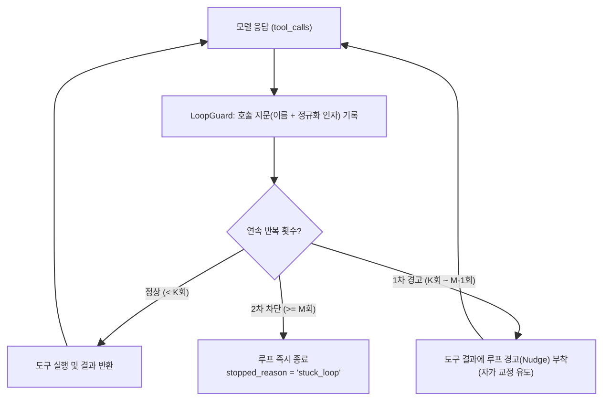

# [마스터 설계도] 15-루프 정체 감지·자가 교정 MVP (초안)

> **상태**: `Blocked` (14번 마감 후 구체화)  
> **대시보드**: [README.md](README.md) · **의도( 초안)**: [WHY.md](WHY.md) · **계획(초안)**: [PLAN.md](PLAN.md)

---

## 1. 핵심 구조 요약



---

## 2. 예상 변경 범위 (초안)

```text
src/hermes_core/
  constants.py          # 변경: LOOP_GUARD_NUDGE_THRESHOLD, LOOP_GUARD_BREAK_THRESHOLD, 안내 문구 상수
  agent/loop_guard.py   # 신규: 정규화 지문 생성 및 연속/반복 판정 순수 클래스 LoopGuard
  agent/agent.py        # 변경: run_conversation / _execute_tool_calls 내 LoopGuard 연동 및 stopped_reason="stuck_loop"
  cli.py                # 변경: stopped_reason == "stuck_loop" 시 화면 안내 출력
tests/test_hermes_core/
  test_loop_guard.py    # 신규: 지문 정규화·경고·차단 단위 및 에이전트 통합 시험
```

---

## 3. 핵심 메커니즘 (14번 마감 후 상세 확정)

1. **인자 정규화 지문 (`make_call_fingerprint`)**:
   - JSON 파싱 성공 시 `json.dumps(args, sort_keys=True, ensure_ascii=False)`로 키 순서·공백 차이를 제거한 정규화 지문 `(func_name, canonical_json)`을 생성한다.
   - 인자 파싱 실패 시에도 `(func_name, raw_str.strip())`으로 지문을 만들어, 잘못된 JSON을 똑같이 반복 전송하는 루프도 동일하게 감지한다.
2. **오탐(False Positive) 원천 차단**:
   - `read_file("a.txt")` → `read_file("b.txt")` → `read_file("c.txt")`처럼 같은 도구라도 인자가 다르면 지문이 다르므로 개입하지 않는다.
3. **2단계 개입**:
   - **1차 (Nudge)**: 모델에게 현재 루프에 빠졌음을 알리고 다른 접근법(파일 재확인, 다른 도구, 사용자 질문)을 택하도록 유도.
   - **2차 (Circuit Breaker)**: `stopped_reason = "stuck_loop"`으로 루프를 즉시 탈출하고 CLI에 정체 중단 사실을 표시.
