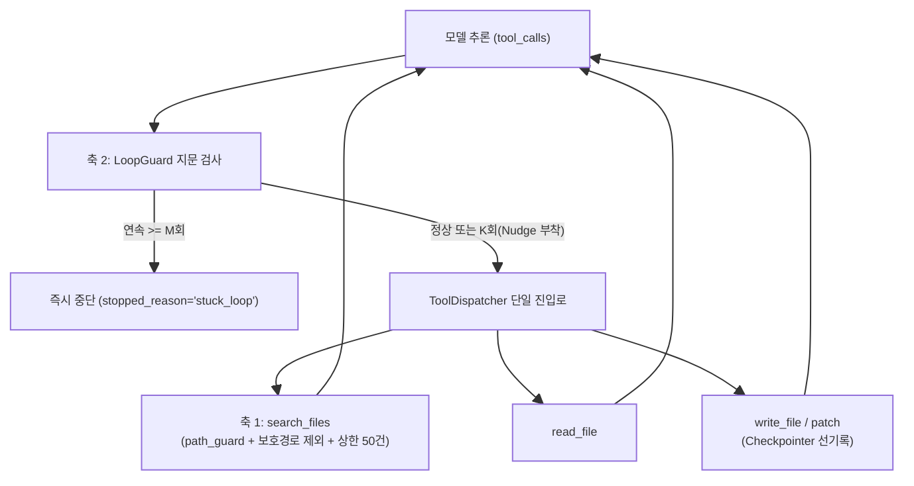

# [마스터 설계도] 15-탐색 도구(`search_files`) 및 루프 정체 감지(`LoopGuard`) MVP (초안)

> **상태**: `Blocked` (14번 마감 후 구체화)  
> **대시보드**: [README.md](README.md) · **의도(초안)**: [WHY.md](WHY.md) · **계획(초안)**: [PLAN.md](PLAN.md)

---

## 1. 핵심 구조 요약 (Search → Read → Edit + LoopGuard)



---

## 2. 예상 변경 범위 (초안)

```text
src/hermes_core/
  constants.py          # 변경: SEARCH_MAX_* 상수, CHILD_TOOL_NAMES에 search_files 추가, LOOP_GUARD_* 상수
  tools/file_tools.py   # 변경: SEARCH_FILES_SCHEMA 및 search_files_tool 구현 (path_guard 연동)
  tools/dispatcher.py   # 변경: _DEFAULT_TOOL_NAMES 및 create_default_dispatcher에 search_files 등록
  agent/prompt_builder.py # 변경: TOOL_GUIDANCE_MAP에 search_files 안내 1줄 추가
  agent/loop_guard.py   # 신규: 정규화 지문 생성 및 연속 반복 판정 순수 클래스 LoopGuard
  agent/agent.py        # 변경: run_conversation / _execute_tool_calls 내 LoopGuard 연동
  cli.py                # 변경: stopped_reason == "stuck_loop" 시 화면 안내 출력
tests/test_hermes_core/
  test_search_files.py  # 신규: search_files 단위·보안 경계·상한 시험
  test_loop_guard.py    # 신규: 지문 정규화·Nudge·stuck_loop 차단 시험
```

---

## 3. 핵심 메커니즘 요약 (14번 마감 후 상세 확정)

### 3-1. 축 1: `search_files` (탐색 → 읽기 → 수정 3박자 완성)
- **입력 인자**:
  - `path` (선택, 기본 `"."`): 탐색 시작 상대 경로 (`check_read_path`로 작업 폴더 경계 검증).
  - `pattern` (선택): 파일 내용에서 찾을 문자열(기본 리터럴, 선택적 정규식).
  - `file_glob` (선택, 기본 `"*"`): 파일 이름 필터(예: `"*.py"`).
  - `pattern`과 `file_glob`이 모두 비어 있으면 거부.
- **안전 장치**:
  - 순회 중 `is_protected_path`(비밀 파일 `.env*`, `.git`, `.hermes` 등)에 해당하는 모든 파일·디렉터리는 **자동으로 건너뛴다**(에러로 멈추지 않고 결과에서 조용히 제외).
  - 심볼릭 링크를 따라가 작업 폴더 밖으로 나가는 경로는 차단한다.
  - 결과 건수(`SEARCH_MAX_MATCHES = 50`)와 줄 길이(`SEARCH_MAX_LINE_CHARS = 200`) 상한을 초과하면 `truncated: True`와 함께 잘라내어 컨텍스트 오버플로를 원천 방지한다.

### 3-2. 축 2: `LoopGuard` (루프 정체 감지·자가 교정)
- **지문 정규화**: `(func_name, json.dumps(args, sort_keys=True))`로 공백·키 순서 무관하게 동일 호출을 식별한다.
- **2단계 개입**:
  - 연속 $K=3$회 동일 호출 시 도구 결과 끝에 루프 경고를 붙여 모델 스스로 다른 도구(`search_files`, `read_file`)를 쓰거나 사람에게 묻도록 유도한다.
  - 연속 $M=5$회 도달 시 `stopped_reason = "stuck_loop"`으로 루프를 즉시 종료한다.
