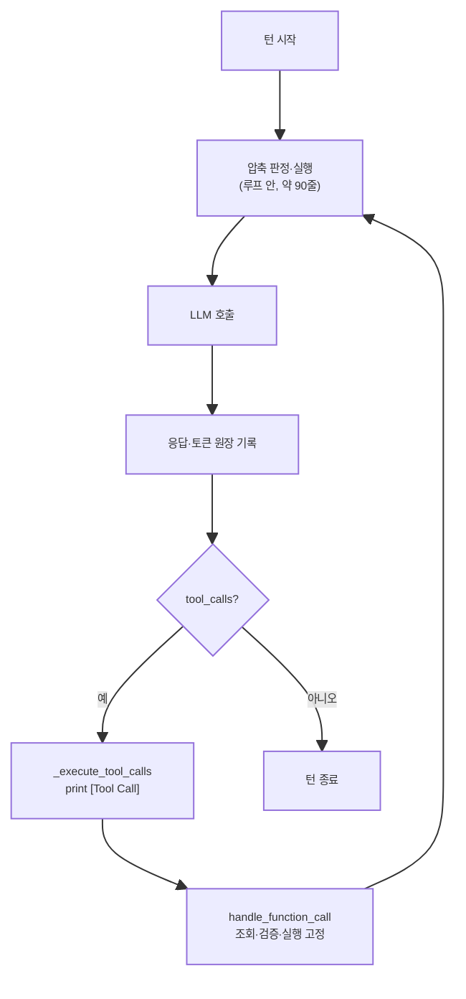
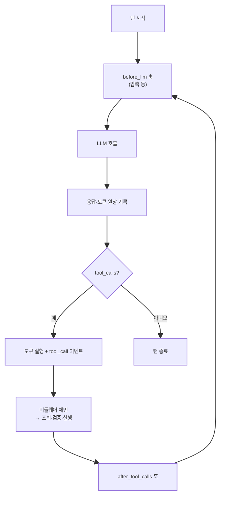
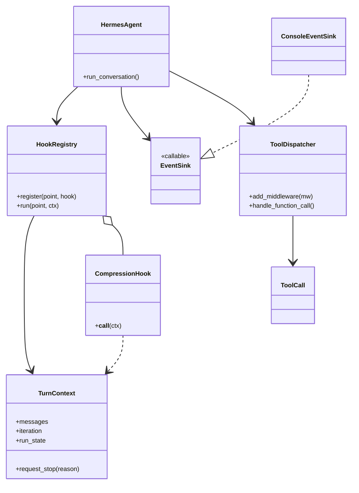
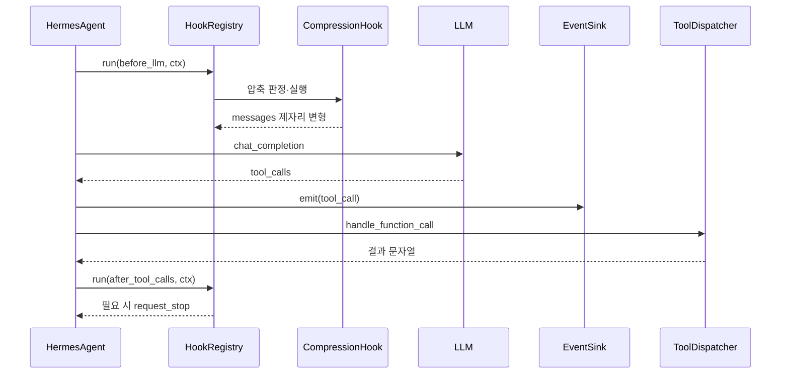

# [마스터 설계도] 15-코어 확장 파이프라인 MVP

> **상태**: `Draft`  
> **대시보드**: [README.md](README.md)  
> **의도(Why)**: [WHY.md](WHY.md) · **승인된 계획**: [PLAN.md](PLAN.md) · **근거 결정**: [ADR-0015](../../adr/0015-코어_확장_파이프라인_MVP_범위와_결정.md)  
> **기준 코드**: `main` `569e606` (14 `Closed`, 16 `Draft`)

---

## 1. 배경 및 목적 (Why)

14번까지의 기능(압축, 승인, 체크포인트, 재개)은 대화를 되풀이하는 부분(`HermesAgent.run_conversation`, [`agent.py:338-546`](../../../src/hermes_core/agent/agent.py), 약 208줄)과 도구의 문(`ToolDispatcher.handle_function_call`, [`dispatcher.py:107`](../../../src/hermes_core/tools/dispatcher.py))에 직접 박혀 있다. 압축 블록만 약 90줄(`agent.py:378-468`)이고, 코드 전체에 hook·middleware·callback 구조가 없다. 새 기능은 매번 이 두 곳을 직접 고쳐야 하고, 곧 들어올 16번 `LoopGuard`도 마찬가지다.

이 로드맵은 **새 기능이 붙는 자리를 용도별로 정해 둔다**: 도구 호출은 **미들웨어 체인**, 턴 단계는 **훅**, 화면 알림은 **이벤트 sink**. 그리고 기존 기능 둘(압축, 루프 안 `print`)을 새 자리로 옮겨 구조가 쓸 만함을 보인다. 새 능력을 더하는 로드맵이 아니다.

---

## 2. As-Is vs To-Be 아키텍처

### 2-1. 폴더 구조 (신규·변경)

```text
src/hermes_core/
  agent/
    events.py             # 신규: AgentEvent, EventSink, ConsoleEventSink (010)
    turn_hooks.py         # 신규: TurnContext, HookRegistry, 훅 지점 이름 (030)
    compression_hook.py   # 신규: CompressionHook (압축 판정·실행·원장 반영) (030)
    agent.py              # 변경: event_sink 인자·hooks 속성 추가, print → 이벤트, 압축 블록 → before_llm 호출 (010·030)
  tools/
    dispatcher.py         # 변경: ToolCall, add_middleware, 체인 호출 (020)
tests/test_hermes_core/
  test_agent_events.py        # 신규: 010 이벤트 시험
  test_dispatcher_middleware.py  # 신규: 020 체인 시험
  test_turn_hooks.py          # 신규: 030 훅 계약·압축 동일성 시험
  test_pipeline_extension.py  # 신규: 040 루프 무수정 확장 예시·E2E
docs/작동원리/
  03-코어구조-메인루프-확장방식.md  # 변경: 확장 방식 개정 (040)
docs/
  코딩규약.md                  # 변경: §1 개념 대조표·§3 확장 규칙 (040)
```

### 2-2. 구성요소 흐름: As-Is



### 2-3. 구성요소 흐름: To-Be



훅은 `request_stop`으로 턴 종료를 요청할 수 있다(`H2` 뒤, 반복 종료 판정에서 반영). 이벤트는 `X`와 훅 예외 지점에서 sink로 나간다(응답을 기다리지 않음).

### 2-4. 클래스·모듈 관계



의존 방향은 `HermesAgent` → 확장 장치 쪽 한 방향이다. `CompressionHook`은 `compression.py`·`context_budget.py`·`SessionDB`를 쓰고, 이 새 모듈들은 `cli.py`를 모른다.

### 2-5. 실행 순서 (대표 시나리오: 도구 호출이 있는 한 턴)



**미확인**: `after_tool_calls`의 호출 위치(도구 결과를 `messages`와 장부에 모두 적은 뒤)는 지시서 030에서 `_execute_tool_calls` 끝으로 확정한다. 기존 도구 쌍 기록 순서(`messages` append → `append_message`)는 바꾸지 않는다.

---

## 3. 파급 범위와 무영향 근거 (Blast Radius)

| 대상 | 영향 | 근거 |
|---|---|---|
| `agent/agent.py` | `event_sink` 인자와 `hooks` 속성 추가, `print` 제거, 압축 블록(`378-468`)을 훅 호출로 교체 | 인자 기본값이 현재 동작을 재현한다(기본 sink는 같은 문자열을 `print`, 기본 레지스트리는 압축 훅을 담음). 기존 속성 `_last_input_tokens`·`_rejected_at_tokens`·`_last_message_count`는 읽기·쓰기 호환을 유지한다 |
| `tools/dispatcher.py` | `add_middleware`와 체인 호출 추가 | 미들웨어 0개일 때 안쪽 실행이 현재 코드와 같은 순서(조회→검증→실행)와 같은 오류 JSON을 낸다 |
| 신규 `events.py`·`turn_hooks.py`·`compression_hook.py` | 추가만 | 기존 모듈이 이들을 부르는 방향만 생긴다 |
| `cli.py`·`session_db.py`·`llm_client.py`·`compression.py`·`context_budget.py`·각 도구 | 무변경 | 압축 알고리즘·장부·도구 로직은 호출 방식만 바뀌고 내용은 그대로다. `cli.py`는 `HermesAgent(...)` 기본값을 쓰므로 수정이 필요 없다(**미확인**: 010·030에서 `cli.py` 무수정 확인) |
| `delegate_tool.py`(자식) | 무변경 | 자식은 `quiet_mode=True`라 sink가 없고, 기본 레지스트리에는 압축 훅이 들어 자식도 현재처럼 압축한다 |
| 기존 시험 ~800개 | 무수정 통과가 합격 기준 | 특히 `test_compression_agent.py`가 `agent.llm_client = client2`로 생성 후 속성을 바꾸므로, 압축 훅은 호출 시점에 에이전트의 속성을 읽는다 |

---

## 4. 사전 점검 및 실패 위험 분석 (Pre-Mortem)

| # | 위험 | 분류 | 방어 |
|---|---|---|---|
| 1 | **압축 이관 중 순서가 바뀌어 장부와 대화가 어긋남**: 현재는 `archive_and_compact` 성공 뒤에만 `messages[:] = ...`로 교체하고 실패하면 원본 유지 (`agent.py:434-462`) | 상태 정합 | 훅 안에서 같은 순서를 그대로 옮기고, 이관 전후 동일 Mock 입력의 `messages`·장부 행·`result["compression"]` 동일성 시험(030). 기존 압축 시험 무수정 통과 |
| 2 | **훅이 시스템 프롬프트를 바꿔 캐시를 깸** (코딩규약 §3-1) | 비인가 변형 | 훅 실행 뒤 `messages[0]`의 `role`·`content` 검사, 달라지면 복구와 경고(030). 객체 동일성은 보지 않는다 — 압축이 시스템 메시지를 복사본으로 다시 만든다(`prune_old_tool_results`) |
| 3 | **훅 예외가 턴을 죽이거나, 반대로 조용히 묻힘** | 루프 안정 | 예외는 격리해 턴을 계속하고 `logger.warning`과 `hook_error` 이벤트로 드러낸다(030) |
| 4 | **미들웨어가 문자열이 아닌 값을 돌려줘 `tool` 메시지가 깨짐** (`content=None` 등) | 비정형 출력 | 체인 결과가 `str`이 아니면 오류 JSON으로 바꾼다(020 시나리오 고정) |
| 5 | **미들웨어를 우회하는 경로가 생겨 단일 진입로가 깨짐** (코딩규약 §3-6) | 샌드박스 | 체인은 `handle_function_call` 안에만 있다. 직접 `_handlers`를 호출하는 경로가 없음을 검색으로 확인(020) |
| 6 | **훅 지점이 소비자 없이 늘어남** (AGENTS §1-4) | 설계 | 지점 2개 고정. 새 지점은 소비자와 함께 ADR을 거쳐 추가 |
| 7 | **`after_tool_calls`·미들웨어의 실제 소비자가 15에 없어 증명이 약함** | 검증 공백 | 040의 확장 예시(시험용 기능)로 보강하고 한계로 명시. 실제 소비자는 16 |
| 8 | **`R15-*` 식별자 충돌** (이전 15번 → 현 16번의 커밋 제목) | 추적성 | PLAN.md·대시보드의 번호 안내. 날짜와 경로로 구분 |

---

## 5. 4층위 검증 범위 설계 (Validation Grid)

| 층위 | 내용 | 단계 |
|---|---|---|
| 1 Mock·픽스처 | `MockLLMClient`, 임시 SQLite DB, 가짜 sink·훅·미들웨어, `capsys` | 010~040 |
| 2 단위·구조 | 이벤트 방출과 `ConsoleEventSink` 출력 문자열, 미들웨어 순서·차단·예외·비문자열 결과, `HookRegistry` 등록·실행·예외 격리·시스템 메시지 검사·`request_stop` | 010·020·030 |
| 3 상태·정합 | 압축 이관 전후 `messages`·장부 행(`active`·`compacted`)·`result["compression"]` 동일성, 기존 압축·재개 시험 무수정 통과 | 030·040 |
| 4 E2E | 실제 `OpenRouterClient`+`MockTransport`로 훅·미들웨어·sink가 모두 붙은 한 세션, 실제 모델 터미널 스모크 | 040·050 |

---

## 6. 설계 결정 상세

### 6-1. 이벤트 출력 계층 (010)
- `events.py`에 `AgentEvent(kind, data)`(불변), `EventSink = Callable[[AgentEvent], None]`, `ConsoleEventSink`를 둔다. 이벤트 종류 이름은 상수로 둔다(`EVENT_TOOL_CALL = "tool_call"`, 030에서 `EVENT_HOOK_ERROR` 추가).
- `ConsoleEventSink`는 `tool_call`을 받아 `  [Tool Call] {name}({arguments})`를 `print`한다(**현재 문자열과 동일**). 모르는 종류는 무시한다.
- `HermesAgent(event_sink=None)`: 주어지면 그 sink, 없고 `quiet_mode=False`면 `ConsoleEventSink()`, `quiet_mode=True`면 sink 없음. `_emit(kind, **data)`가 sink 예외를 삼키고 경고만 남긴다.
- 방출 위치는 지금 `print`가 있는 자리(`agent.py:307`, 도구 실행 직전)를 그대로 쓴다.

### 6-2. 도구 미들웨어 체인 (020)
- `ToolCall(name, args, task_id)`를 만들고, 미들웨어는 `mw(call, next) -> str`이다. `add_middleware(mw)`는 목록 끝에 추가한다. 먼저 등록한 것이 바깥이다.
- 체인의 안쪽 끝은 현재의 조회 → `_validate_arguments` → 핸들러 실행(`TypeError`·일반 예외 → 기존 오류 JSON)이다. 미들웨어가 없으면 이 안쪽만 실행된다.
- 체인 실행 중 미들웨어가 던진 예외는 `Tool '<name>' failed: ...` JSON으로 바꾼다. 결과가 `str`이 아니면 오류 JSON으로 바꾼다.
- `handle_function_call`의 시그니처와 반환형은 그대로다. `create_child_dispatcher`로 만든 자식 디스패처에는 미들웨어를 달지 않는다.

### 6-3. 턴 훅 레지스트리와 압축 이관 (030)
- `turn_hooks.py`: 지점 상수 `BEFORE_LLM`, `AFTER_TOOL_CALLS`. `TurnContext`는 `messages`(루프와 같은 리스트), `tools_schema`, `iteration`, `session_id`, `run_state`(턴 한 번 동안 훅이 공유하는 사전), `request_stop(reason)`(먼저 요청한 것이 이긴다)을 가진다. `TurnContext`는 `run_conversation` 호출마다 새로 만든다.
- `HookRegistry.register(point, hook)`는 모르는 지점이면 `ValueError`. `run(point, ctx)`는 등록 순서대로 실행하며, 각 훅 실행 뒤 `messages[0]`(시스템 메시지가 있을 때)의 `role`·`content`를 호출 전과 비교해 달라졌으면 복구하고 경고한다. 훅 예외는 격리한다.
- `run_conversation`은 `BEFORE_LLM` 지점에서 `run`을 부르고, 도구 실행이 끝난 뒤 `AFTER_TOOL_CALLS`를 부른다. 한 지점 실행 뒤 `ctx.stop_reason`이 있으면 반복을 끝내고 그 값을 `stopped_reason`으로 쓴다.
- `compression_hook.py`의 `CompressionHook(agent)`가 현재 `agent.py:378-468`의 블록을 그대로 옮긴다: 판정(`should_compress`·`may_retry_after_reject`) → `compress_messages` → `archive_and_compact` 성공 시에만 `messages[:] = ...` → 토큰 추정 상태 초기화 → 사용량 반영. 호출 시점에 `agent`의 `llm_client`·`context_window_tokens`·`compression_threshold_ratio`·`compression_enabled`를 읽는다. 시도·성공·폴백 횟수는 `ctx.run_state["compression"]`에 쌓고, `run_conversation`이 마지막에 현재와 같은 형식으로 `result["compression"]`을 만든다.
- 토큰 추정 상태(`_last_input_tokens`, `_last_message_count`, `_rejected_at_tokens`)는 에이전트가 계속 소유하며(루프의 usage 처리가 갱신), 훅이 읽고 갱신한다. 기존 시험이 직접 읽으므로 속성 이름과 의미를 바꾸지 않는다.
- 레지스트리 소유: `HermesAgent`는 생성자에서 `self.hooks = HookRegistry()`를 만들고 `CompressionHook(self)`를 `BEFORE_LLM`에 **먼저** 등록한다. 생성자 인자로 레지스트리를 받지 않는다(받으면 압축이 조용히 꺼지는 실수가 가능하다). 추가 훅은 `agent.hooks.register(point, hook)`로 붙이고, 압축을 쓸지는 훅이 호출 시점에 `agent.compression_enabled`를 읽어 판단한다(시험이 생성 후 속성을 바꾸므로).

### 6-4. 통합 검증과 확장 예시 (040)
- 시험용 기능 하나(예: 도구 호출 횟수를 세고 N회가 넘으면 `request_stop("budget")`)를 훅·미들웨어·sink 세 장치로만 붙이고, `agent.py`·`dispatcher.py`를 수정하지 않았음을 `git diff` 기준으로 확인하는 시험(핵심 가정 B).
- 실제 클라이언트 경로(`OpenRouterClient`+`MockTransport`)에서 압축 이관 전후 동일성과 세 장치 동시 사용을 확인한다.

### 6-5. 원본과 다른 점 (원본은 읽기 전용 조사)

| 원본 (`hermes-agent/`) | 우리 (`hermes_core`) | 이유 |
|---|---|---|
| `VALID_HOOKS`에 수십 개 지점, 플러그인 등록, 반환값 규약(`action: skip` 등)으로 차단·변형 (`hermes_cli/plugins.py`) | 지점 2개, 차단은 미들웨어에서, 훅은 컨텍스트 변형·종료 요청만 | 소비자 있는 지점만 둔다. 학습용으로 단순하되 견고하게 |
| `AIAgent.__init__`에 `*_callback` 인자 20개 이상 (`run_agent.py`) | `event_sink` 1개, `hooks` 1개 | 알림은 이벤트 하나로 모은다 |
| `pre_tool_call` 훅이 차단·인자 수정 (`model_tools.py` `_pre_dispatch_guards`) | 도구 미들웨어 체인 (`mw(call, next)`) | 순서가 드러나는 책임연쇄 형태 |

---

## 7. 문서 동기화 방식

040에서 [03-코어구조-메인루프-확장방식.md](../../작동원리/03-코어구조-메인루프-확장방식.md)(1부 「고리를 만들지 않는다」 표, Q3 압축 블록 무거움, Q4 붙는 자리 표)와 [코딩규약.md](../../코딩규약.md)(§1 개념 대조표에 새 모듈, §3에 확장 규칙)를 실제 코드와 4축 대조해 갱신한다. 작동원리의 기준 커밋과 「다시 확인하는 법」도 맞춘다.

---

## 8. 이 로드맵이 다루지 않는 것 (Non-Goals)

- 승인·체크포인트 래핑의 미들웨어 이관
- `cli.py`의 화면 출력·중단 처리의 이벤트화
- 플러그인 자동 탐색, 설정 파일 기반 켜고 끄기
- 훅 우선순위, 비동기, 스트리밍
- `after_llm` 등 추가 훅 지점
- 위임 자식 에이전트로의 훅·미들웨어 전파
- 16번 `LoopGuard` 구현(15 마감 후 16의 020 지시서를 개정해 진행)
- DB 스키마 변경, 새 pty 시험
