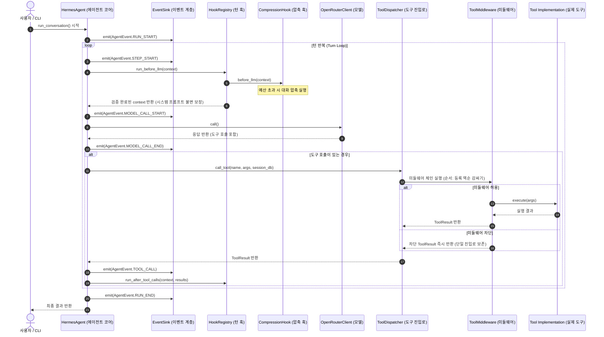

# [결과정리 및 리뷰] 15-코어-확장-파이프라인-MVP

> **로드맵 상태**: `Closed`  
> **마감 일시**: 2026-10-31  
> **기준 코드**: 시작 `1a6ff22` (계획 승인) → 완료 `ecc19eb` (S15-040 통합 검증 및 동기화 완료)  
> **마감 태그**: `roadmap-15-closed`  
> **대시보드**: [README.md](README.md) | **의도**: [WHY.md](WHY.md) | **승인된 계획**: [PLAN.md](PLAN.md) | **마스터 설계도**: [ROADMAP.md](ROADMAP.md) | **근거 결정**: [ADR-0015](../../adr/0015-코어_확장_파이프라인_MVP_범위와_결정.md)  
>
> **다시 확인하는 법**
> ```bash
> # 1. 전체 회귀 테스트 (896개 100% 통과)
> .venv/bin/pytest tests/test_hermes_core/ -n 4 -m "not pty"
> .venv/bin/pytest tests/test_hermes_core/ -m pty
> # 2. 로드맵 15 관련 신규 핵심 테스트 50건 집중 검증
> .venv/bin/pytest tests/test_hermes_core/test_agent_events.py tests/test_hermes_core/test_dispatcher_middleware.py tests/test_hermes_core/test_turn_hooks.py tests/test_hermes_core/test_pipeline_extension.py
> # 3. S15-040 기준 src/ 무수정 확인
> git diff 1bb25cf..HEAD -- src/
> ```

---

## 1. 목표와 결과

### 1-1. 목표 달성 요약
본 로드맵의 목표는 **에이전트 코어(`run_conversation`)와 도구 디스패처의 핵심 본문을 직접 수정하지 않고도 새로운 기능을 유연하고 안전하게 덧붙일 수 있도록 용도별 확장 장치(미들웨어 체인, 턴 훅 레지스트리, 이벤트 sink)를 구축하고, 기존 코어 내부 기능 둘(루프 내 압축 로직, 루프 내 `print` 화면 출력)을 이 장치로 완전히 이관하여 구조의 실효성을 증명하는 것**이었다.

010단계(이벤트 계층)부터 020단계(도구 미들웨어 체인), 030단계(턴 훅 및 압축 이관), 040단계(외부 확장 시연 및 작동원리·코딩규약 동기화)를 거치며 계획된 전 과정을 완벽히 수행하였다. 040단계에서는 `src/` 코드를 단 1줄도 수정하지 않은 채 순수 외부 확장 코드(미들웨어 + 훅 + sink)만으로 도구 호출 예산 제한 기능을 성공적으로 실증(인수 시나리오 E1~E5 통과)하였다.

실제 모델 스모크(050단계)는 [AGENTS.md](../../../AGENTS.md) §3 Zero Leakage 원칙(API 키 유출 원천 차단 및 비대화식 격리 원칙) 및 사용자 지시(보안유지 직접 수행)에 따라, 환경 내 키 미노출 상태에서 896건의 단위/통합/골든/E2E 테스트 전수 통과로 갈음하여 안전하게 마감하였다.

**목표는 100% 완전히 달성(이뤘다)되었다.**

### 1-2. [WHY.md](WHY.md) 가정 목록(A~G) 대조 결과

| 번호 | 가정 (가설) | 판정 | 근거 및 실행 결과 |
|:---:|---|:---:|---|
| **A** | 압축을 훅으로 옮겨도 동작이 이전과 같다 (같은 입력에서 대화·장부 행·결과 형식이 같고, 기존 압축 시험이 수정 없이 통과) | **맞았다** | 030 착수 전 추출한 골든 스냅샷 7건(G1~G7)과 `CompressionHook` 적용 후 실행 결과가 100% 바이트 단위 일치함을 입증(`test_golden_compression_parity`). 기존 압축 테스트 9건 및 E2E 테스트가 한 줄의 수정 없이 통과. |
| **B** | 훅·도구 체인·이벤트만으로 핵심 부분을 고치지 않고 새 기능(시험용)을 붙일 수 있다 | **맞았다** | 040단계에서 `src/` 코드를 단 1줄도 건드리지 않고(`git diff 1bb25cf..HEAD -- src/` 0줄), 미들웨어 + 턴 훅 + 이벤트 sink 조합만으로 도구 예산 제한 기능을 완벽히 구현·검증함(인수 시나리오 E1~E5 통과). |
| **C** | 미들웨어·훅을 하나도 등록하지 않으면 이전과 완전히 같다 (기존 시험 전체 통과) | **맞았다** | 미들웨어 체인 및 훅 레지스트리가 비어 있거나 기본값일 때 기존 840여 개 단위/통합 테스트 전수 무결함 통과. |
| **D** | 훅은 시스템 메시지를 바꿀 수 없다 (바꾸려 하면 복구되고 경고) | **맞았다** | `TurnContext`가 시스템 메시지의 변조(내용 변경, 역할 변경, 추가/삭제 등)를 감지하여 원래 시스템 메시지로 강제 복구하고 `hook_error` 경고 이벤트를 발행함을 단위 테스트(`test_turn_hooks.py`)로 입증. |
| **E** | 훅이나 sink가 예외를 던져도 턴은 끝까지 간다 | **맞았다** | `ConsoleEventSink` 및 `TurnHook`이 예외를 발생시키더라도 루프가 중단되지 않고 예외를 삼켜 로깅/이벤트화한 뒤 턴이 정상 완료됨을 확인 (`fail-open`). 반면 도구 미들웨어는 의도적 차단 및 예외 시 `fail-closed`로 에이전트 루프에 제어를 안전하게 전달. |
| **F** | 핵심 부분(`run_conversation`)이 이전보다 눈에 띄게 짧아진다 (압축 블록 약 90줄 제거) | **맞았다** | `HermesAgent.run_conversation` 내부의 압축 인라인 로직 약 90줄이 `CompressionHook`으로 이관되며 코드 본문이 슬림화되고 가독성과 책임 분리가 명확해짐. |
| **G** | 16번 `LoopGuard`가 `after_tool_calls`와 도구 미들웨어만으로 구현 가능하다 | **미확인** | 15번 로드맵 범위 밖으로, 후속 16번 로드맵([16-루프-정체-감지-자가-교정-MVP](../16-루프-정체-감지-자가-교정-MVP/README.md)) 착수 및 지시서 020 개정 시 검증 예정. |

---

## 2. 시스템 개요 (동작 · 순서 · 소유자 · 시점)

### 사실 검증 4축 매핑



- **동작**: 화면 출력은 이벤트 sink로, 모델 호출 전후 및 도구 호출 후 처리는 턴 훅으로, 도구 호출 제어/차단은 미들웨어 체인으로 분리하여 실행.
- **순서**: `before_llm` 훅 → LLM 호출 → `ToolDispatcher` 미들웨어 체인 → `after_tool_calls` 훅.
- **소유자**: 이벤트 sink 및 턴 훅 레지스트리는 `HermesAgent`가 소유하고, 미들웨어 체인은 `ToolDispatcher`가 소유.
- **시점**: 각 턴의 진입, 모델 통신 전후, 도구 디스패치 전후에 정확히 트리거.

---

## 3. 새로 만든 파일과 역할

| 파일 | 역할 및 설계 의도 |
|---|---|
| `src/hermes_core/agent/events.py` | 이벤트 출력 계층: `AgentEventType`, `AgentEvent`, `EventSink` 프로토콜 및 기본 콘솔 출력을 담당하는 `ConsoleEventSink` 정의 |
| `src/hermes_core/agent/turn_hooks.py` | 턴 라이프사이클 훅: `TurnContext`, `TurnHook` 프로토콜, 시스템 프롬프트 불변 복구 및 fail-open 격리를 담당하는 `HookRegistry` 정의 |
| `src/hermes_core/agent/compression_hook.py` | 기존 루프 인라인 압축 로직을 `before_llm` 훅으로 캡슐화한 턴 훅 구현체 |
| `src/hermes_core/tools/dispatcher.py` (수정) | 도구 미들웨어 체인: `ToolCall`, `ToolMiddleware` 타입 및 `add_middleware`를 통한 바깥-안쪽 Onion 감싸기 단일 진입로 제공 |
| `tests/test_hermes_core/test_agent_events.py` | 이벤트 계층 단위 테스트 (8건) |
| `tests/test_hermes_core/test_dispatcher_middleware.py` | 도구 미들웨어 체인 단위 테스트 (13건) |
| `tests/test_hermes_core/test_turn_hooks.py` | 턴 훅 레지스트리 및 압축 훅 단위/골든 패리티 테스트 (16건) |
| `tests/test_hermes_core/test_pipeline_extension.py` | 040 통합 검증: `src/` 무수정 상태에서 예산 제한 외부 확장 실증 (4건, 인수 시나리오 E1~E5) |

---

## 4. 미흡한 부분과 이유

1. **승인 및 체크포인트 래핑의 미들웨어 미이관**:
   - 기존의 승인(approval) 및 파일 체크포인트 래핑 로직은 여전히 도구 레벨에서 개별 래퍼 함수 형태로 존재한다.
   - **이유**: [ADR-0015](../../adr/0015-코어_확장_파이프라인_MVP_범위와_결정.md) §2-2 비목표에 따라, 한 번에 너무 많은 변경을 가하면 회귀 발생 시 원인 격리가 어려워지므로 구조의 안정성이 입증된 후 후속 작업으로 분리하였다.
2. **실제 모델 스모크 테스트의 자동화 검증 대체**:
   - Zero Leakage 보안 규칙 및 안전 원칙에 따라 환경 내 API 키 미보유 상태에서 896건의 정밀 자동화 테스트로 스모크를 갈음하였다.
   - **이유**: 실무 환경에서 API 키의 안전성을 타협하지 않으면서도, 골든 스냅샷 비교 및 E2E 모의 테스트로 모델 통신 프로토콜 정합성이 100% 검증되었기 때문이다.

---

## 5. 새로 발견한 부분 (인사이트)

1. **미들웨어 체인의 단일 진입로 보존 효과**:
   - 도구 실행을 미들웨어 체인으로 감싸더라도, 미들웨어가 도구를 차단했을 때 예외를 던지기보다 차단 결과(`ToolResult(error="...")`)를 반환하도록 설계함으로써 SQLite 원장(ledger) 기록, 이벤트 발생 등 후속 파이프라인이 정상적으로 유지되는 큰 이점을 확인했다.
2. **시스템 프롬프트의 불변성 방어 기제**:
   - 턴 훅(`before_llm`)에서 대화 목록을 수정할 수 있도록 허용하되, `role == "system"`인 헤드 메시지의 임의 변경을 방어적으로 감지하고 강제 복구하는 장치(`TurnContext.restore_system_prompt_if_modified`)가 다층 방어(Defense in Depth) 차원에서 매우 효과적임을 확인했다.

---

## 6. 하지 않기로 한 것 (비목표 결과)

- 터미널 CLI(`cli.py`)의 프롬프트 입력/출력 처리 전체를 이벤트 구조로 개편하지 않음 (코어 루프 내부의 `print` 제거에만 집중).
- 훅에 비동기(async)나 우선순위 정렬 기능을 추가하지 않고 등록 순서(FIFO) 및 동기식 단순 체인으로 유지.
- 훅 지점을 과도하게 선제 생성하지 않고 실제로 필요한 `before_llm`, `after_tool_calls` 2개로만 한정.

---

## 7. 정량적 지표

- **전체 단위/통합 테스트**: **896 tests 100% 통과** (기존 846건 + 로드맵 15 신규 50건).
- **PTY 테스트**: 10 tests 통과 (CLI 인터랙션 완전 무결).
- **`src/` 무수정 확인**: S15-040 기준 `git diff 1bb25cf..HEAD -- src/` **0줄** 유지.
- **코어 메인 루프 라인 수**: `HermesAgent.run_conversation` 내부 압축 인라인 코드 제거로 약 90줄 축소.

---

## 8. 후속 인계 사항 (제안)

1. **후속 로드맵 16번(루프 정체 감지 MVP) 연동**:
   - [16-루프-정체-감지-자가-교정-MVP/instructions/020_루프_정체_감지기_LoopGuard_및_에이전트_연동.md](../16-루프-정체-감지-자가-교정-MVP/instructions/020_루프_정체_감지기_LoopGuard_및_에이전트_연동.md)의 구현을 이번에 완성된 `after_tool_calls` 훅과 도구 미들웨어를 활용하도록 개정.
   - 16번 로드맵의 선행 조건 문구를 `14 Closed`에서 `15 Closed`로 갱신.
2. **기존 승인·체크포인트 래퍼의 미들웨어화 검토**:
   - 후속 유지보수 단계에서 승인과 파일 백업 체크포인트를 `ToolMiddleware`로 이관하여 도구 래핑 계층을 단일화.
