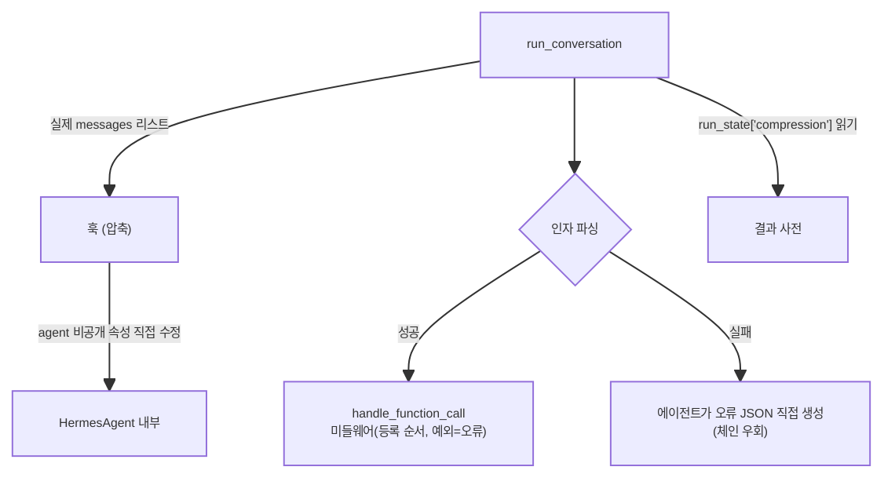
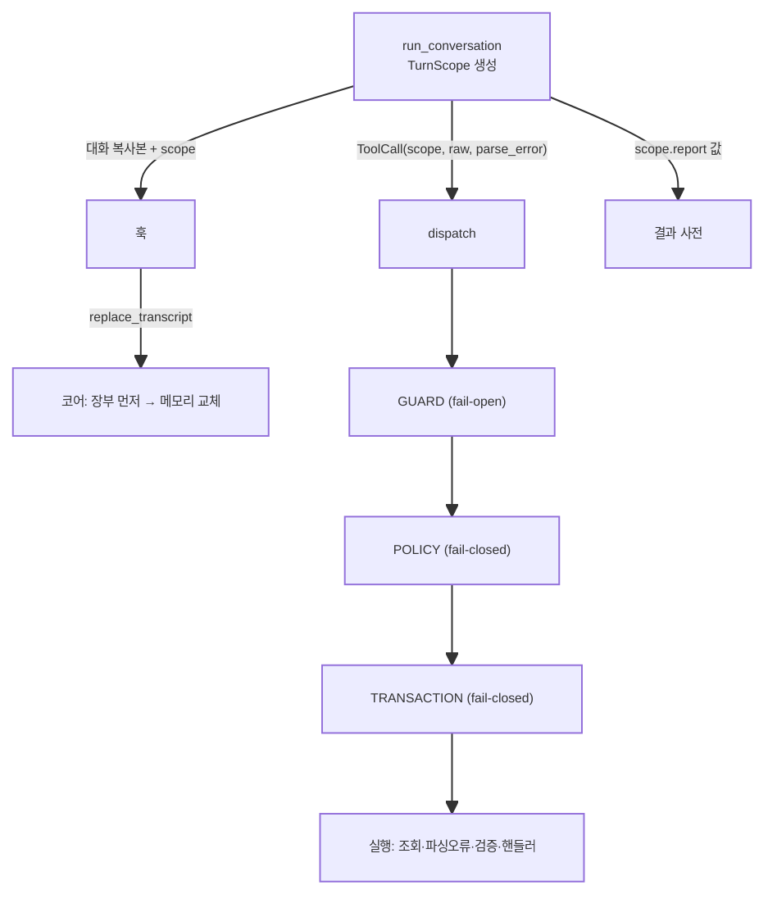
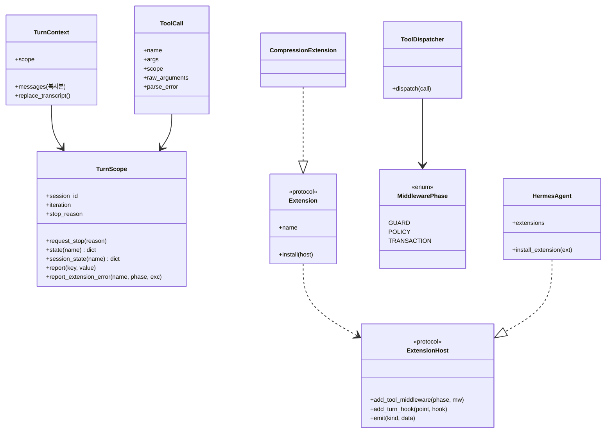
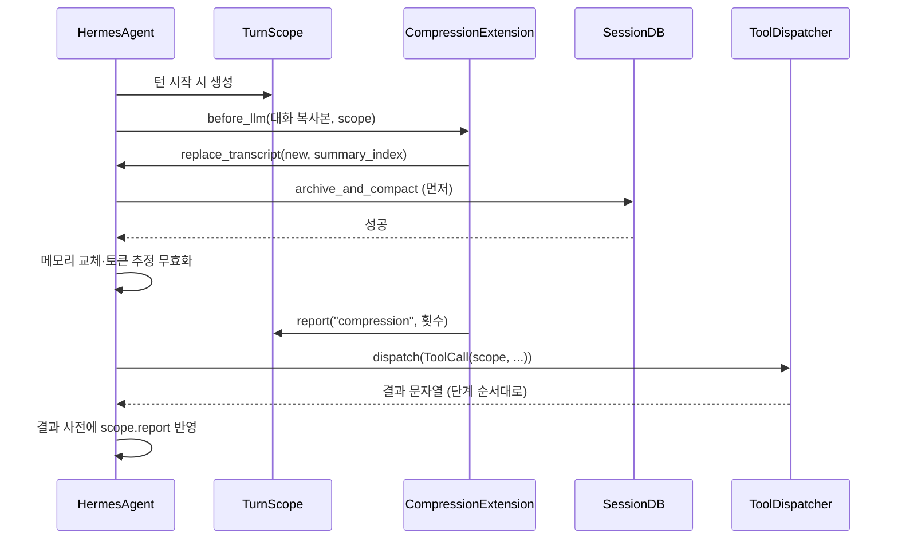
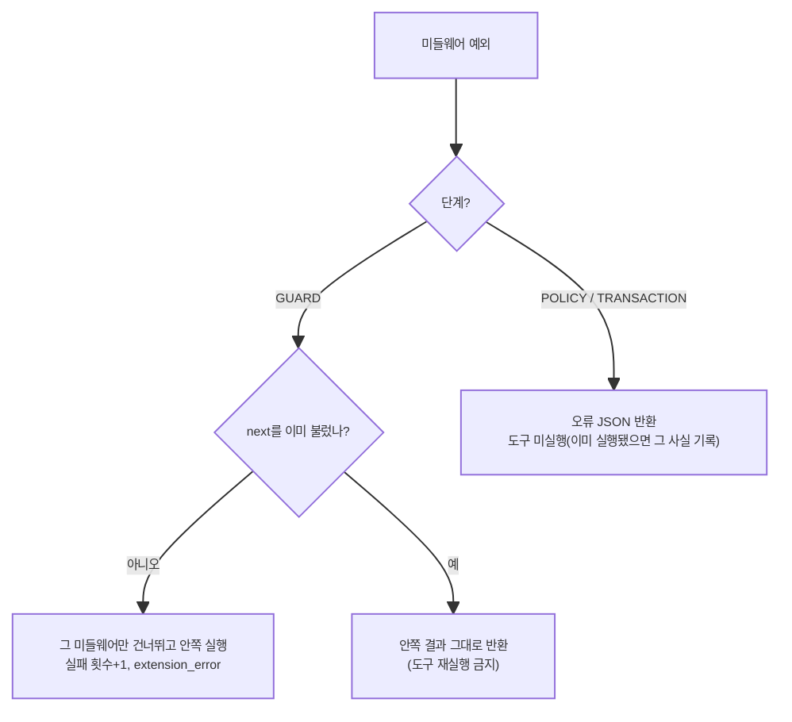

# [마스터 설계도] 16-확장 계약 정비 MVP

> **상태**: `Draft`  
> **대시보드**: [README.md](README.md)  
> **의도(Why)**: [WHY.md](WHY.md) · **승인된 계획**: [PLAN.md](PLAN.md) · **근거 결정**: [ADR-0016](../../adr/0016-확장_계약_정비_MVP_범위와_결정.md)  
> **기준 코드**: `main` `e87f474` (15 `Closed`, `roadmap-15-closed`)

---

## 1. 배경 및 목적 (Why)

15번이 만든 확장 장치 셋(도구 미들웨어 [`dispatcher.py`](../../../src/hermes_core/tools/dispatcher.py), 턴 훅 [`turn_hooks.py`](../../../src/hermes_core/agent/turn_hooks.py), 이벤트 sink [`events.py`](../../../src/hermes_core/agent/events.py))에는 계약이 없다. 훅은 장부 없이 대화를 바꿀 수 있고(시험 H3), 압축 훅은 에이전트 내부를 직접 고치며(`compression_hook.py:39-151`), 턴 상태는 이름 약속뿐인 사전이고(`run_state["compression"]`), 미들웨어는 턴 문맥을 모르며, 깨진 JSON 호출은 체인을 우회하고(`agent.py:332-343`), 실패 정책과 순서는 하나뿐이다.

이 로드맵은 **확장의 상태 수명·권한·실패 정책·실행 순서를 계약으로 고정**하고, 압축을 그 계약의 첫 소비자로 옮긴다. 17번(LoopGuard)과 18번(제어판)이 이 계약 위에 얹힌다. 원칙 P1~P7과 결정 D-01~D-09는 [ADR-0016](../../adr/0016-확장_계약_정비_MVP_범위와_결정.md) §2가 정본이다.

---

## 2. As-Is vs To-Be 아키텍처

### 2-1. 폴더 구조 (신규·변경)

```text
src/hermes_core/
  extensions/
    __init__.py           # 신규 (010)
    contract.py           # 신규: TurnScope, MiddlewarePhase, FailurePolicy, Extension, ExtensionHost, ExtensionRecord (010·040)
  agent/
    turn_hooks.py         # 변경: TurnContext가 scope를 품음 (010), 읽기 전용 대화·replace_transcript (030)
    compression_hook.py   # 변경: CompressionExtension, 역참조 제거 (040)
    agent.py              # 변경: TurnScope 생성·report 반영 (010), dispatch 호출 (020), replace_transcript 제공 (030), install_extension·extensions (040)
  tools/
    dispatcher.py         # 변경: ToolCall 필드, dispatch (010·020), 단계·실패 정책 (040)
tests/test_hermes_core/
  test_extension_scope.py       # 신규 (010)
  test_dispatch_single_entry.py # 신규 (020)
  test_transcript_integrity.py  # 신규 (030)
  test_extension_contract.py    # 신규 (040)
  test_extension_e2e.py         # 신규 (050)
  test_turn_hooks.py            # 변경: H3 한 건만 (030, 사용자 승인)
docs/작동원리/03-코어구조-메인루프-확장방식.md  # 변경 (050)
docs/코딩규약.md                                 # 변경: §1 대조표, §3-7 (050)
```

### 2-2. 구성요소 흐름: As-Is



### 2-3. 구성요소 흐름: To-Be



### 2-4. 클래스·모듈 관계



`TurnScope`·`Extension`·`ExtensionHost`·`MiddlewarePhase`는 `extensions/contract.py`에 있고 이 모듈은 `agent`·`tools`를 import하지 않는다. 호스트는 `HermesAgent` 자신이 아니라 `install_extension`이 만드는 **내부 전용 객체**다. 이 객체는 `ExtensionHost`의 세 메서드만 가지므로 확장이 에이전트의 다른 속성에 닿을 길이 없다(그림의 `HermesAgent ..|> ExtensionHost`는 「에이전트가 호스트를 제공한다」는 뜻).

### 2-5. 실행 순서 (대표 시나리오: 압축이 일어나고 도구 호출이 한 번 있는 한 턴)



### 2-6. 미들웨어 실패 분기 (단계·정책)



---

## 3. 파급 범위와 무영향 근거 (Blast Radius)

| 대상 | 영향 | 근거 |
|---|---|---|
| `extensions/contract.py` | 신규 | 표준 라이브러리만 import |
| `tools/dispatcher.py` | `ToolCall` 선택 필드, `dispatch`, 단계별 정렬·실패 정책 | 필드 기본값 `None`, `handle_function_call` 시그니처 유지, `add_middleware`는 `POLICY` 단계 = 현재 동작 |
| `agent/turn_hooks.py` | `TurnContext.scope`, 대화 복사본, `replace_transcript` | `register`·`run`·지점 이름 유지 |
| `agent/agent.py` | 턴 시작 때 `TurnScope`, `dispatch` 호출, `replace_transcript`, `install_extension`·`extensions`, 결과의 `compression` 조립 제거 | 결과 사전 키와 값 형식 유지(`report`로 같은 값) |
| `agent/compression_hook.py` | `CompressionExtension`으로, 에이전트 대신 설정 공급 함수 | 판정·호출 순서는 그대로 옮김, 골든 동일이 합격 기준 |
| `cli.py`·`session_db.py`·`llm_client.py`·`compression.py`·`context_budget.py`·도구 모듈·`delegate_tool.py` | 무변경 | 공개 진입점(`HermesAgent(...)`, `run_conversation`, `handle_function_call`)과 결과 형식이 그대로 |
| 기존 시험 | H3 한 건만 변경 | 사용자 승인(2026-10-31). 나머지는 무수정 통과가 각 단계 Done 조건 |

---

## 4. 사전 점검 및 실패 위험 분석 (Pre-Mortem)

| # | 위험 | 분류 | 방어 |
|---|---|---|---|
| 1 | **압축 이관 중 순서·결과가 달라짐** | 상태 정합 | 15번 골든(`golden/compression_before.json`)과 `test_compression_agent.py` 무수정 통과(040·050) |
| 2 | **fail-open 미들웨어가 도구를 두 번 실행** (`next` 호출 뒤 예외) | 비인가 부작용 | `next` 호출 여부를 추적해 호출 뒤 예외면 안쪽 결과를 그대로 반환(040 시나리오 고정) |
| 3 | **깨진 JSON 이동으로 오류 문구·경고 로거가 바뀜** | 비정형 출력 | 문구 글자 동일, 경고는 `hermes_core.agent.agent` 로거 유지(020, `test_agent_loop_signals.py` 무수정) |
| 4 | **`replace_transcript`가 시스템 메시지를 바꿔 캐시 파괴** | 캐시 불변식 | 새 대화의 맨 앞 시스템 메시지가 기존과 `role`·`content` 다르면 거부(030) |
| 5 | **장부 쓰기 실패 뒤 메모리만 바뀜** | 상태 정합 | 장부 먼저, 성공 시에만 교체. 실패는 호출한 훅에 예외로 전달(030, 기존 G3 골든) |
| 6 | **위임 자식 실행 중 부모 턴 칸과 섞임** | 상태 정합 | 문맥을 인자로만 전달, 전역·`ContextVar` 금지(050 시나리오) |
| 7 | **공유 디스패처에 상태 든 미들웨어가 붙어 에이전트 간 누수** | 상태 정합 | 미들웨어는 상태를 갖지 않고 `call.scope`에서만 읽음. `scope=None`이면 통과(010·040) |
| 8 | **훅 대화 복사 비용으로 느려짐** | 성능 | 060에서 실측해 기록(미확인) |
| 9 | **같은 이름 확장 이중 설치로 칸 충돌** | 설계 | `install_extension`이 같은 이름이면 `ValueError`(040) |
| 10 | **`report`가 코어 결과 키를 덮어씀** | 비정형 출력 | 예약 키 거부(010) |

---

## 5. 4층위 검증 범위 설계 (Validation Grid)

| 층위 | 내용 | 단계 |
|---|---|---|
| 1 Mock·픽스처 | `MockLLMClient`, 임시 `SessionDB`, 가짜 확장·미들웨어·훅, 15번 골든 | 010~050 |
| 2 단위·구조 | `TurnScope` 칸·정지·`report`, `ToolCall` 필드, 단계 정렬, 실패 정책(이중 실행 방지 포함), 확장 설치·목록, 중립 모듈 import 검사 | 010·020·040 |
| 3 상태·정합 | 대화 복사본 격리, `replace_transcript` 장부 먼저·실패 시 무변경, 압축 골든 동일, 재개 후 대화 일치 | 030·040·050 |
| 4 E2E | 실제 `OpenRouterClient`+`MockTransport`로 압축+가짜 GUARD·POLICY 확장+위임 자식이 함께 도는 세션, 실제 모델 스모크 | 050·060 |

---

## 6. 설계 결정 상세

### 6-1. 중립 계약과 `TurnScope` (010)
- `extensions/contract.py`: `TurnScope` 데이터 클래스. `state(name)`은 턴 칸 저장소(`dict[str, dict]`)에서 이름별 사전을 만들거나 돌려주고, `session_state(name)`은 에이전트가 넘겨준 세션 칸 저장소에서 같은 일을 한다. `report(key, value)`는 예약 키면 `ValueError`, 아니면 보고 사전에 넣는다.
- `TurnContext`(15번)는 `scope` 필드를 갖고, 기존 `run_state`는 `scope`의 턴 칸 저장소 자체를 가리키며, `stop_reason`·`request_stop`은 `scope`에 위임한다.
- `ToolCall`에 `scope: Optional[TurnScope] = None`. 에이전트는 도구를 부를 때 현재 턴의 `scope`를 싣는다.
- 결과 사전: `run_conversation` 끝에서 `scope`의 보고 사전을 결과에 합친다. 압축 훅은 `scope.report("compression", {"count", "fallback"})`를 한다(성공 1회 이상일 때만, 현재와 같은 조건). `agent.py:481-486`의 압축 전용 조립은 삭제한다.

### 6-2. 단일 입구 완결 (020)
- `ToolCall`에 `raw_arguments`, `parse_error`. `ToolDispatcher.dispatch(call)`이 체인을 실행하는 유일한 메서드. `handle_function_call(name, args, task_id=None)`는 `dispatch(ToolCall(name, args, task_id))`.
- 에이전트: 파싱 실패 시 지금처럼 경고 로그를 남긴 뒤 `ToolCall(name, {}, raw_arguments=원문, parse_error=사유, scope=…)`로 `dispatch`. 체인 안쪽 `_execute`가 `parse_error`면 `Invalid JSON arguments for tool '<name>': <사유>` 오류 JSON(지금과 같은 문자열)을 반환.

### 6-3. 대화 무결성 (030)
- 훅에는 `copy.deepcopy(messages)`를 준다. 훅 실행 뒤 복사본이 실행 전 복사본과 다르면 `on_error`로 `ValueError("transcript modified outside replace_transcript")`. 실제 `messages`는 바뀌지 않는다.
- `TurnContext.replace_transcript(new_messages, *, summary_index=None)`: 에이전트가 넘긴 함수를 부른다. 에이전트는 ① `new_messages[0]`이 기존 시스템 메시지와 `role`·`content`가 같은지 검사(다르면 `ValueError`) ② `archive_and_compact(session_id, new_messages[시스템 제외], summary_index)` ③ 성공 시 `messages[:] = new_messages` ④ `_last_input_tokens`·`_last_message_count`를 `None`으로. 장부 단계 예외는 그대로 위로 던진다(메모리 무변경). 교체 뒤 훅의 복사본도 새 대화로 맞춘다.
- 시험 H3 변경(승인): 「append는 LLM 입력에 반영되지 않고 `hook_error`가 남는다」.

### 6-4. 확장 단위와 단계·실패 정책, 압축 이관 (040)
- `MiddlewarePhase`(`GUARD`, `POLICY`, `TRANSACTION`), 단계별 `FailurePolicy`(`OPEN`, `CLOSED`) 고정 표. 디스패처는 `(단계 순서, 등록 순서)`로 정렬한 체인을 만든다. `add_middleware(mw)`는 `POLICY`.
- GUARD 래퍼: `next` 호출 여부 플래그. 예외 시 호출 전이면 경고 후 안쪽 실행, 호출 뒤면 안쪽 결과 반환.
- 실패 보고: 디스패처는 에이전트 간에 공유될 수 있으므로 디스패처에 청취자를 달지 않는다. 미들웨어 실패는 `call.scope.report_extension_error(name, phase, exc)`로 그 호출의 턴에만 보고되고, 에이전트가 등록 목록의 실패 횟수를 올리고 `extension_error` 이벤트를 낸다. `scope`가 `None`(직접 호출)이면 경고 로그만 남긴다. 미들웨어 등록에는 이름이 필요하다(`add_middleware(mw, phase=…, name=…)`, 이름 기본값은 함수 이름).
- `Extension`·`ExtensionHost` 프로토콜, `ExtensionRecord(name, kind, slot, failures)`. `HermesAgent.install_extension(ext)`은 내부 전용 호스트 객체를 만들어 `install`에 넘기고 기록한다. `extensions`는 기록의 튜플.
- `CompressionExtension(config: Callable[[], CompressionConfig])`: `CompressionConfig`는 `enabled`, `context_window_tokens`, `threshold_ratio`, `llm_client`. 판정용 마지막 입력 토큰·메시지 수는 `TurnContext`의 읽기 전용 값. 거부 기억은 `scope.session_state("compression")["rejected_at_tokens"]`. `agent._rejected_at_tokens`는 그 값을 돌려주는 읽기 전용 속성. 장부 반영·교체·무효화는 `ctx.replace_transcript`. 요약 호출의 사용량은 `ctx.replace_transcript(new, summary_index=…, usage=…)`로 넘기고, 코어가 장부 교체 성공 뒤 `update_token_counts`를 부른다(장부를 만지는 길을 코어 연산 하나로 유지).

### 6-5. 원본과 다른 점 (원본은 읽기 전용 조사)

| 원본 (`hermes-agent/`) | 우리 (`hermes_core`) | 이유 |
|---|---|---|
| 훅 규약이 반환값(`{"action": "skip"}` 등)과 `ContextVar`(`_post_tool_call_hook_suppressed`, `model_tools.py:30`) | 단계·정책 고정, 문맥은 인자 전달 | 중첩 실행에서 숨은 전역 상태를 피함 |
| 플러그인 등록·활성화 경로가 여러 모듈에 분산(`hermes_cli/plugins_*`) | 확장 설치 진입점 하나와 읽기 전용 목록 | 18번 제어판이 읽을 단일 원천 |

---

## 7. 문서 동기화 방식

050에서 [03-코어구조-메인루프-확장방식.md](../../작동원리/03-코어구조-메인루프-확장방식.md)(확장 계약: 상태 칸, 권한, 단계·실패 정책, 대화 변경 연산)와 [코딩규약.md](../../코딩규약.md)(§1 대조표에 `extensions/contract.py`, §3-7 확장 파이프라인 규칙을 ADR-0016 계약으로 개정 — 「원장 일치는 훅의 책임」 문장 삭제)를 실제 코드와 4축 대조해 갱신한다.

---

## 8. 이 로드맵이 다루지 않는 것 (Non-Goals)

- Settings·제어판·상태 스냅샷·변경 감사·서킷브레이커·조립 지점 단일화 (18)
- LoopGuard (17)
- 승인·체크포인트의 실제 미들웨어 이관 (단계만 정의)
- LLM 호출 미들웨어, 비동기·스트리밍, 대화 힌트 삽입 연산
- DB 스키마 변경, 새 pty 시험
