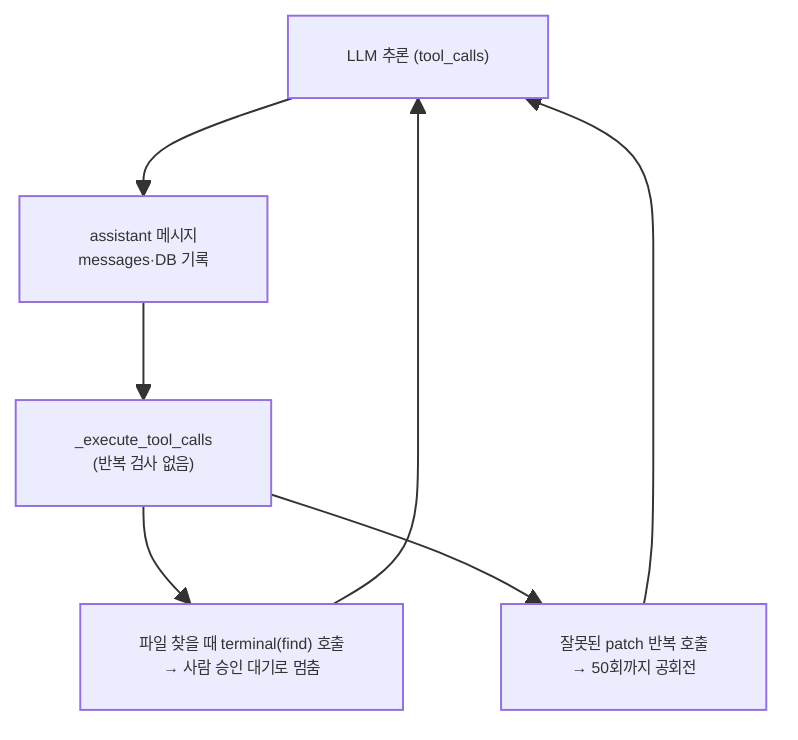
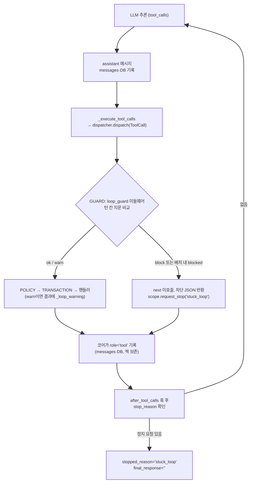
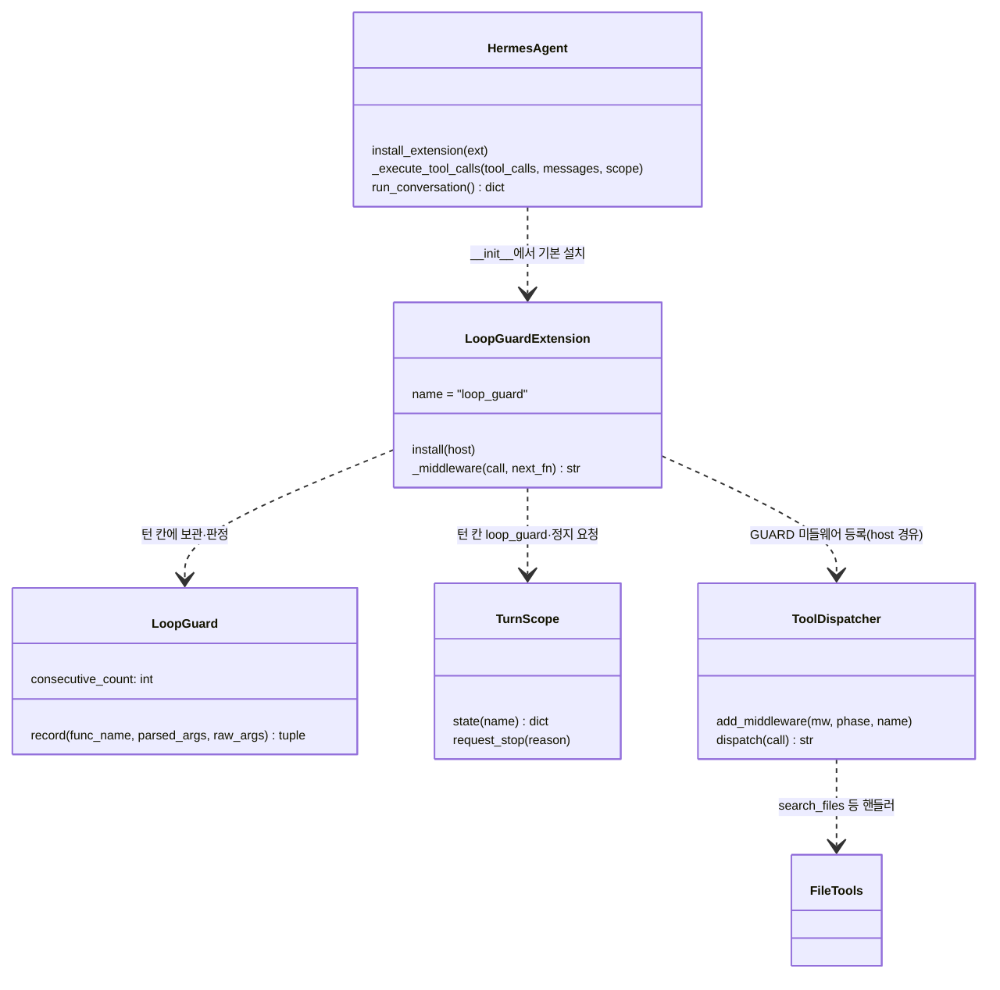
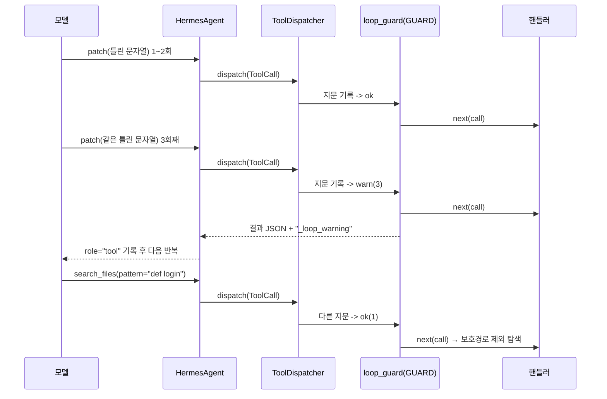

# [마스터 설계도] 17-코드 탐색(`search_files`) 및 루프 정체 감지(`LoopGuard`) MVP

> **상태**: `Draft`  
> **대시보드**: [README.md](README.md)  
> **의도(Why)**: [WHY.md](WHY.md) · **승인된 계획**: [PLAN.md](PLAN.md) · **근거 결정**: [ADR-0017](../../adr/0017-코드_탐색_및_루프_정체_감지_MVP_범위와_결정.md)  
> **기준 코드**: `main` `3dcad60` (14 `Closed`, `roadmap-14-closed`) → **재계획 `092b115` (16 `Closed`, `roadmap-16-closed`)**. 020 관련 절(§2·§3·§4·§6-2)은 재계획 기준이다([ADR-0017](../../adr/0017-코드_탐색_및_루프_정체_감지_MVP_범위와_결정.md) 개정 기록)

---

## 1. 배경 및 목적 (Why)

14번까지로 기억, 안전 가드, 컨텍스트 압축, 스킬, 위임, 승인, 체크포인트·롤백, 중단·종료, 세션 재개(`--resume`)가 모두 갖춰졌다. 그러나 에이전트가 작업 폴더 안에서 코드를 자율적으로 탐색하고 수정할 때 두 가지 공백이 남아 있다.

1. **[축 1 — 가장 급선무] 전용 코드·파일 탐색 도구(`search_files`)의 부재**:
   - [ADR-0003](../../adr/0003-파일_도구_범위와_쓰기_안전_정책.md) §2-1에서 `read_file`·`write_file`·`patch`만 먼저 넣고 `search_files`를 이월한 상태다.
   - 모델이 파일 위치나 문자열을 찾으려면 `terminal`로 `find`나 `grep`을 불러야 하는데, `find`는 허용목록 밖이라 매번 사람 승인(`Approver`)에 막히고 `grep`은 `.git`·`.hermes` 제외나 줄 단위 상한이 없다.
   - `path_guard` 보안 경계(`.env*`·`.git`·`get_hermes_home()`·심볼릭 링크 자동 제외)와 출력 상한(50건·200자·5,000파일)을 내장한 전용 `search_files`를 추가해 **`Search(찾기) → Read(읽기) → Edit(고치기)`** 3박자를 완성한다.
2. **[축 2 — 루프 안전망] 동일 호출 반복 제어(`LoopGuard`)의 부재**:
   - 한 턴 안에서 모델이 똑같은 도구·인자를 연속 호출하며 `max_iterations = 50`까지 공회전할 때, **연속 3회($K=3$)에 자가 교정 경고(`_loop_warning`)**를 주입하고 **연속 5회($M=5$)에 도구 쌍(Tool Pair) 불변식을 보존한 채 루프를 조기 종료(`stopped_reason = "stuck_loop"`)**한다.

---

## 2. As-Is vs To-Be 아키텍처

### 2-1. 폴더 구조 (신규·변경)

```text
src/hermes_core/
  constants.py            # 변경: SEARCH_MAX_* 3종, CHILD_TOOL_NAMES에 search_files 추가 (010), LOOP_GUARD_* 4종·CLI_STUCK_LOOP_NOTICE 추가 (020)
  tools/path_guard.py     # 변경: is_hermes_home_path 공용 함수 추출 (010)
  tools/file_tools.py     # 변경: SEARCH_FILES_SCHEMA 및 search_files_tool 구현 (010)
  tools/dispatcher.py     # 변경: _DEFAULT_TOOL_NAMES 및 create_default_dispatcher에 search_files 등록 (010)
  agent/prompt_builder.py # 변경: SEARCH_FILES_GUIDANCE 및 select_tools_guidance 반영 (010)
  agent/loop_guard.py     # 신규: 순수 부품(make_fingerprint, LoopGuard, attach_loop_warning) + LoopGuardExtension (020)
  agent/events.py         # 변경: EVENT_LOOP_GUARD 이벤트 이름 (020)
  agent/agent.py          # 변경: import 1줄 + __init__ 기본 설치 1줄, 루프 본문 무변경 (020)
  cli.py                  # 변경: stopped_reason == "stuck_loop" 안내 출력 (020)
tests/test_hermes_core/
  test_search_files.py        # 신규: 010 단위·보안 경계·상한 시험
  test_loop_guard.py          # 신규: 020 지문 정규화·Nudge·stuck_loop·도구 쌍 정합 시험
  test_search_and_loop_e2e.py # 신규: 030 실제 클라이언트 경로 E2E 시험
docs/작동원리/
  01-헤르메스코어-작동원리.md # 변경: LoopGuard 및 search_files 반영 (030)
  02-코어안전-작동원리.md     # 변경: 루프 정체 감지 안전망 반영 (030)
  03-파일도구-작동원리.md     # 변경: search_files 경계·상한 반영 (030)
```

### 2-2. 구성요소 흐름: As-Is



### 2-3. 구성요소 흐름: To-Be

`LoopGuard`는 루프 본문이 아니라 디스패처의 GUARD 단계(가장 바깥)에 끼운 내장 확장이다. 차단된 호출은 승인(POLICY)·체크포인트(TRANSACTION)·핸들러에 도달하지 않는다.



### 2-4. 클래스·모듈 관계



`make_fingerprint`·`attach_loop_warning`은 `loop_guard.py`의 모듈 함수다. `FileTools`·`PathGuard` 관계(010)는 바뀌지 않는다: `search_files_tool` → `check_path`·`is_protected_path`·`is_hermes_home_path`.

### 2-5. 실행 순서 (대표 시나리오: `patch` 3회 반복 경고 → `search_files` 자가 교정)



---

## 3. 파급 범위와 무영향 근거 (Blast Radius)

| 대상 | 영향 | 근거 |
|---|---|---|
| `path_guard.py` | `is_hermes_home_path` 추출 | `check_write_path`의 4단계 검사를 같은 로직의 공용 함수 호출로 바꾸므로 기존 동작과 100% 동일하다 |
| `file_tools.py` | `SEARCH_FILES_SCHEMA`, `search_files_tool` 추가 | 기존 `read_file_tool`, `write_file_tool`, `patch_tool`은 한 줄도 바꾸지 않는다 |
| `dispatcher.py` | `_DEFAULT_TOOL_NAMES` 및 `create_default_dispatcher`에 `search_files` 추가 | 기존 8종 도구의 등록·검증·체크포인트 래핑 로직은 그대로 유지된다 |
| `prompt_builder.py` | `SEARCH_FILES_GUIDANCE` 추가 | `select_tools_guidance`에서 `"search_files"`가 포함된 디스패처일 때만 안내문 1줄이 추가된다 |
| `loop_guard.py` | 신규: 순수 부품 + `LoopGuardExtension` | 상태는 턴 칸에만 둔다(전역 없음). 3회 미만 호출은 `next`의 결과를 그대로 돌려주므로 결과 문자열이 기존과 같다 |
| `events.py` | `EVENT_LOOP_GUARD` 추가 | `ConsoleEventSink`는 `tool_call`만 출력하므로 화면 출력이 바뀌지 않는다 |
| `agent.py` | import 1줄, 기본 설치 1줄 | `run_conversation`·`_execute_tool_calls` 본문 무변경. `agent.extensions`에 `loop_guard` 기록 1건이 압축 기록 뒤에 추가된다(첫 기록이 `compression`이라는 기존 시험은 유지) |
| 기존 확장·미들웨어 | GUARD 가장 바깥에 하나 추가 | 사용자가 설치한 GUARD는 등록 순서상 그 안쪽에 선다. 차단 때만 안쪽 단계가 불리지 않는다 |
| `delegate_tool.py` | 무변경 | 자식도 `HermesAgent`이므로 기본 설치로 적용되고, `stuck_loop`은 기존 「`completed` 아님」 경로로 처리된다 |
| `cli.py` | `stopped_reason == "stuck_loop"` 분기 2줄 추가 | 정상 완료(`completed`) 및 `llm_error` 경로는 기존과 동일하다 |
| 한 턴에 같은 호출을 3회 이상 하는 기존 시험 | 결과 문자열에 `_loop_warning`이 붙거나 5회째 정지 | **미확인**: 020 착수 전 전수 조사, 영향이 있으면 멈추고 보고 |
| `session_db.py`·`checkpoint.py`·`compression.py`·`approval.py` | 무변경 | DB 스키마(v6), 롤백, 컨텍스트 압축, 승인 모듈은 건드리지 않는다 |

---

## 4. 사전 점검 및 실패 위험 분석 (Pre-Mortem)

| # | 위험 | 분류 | 방어 |
|---|---|---|---|
| 1 | **`stuck_loop` 조기 차단 시 짝 없는 `assistant(tool_calls)`가 `messages`와 DB에 남는 위험**: `run_conversation`은 `assistant` 메시지를 먼저 기록한 뒤 `_execute_tool_calls`를 부른다. `role="tool"` 응답 없이 바로 `break`하면 다음 턴·압축·`--resume`이 깨진다 | 컨텍스트·상태 정합 | **핵심 방어**: 감지기는 루프를 끊지 않는다. 5회째(`"block"`)와 같은 배치의 후속 호출에는 `next` 대신 `{"success": False, "error": LOOP_GUARD_BLOCKED_MESSAGE}` 문자열을 돌려주고, 코어 `_execute_tool_calls`가 이를 `role="tool"`로 `messages`·`SessionDB`에 기록한다. 정지는 `request_stop("stuck_loop")`으로 요청하고 코어가 배치 뒤에 집행한다 (가정 F, 020·030 고정) |
| 2 | **작업 폴더가 레포 루트일 때 `search_files`가 `.hermes/state.db`나 `.hermes/memories/`를 긁는 위험**: `check_path`에는 `get_hermes_home()` 제외가 없다 | 샌드박스·보안 | `path_guard.is_hermes_home_path(target_path, base)`를 공용화하여 시작 경로 검사 및 순회 중 디렉터리·파일 건너뛰기에 모두 적용한다 (가정 B, 010 고정) |
| 3 | **심볼릭 링크를 따라가 작업 폴더 밖 파일을 노출하거나 순환 링크(Symlink Loop)에 빠지는 위험** | 샌드박스·루프 | 순회 중 `entry.is_symlink()`인 파일·디렉터리는 `resolve()`하기 전에 즉시 건너뛴다. 또한 모든 후보 경로에 `is_inside`와 `is_protected_path`를 적용한다 (가정 B, 010 고정) |
| 4 | **잘못된 정규식(`pattern="[unclosed"`, `regex=True`) 입력 시 `re.error` 예외나 비정형 출력 발생** | 스키마·파싱 | `re.compile`을 `try ... except re.error`로 감싸 `{"success": False, "error": f"Invalid regex pattern: {e}"}` JSON을 반환한다 (010 고정) |
| 5 | **1차 경고(Nudge) 부착 시 도구 결과 JSON 문자열 뒤에 평문을 붙여 `json.loads` 소비자가 깨지는 위험** | 파싱·정합성 | `attach_loop_warning(result_str, warning_msg)`가 `json.loads(result_str)`로 파싱해 `dict`이면 `"_loop_warning"` 키를 넣어 다시 `json.dumps`한다 (가정 D, 020 고정) |
| 6 | **인자 JSON 키 순서(`{"a":1,"b":2}` vs `{"b":2,"a":1}`)나 깨진 JSON 반복으로 지문 감지를 우회하는 위험** | 루프 제어 | `json.dumps(parsed_args, sort_keys=True, separators=(",", ":"))`로 정규화하고, 파싱 실패(`parsed_args is None`) 시에는 `f"<invalid_json:{raw.strip()}>"`를 지문으로 쓴다 (가정 D, 020 고정) |
| 7 | **디스패처 하나를 에이전트 둘이 공유하면 `loop_guard` 미들웨어가 두 번 등록되어 한 호출을 두 번 세는 위험** (2번째 호출에 경고) | 루프 제어 | 턴 칸 소유 표시(`slot.setdefault("owner", self)`), 소유자가 아니면 `next`만 호출 (D-10, 020 시나리오 14). 근본 원인은 18번 후보 |
| 8 | **정지된 턴의 `final_response`가 빈 문자열이라 CLI에 `Assistant: ` 빈 줄만 찍히는 위험** | 출력·정합성 | CLI가 `stuck_loop`을 먼저 분기해 `CLI_STUCK_LOOP_NOTICE` 출력 (D-08·D-09, 020 시나리오 12) |
| 9 | **감지기 예외로 반복이 막히지 않는 위험** | 루프 제어 | GUARD fail-open 계약상 도구는 실행되고 `extension_error`로 드러난다. 최종 안전망은 `max_iterations`. 받아들인 한계(ADR-0017 §4) |

---

## 5. 4층위 검증 범위 설계 (Validation Grid)

| 층위 | 내용 | 단계 |
|---|---|---|
| 1 Mock·픽스처 | 임시 작업 디렉터리(`tmp_path`), 가짜 `.env`·`.git`·`.hermes`·심볼릭 링크·바이너리 픽스처, `MockLLMClient` | 010·020 |
| 2 단위·구조 | `search_files_tool`(파일/리터럴/정규식 검색, 보호 경로·상태 폴더·심볼릭 링크·바이너리 제외, 50건·200자·5,000파일 상한), `LoopGuard`(지문 정규화, `ok`/`warn`/`block` 전이, `attach_loop_warning`) | 010·020 |
| 3 상태·정합 | `HermesAgent` 루프 내 3회 경고 주입, 5회 차단 시 핸들러 미실행 + `role="tool"` 메시지 1:1 기록(`messages` 및 `SessionDB`), `cli.py` `CLI_STUCK_LOOP_NOTICE` 출력 | 020 |
| 4 E2E | 실제 `OpenRouterClient` + `MockTransport`로 ① `search_files` → `read_file` → `patch` 완주, ② 3회 반복 경고 후 `search_files` 자가 교정, ③ 5회 반복 `stuck_loop` 차단 후 다음 턴 및 `--resume` 정상 동작 검증 | 030·040 |

---

## 6. 설계 결정 상세

### 6-1. 축 1: 안전한 코드 탐색 도구 `search_files` (010)

- **상수 (`constants.py`)**:
  - `SEARCH_MAX_MATCHES = 50`
  - `SEARCH_MAX_LINE_CHARS = 200`
  - `SEARCH_MAX_FILES_SCANNED = 5000`
  - `CHILD_TOOL_NAMES = ("terminal", "read_file", "write_file", "patch", "search_files", "skills_list", "skill_view")`
- **상태 폴더 판정 공용화 (`path_guard.py`)**:
  - `is_hermes_home_path(target_path: Path, workspace: Path) -> bool`:
    - `hermes_home = get_hermes_home().resolve()`, `resolved_workspace = workspace.resolve()`, `resolved_target = target_path.resolve()`
    - `is_workspace_inside_home = resolved_workspace.is_relative_to(hermes_home) and resolved_workspace != hermes_home`
    - `return (not is_workspace_inside_home) and resolved_target.is_relative_to(hermes_home)`
  - `check_write_path`의 4단계 검사가 이 함수를 호출하도록 정리한다.
- **`search_files_tool` (`file_tools.py`)**:
  - 시그니처:
    ```python
    def search_files_tool(
        path: str = ".",
        pattern: str = "",
        file_glob: str = "*",
        regex: bool = False,
        workspace: Optional[Path] = None,
    ) -> str:
    ```
  - 입력 검증:
    - `path`가 `None`이거나 공백뿐인 문자열이면 `"."`로 기본값 처리, `str`이 아니면 실패 반환.
    - `pattern`이 `None`이면 `""`, `str`이 아니면 실패 반환.
    - `file_glob`이 `None`이면 `"*"`, `str`이 아니면 실패 반환.
    - `isinstance(regex, bool)`이 아니면 실패 반환.
    - `pattern == ""`이고 `(file_glob.strip() == "")`이면 `_failure("At least one of 'pattern' or 'file_glob' must be non-empty.")` 반환 (`pattern != ""`일 때 `file_glob`이 빈 문자열이면 `"*"`로 정규화).
    - `base = resolve_workspace(workspace)`
    - `target_path, err = check_path(path, base)` → `err`이면 `_failure(err)` 반환.
    - `if is_hermes_home_path(target_path, base): return _failure("Searching inside the Hermes state folder is not allowed.")`
    - `if not target_path.exists(): return _failure(f"Path not found: '{path}'")`
    - `regex=True`이고 `pattern != ""`일 때 `re.compile(pattern)` 시도, `re.error as e` 발생 시 `_failure(f"Invalid regex pattern: {e}")` 반환.
  - 파일 순회 (`_iter_ candidate_files`):
    - `target_path`가 일반 파일이면(단, `(base / path).is_symlink()`이면 제외) 그 파일 1개만 후보로 삼고, 디렉터리이면 재귀 순회(매 디렉터리 엔트리를 이름순 정렬 `sorted(cur_dir.iterdir(), key=lambda p: p.name)`)한다.
    - 각 엔트리 `entry`에 대해:
      1. `entry.is_symlink()`이면 즉시 건너뛴다(디렉터리여도 하위 진입 안 함).
      2. `rel_str = entry.relative_to(base).as_posix()`에 대해 `is_protected_path(rel_str, base)` 또는 `is_hermes_home_path(entry, base)` 또는 `not is_inside(rel_str, base)`이면 건너뛴다.
      3. 디렉터리이면 재귀 진입하고, 일반 파일(`entry.is_file()`)이면 `file_glob` 필터(`fnmatch.fnmatchcase(entry.name, eff_glob) or fnmatch.fnmatchcase(rel_str, eff_glob)`)를 검사해 통과한 파일만 내보낸다.
  - 매칭 및 상한 처리:
    - 후보 파일마다 `files_scanned += 1` (단, `files_scanned > SEARCH_MAX_FILES_SCANNED`가 되면 `truncated = True`로 설정하고 중단).
    - **파일 찾기 모드 (`pattern == ""`)**:
      - 매치가 `SEARCH_MAX_MATCHES`개 미만이면 `matches.append({"path": rel_str})`, 이미 `SEARCH_MAX_MATCHES`개이면 `truncated = True`로 설정하고 즉시 중단.
    - **내용 찾기 모드 (`pattern != ""`)**:
      - 파일 크기가 `FILE_MAX_BYTES` 초과이거나 `read_bytes()` 실패, `b"\x00"` 포함, UTF-8 디코드 실패 시 건너뛴다.
      - 줄 단위(1-based `line_num`)로 순회하며 일치(`compiled_re.search(line)` 또는 `pattern in line`)하면:
        - 이미 `len(matches) >= SEARCH_MAX_MATCHES`이면 `truncated = True`로 설정하고 즉시 중단.
        - `preview = line[:SEARCH_MAX_LINE_CHARS] + "..." if len(line) > SEARCH_MAX_LINE_CHARS else line`
        - `matches.append({"path": rel_str, "line": line_num, "content": preview})`
  - 반환 JSON:
    ```json
    {
      "success": true,
      "mode": "content" | "files",
      "matches": [...],
      "total_matches": 12,
      "files_scanned": 34,
      "truncated": false
    }
    ```

### 6-2. 축 2: 루프 정체 감지기 `LoopGuard` (GUARD 내장 확장) 및 CLI 연동 (020, 2026-10-31 재계획)

- **상수 (`constants.py`)**:
  - `LOOP_GUARD_WARN_THRESHOLD = 3`, `LOOP_GUARD_BLOCK_THRESHOLD = 5`
  - `LOOP_GUARD_WARNING_MESSAGE = "Loop guard warning: tool '{tool_name}' was called {count} times consecutively with identical arguments. Do not repeat the same call; inspect with search_files/read_file, change arguments, or ask the user."`
  - `LOOP_GUARD_BLOCKED_MESSAGE = "Loop guard blocked: tool '{tool_name}' was called {count} times consecutively with identical arguments. Execution was skipped and the turn is stopping to prevent an infinite loop."`
  - `CLI_STUCK_LOOP_NOTICE = "⚠️  Agent stopped early: repeated identical tool calls detected (stuck_loop)."`
  - `LOOP_GUARD_FINAL_RESPONSE`는 **두지 않는다**(D-09: 정지된 턴의 `final_response`는 코어 규칙대로 `""`).
- **`agent/events.py`**: `EVENT_LOOP_GUARD = "loop_guard"` 추가. `ConsoleEventSink`는 이 종류를 출력하지 않는다(기존 분기 그대로).
- **`agent/loop_guard.py`** (신규):
  - 순수 부품 `make_fingerprint(func_name, parsed_args, raw_args="")`, `LoopGuard(warn_threshold, block_threshold)`(`record` → `("ok"|"warn"|"block", count)`), `attach_loop_warning(result_str, warning_message)` — 동작은 첫 계획과 같다.
  - `class LoopGuardExtension` (`name = "loop_guard"`):
    - `install(host)`: `host`를 보관하고 `host.add_tool_middleware(MiddlewarePhase.GUARD, self._middleware)`.
    - `_middleware(call, next_fn)`:
      1. `call.scope is None`이면 `return next_fn(call)`.
      2. `slot = call.scope.state("loop_guard")`; `if slot.setdefault("owner", self) is not self: return next_fn(call)` (D-10).
      3. `guard = slot.setdefault("guard", LoopGuard())`.
      4. `if slot.get("blocked"):` → 차단 JSON 반환(`next` 미호출, `count = guard.consecutive_count`).
      5. `status, count = guard.record(call.name, call.args if call.parse_error is None else None, call.raw_arguments or "")`.
      6. `block`: `slot["blocked"] = True`, `call.scope.request_stop("stuck_loop")`, `logger.warning(...)`, `host.emit(EVENT_LOOP_GUARD, status="block", tool=..., count=...)`, 차단 JSON 반환.
      7. 그 밖: `result = next_fn(call)`; `warn`이면 `host.emit(..., status="warn", ...)` 후 `attach_loop_warning(result, ...)` 반환, `ok`면 `result` 반환.
- **`agent/agent.py`**: `from hermes_core.agent.loop_guard import LoopGuardExtension` 1줄, `__init__`의 압축 확장 설치 다음에 `self.install_extension(LoopGuardExtension())` 1줄. `run_conversation`·`_execute_tool_calls` 본문은 **무변경**.
- **`cli.py`**: 결과 출력 분기에 `elif result.get("stopped_reason") == "stuck_loop": print(f"\n{CLI_STUCK_LOOP_NOTICE}")`.
- **위임 자식**: `delegate_tool.py` 무변경. 자식의 `stuck_loop`은 기존 「`completed` 아님」 경로로 `status="failed"`, `error.kind="stuck_loop"`가 되어 부모에게 도구 결과로 돌아간다.

### 6-3. 원본과 다른 점 (원본은 읽기 전용 조사)

| 원본 (`hermes-agent/`) | 우리 (`hermes_core`) | 이유 |
|---|---|---|
| `search_files`가 외부 `ripgrep`(`rg`) 서브프로세스와 `ShellFileOperations` 캐시를 사용 (`file_operations_search.py:806-930`) | 파이썬 표준 라이브러리(`Path.iterdir`, `fnmatch`, `re`)와 `path_guard`를 직접 사용 | 외부 바이너리 의존성 0과 `path_guard` 단일 보안 경계 유지를 위함 |
| `file_tools_read_tracking.py`가 프로세스 전역 딕셔너리(`_read_tracker`)와 락으로 읽기·검색만 연속 추적 (`file_tools.py:1063-1076`) | `LoopGuard` 인스턴스를 GUARD 미들웨어의 턴 칸(`scope.state("loop_guard")`)에 두어 **모든 도구(`patch`, `terminal`, `search_files` 등)**의 연속 동일 호출을 추적 | 전역 상태 오염이 없고, `patch`나 `terminal` 반복 실패까지 일관되게 제어하기 위함 |

---

## 7. 문서 동기화 방식

030에서 다음 세 작동원리 문서를 실제 코드와 4축 대조해 갱신한다:
1. [01-헤르메스코어-작동원리.md](../../작동원리/01-헤르메스코어-작동원리.md): 에이전트 루프 종료 사유(`stuck_loop`)와 `LoopGuard`·`search_files` 반영.
2. [02-코어안전-작동원리.md](../../작동원리/02-코어안전-작동원리.md): 루프 정체 감지(3회 경고·5회 조기 차단 및 도구 쌍 보존)와 상태 폴더 읽기/탐색 경계 반영.
3. [03-파일도구-작동원리.md](../../작동원리/03-파일도구-작동원리.md): `search_files`(파일 찾기·내용 찾기·보호 경로 자동 제외·3중 상한) 반영.

---

## 8. 이 로드맵이 다루지 않는 것 (Non-Goals)

- 외부 검색 엔진(`ripgrep` 바이너리, AST 인덱서, 벡터 검색) 도입
- 심볼릭 링크를 따라가는 파일·디렉터리 탐색
- 두 도구를 번갈아 부르는 교대 루프(A ↔ B)나 LLM 기반 의미론적 루프 판정
- 턴 간(`run_conversation` 호출 간) 루프 카운터 영속화
- DB 스키마 변경 및 새 pty 시험
