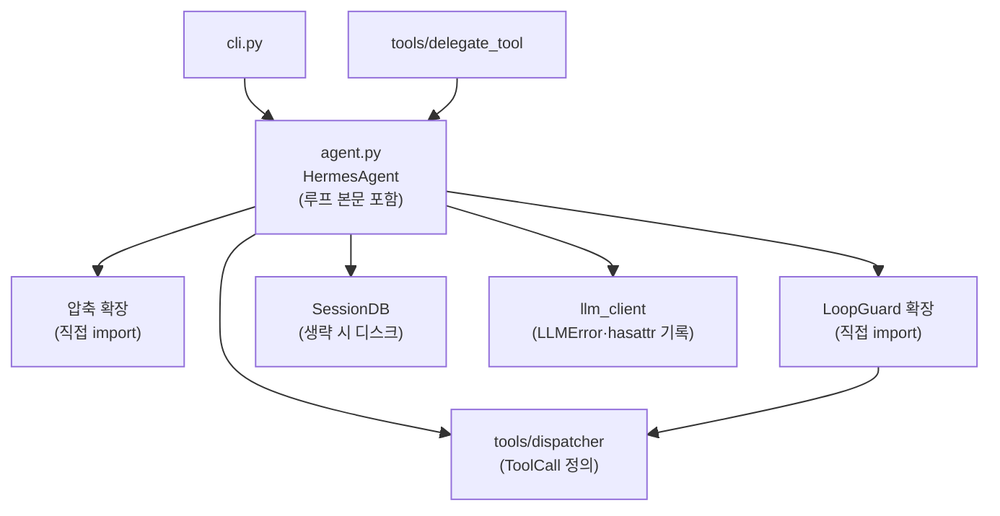
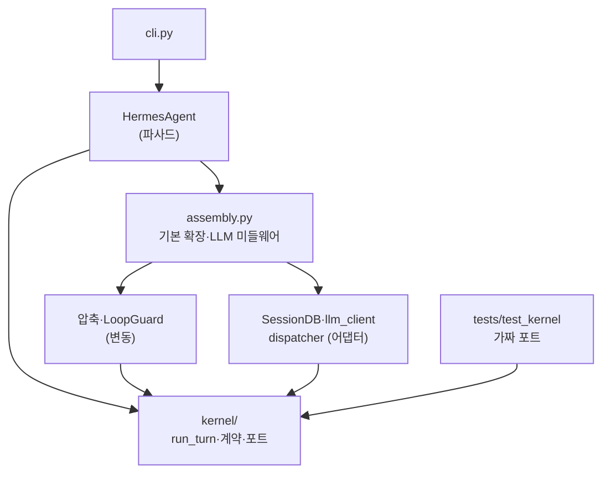
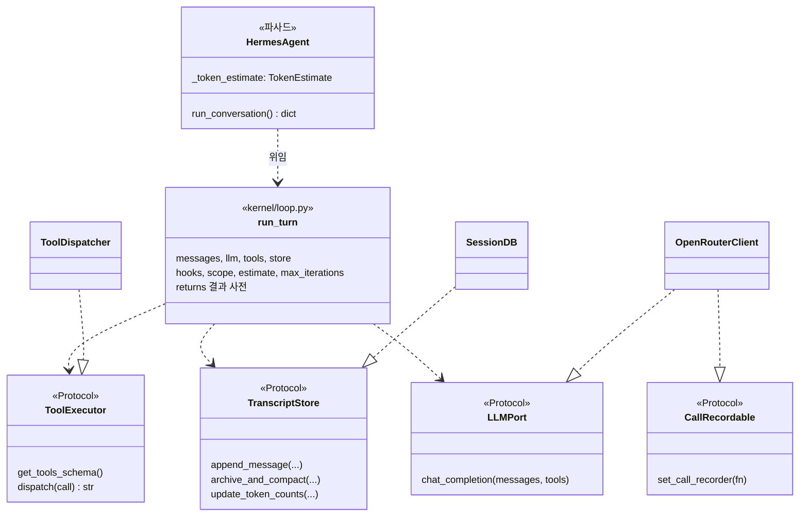
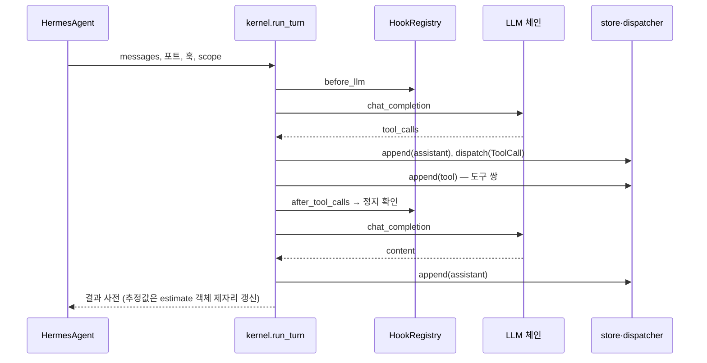

# [마스터 설계도] 18-코어 커널 경계 정비 MVP

> **상태**: `Draft`  
> **대시보드**: [README.md](README.md)  
> **의도(Why)**: [WHY.md](WHY.md) · **승인된 계획**: [PLAN.md](PLAN.md) · **근거 결정**: [ADR-0018](../../adr/0018-코어_커널_경계_정비_MVP_범위와_결정.md)  
> **기준 코드**: `main` `d2cd2af` (17 `Closed`, `roadmap-17-closed`)

---

## 1. 배경 및 목적 (Why)

15·16번이 확장 장치(도구 미들웨어·턴 훅·이벤트 sink)와 그 계약을 만들었고, 17번이 `LoopGuardExtension`으로 그 위에 기능을 실제로 붙였다. 그러나 루프 자체는 아직 기능과 붙어 있다([PLAN.md §2-2](PLAN.md)).

- 루프가 든 [`agent.py`](../../../src/hermes_core/agent/agent.py)가 압축·`LoopGuard`를 직접 import·설치한다.
- 루프만 시험할 수 없다. `HermesAgent`를 만들면 `SessionDB`·`MemoryStore`·도구 9종 디스패처·프롬프트 조립이 따라온다.
- LLM 호출은 단일 입구가 아니다(사용량 누적 인라인, `hasattr` 기록 콜백).
- 경계 규칙은 문서뿐이고, 그 사이 Python 3.10~3.13에서 import가 깨지는 결함(`Callable` 미import)이 숨어 있었다.

목적: 루프·계약·포트·대화 불변식을 표준 라이브러리만 쓰는 `kernel/`로 떼고, 경계를 시험으로 강제하며, 루프를 단독으로 검증한다. 동작은 바꾸지 않는다.

---

## 2. As-Is vs To-Be 아키텍처

### 2-1. 폴더 구조 (신규·변경)

```text
src/hermes_core/
  kernel/                  # 신규 (020~050). 표준 라이브러리만 import
    __init__.py            # 신규 (020)
    contract.py            # 신규 (020) ← extensions/contract.py 본문 이동
    turn_hooks.py          # 신규 (020) ← agent/turn_hooks.py 본문 이동
    tool_call.py           # 신규 (020) ← tools/dispatcher.py의 ToolCall·ToolMiddleware 이동
    events.py              # 신규 (020) ← agent/events.py의 AgentEvent·EventSink·코어 이벤트 종류 3개 이동
    ports.py               # 신규 (030) LLM·대화 기록·도구 실행 포트(Protocol), LLMError, (050) CallRecordable
    transcript.py          # 신규 (030) 대화 불변식 한 곳(시스템 메시지 불변·도구 결과 메시지·인자 해석)
    loop.py                # 신규 (030) 턴 루프 run_turn
    llm_pipeline.py        # 신규 (050) LLM 미들웨어 체인 (LLMRequest·LLMNext·LLMMiddleware·build_llm_chain)
  assembly.py              # 신규 (040) default_extensions·compression_config_of, (050) usage_ledger_middleware·default_llm_middlewares·connect_call_recorder
  extensions/contract.py   # 변경 (020) 재수출만 남김 (호환 층 목록)
  agent/__init__.py        # 변경 (040) 지연 import (PEP 562)
  agent/turn_hooks.py      # 변경 (020) 재수출만 남김 (호환 층 목록)
  agent/events.py          # 변경 (020) 코어 이름 재수출 + EVENT_LOOP_GUARD·ConsoleEventSink 유지
  agent/agent.py           # 변경 (010 import 1줄, 030 루프 위임, 040 확장 조립 위임, 050 사용량 코드 제거)
  agent/loop_guard.py      # 변경 (020) import 경로만 kernel로
  agent/compression_hook.py# 변경 (020) import 경로만 kernel로
  tools/dispatcher.py      # 변경 (020) ToolCall을 kernel에서 import(재수출 유지)
  cli.py                   # 변경 (010) typing.Optional import 1줄
  llm_client.py            # 변경 (030) LLMError를 kernel에서 import(이름 유지)
tests/
  test_architecture/       # 신규 (010) 의존 방향 래칫 시험, 주석 해석 시험
  test_kernel/             # 신규 (030) 가짜 포트만 쓰는 루프 단독 시험
```

- `tests/test_hermes_core/`의 기존 시험은 고치지 않는다(ADR-0018 D-05·D-06·D-09).
- 이름(`run_turn`·`llm_pipeline.py`·`test_architecture` 등)은 이 설계의 가칭이며 각 지시서에서 확정한다. 확정 이름이 다르면 이 그림을 고친다.

### 2-2. 구성요소 흐름: As-Is



- 루프 시험 = `HermesAgent` 생성 = 위 화살표 끝의 부품 전부가 따라옴.

### 2-3. 구성요소 흐름: To-Be



- 화살표는 import 방향이다. `kernel/`에서 나가는 화살표는 없다(R1).
- 시험 `tests/test_kernel`은 `kernel/`만 import한다.

### 2-4. 클래스·모듈 관계



- 포트는 구조적 타입(`typing.Protocol`)이라 `SessionDB`·`ToolDispatcher`·`OpenRouterClient`·`MockLLMClient`는 상속 없이 메서드 모양만 맞으면 된다. 포트의 메서드 이름은 지금 어댑터의 이름을 그대로 쓴다(어댑터 클래스 신설 불필요).
- `HookRegistry`·`TurnContext`·`TurnScope`·`Extension`·`ExtensionHost`는 020에서 `kernel/`로 옮겨지며 모양은 바뀌지 않는다.

### 2-5. 실행 순서 (대표 시나리오: 도구 1회 호출 뒤 최종 응답, To-Be)



- 050에서는 「LLM 체인」(`build_llm_chain`)을 거쳐 LLM 포트를 부르며, 사용량 누적 미들웨어가 응답을 받아 원장에 누적한다.
- 정지 사유 확인 시점(before_llm 뒤, after_tool_calls 뒤)과 원장 기록 시점(assistant는 도구 실행 전, tool은 호출마다 즉시)은 지금과 같다.
- 직전 토큰 추정값은 파사드가 소유한 `TokenEstimate` 객체를 커널이 제자리에서 갱신하여, 중간 예외로 중단되어도 즉시 반영을 보존한다.

---

## 3. 파급 범위와 무영향 근거 (Blast Radius)

| 단계 | 바뀌는 것 | 바뀌지 않는 것 (근거) |
|---|---|---|
| 010 | `agent.py` import 1줄, 시험 폴더 신설 | 실행 동작 전부(import 추가는 런타임 동작 무변경) |
| 020 | 계약 4모듈 위치, 구 경로는 재수출 | 클래스 객체 동일성(재수출은 같은 객체를 가리킴 → `isinstance`·`Enum` 비교 무변경), 기존 시험 import 경로 |
| 030 | 루프 본문 위치, 포트 정의, 대화 규칙 모듈, `LLMError` 정의 위치 | `HermesAgent` 생성자·`run_conversation` 인자와 반환 키, 시험이 읽는 내부 속성, 원장 기록 순서, 정지 확인 시점 |
| 040 | 기본 확장 목록 위치, `extensions` 인자 추가 | 기본 설치 순서(압축 → `LoopGuard`), `extensions` 등록 목록(`agent.extensions`)의 내용 |
| 050 | 사용량 누적 코드 위치, 호출 기록 연결 위치 | 원장 `llm_calls` 행과 세션 토큰 합계 값, 압축이 보는 직전 토큰 추정값 |

- 어느 단계도 바꾸지 않는 것: 도구 구현(`tools/*_tool.py`, `file_tools.py`), 상태 DB 스키마(`SCHEMA_VERSION`), CLI 동작과 출력, 프롬프트 조립, 압축 알고리즘(`compression.py`·`context_budget.py`), 체크포인트·승인.

---

## 4. 사전 점검 및 실패 위험 분석 (Pre-Mortem)

「18이 실패한다면 가장 그럴듯한 이유는?」

| # | 위험 | 대표 위험 분류 | 방어 |
|---|---|---|---|
| 1 | 루프 이동 중 인자 해석(`_parse_tool_arguments`)·깨진 JSON 처리 동작이 바뀜 | 파라미터·파싱 실패 | 함수를 `kernel/transcript.py`로 옮기고 인자 해석 및 `Invalid JSON arguments` 로깅 불변 유지 |
| 2 | 직전 토큰 추정값(`_last_input_tokens`·`_last_message_count`) 동기화 누락 → 압축이 안 일어나 컨텍스트 초과 | 루프·토큰 오버플로 | 파사드가 소유한 `TokenEstimate` 객체를 커널이 제자리에서 갱신(예외 중단 경로 포함 즉시 반영). 기존 압축 시험(`test_compression_agent.py`)과 030 시나리오로 확인 |
| 3 | 정지 사유 우선순위·확인 시점이 바뀜 → `stuck_loop` 뒤에도 바퀴가 돌거나 도구 쌍이 깨짐 | 루프 무한 반복 | 030 커널 시나리오에 「배치 중 정지 요청 → 배치의 tool 기록 완료 후 정지」를 명시. 기존 `test_loop_guard.py`·`test_transcript_integrity.py` 무수정 통과 |
| 4 | 재수출이 클래스를 복사해 `isinstance`·`Enum` 비교가 깨짐 | — | 재수출은 `from kernel.x import Name` 형태만(재정의 금지). 010 시험에 「구 경로 이름 is 새 경로 이름」 확인을 020 지시서에서 추가 |
| 5 | 커널 단독 시험이 몰래 파일·DB를 씀 | 파일시스템 오염 | `tests/test_kernel`은 `kernel/`만 import. 아키텍처 시험이 시험 폴더의 import도 검사하도록 030 지시서에서 정한다 |
| 6 | 순환 import (구 경로 재수출 ↔ kernel) | — | `kernel/`은 아무것도 import하지 않으므로 순환 불가. R1이 보장 |
| 7 | 주석 해석 시험의 잡음(정당한 지연 이름) | — | 예외를 시험 안에 사유와 함께 목록화. 010에서 실제 실행으로 잡음 규모 확인 |
| 8 | 래칫 목록이 「일단 넣고 보자」의 쓰레기통이 됨 | — | 각 항목에 사유·해소 예정 단계 필수. 마감 가정 G(목록이 시작보다 늘지 않음)로 대조 |
| 9 | `src/hermes_agent_study.egg-info/SOURCES.txt`의 낡은 목록 | — | 빌드 산출물이며 import 경로에 영향 없음. 손대지 않는다 |

---

## 5. 4층위 검증 범위 설계 (Validation Grid)

| 층위 | 무엇을 | 어디서 |
|---|---|---|
| 1 수동 반복 배제 | 실제 모델 호출 없이 전부 자동 시험. 실제 키 불필요 | 전 단계 |
| 2 단위·구조 | 의존 방향 래칫(R1~R3), 주석 해석, 커널 루프 시나리오(가짜 포트), LLM 체인 순서 | `tests/test_architecture`(010~), `tests/test_kernel`(030~050) |
| 3 상태·정합성 | 도구 쌍 불변식, 대화 교체 원자성(원장 실패 시 메모리 불변), 재개(`--resume`) 무결성, 원장 토큰 합계 | 기존 `test_transcript_integrity.py`·`test_session_resume.py`·`test_llm_call_ledger.py` 무수정 통과 + 커널 시나리오 |
| 4 통합 | 기존 E2E(`test_agent_e2e.py`·`test_extension_e2e.py`·`test_search_and_loop_e2e.py`·CLI pty) 무수정 통과 | 매 단계, 마감에서 최종 확인 |

---

## 6. 설계 결정 상세

### 6-1. 010 아키텍처 안전망
- `agent.py`에 `Callable`, `cli.py`에 `Optional` import 추가(전수 탐침에서 `get_type_hints` 실패는 이 두 결함의 3건뿐).
- 의존 방향 시험: `src/hermes_core/**/*.py`를 `ast`로 읽어 `import`·`from ... import`의 대상 모듈을 모은다. 규칙 R1(`kernel/` 고립), R2(`cli`·`cli_input`은 누구도 import 금지), R3(`tools/` → `agent/` 금지), 그리고 지금 문서로만 있는 「`extensions/contract.py`는 `hermes_core`를 import하지 않는다」를 검사한다.
- 010 시점 부채 목록(2026-10-31 확인): R3 위반 `tools/delegate_tool.py` → `hermes_core.agent.agent`, `hermes_core.agent.prompt_builder` 2건. R1·R2는 0건(`kernel/` 없음, CLI를 import하는 모듈 없음). 실제 목록은 010 실행 때 시험이 뽑은 결과로 확정한다.
- 래칫: 새 위반 → 실패. 목록에 있으나 사라진 위반 → 「목록에서 지워라」 실패.
- 주석 해석 시험: 모듈별 공개 함수·클래스 메서드에 `typing.get_type_hints`. 실패는 시험 안의 예외 목록에 사유가 있어야만 허용.
- python3.12 확인: 방법(임시 3.12 가상환경에 의존성 설치 등)은 010 지시서에서 정한다. 이 기기에 httpx가 설치된 3.12 환경은 없다(2026-10-31 확인).

### 6-2. 020 커널 패키지 신설과 계약 이동
- 옮기는 것: `extensions/contract.py` 전부, `agent/turn_hooks.py` 전부, `ToolCall`·`ToolMiddleware`, `AgentEvent`·`EventSink`·`EVENT_TOOL_CALL`·`EVENT_HOOK_ERROR`·`EVENT_EXTENSION_ERROR`.
- 남기는 것: `EVENT_LOOP_GUARD`(기능의 이벤트 종류는 커널이 알 필요가 없다)와 `ConsoleEventSink`(화면)는 `agent/events.py`에 남는다.
- 구 경로는 새 경로의 같은 객체를 다시 내보낸다. 호환 층 목록에 등록.
- `loop_guard.py`·`compression_hook.py`·`dispatcher.py`·`agent.py`의 import는 새 경로로 바꾼다(src 쪽은 새 경로, 시험 쪽은 구 경로 유지).

### 6-3. 030 턴 루프 추출과 단독 시험
- `kernel/ports.py`: `LLMPort`, `TranscriptStore`, `ToolExecutor`, `LLMError(kind)`. 메서드 이름은 현재 `MockLLMClient`·`OpenRouterClient`·`SessionDB`·`ToolDispatcher`와 같게 둔다.
- `kernel/transcript.py`: 시스템 메시지 불변 검사(현재 두 곳 → 한 함수 `first_message_unchanged`), 도구 결과 메시지 생성(`tool_result_message`), 도구 인자 해석(`parse_tool_arguments`).
- `kernel/loop.py`: 현재 `run_conversation`의 사용자 메시지 기록부터 결과 사전 조립까지와 `_execute_tool_calls`, `_replace_transcript`의 본문. 시스템 프롬프트 조립·스킬 인덱스·기억 블록은 파사드에 남는다(변동 영역).
- `HermesAgent.run_conversation`: 시스템 프롬프트 준비 → `TokenEstimate` 객체와 함께 `run_turn` 호출 → 결과 반환(추정값은 커널이 제자리에서 갱신, 프로퍼티로 노출).
- `tests/test_kernel/`: 메모리 안 목록 기반 가짜 포트. 시나리오(정상 종료, 최대 횟수, LLM 오류, before_llm 정지, 배치 중 정지 요청과 도구 쌍, 훅 예외 격리, 훅의 대화 직접 변조 감지, 대화 교체 원장 실패 시 메모리 불변, 결과 예약 키 보호 등)는 030 지시서에 구현 전에 적는다.

### 6-4. 040 기본 확장 조립 분리
- `assembly.py`의 `default_extensions(compression_config: Callable[[], CompressionConfig])`이 `[CompressionExtension(...), LoopGuardExtension()]`를 매번 새 인스턴스로 돌려준다.
- `compression_config_of(agent)`가 에이전트로부터 호출 시점의 압축 설정을 생성한다.
- `HermesAgent.__init__(..., extensions=None)`: 생성자 시작 시 중복 이름 선검사를 수행하여 부수 효과 전에 차단한다. `None`이면 `default_extensions(self._compression_config)`, 목록이면 그 목록을 순서대로 설치.
- `agent/__init__.py`: 패키지 지연 import(PEP 562)를 적용하여 순환 import를 원천 차단한다.
- 결과: `agent.py`는 `CompressionExtension`·`LoopGuardExtension`·`CompressionConfig`를 일체 import하지 않는다.
- 의존 방향 시험에 규칙 R5 추가: 기본 기능 확장 모듈(`FEATURE_EXTENSION_MODULES`)을 import하는 `src` 모듈은 오직 `hermes_core.assembly`뿐이다. 시나리오 11이 목록 누락을 방지한다.

### 6-5. 050 LLM 호출 단일 입구
- `kernel/llm_pipeline.py`: `LLMMiddleware = Callable[[LLMRequest, LLMNext], LLMReply]`, 등록 순서대로 감싸는 체인(`build_llm_chain`).
- 첫 소비자(조립 지점이 등록): 세션 토큰 합계 누적(`usage_ledger_middleware`).
- 호출 기록 연결: ADR D-08 보완(`852d5ea`)에 따라 어댑터 안의 기록 작성은 그대로 두고 연결만 조립 지점(`assembly.connect_call_recorder`)으로 옮긴다. 조건은 `kernel/ports.CallRecordable`.
- 루프에 남는 것: 응답 `usage`로 직전 토큰 추정값 갱신(압축이 쓰는 턴 데이터).
- `ExtensionHost`에 LLM 미들웨어 창구는 열지 않는다(ADR-0018 D-08).

### 6-6. 원본과 다른 점 (원본은 읽기 전용 조사)
- Hermes 원본(`hermes-agent/run_agent.py`의 `AIAgent`)은 루프·프롬프트·도구·압축이 한 클래스에 있다. 이 레포는 학습 목적상 원본 구조를 따라오다가 15~17에서 확장 장치를 분리했고, 18에서 루프 자체를 떼어 낸다. 원본에 같은 커널 분리가 있는지는 이번에 다시 조사하지 않았다(**미확인**).

---

## 7. 문서 동기화 방식

- 작동원리 [03편](../../작동원리/03-코어구조-메인루프-확장방식.md)이 「부품이 어떻게 나뉘고 기능이 어디에 붙는가」의 정본이므로 060에서 커널 경계·조립 지점·의존 방향 시험을 반영한다. 01편(엔터 한 번의 여정)은 루프 위치가 바뀐 곳의 구현 귀띔만 고친다.
- 060에서 02편(지침 주입·도구 호출)과 04편(기억)의 구현 귀띔도 함께 동기화했다(지시서 060 §1-3).
- 구현 중 이름이 확정되면 이 문서 §2의 그림을 같은 단계 커밋에서 고친다.

---

## 8. 이 로드맵이 다루지 않는 것 (Non-Goals)

정본은 [ADR-0018](../../adr/0018-코어_커널_경계_정비_MVP_범위와_결정.md) D-10, 쉬운 말 설명은 [WHY.md §2](WHY.md). 요약: 체크포인트·승인 미들웨어 이주, 에이전트·디스패처 소유 일원화, CLI 문자열 분기 제거, `constants.py` 분할, 호환 층 제거, 생성자 실물 기본값 제거, 훅 deepcopy 최적화, 턴 시작·끝 훅, 디렉터리 대이동, 단일 제어판(19).
