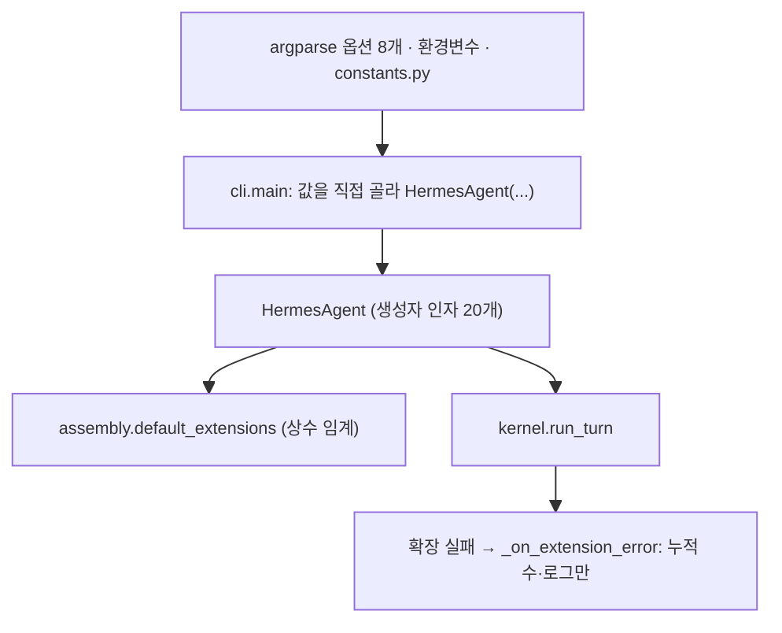
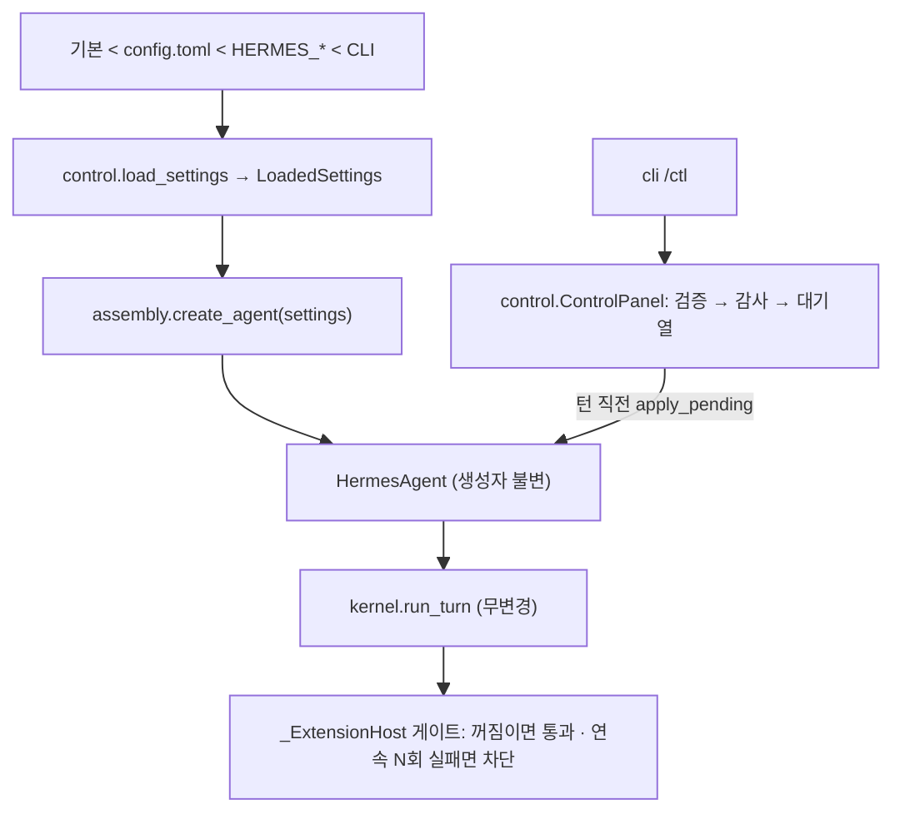
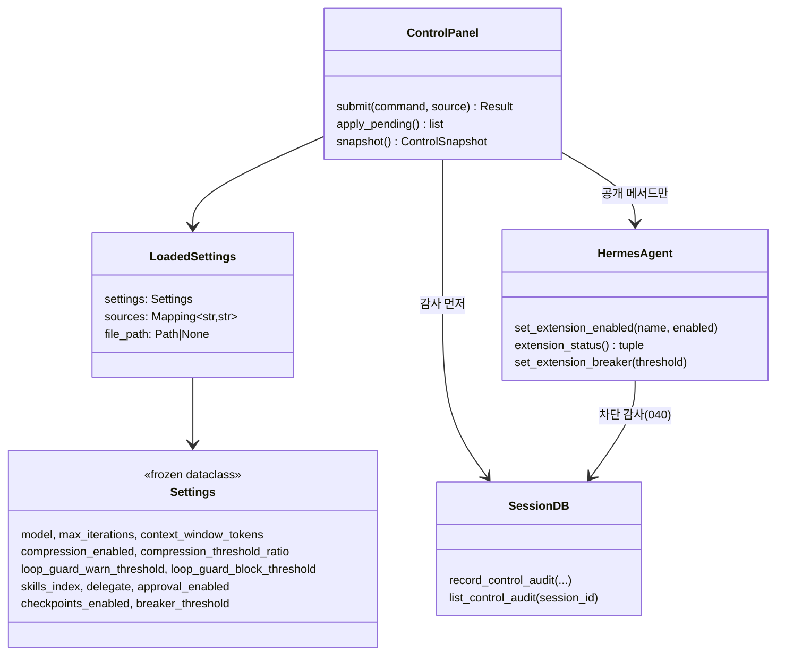
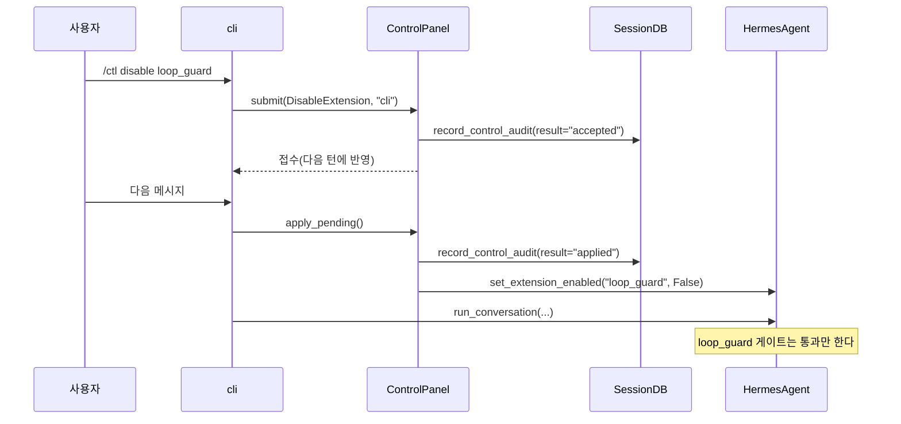
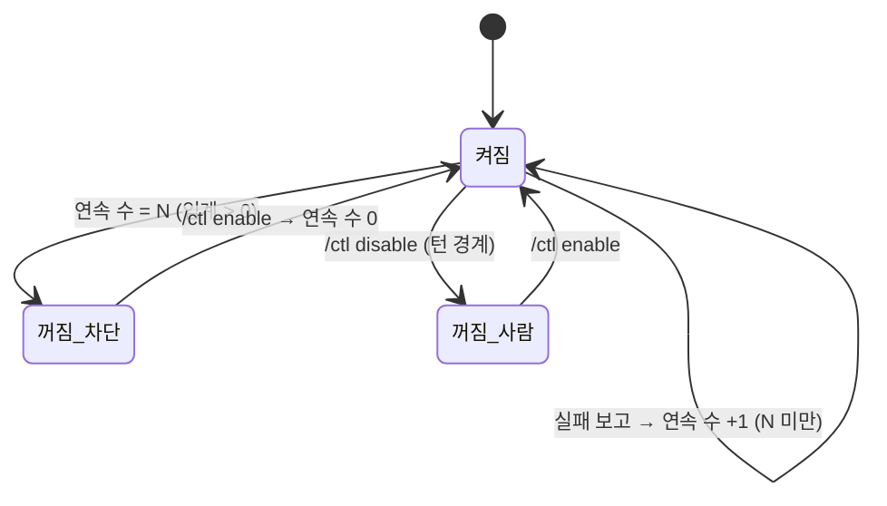

# [마스터 설계도] 19-단일-제어판-MVP

> **상위**: [대시보드](README.md) | [PLAN.md](PLAN.md) | [WHY.md](WHY.md) | 근거 결정: [ADR-0019](../../adr/0019-단일_제어판_MVP_범위와_결정.md)
> **기준**: `main` `9a37e5d`. 코드는 18 마감 `a972b78`과 같다(`git log -1 --format=%h -- src tests` = `a972b78`).
> **이어받는 에이전트는 §9부터 읽는다.**

---

## 1. 배경 및 목적 (Why)

- 쉬운 말 설명은 [WHY.md](WHY.md)에, 결정은 ADR-0019에 있다. 이 문서는 **어디를 어떻게 바꾸는가**를 다룬다.
- 목표: 설정·상태·확장 켜기·끄기·바꾸기를 `control/` 패키지 하나에 모은다. 메인루프(커널)와 에이전트 생성 방법은 그대로 둔다.

---

## 2. As-Is vs To-Be 아키텍처

### 2-1. 폴더 구조 (신규·변경)

```text
src/hermes_core/
├── control/                 [신규] 제어판. 아는 곳은 assembly·cli뿐 (R6)
│   ├── __init__.py          [신규 010]
│   ├── settings.py          [신규 010] Settings, SettingSpec, LoadedSettings, load_settings, SettingsError
│   ├── snapshot.py          [신규 020] ControlSnapshot, build_snapshot, mask_secrets
│   ├── commands.py          [신규 040] SetSetting, EnableExtension, DisableExtension, validate_command
│   └── panel.py             [신규 040] ControlPanel(submit, apply_pending, snapshot)
├── assembly.py              [변경 010] create_agent(settings, **parts), [040] apply_runtime_settings
├── cli.py                   [변경 010] Settings로 에이전트 생성, [040] 턴 직전 apply_pending, [050] /ctl 분기
├── agent/agent.py           [변경 030] _ExtensionHost 게이트, set_extension_enabled, extension_status,
│                                       set_extension_breaker, 연속 실패, [040] 차단 감사 기록
├── agent/events.py          [변경 030] EVENT_EXTENSION_TRIPPED
├── session_db.py            [변경 040] SCHEMA_VERSION 7, control_audit 표, record_control_audit, list_control_audit
├── kernel/                  (무변경 — WHY 가정 C)
└── tools/dispatcher.py      (무변경 — WHY 가정 C)
tests/
├── test_control/            [신규 010~050] 제어판 단독 시험
└── test_architecture/test_dependency_rules.py  [변경 010] R6 추가
```

### 2-2. 구성요소 흐름: As-Is



### 2-3. 구성요소 흐름: To-Be



### 2-4. 클래스·모듈 관계



### 2-5. 실행 순서 (대표 시나리오: `/ctl disable loop_guard` 뒤 다음 턴)



### 2-6. 차단기 상태 (확장 하나 기준)



---

## 3. 파급 범위와 무영향 근거 (Blast Radius)

| 단계 | 바뀌는 것 | 바뀌지 않는 것 (근거) |
|---|---|---|
| 010 | `control/settings.py` 신설, `assembly.create_agent`, `cli.py`의 에이전트 생성 경로, argparse 기본값(「주지 않음」을 알기 위해 `None`) | `HermesAgent.__init__`(시그니처·기본값), 설정이 없을 때의 값(가정 A), `--context-window` 오류 시 종료 코드 2와 DB 미생성(`test_cli.py` 시나리오 25), `--help` 출력의 옵션 이름 |
| 020 | `control/snapshot.py` 신설 | 에이전트·장부 상태(읽기만) |
| 030 | `agent.py`의 `_ExtensionHost` 두 등록 메서드(게이트로 감쌈), 새 공개 메서드 3개, `agent/events.py` 이벤트 1개 | 커널 전체, `tools/dispatcher.py`, `ExtensionRecord`, `agent.extensions`의 내용, 라이브러리 기본 동작(차단기 꺼짐), 훅 오류 이벤트의 `hook` 이름(게이트는 `functools.wraps`로 이름 보존) |
| 040 | `session_db.py`(v7, 표 1개, 메서드 2개), `control/commands.py`·`panel.py`, `assembly.apply_runtime_settings`, 차단 시 감사 기록 | 기존 표 6개의 열, 기존 이전 경로(v2~v6), 스키마 단언 시험(모두 `>=` 비교라 영향 없음: `test_approval_ledger.py`·`test_agent_e2e.py`) |
| 050 | `cli.py`의 입력 분기에 `/ctl` 추가 | `/rollback`·`exit/quit` 분기, 턴 실행 경로 |

- 어느 단계도 바꾸지 않는 것: `kernel/`, `tools/`(디스패처 포함), 프롬프트 조립, 압축 알고리즘, 체크포인트·승인 로직(값은 Settings에서 오지만 동작은 그대로), `constants.py`의 기존 이름.

---

## 4. 사전 점검 및 실패 위험 분석 (Pre-Mortem)

「19가 실패한다면 가장 그럴듯한 이유는?」

| # | 위험 | 대표 위험 분류 | 방어 |
|---|---|---|---|
| 1 | 게이트가 디스패처의 「자체 실패 vs 안쪽 예외」 구분(`dispatcher.py` 198행 `mw_exc is inner_exc`)을 깨뜨림 | 파라미터·파싱 실패 | 게이트는 예외를 잡지 않고 그대로 다시 던진다. `next`도 그대로 넘긴다. 예외 객체의 동일성이 유지된다. 030 시나리오에 「GUARD 미들웨어 안쪽 핸들러 예외는 확장 실패로 세지 않음」을 넣는다 |
| 2 | 「성공」을 잘못 셈 → 영원히 안 끊기거나 너무 빨리 끊김 | 루프 무한 반복 | 성공 = **게이트가 정상 반환**. 실패 = `_on_extension_error`에 보고됨. 안쪽 예외로 게이트가 예외를 내면 성공도 실패도 아니다(중립). 확장 하나에 수 하나(자리 구분 없음) |
| 3 | 훅을 감싸서 `_hook_to_extension[id(hook)]` 매핑이 어긋남 → 훅 실패가 확장 실패로 안 잡힘 | — | 등록(`hooks.register`)과 매핑에 **같은 감싼 객체**를 쓴다(둘 다 `_ExtensionHost.add_turn_hook` 안) |
| 4 | 환경변수 계층이 개발자 기기의 `HERMES_*` 값을 시험에 섞음 | — | 계층 로더는 `environ` 인자를 받는다(기본 `os.environ`). 새 시험은 빈 사전을 넘긴다. 기존 시험 환경에 `HERMES_` 값이 있는지는 010 착수 전 점검 항목 |
| 5 | argparse 기본값을 `None`으로 바꿔 기존 동작이 바뀜(`--context-window` 검증 등) | — | 검증은 Settings 로더가 하되 오류 시 기존과 같은 종료 코드 2와 같은 안내를 낸다. DB를 만들기 전에 검증한다 |
| 6 | 턴 도중 반영 → 한 턴 안에서 설정이 달라짐, 캐시 깨짐 | 컨텍스트·토큰 | 반영 함수는 `apply_pending` 하나이고, 부르는 곳은 `cli.py`의 `run_conversation` 직전 한 곳뿐이다(050 시험이 확인) |
| 7 | 감사 기록 실패인데 반영됨 | 비인가 실행 부작용 | 패널은 기록 호출이 예외 없이 끝난 뒤에만 반영한다. 040 시나리오에 기록 실패 주입을 넣는다 |
| 8 | `/ctl set`으로 보안 설정 하향 | 비인가 실행 | `locked` 항목은 검증에서 거부하고, 거부를 감사에 남긴다. 반영 함수에도 `locked` 키가 오면 예외를 내는 이중 확인을 둔다(다층 방어) |
| 9 | 스냅샷이 비밀값 노출 | — | Settings에 비밀값 항목이 없다(구조). 출력 직전 `mask_secrets`를 한 번 더 건다. `llm_client._mask_str`(40행)은 키 값을 알아야 하는 방식이라 재사용하지 않고, 패턴 방식을 따로 둔다 |
| 10 | `control`이 `agent`를 import → R6과 순환 | — | `control`은 `HermesAgent`의 타입만 `typing.TYPE_CHECKING` 아래에서 쓴다. 실제 객체는 인자로 받는다. R6 시험이 `control` → 금지 방향(`agent` 런타임 import)도 볼지는 010 지시서에서 정한다 |

---

## 5. 4층위 검증 범위 설계 (Validation Grid)

| 층위 | 무엇을 | 어디서 |
|---|---|---|
| 1 수동 반복 배제 | 실제 모델 호출 없이 모두 자동 시험. 실제 키 불필요 | 전 단계 |
| 2 단위·구조 | 계층 우선순위, 값 검증, 스냅샷 불변, 명령 검증, 게이트·차단기 상태 전이, R6 | `tests/test_control/`, `tests/test_architecture` |
| 3 상태·정합성 | 감사 기록 먼저(기록 실패 시 미반영), v6 → v7 이전, 턴 경계 반영, 차단 뒤 도구 쌍 무결 | `tests/test_control/`, 기존 `test_transcript_integrity.py` 무수정 통과 |
| 4 통합 | `--mock` CLI에서 `/ctl status`·`set`·`disable`·`enable` 종단간, pty | 050, 마감 |

---

## 6. 단계별 상세 명세 (지시서 작성용)

> 각 지시서 작성 전에 「탐침」 항목을 코드로 확인하고, 결과가 이 절과 다르면 지시서 §6에 「ROADMAP과 다른 점」으로 적는다. 시그니처는 **초안**이다. 확정은 지시서가 한다.

### 6-1. 010 Settings와 경계

- **만들 것**: `control/__init__.py`(빈 패키지 또는 공개 이름 재수출), `control/settings.py`.
- **항목 표(초안, 소비자가 있는 것만)**:

| 키 | 타입 | 기본값(출처) | 바꿀 수 있는 시점 | 소비자 |
|---|---|---|---|---|
| `model` | str 또는 None | None(실제 모드에서 `DEFAULT_REAL_MODEL`) | startup | `cli.py` `OpenRouterClient(model=)`, `HermesAgent(model=)` |
| `max_iterations` | int ≥ 1 | 50(`HermesAgent.__init__` 기본값, 상수 없음) | runtime | `agent.max_iterations`(`agent.py` 136행, `run_turn`에 399행에서 전달) |
| `context_window_tokens` | int ≥ 1 | `CONTEXT_WINDOW_TOKENS` | runtime | `agent.context_window_tokens` → `assembly.compression_config_of`가 호출 때마다 읽음 |
| `compression_enabled` | bool | True | runtime | `agent.compression_enabled` → 같음 |
| `compression_threshold_ratio` | float (0, 1] | `COMPRESSION_THRESHOLD_RATIO` | runtime | 같음 |
| `loop_guard_warn_threshold` | int ≥ 2 | `LOOP_GUARD_WARN_THRESHOLD` (3) | startup | `LoopGuardExtension(warn_threshold=)`(`agent/loop_guard.py` 120행, 하한 ≥ 2) |
| `loop_guard_block_threshold` | int > warn (최소 3) | `LOOP_GUARD_BLOCK_THRESHOLD` (5) | startup | 같음 |
| `skills_index` | bool | True(CLI 기본, `--no-skills-index`) | startup | `HermesAgent(skills_index=)` |
| `delegate` | bool | False(`--delegate`) | startup | `cli.py` 376행 `register_delegate_tool` |
| `approval_enabled` | bool | True(`--no-approval`) | locked | `cli.py` `approval_enabled`(TTY 조건은 그대로 곱함) |
| `checkpoints_enabled` | bool | True(`--no-checkpoints`) | locked | `cli.py` 체크포인터 생성 |
| `breaker_threshold` | int ≥ 0 (0 = 꺼짐) | 3 | runtime | 030의 `HermesAgent.set_extension_breaker` |

  - `--mock`과 `--resume`은 실행 방식이지 설정이 아니므로 Settings에 넣지 않는다.
  - API 키는 넣지 않는다(ADR D-03).
- **계층**:
  - 파일은 `$HERMES_HOME/config.toml`이다. 경로는 `constants.get_hermes_home()` 기준이고, 평평한 키만 허용한다.
  - 환경변수는 `HERMES_` + 키 대문자다(예: `HERMES_MAX_ITERATIONS`). `SETTING_SPECS`에 등록된 키만 읽고 무관한 `HERMES_*`(`HERMES_HOME` 등)는 무시한다. 불리언은 `1/0/true/false/yes/no`다.
  - CLI는 사용자가 **준** 옵션만 덮는다. 이를 위해 argparse 기본값을 `None`으로 두고, `--no-*` 플래그는 「주어졌을 때만 False」로 해석한다.
- **시그니처 초안**:
  - `load_settings(*, cli_overrides: Mapping[str, Any] | None = None, environ: Mapping[str, str] | None = None, config_path: Path | None = None) -> LoadedSettings`
  - `LoadedSettings.sources[key]`는 `"default" | "file" | "env" | "cli"` 중 하나다.
  - 오류는 `SettingsError(layer, key, reason)`로 낸다.
  - 항목 메타데이터는 `SETTING_SPECS: Mapping[str, SettingSpec(type, mutability, validator)]` 하나에 둔다. 항목 표의 정본이다.
- **조립**:
  - `assembly.create_agent(settings: Settings, **parts) -> Any`. `parts`는 `llm_client`, `session_id`, `session_db`, `memory_store`, `dispatcher`, `resume` 등 실행 부품이다. 반환 타입 주석은 순환 방지를 위해 `Any`로 두고, `HermesAgent` import는 함수 본문 안에서 수행한다.
  - LoopGuard 임계를 넘기려면 `extensions=`를 직접 만들어야 한다. 그런데 압축 확장은 에이전트를 가리키는 설정 함수가 필요하다. 그래서 늦게 묶는 함수(`lambda: compression_config_of(agent)`)를 쓴다.
  - **탐침 확인 완료**: `CompressionExtension`이 설치(`install`) 중에 설정 함수를 부르지 않으므로 늦게 묶기가 안전하게 성립한다.
  - `default_extensions`에 임계 키워드 인자(기본값은 지금 상수)를 더해도 기존 호출 4곳(에이전트 및 시험)은 그대로다.
- **CLI 변경**:
  - `cli.py` 364~374행의 `HermesAgent(...)`를 `create_agent(settings, ...)`로 바꾼다. `cli.HermesAgent` 이름은 남긴다(`test_cli.py`가 `cli.HermesAgent.__init__`을 패치함).
  - 검증 오류는 세션 DB를 열기 전에 종료 코드 2로 끝낸다(`test_cli.py` 시나리오 25).
- **R6**: `test_dependency_rules.py`에 유입(`control`을 import할 수 있는 모듈은 `assembly`·`cli`·`control.*`뿐) 및 유출(`control`이 import할 수 있는 모듈은 표준 라이브러리·`constants`·`control.*`뿐) 양방향을 검사한다. 기존 R1~R5 구조(ast 수집, 부채 목록 완전성)를 따른다.
- **인수 시나리오 후보**:
  1. 아무 계층도 없음 → 모든 값이 표의 기본값, 출처는 전부 `default`.
  2. 파일 + 환경변수 + CLI가 같은 키를 주면 CLI가 이긴다. 키 셋을 섞으면 키마다 출처가 맞다.
  3. 파일의 모르는 키 → `SettingsError`(layer=`file`, key).
  4. 타입 오류·범위 밖 값(`compression_threshold_ratio = 1.5`, `loop_guard_block <= warn`) → 오류.
  5. 환경변수 불리언 해석. 잘못된 문자열은 오류.
  6. `Settings`는 대입하면 `FrozenInstanceError`.
  7. CLI `--mock`만 → 에이전트의 `context_window_tokens`·`max_iterations`·`compression_*`가 지금과 같다.
  8. `--mock --context-window 2000` → 기존 시나리오 24와 같은 결과(기존 시험 무수정).
  9. `config.toml`의 `max_iterations = 7` → CLI 에이전트의 `max_iterations == 7`.
  10. R6 위반 모듈을 만들면 실패한다(붉은 확인).
  11. 기존 시험 무수정 통과(1,094 / pty 10 / 아키텍처 33+ / 커널 34).

### 6-2. 020 상태 스냅샷

- **만들 것**: `control/snapshot.py`.
  - `ControlSnapshot`(동결): `settings: tuple[SettingView(key, value, source, mutability)]`, `extensions: tuple[ExtensionView(name, kinds, slots, total_failures)]`, `session_id`, `input_tokens`, `output_tokens`, `pending_commands: int`.
  - `build_snapshot(agent, loaded, *, pending: int = 0) -> ControlSnapshot`.
  - `render_snapshot(snapshot) -> str`: 050에서 화면에 쓴다. 이 단계에서 만들어 둘지는 지시서가 정한다.
- 확장 정보: 020에서는 `agent.extensions`(이름별로 묶음)만 쓴다. 030에서 `extension_status()`의 켜짐·연속 실패를 더한다(030이 이 파일을 함께 고친다).
- 토큰: `session_db.get_session(session_id)`(310행)의 `input_tokens`·`output_tokens`.
- 마스킹: `mask_secrets(text)`. 패턴은 OpenRouter 키 모양(`sk-or-` 접두), `Bearer` 토큰 등이다. 정확한 패턴은 지시서에서 `llm_client.py` 40~60행을 대조해 정한다.
- **인수 시나리오 후보**:
  1. 스냅샷 전후로 에이전트 속성과 장부 행 수가 같다.
  2. 출처가 `LoadedSettings.sources`와 같다.
  3. 기본 확장 2개(`compression`, `loop_guard`)가 순서대로 보인다.
  4. 키 모양 문자열이 값에 섞여도 렌더 결과에 원문이 없다.
  5. 동결이라 대입할 수 없다.

### 6-3. 030 확장 게이트와 차단기

- **고칠 곳**: `agent.py`의 `_ExtensionHost.add_tool_middleware`(414행)·`add_turn_hook`(430행), `__init__`의 확장 상태 초기화(215~220행), `_on_extension_error`(271행).
- **게이트**(초안):
  ```python
  def _gate_middleware(agent, name, mw):
      @functools.wraps(mw)
      def gated(call, next_fn):
          if not agent._extension_enabled.get(name, True):
              return next_fn(call)
          result = mw(call, next_fn)      # 예외는 잡지 않는다(위험 1)
          agent._extension_succeeded(name) # 정상 반환 = 성공(위험 2)
          return result
      return gated
  ```
  - 훅도 같은 모양으로 감싼다. 꺼졌으면 `None`을 돌려준다. 훅 반환값의 의미는 `kernel/turn_hooks.py`에서 **탐침**한다.
  - 감싼 객체를 `hooks.register`와 `_hook_to_extension`에 같이 쓴다(위험 3).
- **공개 메서드**:
  - `set_extension_enabled(name: str, enabled: bool) -> None`: 모르는 이름이면 `ValueError`. 켜면 연속 수를 0으로 한다.
  - `extension_status() -> tuple[ExtensionStatus, ...]`: `ExtensionStatus(name, enabled, consecutive_failures, tripped: bool)`, `agent` 쪽 동결 dataclass.
  - `set_extension_breaker(threshold: int) -> None`: 0이면 꺼짐. 기본값 0(라이브러리 기본 꺼짐, ADR D-07).
- **차단**:
  - `_on_extension_error`에서 연속 수를 +1 한다. 임계 > 0이고 연속 수 ≥ 임계이면 꺼짐으로 바꾸고, `tripped=True`로 표시한 뒤 `EVENT_EXTENSION_TRIPPED(name, failures)`를 낸다.
  - 감사 기록은 040에서 이 지점에 더한다.
- **조립**: `assembly.create_agent`가 `settings.breaker_threshold`로 `set_extension_breaker`를 부른다. 020 스냅샷에 켜짐·연속 실패를 더한다.
- **탐침**:
  - 디스패처가 미들웨어를 부를 때 `name`을 어디서 얻는지 확인한다(`add_middleware(name=)`).
  - 감싼 함수가 `phase` 판정이나 시험의 미들웨어 동일성 비교(`is`)에 걸리는지 확인한다. `grep -rn "add_middleware\|_middlewares" tests`.
- **인수 시나리오 후보**:
  1. 꺼진 GUARD 미들웨어는 호출되지 않고 도구 결과는 같다.
  2. 꺼진 턴 훅은 호출되지 않는다.
  3. 임계 3: 잇단 실패 3회 → 꺼짐 + 이벤트 1회. 4번째 턴에는 그 확장의 실패 보고가 없다(WHY 가정 E).
  4. 실패-성공-실패-실패 → 연속 수 2, 꺼지지 않음.
  5. GUARD 안쪽 핸들러 예외 → 연속 수 변화 없음.
  6. 임계 0(라이브러리 기본) → 실패 10회에도 켜짐. `agent.extensions`의 누적 `failures`는 기존과 같이 증가.
  7. `set_extension_enabled(True)` → 연속 수 0, `tripped` 해제.
  8. 모르는 이름 → `ValueError`.
  9. 차단 뒤에도 대화 기록의 도구 쌍이 맞다.
  10. `kernel/`·`tools/dispatcher.py` diff 0줄.

### 6-4. 040 쓰기 명령과 감사 기록

- **장부**:
  - `SCHEMA_SQL`에 `control_audit` 표를 더한다. 열: `id INTEGER PRIMARY KEY`, `session_id TEXT`, `created_at REAL`, `source TEXT`, `command TEXT`, `target TEXT`, `old_value TEXT`, `new_value TEXT`, `result TEXT`, `reason TEXT`.
  - `SCHEMA_VERSION = 7`로 올린다. `_init_schema`(179행~)에 `if current_version < 7: UPDATE ... 7`을 더한다. 표는 `CREATE TABLE IF NOT EXISTS`라서 v6 파일을 열 때도 생긴다.
  - 메서드는 `record_control_audit(...) -> int`와 `list_control_audit(session_id) -> list[dict]`다.
  - 값 열에 쓰기 전에 `mask_secrets`를 건다. `session_db`는 `control`을 import할 수 없으므로(R6), 마스킹은 패널이 기록 전에 한다.
- **명령**(`control/commands.py`):
  - `SetSetting(key, value)`, `EnableExtension(name)`, `DisableExtension(name)`. 모두 동결이다.
  - `validate_command(cmd, loaded, extension_names) -> Rejection | None`.
  - 거부 사유 코드: `unknown_key`, `bad_value`, `locked`, `startup_only`, `unknown_extension`.
- **패널**(`control/panel.py`):
  - `ControlPanel(agent, loaded, session_db)`.
  - `submit(cmd, source="cli")`: 검증한다. 감사(`accepted` 또는 `rejected`)를 쓰고, 예외가 나면 대기열에 넣지 않는다. 그다음 대기열에 넣는다.
  - `apply_pending()`: 각 명령마다 감사(`applied`)를 쓰고, 그다음 반영한다.
    - 설정 반영: `dataclasses.replace`로 새 Settings를 만들고 `assembly.apply_runtime_settings(agent, settings)`를 부른다.
    - 확장 반영: `agent.set_extension_enabled`를 부른다.
  - `snapshot()`: `build_snapshot(..., pending=len(queue))`.
  - `apply_runtime_settings`는 `runtime` 키만 에이전트 속성에 대입한다. `locked`·`startup` 키가 오면 예외를 낸다(위험 8).
- **차단 감사**: 030의 차단 지점에서 꺼짐으로 바꾸기 **전에** `session_db.record_control_audit(source="breaker", command="disable_extension", ...)`를 부른다. 기록이 실패해도 차단은 한다. 안전 쪽이기 때문이고, 실패는 로그로 남긴다. 이 예외는 지시서에 명시한다.
- **CLI 연결**: `cli.py` 479행(대화 루프 안) `agent.run_conversation(...)` 바로 앞에서 `panel.apply_pending()`을 부른다. 426행의 `run_conversation`은 「`--mock`이고 표준 입력이 터미널이 아닐 때」 한 턴만 자동으로 돌리고 끝내는 경로다(423행). 대화 루프 밖이고 대기 명령이 있을 수 없으므로 반영 지점으로 쓰지 않는다.
- **인수 시나리오 후보**:
  1. 새 DB → `schema_version == 7`, `control_audit` 있음.
  2. v6 모양 옛 DB → 7로 오르고 옛 행이 그대로다.
  3. `SetSetting("max_iterations", 7)` → `accepted` 행. 반영 전 `agent.max_iterations`는 그대로이고, `apply_pending` 뒤 7과 `applied` 행.
  4. `SetSetting("approval_enabled", False)` → `rejected/locked`, 대기열 0.
  5. `SetSetting("model", ...)` → `rejected/startup_only`.
  6. 기록 실패 주입(장부 메서드가 예외) → 대기열 0, 에이전트 무변경.
  7. `DisableExtension("loop_guard")` → 다음 `apply_pending` 뒤 꺼짐.
  8. 차단 → `source="breaker"` 행 1개.
  9. 값에 키 모양 문자열 → 장부에 원문 없음.

### 6-5. 050 CLI `/ctl`

- `cli.py` 459행 `/rollback` 분기 옆에 `if tokens[0].lower() == "/ctl":` 분기를 둔다. 처리 함수는 `_handle_ctl(tokens, panel) -> None`이다.
  - `status`: `render_snapshot` 출력.
  - `set <key> <value>`: 문자열 값을 `SETTING_SPECS` 타입으로 해석한다.
  - `enable|disable <ext>`.
  - 사용법 오류는 안내만 하고 턴으로 넘기지 않는다(`continue`).
- 안내 문구는 `constants.py`의 `CLI_*` 관례를 따른다(새 상수 `CLI_CTL_*`).
- **주의**: `--mock`에 표준 입력이 터미널이 아니면 CLI는 자동 1턴 뒤 끝난다(`cli.py` 423행). 따라서 `/ctl` 종단간 시험은 pty 시험이나, 기존 `test_cli.py`처럼 입력 함수를 바꿔 끼우는 방식(`_run` 도우미)으로 한다. 어느 방식이 맞는지는 기존 `/rollback` 시험(`test_cli_rollback.py`)을 탐침해 정한다.
- **인수 시나리오 후보**:
  1. `--mock`에서 `/ctl status` → 설정 표와 확장 2개, 모델 호출 0회.
  2. `/ctl set max_iterations 3` 뒤 다음 메시지 → 에이전트 값 3, 감사 2행.
  3. `/ctl set approval_enabled false` → 거부 안내, 값 그대로.
  4. `/ctl disable loop_guard` → 접수 안내. 반영은 다음 턴.
  5. `/ctl` 단독·모르는 하위 명령 → 사용법.
  6. `/rollback` 동작 무변경(기존 시험).
  7. pty 시험 1개 이상(`-m pty`).

### 6-6. 060 작동원리 동기화, 070 마감

- 060: §7을 따른다.
- 070: 18번 070 지시서([070_마감.md](../18-코어-커널-경계-정비-MVP/instructions/070_마감.md))를 형식 견본으로 쓴다. 가정은 WHY A~I이고, 3.12 import 대상에 `hermes_core.control.*`를 더한다.

---

## 7. 문서 동기화 방식

- 작동원리 [03편](../../작동원리/03-코어구조-메인루프-확장방식.md)은 「부품과 기능이 붙는 자리」의 정본이다. 060에서 다음을 반영한다:
  - 조립 지점 바깥의 제어판
  - R6
  - 확장 게이트와 차단기
  - 턴 경계 반영
- 설정 계층과 감사 기록을 03편에 넣을지 새 편(05)으로 뗄지는 060 지시서 작성 때 03편 분량을 보고 정한다. 판단 기준은 작동원리 README 「설명의 기준」이다.
- 구현 중 이름이 확정되면 이 문서 §2 그림과 §6을 같은 단계 커밋에서 고친다.

---

## 8. 이 로드맵이 다루지 않는 것 (Non-Goals)

정본은 ADR-0019 D-11, 쉬운 말 설명은 [WHY.md §2](WHY.md). 요약:
- HTTP 백오피스, 핫 리로드, half-open
- 보안 설정 변경, 실행 중 모델·스킬 색인·LoopGuard 임계 변경
- 위임 자식 팩토리, 미들웨어 이주, CLI 분기 구조 정리
- `constants.py` 분할, 호환 층 제거

---

## 9. 이어받는 에이전트를 위한 안내

이 로드맵은 토큰 사정으로 여러 세션·에이전트가 나눠 진행할 수 있다. 처음 이어받으면 아래 순서를 지킨다.

1. **읽을 순서**:
   1. [`docs/인계/`](../../인계/README.md)의 최신 파일(이름순 마지막)
   2. 이 로드맵 [대시보드](README.md) §2·§3: 어느 지시서가 어디까지 되었는지
   3. [ADR-0019](../../adr/0019-단일_제어판_MVP_범위와_결정.md)(D-01~D-11, 개정 기록)
   4. 이 문서 §3·§4·§6의 해당 단계
   5. 형식 견본: [18번 지시서 040](../18-코어-커널-경계-정비-MVP/instructions/040_기본_확장_조립_분리.md)과 [050](../18-코어-커널-경계-정비-MVP/instructions/050_LLM_호출_단일_입구.md). 머리 → §0 착수 전 점검 → §1 작업 명세 → 시나리오 표 → §5 넘기는 사실 → §6 다른 점.
2. **지시서 작성 규칙**(정본 [ROADMAP_정책](../ROADMAP_정책.md), [AGENTS.md](../../../AGENTS.md)):
   - 한 번에 **하나만** 쓴다. 쓰기 전에 §6의 「탐침」을 코드로 확인한다. 쓴 뒤 자체 검토 4항목을 확인하고 보고한 뒤 멈춘다. 4항목:
     1. 시험이 동어반복이 아닌가
     2. 경계값이 작은 값에서도 성립하는가
     3. 실패·거부 뒤 반복 비용이 폭주하지 않는가
     4. 현재 코드 모양과 맞는가
   - 탐침은 **실제로 실행**한다(코드 열람·grep·명령). 실행한 명령과 결과를 지시서 **§0 착수 전 점검**에 적는다. 결과가 이 문서 §6과 다르면 지시서 §6 「ROADMAP과 다른 점」에 적는다.
   - 인수 시나리오(입력 → 기대 결과)는 지시서에 **구현 전에** 적는다. 구현 중에 바꿔야 하면 멈추고 보고한다.
   - 파일 이름은 `instructions/0N0_<단계명>.md`다. 작성 커밋은 `docs(roadmap): R19-PLAN - 지시서 0N0 작성 (...)`이다. 같은 커밋에서 대시보드 해당 행의 「미작성」을 링크와 `Draft`로 바꾸고, 실행 기록에 한 줄을 더한다. 직전 행의 커밋 칸이 식별자뿐이면 실제 해시로 채운다.
3. **실행 규칙**:
   - 「0N0 구현해라」 한 번에 지시서 하나만 실행한다. 착수 전 점검 → 구현 → 시나리오 시험 → 전체 회귀 → 커밋 `<type>(core): R19-0N0 - ...` → 멈춤.
   - 기존 시험을 고쳐야 하면 멈추고 사용자 승인을 받는다(WHY 가정 B).
4. **기준 시험 수**(2026-10-31, 이 문서 작성 시점): `.venv/bin/pytest --co -q -m "not pty"` 1,094 / `-m pty` 10 / `tests/test_architecture` 33 / `tests/test_kernel` 34. 실행은 `.venv/bin/pytest -n 4 -q -m "not pty"`.
5. **금지**:
   - `hermes-agent/` 수정
   - `git add -A`·`git add .`(경로를 지정해서 add한다)
   - 무지시 푸시·되돌리기
   - 키를 대화나 명령줄에 쓰기(AGENTS §3)
   - `kernel/`·`tools/dispatcher.py` 수정(가정 C. 필요해 보이면 멈추고 보고한다)
   - 커밋 전에 실제 해시를 지어내기. 18번에서 존재하지 않는 해시 2건이 기록된 적이 있다. 해시 칸에는 식별자를 쓰고, 다음 커밋에서 실제 값으로 채운다.
6. **열린 질문**(지시서 작성 때 정한다):
   - `render_snapshot`을 020에 둘지 050에 둘지
   - R6이 `control → agent` 런타임 import도 금지할지
   - 060에서 새 편을 만들지
