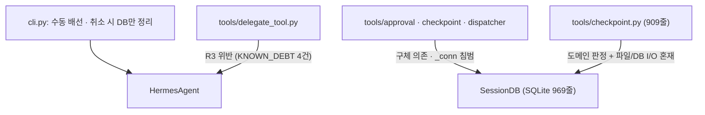
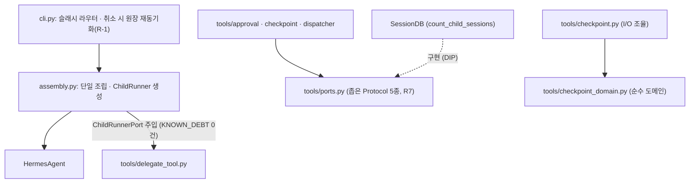
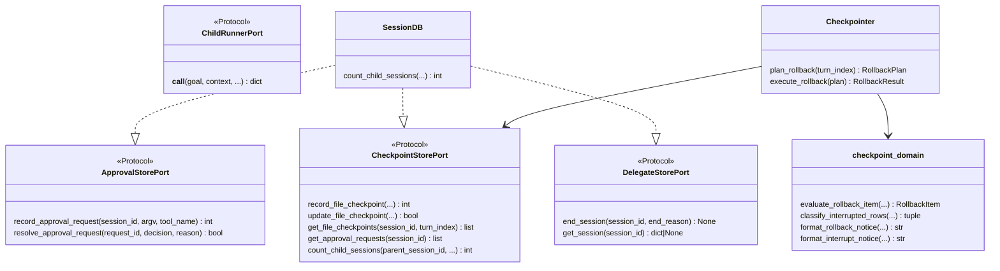
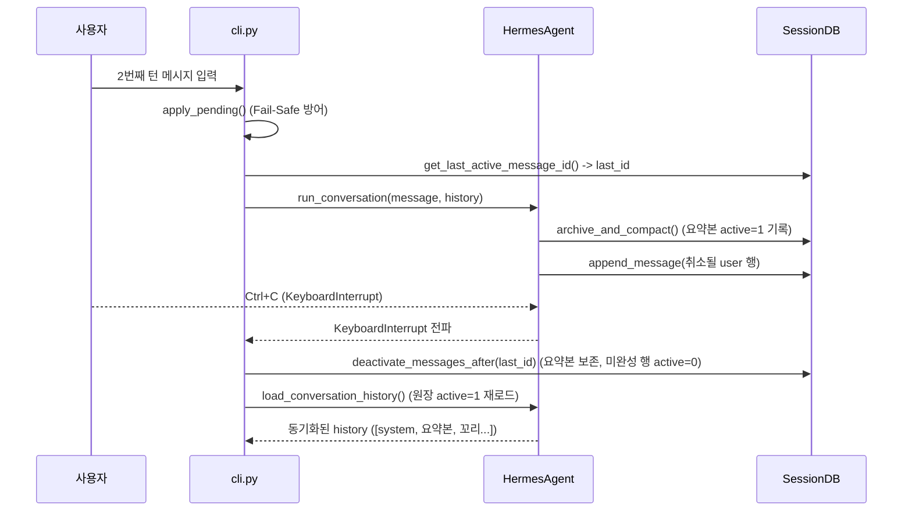
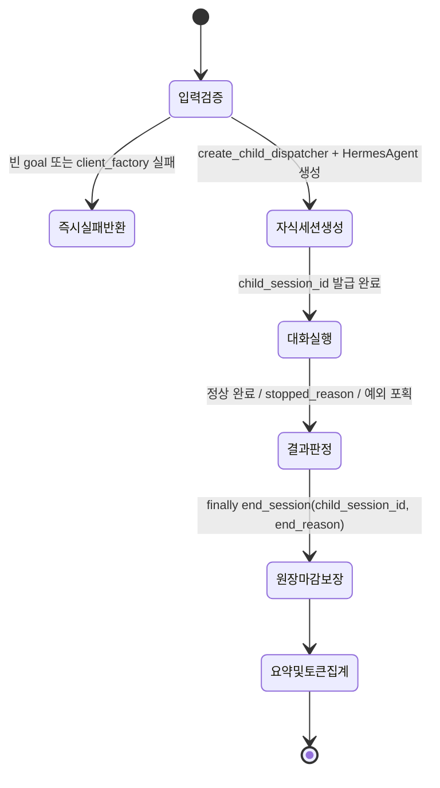

# [마스터 설계도] 20-의존성-역전-도메인-분리-완결-MVP

> **상위**: [대시보드](README.md) | [PLAN.md](PLAN.md) | [WHY.md](WHY.md) | 근거 결정: [ADR-0020](../../adr/0020-의존성_역전_도메인_분리_완결_MVP_범위와_결정.md)
> **기준**: `main` `fb2e61e`. 코드는 19 마감 `bd41ec4`와 같다(`git log -1 --format=%h -- src tests` = `bd41ec4`).
> **이어받는 에이전트는 §9부터 읽는다.**

---

## 1. 배경 및 목적 (Why)

- 쉬운 말 설명은 [WHY.md](WHY.md)에, 결정은 [ADR-0020](../../adr/0020-의존성_역전_도메인_분리_완결_MVP_범위와_결정.md)에 있다. 이 문서는 **어디를 어떻게 바꾸는가**를 다룬다.
- 목표:
  1. `tools/` 계층의 `SessionDB` 구체 의존과 `_conn` 직접 접근을 `tools/ports.py` 프로토콜로 역전(R7)한다.
  2. `delegate_tool`의 `HermesAgent`·`build_child_system_message` 역방향 의존을 `assembly.py` 자식 실행기 주입(`ChildRunnerPort`)으로 해소해 `KNOWN_DEBT` 4건을 0건(`{}`)으로 청산하고, 자식 세션 마감(`try...finally`, R-2)을 보장한다.
  3. `checkpoint.py`(909줄)에서 순수 롤백 도메인 모델·판정·알림 렌더러를 `checkpoint_domain.py`로 분리한다(R-4).
  4. 턴중 압축 후 `Ctrl+C`(`KeyboardInterrupt`) 취소 시 원장에서 인메모리 `history`를 재동기화해 Split-Brain(R-1)을 막고, REPL 턴 시작 경계(`apply_pending` 등)를 Fail-Safe로 보호(R-3)하며 조립과 슬래시 명령 라우팅을 정돈한다.

---

## 2. As-Is vs To-Be 아키텍처

### 2-1. 폴더 구조 (신규·변경)

```text
src/hermes_core/
├── tools/
│   ├── ports.py                 [신규 010] ApprovalStorePort, CheckpointStorePort, DelegateStorePort,
│   │                                       SessionSearchPort, ChildRunnerPort
│   ├── checkpoint_domain.py     [신규 030] 순수 롤백 도메인 모델, 판정 함수, 알림 렌더러 (외부 I/O 0개)
│   ├── approval.py              [변경 010] SessionDB import 제거 → ApprovalStorePort
│   ├── checkpoint.py            [변경 010] SessionDB 제거·count_child_sessions 호출, [030] 도메인 분리·재수출
│   ├── session_search_tool.py   [변경 010] SessionDB import 제거 → SessionSearchPort
│   ├── dispatcher.py            [변경 010] SessionDB import 제거 → SessionSearchPort
│   └── delegate_tool.py         [변경 010] DelegateStorePort, [020] HermesAgent/prompt_builder 제거·ChildRunnerPort
├── session_db.py                [변경 010] count_child_sessions 공개 메서드 추가
├── assembly.py                  [변경 020] run_child_session / create_child_runner, [040] register_configured_delegate
├── cli.py                       [변경 040] 취소 후 load_conversation_history 재동기화(R-1), 턴 경계 Fail-Safe(R-3),
│                                           슬래시 명령 라우팅 및 assembly 위임 배선 연결
└── kernel/                      (무변경 — WHY 가정 G)
tests/
├── test_architecture/
│   ├── test_dependency_rules.py [변경 010] R7 추가, [020] KNOWN_DEBT = {}, [050] _conn·도메인 순수성 잠금
│   └── test_ports_conformance.py [변경 010·050] tools/ports.py 적합성 검증 추가
└── test_hermes_core/            [신규 시나리오 파일 추가, 기존 시험 파일 무수정]
```

### 2-2. 구성요소 흐름: As-Is



### 2-3. 구성요소 흐름: To-Be



### 2-4. 클래스·모듈 관계



### 2-5. 실행 순서 (대표 시나리오: 턴중 압축 후 `Ctrl+C` 취소 시 원장-메모리 재동기화 R-1)



### 2-6. 자식 에이전트 위임 생명주기 상태 전이 (R-2 안전망)



---

## 3. 파급 범위와 무영향 근거 (Blast Radius)

| 단계 | 바뀌는 것 | 바뀌지 않는 것 (근거) |
|---|---|---|
| 010 | `tools/ports.py` 신설, `SessionDB.count_child_sessions` 추가, `tools/*` 5개 모듈의 `SessionDB` import를 `tools/ports.py`로 교체, `checkpoint.py`의 `self.db._conn.execute` 3곳을 `count_child_sessions` 호출로 교체, `test_dependency_rules.py`에 R7 추가 | `Approver`·`Checkpointer`·`session_search_tool`·`create_default_dispatcher`·`register_delegate_tool`의 공개 시그니처와 런타임 동작, `kernel/` 전체 |
| 020 | `assembly.py`에 `run_child_session`·`create_child_runner` 신설, `delegate_tool.py`에서 `HermesAgent`·`build_child_system_message` import 제거 및 `ChildRunnerPort` 연결, `test_dependency_rules.py`의 `KNOWN_DEBT` 4건 삭제(`{}`) | `register_delegate_tool` 기존 4인자 호출 호환, `dt_module.create_child_dispatcher` 패치 호환(`test_extension_e2e.py:268`), 4대 격벽 동작(`test_delegate_tool.py` 전 시나리오) |
| 030 | `tools/checkpoint_domain.py` 신설, `tools/checkpoint.py`에서 도메인 모델·판정·포맷 함수를 분리 후 재수출 | `from hermes_core.tools.checkpoint import ...`로 가져가는 모든 클래스·함수 객체 동일성, `hermes_core.tools.checkpoint.time.time` 패치 호환(`test_checkpoint_module.py:463`), `_validate_arguments` 후 `record_before` 실행 순서(`test_18`) |
| 040 | `cli.py` 취소 복구 시 `history = agent.load_conversation_history()` 추가(R-1), `apply_pending`·`get_last_active_message_id` Fail-Safe 방어(R-3), `assembly.py` 위임 배선 도우미 및 `cli.py` 슬래시 명령 라우팅 정돈 | 기존 취소·재개·롤백·`/ctl` CLI 출력 문구 및 종료 코드, `deactivate_messages_after` 실패 시 경고 후 계속 동작하는 `test_cli_resume.py` 시나리오 R12 |
| 050 | `tests/test_architecture/`에 `KNOWN_DEBT == {}`, 외부 `_conn` 접근 0건, 도메인 순수 모듈 무의존성 시나리오 추가 | `src/` 코드 무변경 |
| 060·070 | `docs/작동원리/` 및 `결과정리및리뷰.md`, 대시보드, 태그 | `src/` 및 `tests/` 코드 무변경 (050 고정) |

---

## 4. 사전 점검 및 실패 위험 분석 (Pre-Mortem: 10대 위험과 방어책)

| 번호 | 만약 실패한다면 무엇 때문인가? | 코드베이스 대조 결과 및 사전 방어책 |
|:---:|---|---|
| **위험 1** | `delegate_tool.py`에서 `create_child_dispatcher` 호출을 `assembly.py` 안으로 숨겼더니 기존 시험이 깨짐 | **코드 확인 완료**: [`tests/test_hermes_core/test_extension_e2e.py:252,268`](../../../tests/test_hermes_core/test_extension_e2e.py)이 `monkeypatch.setattr(dt_module, "create_child_dispatcher", custom_child_dispatcher)`로 `delegate_tool` 모듈 네임스페이스의 `create_child_dispatcher`를 패치한다. **방어책**: `delegate_tool.py`에 `create_child_dispatcher` import를 그대로 유지하고, `delegate_task` 안에서 `child_dispatcher = create_child_dispatcher()`를 먼저 호출해 `child_runner(..., dispatcher=child_dispatcher)`로 넘긴다. |
| **위험 2** | `checkpoint_domain.py`로 함수를 옮겼더니 `test_checkpoint_module.py`의 `time.time` 패치나 이름 import가 깨짐 | **코드 확인 완료**: [`tests/test_hermes_core/test_checkpoint_module.py:29`](../../../tests/test_hermes_core/test_checkpoint_module.py)는 `format_interrupt_notice`(`format_interrupted_notice`가 아님!) 등 10개 이름을 `hermes_core.tools.checkpoint`에서 import하고, 463행에서 `hermes_core.tools.checkpoint.time.time`을 패치한다. **방어책**: `Checkpointer.begin_turn`과 `import time`은 `checkpoint.py`에 그대로 두고, `checkpoint.py`가 `checkpoint_domain.py`의 모든 공개 이름을 재수출한다. |
| **위험 3** | 체크포인트를 디스패처 앞단 미들웨어로 옮겼더니 잘못된 인자 호출에도 체크포인트 행이 기록되어 `test_18`이 실패함 | **코드 확인 완료**: [`tests/test_hermes_core/test_file_tools_checkpoint.py:363-377`](../../../tests/test_hermes_core/test_file_tools_checkpoint.py)(`test_18_invalid_arguments`)은 필수 인자가 빠진 `write_file` 호출 시 `rows(db, sid) == []`를 단언한다. **방어책**: `dispatcher.py`의 `_validate_arguments` 통과 후 `_checkpointed_handler`가 실행되는 기존 순서와 `dispatcher.write_file_tool` 모듈 속성 참조를 그대로 보존한다(ADR D-04). |
| **위험 4** | `cli.py` 취소 복구에서 `deactivate_messages_after`가 예외를 던졌는데 `load_conversation_history()`를 덮어써서 `test_cli_resume.py` 시나리오 R12가 깨짐 | **코드 확인 완료**: [`tests/test_hermes_core/test_cli_resume.py:493-519`](../../../tests/test_hermes_core/test_cli_resume.py)(시나리오 R12)는 `deactivate_messages_after`가 `RuntimeError("db locked")`를 던져도 CLI가 죽지 않고 프롬프트로 돌아오는 것을 검증한다. **방어책**: `try:` 블록 안에서 `deactivate_messages_after`가 예외 없이 성공했을 때만 `history = agent.load_conversation_history()`를 갱신하고, 예외 시에는 기존 `history`를 유지하며 경고 로그를 남긴다. |
| **위험 5** | 첫 번째 턴에서 압축 없이 `KeyboardInterrupt`로 취소됐을 때 `load_conversation_history()`가 무엇을 반환하는지 기존 동작과 다름 | **코드 확인 완료**: [`agent.py:476-482`](../../../src/hermes_core/agent/agent.py)의 `load_conversation_history()`는 원장에 `active=1` 메시지가 없으면 `None`을 반환한다. 첫 턴 취소 시 `deactivate_messages_after(sid, 0)` 이후 `active=1` 행은 0개이므로 `load_conversation_history()`는 `None`을 반환하여 기존 초기값(`history = None`)과 100% 동일하다. |
| **위험 6** | `tools/ports.py`에 타입 주석을 달았더니 `test_annotations_resolve.py`의 `typing.get_type_hints()` 검사에서 미해결 이름 오류가 남 | **코드 확인 완료**: [`tests/test_architecture/test_annotations_resolve.py`](../../../tests/test_architecture/test_annotations_resolve.py)는 모든 함수·메서드에 `get_type_hints()`를 실행한다. **방어책**: `tools/ports.py`는 표준 라이브러리 타입(`Any`, `Optional`, `Sequence`, `Callable`, `Protocol`)만 사용하여 런타임에 100% 해석되게 한다. |
| **위험 7** | `test_dependency_rules.py` 시나리오 9(`test_scenario_9_actual_tree_scanner_smoke`)가 `delegate_tool`의 `session_db` import를 단언하고 있어 010에서 실패함 | **코드 확인 완료**: [`test_dependency_rules.py:305-307`](../../../tests/test_architecture/test_dependency_rules.py)이 `del_targets`에 `hermes_core.session_db`가 있는지 단언한다. **방어책**: 010에서 `test_dependency_rules.py`에 R7을 추가할 때 시나리오 9의 스모크 대상을 `hermes_core.tools.ports` 참조 확인으로 함께 갱신한다. |
| **위험 8** | `checkpoint.py`에서 `self.db._conn.execute`를 `self.db.count_child_sessions`로 바꿨을 때, 만약 가짜 DB 객체를 넘기는 시험이 있다면 `AttributeError`가 날까? | **코드 확인 완료**: `Checkpointer.plan_rollback`의 자식 세션 집계(493~513행)는 원래 `try ... except Exception: pass`로 감싸져 있으며, `count_child_sessions`를 부르도록 바꾸면 `SessionDB`에서는 정식 메서드로 정확히 집계되고 가짜 객체에서도 예외 없이 `0`으로 폴백된다. |
| **위험 9** | `delegate_tool.py`가 `assembly.py`를 import하면 순환 import가 생기지 않는가? | **코드 확인 완료**: `assembly.py`는 `delegate_tool`을 최상위에서 import하지 않으며, `HermesAgent`도 `create_agent`/`run_child_session` 함수 내부에서 지연 import한다. 따라서 어떤 순서로 import해도 순환이 없다(`test_assembly_boundary.py` 시나리오 13 통과). |
| **위험 10** | 자식 에이전트 생성(`HermesAgent(...)`) 도중 예외가 발생했을 때 DB에 생성된 자식 세션이 닫히지 않고 남음 | **방어책**: 020의 `run_child_session`에서 자식 `session_id`를 미리 확정(`str(uuid.uuid4())`)하거나 생성 직후 `try...finally`로 감싸, `HermesAgent` 초기화나 `run_conversation` 어디서 예외가 나더라도 `session_db.end_session(child_session_id, end_reason=...)`이 반드시 호출되게 한다. |

---

## 5. 4층위 검증 범위 설계

1. **1층위 (수동 반복 배제)**: 모든 단계는 실제 API 키나 수동 터미널 조작 없이 Mock 클라이언트·`MockTransport`·가상 터미널(`pty`) 자동 시험으로 검증한다.
2. **2층위 (단위 및 구조 검증)**:
   - `tests/test_architecture/`: R1~R7 의존성 방향, `KNOWN_DEBT == {}`, 외부 `_conn` 접근 0건, 포트 적합성(`test_ports_conformance.py`), 도메인 순수성 검증.
   - `tests/test_hermes_core/test_checkpoint_domain.py`(030 신설): 파일시스템·DB 없이 순수 메모리 입력만으로 롤백 건너뜀 판정 및 알림 포맷 검증.
3. **3층위 (상태 및 정합성 검증)**:
   - 020: 자식 에이전트 초기화/실행 중 예외 주입 시 자식 세션 원장의 `end_reason` 마감 정합성 검증.
   - 040: 턴중 압축(`archive_and_compact`) 후 `KeyboardInterrupt` 취소 시 인메모리 `history`와 DB `get_messages_as_conversation`의 완전 일치 검증, 턴 시작 경계 예외 시 세션 생존 검증.
4. **4층위 (전체 통합 검증)**:
   - 전체 회귀 시험(`.venv/bin/pytest -n 4 -q -m "not pty"` 및 `-m pty`) + Python 3.12 격리 환경 import 검증.

---

## 6. 단계별 상세 명세 (010 ~ 070)

### 6-1. 010 도구 계층 포트(`tools/ports.py`) 신설과 `SessionDB` 의존 역전 (R7)

- **신설**: `src/hermes_core/tools/ports.py`
  - 표준 라이브러리(`from __future__ import annotations`, ` collections.abc.Callable`, `typing.Any`, `Optional`, `Protocol`, `runtime_checkable`)만 import한다.
  - `@runtime_checkable` 프로토콜 5종:
    1. `ApprovalStorePort`:
       - `record_approval_request(self, session_id: str, argv: list[str], tool_name: str = "terminal") -> int`
       - `resolve_approval_request(self, request_id: int, decision: str, reason: Optional[str] = None) -> bool`
    2. `CheckpointStorePort`:
       - `record_file_checkpoint(self, session_id: str, turn_index: int, tool_name: str, workspace: str, rel_path: str, before_exists: bool, before_content: Optional[str] = None) -> int`
       - `update_file_checkpoint(self, checkpoint_id: int, status: str, *, after_sha256: Optional[str] = None, reason: Optional[str] = None) -> bool`
       - `get_file_checkpoints(self, session_id: str, turn_index: Optional[int] = None) -> list[dict[str, Any]]`
       - `get_approval_requests(self, session_id: str) -> list[dict[str, Any]]`
       - `count_child_sessions(self, parent_session_id: str, *, started_at_min: Optional[float] = None, started_at_max: Optional[float] = None) -> int`
    3. `DelegateStorePort`:
       - `end_session(self, session_id: str, end_reason: str = "completed") -> None`
       - `get_session(self, session_id: str) -> Optional[dict[str, Any]]`
    4. `SessionSearchPort`:
       - `search_messages(self, query: str, source_filter: Optional[list[str]] = None, role_filter: Optional[list[str]] = None, limit: int = 20, offset: int = 0) -> list[dict[str, Any]]`
    5. `ChildRunnerPort`:
       - `__call__(self, goal: str, context: Optional[str], *, session_db: Any, parent_session_id: str, llm_client: Any, max_iterations: int, dispatcher: Optional[Any] = None) -> dict[str, Any]`
- **변경**: `src/hermes_core/session_db.py`
  - `count_child_sessions(self, parent_session_id: str, *, started_at_min: Optional[float] = None, started_at_max: Optional[float] = None) -> int` 추가(기존 `checkpoint.py` 494~512행의 3가지 분기 SQL을 그대로 캡슐화).
- **변경**: `tools/approval.py`, `tools/checkpoint.py`, `tools/session_search_tool.py`, `tools/dispatcher.py`, `tools/delegate_tool.py`
  - `from hermes_core.session_db import SessionDB`를 모두 제거하고 `tools/ports.py`의 해당 포트로 교체.
  - `checkpoint.py` 494~512행의 `self.db._conn.execute(...)`를 `self.db.count_child_sessions(self.session_id, started_at_min=start_time, started_at_max=end_time)`으로 교체.
- **변경**: `tests/test_architecture/test_dependency_rules.py`, `tests/test_architecture/test_ports_conformance.py`
  - `find_violations`에 **R7** 추가: `is_importer_tools`일 때 `target == "hermes_core.session_db" or target.startswith("hermes_core.session_db.")`이면 `(importer, target, "R7")` 위반 추가.
  - 시나리오 9 스모크의 `delegate_tool` 참조 확인을 `hermes_core.tools.ports`로 갱신하고, R7 단위 검증 시나리오 추가.
  - `test_ports_conformance.py`에 `SessionDB`가 `ApprovalStorePort`, `CheckpointStorePort`, `DelegateStorePort`, `SessionSearchPort`의 서브클래스(`issubclass`)이고 시그니처 바인딩이 일치함을 검증.

### 6-2. 020 위임 도구 의존성 역전(`KNOWN_DEBT` 0건) 및 자식 세션 생명주기 안전망(R-2)

- **변경**: `src/hermes_core/assembly.py`
  - `run_child_session(goal: str, context: Optional[str], *, session_db: Any, parent_session_id: str, llm_client: Any, max_iterations: int = DELEGATE_CHILD_MAX_ITERATIONS, dispatcher: Optional[Any] = None) -> dict[str, Any]` 신설:
    - 함수 내부에서 `HermesAgent`와 `build_child_system_message`를 지연 import(순환 방지).
    - 자식 세션 ID(`child_session_id = str(uuid.uuid4())`)를 확정하고, `HermesAgent(session_id=child_session_id, session_db=session_db, dispatcher=dispatcher or create_child_dispatcher(), llm_client=llm_client, max_iterations=max_iterations, quiet_mode=True, system_message=build_child_system_message(context), parent_session_id=parent_session_id, source=SUBAGENT_SOURCE, skip_memory=True, skip_context_files=True)`를 생성·실행하여 `{"child_session_id": child_session_id, "run_result": run_result, "caught_exception": caught_exception}`을 반환한다.
    - 만약 `HermesAgent(...)` 생성 도중(세션 레코드 생성 이후) 예외가 발생하더라도 `caught_exception`으로 포획하여 `delegate_tool`의 `end_session` 보장 흐름으로 넘긴다.
  - `create_child_runner() -> ChildRunnerPort`: `run_child_session`을 반환하는 팩토리.
- **변경**: `src/hermes_core/tools/delegate_tool.py`
  - `from hermes_core.agent.agent import HermesAgent` 및 `from hermes_core.agent.prompt_builder import build_child_system_message` 완전 제거.
  - `from hermes_core.assembly import run_child_session` import.
  - `register_delegate_tool`에 선택 키워드 인자 `child_runner: Optional[ChildRunnerPort] = None` 추가(기본값 `None`이면 `run_child_session` 사용).
  - `delegate_task` 안에서 `child_dispatcher = create_child_dispatcher()`를 만들어(모듈의 `create_child_dispatcher` 패치 호환 유지, 위험 1) `runner(goal, context, session_db=session_db, parent_session_id=parent_session_id, llm_client=child_client, max_iterations=max_iterations, dispatcher=child_dispatcher)`를 호출하고, `try...finally`로 자식 세션의 `session_db.end_session(child_session_id, end_reason=end_reason)` 호출을 보장한다.
- **변경**: `tests/test_architecture/test_dependency_rules.py`
  - `KNOWN_DEBT`의 4개 항목을 모두 지워 `KNOWN_DEBT: dict[tuple[str, str, str], tuple[str, str]] = {}`로 만든다.
- **신규 시험**: `tests/test_hermes_core/test_delegate_dip.py` (커스텀 `child_runner` 주입, 자식 초기화/실행 예외 시 세션 마감 보장, `create_child_dispatcher` 패치 호환 검증).

### 6-3. 030 체크포인트 순수 도메인 분리 (`checkpoint_domain.py`, R-4)

- **신설**: `src/hermes_core/tools/checkpoint_domain.py`
  - 외부 I/O(`os`, `tempfile`, `session_db`, `path_guard`)를 일체 import하지 않고 표준 라이브러리(`dataclasses`, `re`, ` typing`)와 `hermes_core.constants`만 import한다.
  - 이동 대상:
    - 예외: `CheckpointError`, `CheckpointLimitError`
    - 데이터클래스: `RollbackItem`, `RollbackPlan`, `RollbackItemResult`, `RollbackResult`, `InterruptedItem`, `InterruptedTurn`
    - 순수 도메인 판정 함수:
      - `evaluate_rollback_item(...) -> RollbackItem`: 원장 행 정보와 파일 현재 상태 스냅샷(존재·일반파일 여부·크기·읽기 오류·현재 sha256·경로 판정 오류·동일 경로 선행 건너뜀 사유)을 받아 순수하게 `RollbackItem`(건너뜀 여부 및 사유 포함)을 계산한다.
      - `classify_interrupted_rows(turn_index: int, rows: Sequence[Mapping[str, Any]]) -> Optional[InterruptedTurn]`: 취소된 턴의 원장 행 목록을 받아 `applied`/`pending`/`failed` 항목을 중복 없이 분류해 `InterruptedTurn`을 만든다.
    - 알림 문구 렌더러: `format_rollback_notice`, `format_interrupt_notice`, `format_pending_notices` 및 내부 도우미(`_sanitize_path_for_notice`, `_format_single_interrupt_notice`).
- **변경**: `src/hermes_core/tools/checkpoint.py`
  - `checkpoint_domain.py`에서 위 심볼들을 import하고 그대로 재수출(`__all__` 포함)하여 기존 import 경로 호환을 100% 유지한다.
  - `Checkpointer.plan_rollback`과 `collect_interrupted_turn`은 파일 상태를 읽은 뒤 `evaluate_rollback_item`과 `classify_interrupted_rows`를 호출해 조립한다.
- **신규 시험**: `tests/test_hermes_core/test_checkpoint_domain.py` (파일시스템·DB 없이 순수 도메인 함수와 알림 포맷터를 단독 검증).

### 6-4. 040 런타임 턴 취소·경계 복구 정합(R-1, R-3) 및 조립·CLI 정돈

- **변경**: `src/hermes_core/cli.py`
  1. **(R-1 해결 — 취소 시 원장-메모리 재동기화)**:
     - `except KeyboardInterrupt:` 블록(606~624행)에서 `agent.session_db.deactivate_messages_after(agent.session_id, last_active_msg_id)` 호출이 성공한 직후 `history = agent.load_conversation_history()`를 실행한다.
     - 만약 `deactivate_messages_after`나 `load_conversation_history`에서 예외가 발생하면 기존 `history`를 유지하고 경고 로그만 남겨 시나리오 R12 호환을 지킨다.
  2. **(R-3 해결 — 턴 시작 경계 Fail-Safe)**:
     - `panel.apply_pending()`(579행)을 `try...except Exception as e:`로 감싸 예외 발생 시 `logger.warning("apply_pending failed: %s", e)`를 기록하고 세션을 죽이지 않는다.
     - `agent.session_db.get_last_active_message_id(agent.session_id)`(589행)를 `try...except Exception as e:`로 감싸 예외 발생 시 경고 로그를 남기고 `last_active_msg_id = 0`으로 폴백한다.
  3. **(S-4 해결 — 슬래시 명령 라우팅 및 위임 조립 정돈)**:
     - 슬래시 명령 분기(`/rollback`, `/ctl`)를 `_dispatch_slash_command(tokens, ...)` 도우미로 정리하고, 위임 도구 등록은 `assembly.register_delegate_if_enabled(...)`를 통해 배선한다.
- **변경**: `src/hermes_core/assembly.py`
  - `register_delegate_if_enabled(agent: Any, settings: Settings, *, llm_client_factory: Callable[[], Any]) -> bool` 도우미 추가.
- **신규 시험**: `tests/test_hermes_core/test_runtime_recovery.py` (턴중 압축 후 `KeyboardInterrupt` 취소 시 다음 턴 메모리 `history`와 원장 일치 검증, `apply_pending` 및 `get_last_active_message_id` 일시 실패 시 REPL 생존 검증).

### 6-5. 050 아키텍처 불변식 최종 잠금 시험

- **변경**: `tests/test_architecture/test_dependency_rules.py`
  - 시나리오 추가:
    1. `KNOWN_DEBT == {}` (부채 사전이 완전히 비어 있음을 고정 단언).
    2. `session_db.py`를 제외한 모든 `src/hermes_core/**/*.py`의 AST에서 `Attribute.attr == "_conn"` 접근이 0건임을 단언.
    3. 순수 도메인 모듈(`hermes_core.agent.compression`, `hermes_core.agent.context_budget`, `hermes_core.tools.checkpoint_domain`, `hermes_core.tools.path_guard`)이 `sqlite3`, `httpx`, `hermes_core.session_db`, `hermes_core.agent.agent`, `hermes_core.cli`를 import하지 않음을 단언.

### 6-6. 060 작동원리 동기화, 070 마감

- **060**: `docs/작동원리/03-코어구조-메인루프-확장방식.md`와 `02-안전장치-승인-체크포인트-되돌리기.md`에 R7 도구 포트 격리, `KNOWN_DEBT` 0건(위임 자식 실행 포트 역전), 체크포인트 도메인 분리(`checkpoint_domain.py`), 턴중 압축 후 취소 시 원장 재동기화(R-1)를 반영한다.
- **070**: `WHY.md` 가정 A~I 전수 대조, 전체 회귀 시험 및 Python 3.12 import 검증, 종합보고서(`결과정리및리뷰.md`) 작성, 대시보드 `Closed` 전환 및 `roadmap-20-closed` 태그 발행.

---

## 7. 문서 동기화 방식

- 060 단계에서 작동원리 [03편](../../작동원리/03-코어구조-메인루프-확장방식.md)(의존 방향 규칙 R1~R7 및 위임 자식 실행기 조립)과 [02편](../../작동원리/02-안전장치-승인-체크포인트-되돌리기.md)(체크포인트 순수 도메인 분리 및 취소 시 원장-메모리 재동기화)을 최신 코드와 동기화한다.

---

## 8. 이 로드맵이 다루지 않는 것 (Non-Goals)

정본은 [ADR-0020](../../adr/0020-의존성_역전_도메인_분리_완결_MVP_범위와_결정.md) D-09, 쉬운 말 설명은 [WHY.md §2](WHY.md). 요약:
- 구형 재수출 호환 층(`COMPAT_REEXPORTS` 21건) 제거
- `constants.py` 분할
- 체크포인트의 디스패처 앞단 미들웨어 이주(인자 검증 후 실행 계약 보존을 위해 현 위치 유지)
- 신규 외부 기능(HTTP 서버, 웹 UI 등) 추가

---

## 9. 이어받는 에이전트를 위한 안내

1. **읽을 순서**:
   1. [`docs/인계/`](../../인계/README.md)의 최신 파일(이름순 마지막)
   2. 이 로드맵 [대시보드](README.md) §2·§3
   3. [ADR-0020](../../adr/0020-의존성_역전_도메인_분리_완결_MVP_범위와_결정.md)(D-01~D-09)
   4. 이 문서 §3·§4·§6의 해당 단계
2. **지시서 작성 규칙**(정본 [ROADMAP_정책](../ROADMAP_정책.md), [AGENTS.md](../../../AGENTS.md)):
   - 한 번에 **하나만** 쓴다. 쓰기 전에 §6의 탐침을 실제로 실행하고 결과를 지시서 **§0 착수 전 점검**에 기록한다.
   - 인수 시나리오(입력 → 기대 결과)는 구현 전에 지시서에 적는다.
   - 작성 커밋은 `docs(roadmap): R20-PLAN - 지시서 0N0 작성 (...)`이며, 같은 커밋에서 대시보드 행을 `Draft`로 갱신하고 직전 커밋 해시를 채운다.
3. **실행 규칙**:
   - 「0N0 구현해라」 한 번에 지시서 하나만 실행·검증·커밋(`<type>(core): R20-0N0 - ...`) 후 멈춘다.
   - 기존 시험을 고쳐야 하면 멈추고 사용자 승인을 받는다(WHY 가정 H).
4. **기준 시험 수**(2026-10-31, 이 문서 작성 시점): `.venv/bin/pytest --co -q -m "not pty"` 1,137 / `-m pty` 11 / `tests/test_architecture` 34 / `tests/test_kernel` 34 / `tests/test_control` 43 (총 1,148개).
5. **금지**:
   - `hermes-agent/` 수정
   - `git add -A`·`git add .`(파일 경로 지정 스테이징 필수)
   - 무지시 푸시·되돌리기
   - `kernel/` 수정(WHY 가정 G)
   - 해시 지어내기 금지
