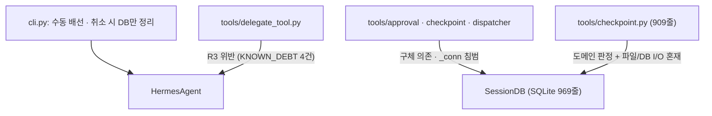
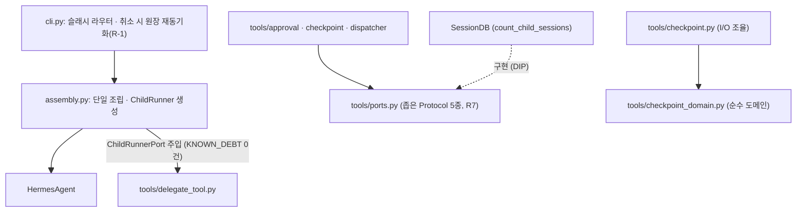
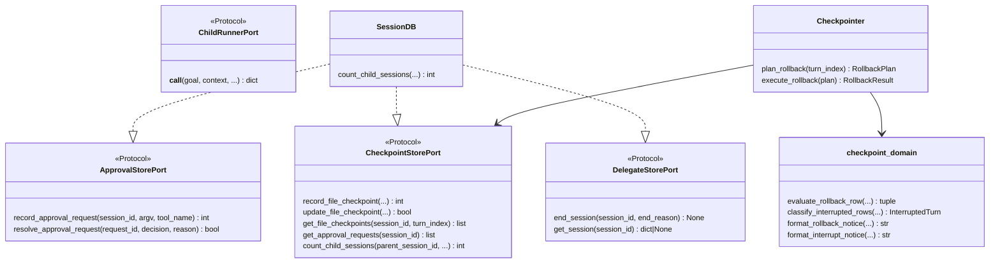
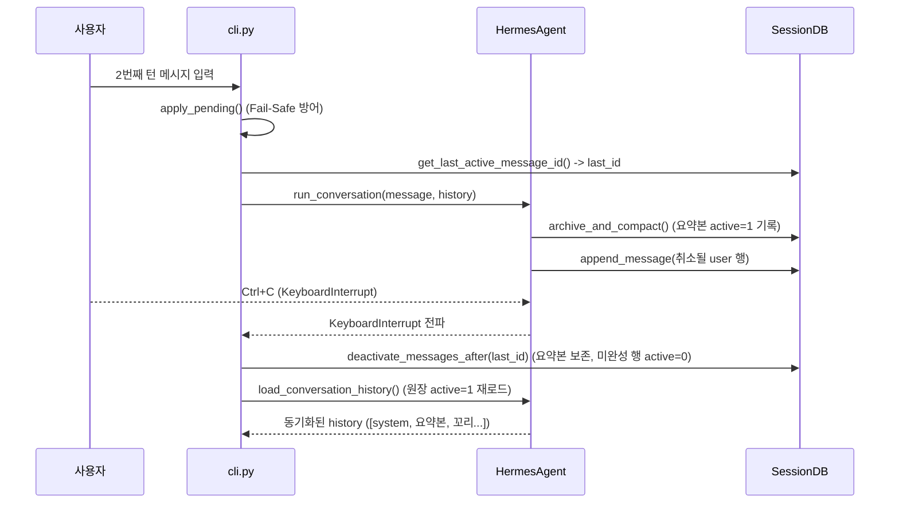
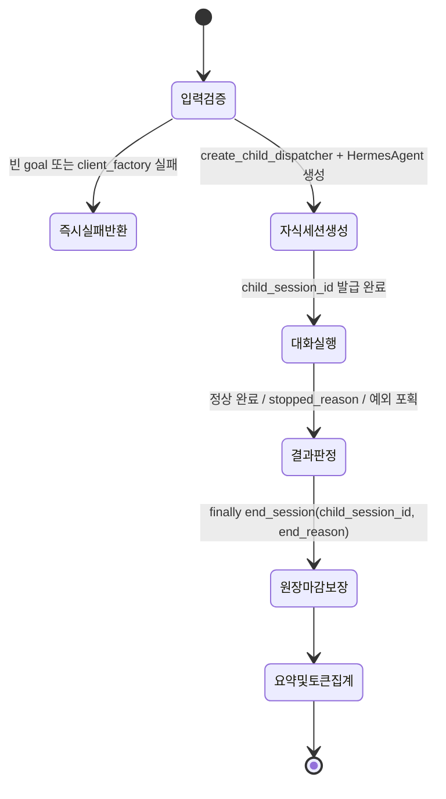

# [마스터 설계도] 20-의존성-역전-도메인-분리-완결-MVP

> **상위**: [대시보드](README.md) | [PLAN.md](PLAN.md) | [WHY.md](WHY.md) | 근거 결정: [ADR-0020](../../adr/0020-의존성_역전_도메인_분리_완결_MVP_범위와_결정.md)
> **기준**: `main` `0a16156`. 코드는 19 마감 `bd41ec4`와 같다(`git log -1 --format=%h -- src tests` = `bd41ec4`).
> **이어받는 에이전트는 §9부터 읽는다.** (`010` 지시서는 컨텍스트 요약 직후 심볼명 오기로 `Dropped` 처리하고 사이번호 `015`로 대체함.)

---

## 1. 배경 및 목적 (Why)

- 쉬운 말 설명은 [WHY.md](WHY.md)에, 결정은 [ADR-0020](../../adr/0020-의존성_역전_도메인_분리_완결_MVP_범위와_결정.md)에 있다. 이 문서는 **어디를 어떻게 바꾸는가**를 다룬다.
- 목표:
  1. `tools/` 계층의 `SessionDB` 구체 의존과 `_conn` 직접 접근을 `tools/ports.py` 프로토콜로 역전(R7)한다.
  2. `delegate_tool`의 `HermesAgent`·`build_child_system_message` 역방향 의존을 `assembly.py` 자식 실행기 주입(`ChildRunnerPort`)으로 해소해 `KNOWN_DEBT` 4건을 0건(`{}`)으로 청산하고, 자식 세션 마감(`try...finally`, R-2)을 보장한다.
  3. `checkpoint.py`(909줄)에서 순수 롤백 도메인 모델·판정·알림 렌더러를 `checkpoint_domain.py`로 분리한다(R-4).
  4. 턴중 압축 후 `Ctrl+C`(`KeyboardInterrupt`) 취소 시 원장에서 인메모리 `history`를 재동기화해 Split-Brain(R-1)을 막고, REPL 턴 시작 경계(`apply_pending` 등)를 Fail-Safe로 보호(R-3)하며 조립과 슬래시 명령 라우팅을 정돈한다.

---

## 2. As-Is vs To-Be 아키텍처

### 2-1. 폴더 구조 (신규·변경)

```text
src/hermes_core/
├── tools/
│   ├── ports.py                 [신규 015] ApprovalStorePort, CheckpointStorePort, DelegateStorePort,
│   │                                       SessionSearchPort, ChildRunnerPort
│   ├── checkpoint_domain.py     [신규 030] 순수 롤백 도메인 모델, 판정 함수, 알림 렌더러 (외부 I/O 0개)
│   ├── approval.py              [변경 015] SessionDB import 제거 → ApprovalStorePort
│   ├── checkpoint.py            [변경 015] SessionDB 제거·count_child_sessions 호출, [030] 도메인 분리·재수출
│   ├── session_search_tool.py   [변경 015] SessionDB import 제거 → SessionSearchPort
│   ├── dispatcher.py            [변경 015] SessionDB import 제거 → SessionSearchPort
│   └── delegate_tool.py         [변경 015] DelegateStorePort, [020] HermesAgent/prompt_builder 제거·ChildRunnerPort
├── session_db.py                [변경 015] count_child_sessions 공개 메서드 추가
├── assembly.py                  [변경 020] run_child_session / create_child_runner, [040] register_delegate_if_enabled
├── cli.py                       [변경 040] 취소 후 load_conversation_history 재동기화(R-1), 턴 경계 Fail-Safe(R-3),
│                                           슬래시 명령 라우팅(_dispatch_slash_command) 및 assembly 위임 배선 연결
└── kernel/                      (무변경 — WHY 가정 G)
tests/
├── test_architecture/
│   ├── test_dependency_rules.py [변경 015] R7 추가, [020] KNOWN_DEBT = {}, [050] _conn·도메인 순수성 잠금
│   └── test_ports_conformance.py [변경 015·050] tools/ports.py 적합성 검증 추가
└── test_hermes_core/            [신규 시나리오 파일 추가, 기존 시험 파일 무수정]
```

### 2-2. 구성요소 흐름: As-Is



### 2-3. 구성요소 흐름: To-Be



### 2-4. 클래스·모듈 관계



### 2-5. 실행 순서 (대표 시나리오: 턴중 압축 후 `Ctrl+C` 취소 시 원장-메모리 재동기화 R-1)



### 2-6. 자식 에이전트 위임 생명주기 상태 전이 (R-2 안전망)



---

## 3. 파급 범위와 무영향 근거 (Blast Radius)

| 단계 | 바뀌는 것 | 바뀌지 않는 것 (근거) |
|---|---|---|
| 015 (`010` Dropped 대체) | `tools/ports.py` 신설, `SessionDB.count_child_sessions` 추가, `tools/*` 5개 모듈의 `SessionDB` import를 `tools/ports.py`로 교체, `checkpoint.py`의 `self.db._conn.execute` 3곳을 `count_child_sessions` 호출로 교체, `test_dependency_rules.py`에 R7 추가 | `Approver`·`Checkpointer`·`session_search_tool`·`create_default_dispatcher`·`register_delegate_tool`의 공개 시그니처와 런타임 동작, `kernel/` 전체 |
| 020 | `assembly.py`에 `run_child_session`·`create_child_runner` 신설, `delegate_tool.py`에서 `HermesAgent`·`build_child_system_message` import 제거 및 `ChildRunnerPort` 연결, `test_dependency_rules.py`의 `KNOWN_DEBT` 4건 삭제(`{}`) | `register_delegate_tool` 기존 4인자 호출 호환, `dt_module.create_child_dispatcher` 패치 호환(`test_extension_e2e.py:268`), 4대 격벽 동작(`test_delegate_tool.py` 전 시나리오) |
| 030 | `tools/checkpoint_domain.py` 신설, `tools/checkpoint.py`에서 도메인 모델·판정·포맷 함수를 분리 후 재수출 | `from hermes_core.tools.checkpoint import ...`로 가져가는 모든 클래스·함수 객체 동일성, `hermes_core.tools.checkpoint.time.time` 패치 호환(`test_checkpoint_module.py:463`), `_validate_arguments` 후 `record_before` 실행 순서(`test_18`) |
| 040 | `cli.py` 취소 복구 시 `history = agent.load_conversation_history()` 추가(R-1), `apply_pending`·`get_last_active_message_id` Fail-Safe 방어(R-3), `assembly.py` 위임 배선 도우미(`register_delegate_if_enabled`) 및 `cli.py` 슬래시 명령 라우팅(`_dispatch_slash_command`) 정돈 | 기존 취소·재개·롤백·`/ctl` CLI 출력 문구 및 종료 코드, `deactivate_messages_after` 실패 시 경고 후 계속 동작하는 `test_cli_resume.py` 시나리오 R12 |
| 050 | `tests/test_architecture/`에 `KNOWN_DEBT == {}`, 외부 `_conn` 접근 0건, 도메인 순수 모듈 무의존성 시나리오 추가 | `src/` 코드 무변경 |
| 060·070 | `docs/작동원리/` 및 `결과정리및리뷰.md`, 대시보드, 태그 | `src/` 및 `tests/` 코드 무변경 (050 고정) |

---

## 4. 사전 점검 및 실패 위험 분석 (Pre-Mortem: 10대 위험과 방어책)

| 번호 | 만약 실패한다면 무엇 때문인가? | 코드베이스 대조 결과 및 사전 방어책 |
|:---:|---|---|
| **위험 1** | `delegate_tool.py`에서 `create_child_dispatcher` 호출을 `assembly.py` 안으로 숨겼더니 기존 시험이 깨짐 | **코드 확인 완료**: [`tests/test_hermes_core/test_extension_e2e.py:252,268`](../../../tests/test_hermes_core/test_extension_e2e.py)이 `monkeypatch.setattr(dt_module, "create_child_dispatcher", custom_child_dispatcher)`로 `delegate_tool` 모듈 네임스페이스의 `create_child_dispatcher`를 패치한다. **방어책**: `delegate_tool.py`에 `create_child_dispatcher` import를 그대로 유지하고, `delegate_task` 안에서 `child_dispatcher = create_child_dispatcher()`를 먼저 호출해 `child_runner(..., dispatcher=child_dispatcher)`로 넘긴다. |
| **위험 2** | `checkpoint_domain.py`로 함수를 옮겼더니 `test_checkpoint_module.py`의 `time.time` 패치나 이름 import가 깨짐 | **코드 확인 완료**: [`tests/test_hermes_core/test_checkpoint_module.py:29`](../../../tests/test_hermes_core/test_checkpoint_module.py)는 `format_interrupt_notice` 등 10개 이름을 `hermes_core.tools.checkpoint`에서 import하고, 463행에서 `hermes_core.tools.checkpoint.time.time`을 패치한다. **방어책**: `Checkpointer.begin_turn`과 `import time`은 `checkpoint.py`에 그대로 두고, `checkpoint.py`가 `checkpoint_domain.py`의 모든 공개 이름을 재수출한다. |
| **위험 3** | 체크포인트를 디스패처 앞단 미들웨어로 옮겼더니 잘못된 인자 호출에도 체크포인트 행이 기록되어 `test_18`이 실패함 | **코드 확인 완료**: [`tests/test_hermes_core/test_file_tools_checkpoint.py:363-377`](../../../tests/test_hermes_core/test_file_tools_checkpoint.py)(`test_18_invalid_arguments`)은 필수 인자가 빠진 `write_file` 호출 시 `rows(db, sid) == []`를 단언한다. **방어책**: `dispatcher.py`의 `_validate_arguments` 통과 후 `_checkpointed_handler`가 실행되는 기존 순서와 `dispatcher.write_file_tool` 모듈 속성 참조를 그대로 보존한다(ADR D-04). |
| **위험 4** | `cli.py` 취소 복구에서 `deactivate_messages_after`가 예외를 던졌는데 `load_conversation_history()`를 덮어써서 `test_cli_resume.py` 시나리오 R12가 깨짐 | **코드 확인 완료**: [`tests/test_hermes_core/test_cli_resume.py:493-519`](../../../tests/test_hermes_core/test_cli_resume.py)(시나리오 R12)는 `deactivate_messages_after`가 `RuntimeError("db locked")`를 던져도 CLI가 죽지 않고 프롬프트로 돌아오는 것을 검증한다. **방어책**: `try:` 블록 안에서 `deactivate_messages_after`가 예외 없이 성공했을 때만 `history = agent.load_conversation_history()`를 갱신하고, 예외 시에는 기존 `history`를 유지하며 경고 로그를 남긴다. |
| **위험 5** | 첫 번째 턴에서 압축 없이 `KeyboardInterrupt`로 취소됐을 때 `load_conversation_history()`가 무엇을 반환하는지 기존 동작과 다름 | **코드 확인 완료**: [`agent.py:476-482`](../../../src/hermes_core/agent/agent.py)의 `load_conversation_history()`는 원장에 `active=1` 메시지가 없으면 `None`을 반환한다. 첫 턴 취소 시 `deactivate_messages_after(sid, 0)` 이후 `active=1` 행은 0개이므로 `load_conversation_history()`는 `None`을 반환하여 기존 초기값(`history = None`)과 100% 동일하다. |
| **위험 6** | `tools/ports.py`에 타입 주석을 달았더니 `test_annotations_resolve.py`의 `typing.get_type_hints()` 검사에서 미해결 이름 오류가 남 | **코드 확인 완료**: [`tests/test_architecture/test_annotations_resolve.py`](../../../tests/test_architecture/test_annotations_resolve.py)는 모든 함수·메서드에 `get_type_hints()`를 실행한다. **방어책**: `tools/ports.py`는 표준 라이브러리 타입(`Any`, `Optional`, `Sequence`, `Callable`, `Protocol`)만 사용하여 런타임에 100% 해석되게 한다. |
| **위험 7** | `test_dependency_rules.py` 시나리오 9(`test_scenario_9_actual_tree_scanner_smoke`)가 `delegate_tool`의 `session_db` import를 단언하고 있어 015에서 실패함 | **코드 확인 완료**: [`test_dependency_rules.py:305-307`](../../../tests/test_architecture/test_dependency_rules.py)이 `del_targets`에 `hermes_core.session_db`가 있는지 단언한다. **방어책**: 015에서 `test_dependency_rules.py`에 R7을 추가할 때 시나리오 9의 스모크 대상을 `hermes_core.tools.ports` 참조 확인으로 함께 갱신한다. |
| **위험 8** | `checkpoint.py`에서 `self.db._conn.execute`를 `self.db.count_child_sessions`로 바꿨을 때, 만약 가짜 DB 객체를 넘기는 시험이 있다면 `AttributeError`가 날까? | **코드 확인 완료**: `Checkpointer.plan_rollback`의 자식 세션 집계(493~513행)는 원래 `try ... except Exception: pass`로 감싸져 있으며, `count_child_sessions`를 부르도록 바꾸면 `SessionDB`에서는 정식 메서드로 정확히 집계되고 가짜 객체에서도 예외 없이 `0`으로 폴백된다. |
| **위험 9** | `delegate_tool.py`가 `assembly.py`를 import하면 순환 import가 생기지 않는가? | **코드 확인 완료**: `assembly.py`는 `delegate_tool`을 최상위에서 import하지 않으며, `HermesAgent`도 `create_agent`/`run_child_session` 함수 내부에서 지연 import한다. 따라서 어떤 순서로 import해도 순환이 없다(`test_assembly_boundary.py` 시나리오 13 통과). |
| **위험 10** | 자식 에이전트 생성(`HermesAgent(...)`) 도중 예외가 발생했을 때 DB에 생성된 자식 세션이 닫히지 않고 남음 | **방어책**: 020의 `run_child_session`에서 자식 `child_session_id = str(uuid.uuid4())`를 미리 확정해 `HermesAgent(session_id=child_session_id, ...)`에 전달하고 `try...except`로 감싸, `HermesAgent` 초기화(`create_session` 직후)나 `run_conversation` 어디서 예외가 나더라도 `delegate_tool`의 `try...finally`에서 `session_db.end_session(child_session_id, end_reason=...)`이 반드시 호출되게 한다. |

---

## 5. 4층위 검증 범위 설계

1. **1층위 (수동 반복 배제)**: 모든 단계는 실제 API 키나 수동 터미널 조작 없이 Mock 클라이언트·`MockTransport`·가상 터미널(`pty`) 자동 시험으로 검증한다.
2. **2층위 (단위 및 구조 검증)**:
   - `tests/test_architecture/`: R1~R7 의존성 방향, `KNOWN_DEBT == {}`, 외부 `_conn` 접근 0건, 포트 적합성(`test_ports_conformance.py`), 도메인 순수성 검증.
   - `tests/test_hermes_core/test_checkpoint_domain.py`(030 신설): 파일시스템·DB 없이 순수 메모리 입력만으로 롤백 건너뜀 판정 및 알림 포맷 검증.
3. **3층위 (상태 및 정합성 검증)**:
   - 020: 자식 에이전트 초기화/실행 중 예외 주입 시 자식 세션 원장의 `end_reason` 마감 정합성 검증.
   - 040: 턴중 압축(`archive_and_compact`) 후 `KeyboardInterrupt` 취소 시 인메모리 `history`와 DB `get_messages_as_conversation`의 완전 일치 검증, 턴 시작 경계 예외 시 세션 생존 검증.
4. **4층위 (전체 통합 검증)**:
   - 전체 회귀 시험(`.venv/bin/pytest -n 4 -q -m "not pty"` 및 `-m pty`) + Python 3.12 격리 환경 import 검증.

---

## 6. 단계별 상세 명세 (지시서 작성용, 015 ~ 070)

> **각 지시서 작성 에이전트 필독**: 각 지시서 작성 전에 아래 단계별 **「착수 전 탐침(Probe)」** 항목을 실제 코드로 확인하고, 그 결과를 지시서 `§0 착수 전 점검`에 기록한다. 만약 탐침 결과가 이 절과 다르면 지시서 `§6 ROADMAP과 다른 점`에 명시한다.

---

### 6-1. 015 도구 계층 포트(`tools/ports.py`) 신설과 `SessionDB` 의존 역전 (R7)

> *(참고: `010` 지시서는 컨텍스트 요약 직후 심볼명 오기로 `Dropped` 처리되었으며, `015` 지시서가 정본이다.)*

- **착수 전 탐침 (코드 확인 완료)**:
  1. `tools/*`의 `SessionDB` 참조 5곳과 실제 호출 메서드 시그니처:
     - [`src/hermes_core/tools/approval.py:31,75,118,131`](../../../src/hermes_core/tools/approval.py): `Approver.__init__(self, *, session_db: SessionDB, session_id: str, ask: Callable[[str], str], is_interactive: Callable[[], bool], say: Callable[[str], None] = print, limit: int = APPROVAL_REQUEST_LIMIT)`
       - 호출: `self._session_db.record_approval_request(self._session_id, argv)`, `self._session_db.resolve_approval_request(request_id, decision, reason=reason)`
     - [`src/hermes_core/tools/checkpoint.py:55,139`](../../../src/hermes_core/tools/checkpoint.py): `Checkpointer.__init__(self, db: SessionDB, session_id: str, workspace: Optional[Path] = None, *, bytes_limit: int = CHECKPOINT_SESSION_BYTES_LIMIT)`
       - 호출: `self.db.get_file_checkpoints(self.session_id, turn_index=...)`, `self.db.record_file_checkpoint(...)`, `self.db.update_file_checkpoint(checkpoint_id, status, *, after_sha256=..., reason=...)`, `self.db.get_approval_requests(self.session_id)`, 그리고 **494~512행의 `self.db._conn.execute(...)` 3분기**.
     - [`src/hermes_core/tools/delegate_tool.py:25,59,144,153`](../../../src/hermes_core/tools/delegate_tool.py): `register_delegate_tool(dispatcher: ToolDispatcher, *, session_db: SessionDB, parent_session_id: str, llm_client_factory: Callable[[], Any], max_iterations: int = DELEGATE_CHILD_MAX_ITERATIONS, summary_max_chars: int = DELEGATE_SUMMARY_MAX_CHARS)`
       - 호출: `session_db.end_session(child_session_id, end_reason=end_reason)`, `session_db.get_session(child_session_id)`
     - [`src/hermes_core/tools/session_search_tool.py:12,41,51`](../../../src/hermes_core/tools/session_search_tool.py): `session_search_tool(query: str, limit: int = 3, db: Optional[SessionDB] = None) -> str`
       - 호출: `db.search_messages(query=query, limit=limit)`
     - [`src/hermes_core/tools/dispatcher.py:28,341`](../../../src/hermes_core/tools/dispatcher.py): `create_default_dispatcher(memory_store: Optional[MemoryStore] = None, session_db: Optional[SessionDB] = None, include: Optional[Collection[str]] = None, approver: Optional[Approver] = None, checkpointer: Optional[Checkpointer] = None) -> ToolDispatcher`
       - `session_search_tool(db=session_db, **kwargs)`에 전달.
  2. [`tests/test_architecture/test_dependency_rules.py:305-307`](../../../tests/test_architecture/test_dependency_rules.py) 스모크 단언 확인: `del_targets`에서 `hermes_core.session_db` 대신 `hermes_core.tools.ports`를 확인하도록 갱신 필요.
- **신설**: `src/hermes_core/tools/ports.py`
  - 표준 라이브러리(`from __future__ import annotations`, `typing.Any`, `Optional`, `Protocol`, `runtime_checkable`)만 import한다.
  - `@runtime_checkable` 프로토콜 5종:
    1. `ApprovalStorePort`:
       - `record_approval_request(self, session_id: str, argv: list[str], tool_name: str = "terminal") -> int`
       - `resolve_approval_request(self, request_id: int, decision: str, reason: Optional[str] = None) -> bool`
    2. `CheckpointStorePort`:
       - `record_file_checkpoint(self, session_id: str, turn_index: int, tool_name: str, workspace: str, rel_path: str, before_exists: bool, before_content: Optional[str] = None) -> int`
       - `update_file_checkpoint(self, checkpoint_id: int, status: str, *, after_sha256: Optional[str] = None, reason: Optional[str] = None) -> bool`
       - `get_file_checkpoints(self, session_id: str, turn_index: Optional[int] = None) -> list[dict[str, Any]]`
       - `get_approval_requests(self, session_id: str) -> list[dict[str, Any]]`
       - `count_child_sessions(self, parent_session_id: str, *, started_at_min: Optional[float] = None, started_at_max: Optional[float] = None) -> int`
    3. `DelegateStorePort`:
       - `end_session(self, session_id: str, end_reason: str = "completed") -> None`
       - `get_session(self, session_id: str) -> Optional[dict[str, Any]]`
    4. `SessionSearchPort`:
       - `search_messages(self, query: str, source_filter: Optional[list[str]] = None, role_filter: Optional[list[str]] = None, limit: int = 20, offset: int = 0) -> list[dict[str, Any]]`
    5. `ChildRunnerPort`:
       - `__call__(self, goal: str, context: Optional[str] = None, *, session_db: Any, parent_session_id: str, llm_client: Any, max_iterations: int, dispatcher: Optional[Any] = None) -> dict[str, Any]`
- **변경**: `src/hermes_core/session_db.py`
  - `count_child_sessions(self, parent_session_id: str, *, started_at_min: Optional[float] = None, started_at_max: Optional[float] = None) -> int` 추가(기존 `checkpoint.py` 494~512행의 3가지 분기 SQL을 그대로 캡슐화).
- **변경**: `tools/approval.py`, `tools/checkpoint.py`, `tools/session_search_tool.py`, `tools/dispatcher.py`, `tools/delegate_tool.py`
  - `from hermes_core.session_db import SessionDB`를 모두 제거하고 `tools/ports.py`의 해당 포트로 교체.
  - `checkpoint.py` 494~512행의 `self.db._conn.execute(...)`를 `self.db.count_child_sessions(self.session_id, started_at_min=start_time, started_at_max=end_time)`으로 교체.
- **변경**: `tests/test_architecture/test_dependency_rules.py`, `tests/test_architecture/test_ports_conformance.py`
  - `find_violations`에 **R7** 추가: `is_importer_tools`일 때 `target == "hermes_core.session_db" or target.startswith("hermes_core.session_db.")`이면 `(importer, target, "R7")` 위반 추가.
  - 시나리오 9 스모크의 `delegate_tool` 참조 확인을 `hermes_core.tools.ports`로 갱신하고, R7 단위 검증 시나리오 추가.
  - `test_ports_conformance.py`에 `SessionDB`가 `ApprovalStorePort`, `CheckpointStorePort`, `DelegateStorePort`, `SessionSearchPort`의 서브클래스(`issubclass`)이고 시그니처 바인딩이 일치함을 검증.
- **인수 시나리오 후보 (10개)**:
  1. `issubclass(SessionDB, Port)`가 4종 저장소 포트(`ApprovalStorePort`, `CheckpointStorePort`, `DelegateStorePort`, `SessionSearchPort`) 모두 `True`이고 `inspect.signature().bind()`가 통과한다.
  2. `SessionDB.count_child_sessions(parent_id)`가 `started_at_min=None, started_at_max=None`일 때 해당 부모의 전체 자식 세션 수를 반환한다.
  3. `SessionDB.count_child_sessions(parent_id, started_at_min=t1, started_at_max=t2)`가 구간 `[t1, t2)` 내 시작된 자식 세션만 정확히 집계한다.
  4. `Checkpointer.plan_rollback()`이 `_conn` 접근 없이 `count_child_sessions`를 통해 `subagent_count`와 `has_warnings`를 기존과 동일하게 계산한다.
  5. `SessionDB`를 상속하지 않는 순수 인메모리 `FakeApprovalStore`로 `Approver.request()`가 정상 동작한다.
  6. `SessionDB`를 상속하지 않는 순수 인메모리 `FakeSearchStore`로 `session_search_tool()`이 정상 동작한다.
  7. `find_violations`가 합성 간선 `("hermes_core.tools.x", "hermes_core.session_db", "R7")`을 정확히 검출한다.
  8. 실제 소스 트리(`src/hermes_core/tools/`)에서 `hermes_core.session_db`를 import하는 모듈이 0개다.
  9. `test_annotations_resolve.py`(시나리오 12)가 `tools/ports.py`를 포함한 전 모듈에서 미해결 주석 0건으로 통과한다.
  10. 기존 1,148개 시험 무수정 통과 및 `src/hermes_core/kernel/` diff 0줄.

---

### 6-2. 020 위임 도구 의존성 역전(`KNOWN_DEBT` 0건) 및 자식 세션 생명주기 안전망(R-2)

- **지시서 작성 전 탐침(Probe) 체크리스트**:
  1. [`src/hermes_core/tools/delegate_tool.py:56-175`](../../../src/hermes_core/tools/delegate_tool.py)의 `register_delegate_tool` 및 내부 `delegate_task` 흐름(1~9단계) 확인.
  2. [`tests/test_hermes_core/test_extension_e2e.py:252,268`](../../../tests/test_hermes_core/test_extension_e2e.py)에서 `monkeypatch.setattr(dt_module, "create_child_dispatcher", custom_child_dispatcher)`로 `delegate_tool` 모듈 속성을 패치하는 방식 확인.
  3. [`src/hermes_core/agent/agent.py:158,188,257-264`](../../../src/hermes_core/agent/agent.py)에서 `HermesAgent(session_id=child_session_id, ...)`에 `session_id`를 명시해 넘기면 그 ID로 `session_db.create_session(...)`이 수행됨을 확인.
  4. [`tests/test_hermes_core/test_delegate_tool.py`](../../../tests/test_hermes_core/test_delegate_tool.py) 전 시나리오가 요구하는 반환 JSON 키(`success`, `status`, `summary`, `child_session_id`, `iterations`, `stopped_reason`, `tokens`, `truncated`, `error`) 확인.
- **구현 명세 및 코드 초안**:
  - **변경 1 (`src/hermes_core/assembly.py`)**:
    - `run_child_session` 및 `create_child_runner` 추가:
      ```python
      def run_child_session(
          goal: str,
          context: Optional[str] = None,
          *,
          session_db: Any,
          parent_session_id: str,
          llm_client: Any,
          max_iterations: int = DELEGATE_CHILD_MAX_ITERATIONS,
          dispatcher: Optional[Any] = None,
      ) -> dict[str, Any]:
          """격리된 자식 에이전트 세션을 생성하고 1회 대화를 실행한다."""
          from hermes_core.agent.agent import HermesAgent
          from hermes_core.agent.prompt_builder import build_child_system_message
          from hermes_core.tools.dispatcher import create_child_dispatcher

          child_session_id = str(uuid.uuid4())
          caught_exception: Optional[Exception] = None
          run_result: Optional[dict[str, Any]] = None
          try:
              child_agent = HermesAgent(
                  session_id=child_session_id,
                  session_db=session_db,
                  dispatcher=dispatcher if dispatcher is not None else create_child_dispatcher(),
                  llm_client=llm_client,
                  max_iterations=max_iterations,
                  quiet_mode=True,
                  system_message=build_child_system_message(context),
                  parent_session_id=parent_session_id,
                  source=SUBAGENT_SOURCE,
                  skip_memory=True,
                  skip_context_files=True,
              )
              child_session_id = child_agent.session_id
              run_result = child_agent.run_conversation(goal)
          except Exception as e:
              caught_exception = e

          return {
              "child_session_id": child_session_id,
              "run_result": run_result,
              "caught_exception": caught_exception,
          }

      def create_child_runner() -> ChildRunnerPort:
          """기본 자식 실행기(run_child_session)를 반환한다."""
          return run_child_session
      ```
  - **변경 2 (`src/hermes_core/tools/delegate_tool.py`)**:
    - `from hermes_core.agent.agent import HermesAgent` 및 `from hermes_core.agent.prompt_builder import build_child_system_message` 완전 제거.
    - `from hermes_core.assembly import run_child_session` 및 `from hermes_core.tools.ports import ChildRunnerPort, DelegateStorePort` import.
    - `register_delegate_tool` 시그니처에 선택 키워드 인자 `child_runner: Optional[ChildRunnerPort] = None` 추가(기본값 `None`이면 `run_child_session` 사용).
    - `delegate_task` 내부(84~147행)에서:
      1. `child_dispatcher = create_child_dispatcher()`를 먼저 호출(`dt_module.create_child_dispatcher` 패치 호환 보존).
      2. `end_reason = "exception"` 초기값을 두고 `child_session_id: Optional[str] = None` 선언 후 `try ... finally` 블록 진입:
         - `outcome = runner(goal, context, session_db=session_db, parent_session_id=parent_session_id, llm_client=child_client, max_iterations=max_iterations, dispatcher=child_dispatcher)`
         - `child_session_id = outcome["child_session_id"]`
         - `run_result = outcome.get("run_result")`
         - `caught_exception = outcome.get("caught_exception")`
         - 기존 5단계(상태 및 `end_reason` 판정) 그대로 수행.
         - `finally:` 블록에서 `if child_session_id is not None: try: session_db.end_session(child_session_id, end_reason=end_reason) except Exception: pass`를 실행하여 어떤 예외가 발생하더라도 자식 세션 마감을 보장한다(R-2).
  - **변경 3 (`tests/test_architecture/test_dependency_rules.py`)**:
    - `KNOWN_DEBT`의 4개 항목을 모두 삭제하여 `KNOWN_DEBT: dict[tuple[str, str, str], tuple[str, str]] = {}`로 만든다.
  - **변경 4 (`tests/test_architecture/test_ports_conformance.py`)**:
    - `assert isinstance(run_child_session, ChildRunnerPort)` 및 시그니처 바인딩 검증 추가.
- **020 인수 시나리오 후보 (8개)**:
  1. `KNOWN_DEBT == {}` 상태에서 `test_dependency_rules.py` 시나리오 10 통과 (`delegate_tool`의 R3 위반 0건, 갚은 부채 잔존 0건).
  2. `isinstance(run_child_session, ChildRunnerPort) is True` 및 `inspect.signature(run_child_session).bind(...)` 통과.
  3. 커스텀 `child_runner` 스텁을 `register_delegate_tool(..., child_runner=stub)`에 주입하면 `HermesAgent` 생성 없이 `stub`만으로 결과 JSON 조립·요약 절삭·토큰 집계가 동작한다.
  4. 자식 `run_conversation` 중 예외 발생 시 `status == "failed"`, `stopped_reason == "exception"` 반환 및 자식 세션 DB 행의 `ended_at IS NOT NULL`, `end_reason == "exception"` 기록 확인.
  5. 자식 `HermesAgent` 생성 도중(`session_db.create_session` 직후, `run_conversation` 진입 전) 예외가 발생하더라도 `try...finally`를 통해 자식 세션의 `end_session`이 호출되어 미종료 고아 세션(`ended_at IS NULL`)이 남지 않는다 (R-2).
  6. `monkeypatch.setattr(dt_module, "create_child_dispatcher", custom_fn)` 패치 시 `custom_fn`이 만든 디스패처가 `child_runner(..., dispatcher=...)`에 그대로 전달된다 (`test_extension_e2e.py:268` 호환).
  7. 임의 순서 모듈 import 시험(`test_assembly_boundary.py` 시나리오 13) 및 기존 `test_delegate_tool.py` 전 시나리오 무수정 통과.
  8. `src/hermes_core/kernel/` diff 0줄.

---

### 6-3. 030 체크포인트 순수 도메인 분리 (`checkpoint_domain.py`, R-4)

- **지시서 작성 전 탐침(Probe) 체크리스트**:
  1. [`tests/test_hermes_core/test_checkpoint_module.py:17-31,463`](../../../tests/test_hermes_core/test_checkpoint_module.py) 및 [`test_file_tools_checkpoint.py`](../../../tests/test_hermes_core/test_file_tools_checkpoint.py)에서 `hermes_core.tools.checkpoint`로부터 import하는 심볼 목록(`Checkpointer`, `CheckpointError`, `CheckpointLimitError`, `InterruptedItem`, `InterruptedTurn`, `RollbackItem`, `RollbackItemResult`, `RollbackPlan`, `RollbackResult`, `format_interrupt_notice`, `format_pending_notices`, `format_rollback_notice`)과 `monkeypatch.setattr("hermes_core.tools.checkpoint.time.time", ...)` 패치 지점 확인.
  2. [`src/hermes_core/tools/checkpoint.py:380-460`](../../../src/hermes_core/tools/checkpoint.py)(`plan_rollback`의 행별 충돌 판정 루프)과 `717-909`(`collect_interrupted_turn`, `_escape_control`, `format_rollback_notice`, `format_interrupt_notice`, `format_pending_notices`)의 입출력 데이터 구조 확인.
- **구현 명세 및 함수 시그니처**:
  - **신설 (`src/hermes_core/tools/checkpoint_domain.py`)**:
    - 허용 import: 표준 라이브러리(`from __future__ import annotations`, `dataclasses.dataclass`, `hashlib`, `re`, `typing.Any`, `Mapping`, `Optional`, `Sequence`, `Union`) 및 `hermes_core.constants`의 체크포인트·알림 상수만 import한다 (`os`, `pathlib`, `tempfile`, `sqlite3`, `session_db`, `path_guard` 일체 금지).
    - 포함할 예외 및 동결 데이터클래스 (8종):
      - `CheckpointError`, `CheckpointLimitError`
      - `RollbackItem`, `RollbackPlan`, `RollbackItemResult`, `RollbackResult`, `InterruptedItem`, `InterruptedTurn`
    - 포함할 순수 도메인 판정 함수 (2종):
      1. `evaluate_rollback_row(row: Mapping[str, Any], *, resolved_workspace_str: str, path_check_error: Optional[str], current_file_state: Optional[tuple[bool, Optional[str]]], simulated_file_state: dict[str, tuple[bool, Optional[str]]]) -> tuple[RollbackItem, bool]`:
         - 단일 원장 행 `row`와 작업 폴더 문자열(`resolved_workspace_str`), 경로 검증 오류 문자열(`path_check_error`), 현재 디스크 파일 상태(`current_file_state = (exists, sha256)` — `rel_path`가 아직 `simulated_file_state`에 없을 때 사용)를 받아 `(RollbackItem, is_pending_warning)`을 반환하고 `simulated_file_state`를 갱신한다(기존 `checkpoint.py:385-459` 로직과 100% 동일).
      2. `classify_interrupted_rows(turn_index: int, rows: Sequence[Mapping[str, Any]]) -> Optional[InterruptedTurn]`:
         - 원장 행 목록 `rows`에서 `status in (CHECKPOINT_STATUS_APPLIED, CHECKPOINT_STATUS_PENDING, CHECKPOINT_STATUS_FAILED)`인 행만 추려 `InterruptedTurn`(0건이면 `None`)을 반환한다(기존 `checkpoint.py:729-741` 로직).
    - 포함할 순수 알림 렌더러 함수 (4종):
      - `_escape_control(s: str) -> str`
      - `format_rollback_notice(results: Sequence[RollbackResult]) -> Optional[str]`
      - `format_interrupt_notice(turn: InterruptedTurn) -> Optional[str]`
      - `format_pending_notices(items: Sequence[Union[RollbackResult, InterruptedTurn]]) -> Optional[str]`
  - **변경 (`src/hermes_core/tools/checkpoint.py`)**:
    - `from hermes_core.tools.checkpoint_domain import (...)`로 위 심볼들을 가져와 모듈 최상위에서 그대로 재수출한다.
    - `Checkpointer.plan_rollback`은 파일시스템에서 `resolved_ws`, `check_write_path`, 디스크 파일 `(exists, sha256)`만 읽은 뒤 `evaluate_rollback_row(...)`를 호출하여 `RollbackItem`과 `has_warnings`를 조립한다.
    - `Checkpointer.collect_interrupted_turn`은 `rows = self.db.get_file_checkpoints(self.session_id, turn_index=idx)`를 조회한 뒤 `return classify_interrupted_rows(idx, rows)`를 호출한다.
    - `import time`과 `Checkpointer.begin_turn`의 `time.time()` 호출은 `checkpoint.py`에 그대로 유지한다(위험 2 방어).
  - **신규 시험 (`tests/test_hermes_core/test_checkpoint_domain.py`)**:
    - 디스크(`tmp_path`)나 `SessionDB` 없이 순수 메모리 입력만으로 `evaluate_rollback_row`, `classify_interrupted_rows`, `format_*_notice`를 검증한다.
- **030 인수 시나리오 후보 (8개)**:
  1. `evaluate_rollback_row`가 ① 작업 폴더 불일치(`ws != resolved_workspace_str`), ② 경로 재판정 실패(`path_check_error is not None`), ③ `pending` 상태(`is_pending_warning is True`), ④ 파일 부재 충돌, ⑤ 외부 변경 해시 불일치 충돌, ⑥ 정상 역순 복원 가능 판정을 디스크 I/O 없이 정확히 계산한다.
  2. 동일 파일(`a.txt`)이 한 턴에 2회 수정된 경우 역순(최신 → 과거)으로 `evaluate_rollback_row`를 2회 호출하면 첫 번째 호출이 `simulated_file_state["a.txt"]`를 `before_content`의 해시로 갱신하여 두 번째 호출도 충돌 없이 복원 가능으로 판정된다.
  3. `classify_interrupted_rows`가 `applied`/`pending`/`failed`만 추출하고 `skipped`/`rolled_back`은 제외하며, 대상이 없으면 `None`을 반환한다.
  4. `format_rollback_notice`, `format_interrupt_notice`, `format_pending_notices`가 제어문자 이스케이프, 중복 제거, 상한 초과 시 `MORE_LINE` 표기를 정확히 수행한다.
  5. `hermes_core.tools.checkpoint`에서 import한 `RollbackItem`, `RollbackPlan`, `RollbackItemResult`, `RollbackResult`, `InterruptedItem`, `InterruptedTurn`, `CheckpointError`, `CheckpointLimitError`, `format_rollback_notice`, `format_interrupt_notice`, `format_pending_notices`가 `checkpoint_domain`의 객체와 `is` 동일하다.
  6. `checkpoint_domain.py`의 AST import 집합에 `os`, `pathlib`, `tempfile`, `sqlite3`, `hermes_core.session_db`, `hermes_core.tools.path_guard`가 없다.
  7. 기존 `test_checkpoint_module.py`(`time.time` 패치 포함) 및 `test_file_tools_checkpoint.py`(`test_18_invalid_arguments` 포함) 무수정 전수 통과.
  8. `test_annotations_resolve.py` 통과 및 `src/hermes_core/kernel/` diff 0줄.

---

### 6-4. 040 런타임 턴 취소·경계 복구 정합(R-1, R-3) 및 조립·CLI 정돈(S-4)

- **지시서 작성 전 탐침(Probe) 체크리스트**:
  1. [`src/hermes_core/cli.py:486-493`](../../../src/hermes_core/cli.py)(위임 도구 등록), `568-592`(슬래시 명령 분기 및 `panel.apply_pending()`, `get_last_active_message_id`), `593-625`(`KeyboardInterrupt` 취소 복구)의 정확한 줄 번호와 변수명(`history`, `last_active_msg_id`, `pending_notices`, `delivered`) 확인.
  2. [`tests/test_hermes_core/test_cli_resume.py:493-519`](../../../tests/test_hermes_core/test_cli_resume.py)(시나리오 R12: `deactivate_messages_after`가 `RuntimeError("db locked")`를 던질 때 경고만 남기고 CLI가 계속 동작) 확인.
  3. [`src/hermes_core/agent/agent.py:466-490`](../../../src/hermes_core/agent/agent.py)(`load_conversation_history()`)이 원장의 `active=1` 행이 0개이면 `None`을, 1개 이상이면 `[system, ...]` 리스트를 반환함을 확인.
- **구현 명세 및 코드 초안**:
  - **변경 1 (`src/hermes_core/cli.py` — R-1 턴 취소 시 원장-메모리 재동기화, 609~615행)**:
    ```python
    try:
        agent.session_db.deactivate_messages_after(
            agent.session_id, last_active_msg_id
        )
        history = agent.load_conversation_history()
    except Exception as e:
        logger.warning("deactivate_messages_after failed: %s", e)
    ```
  - **변경 2 (`src/hermes_core/cli.py` — R-3 턴 시작 경계 Fail-Safe 보호, 579행·589행)**:
    ```python
    try:
        panel.apply_pending()
    except Exception as e:
        logger.warning("apply_pending failed: %s", e)
    ```
    및
    ```python
    try:
        last_active_msg_id = agent.session_db.get_last_active_message_id(
            agent.session_id
        )
    except Exception as e:
        logger.warning("get_last_active_message_id failed: %s", e)
        last_active_msg_id = 0
    ```
  - **변경 3 (`src/hermes_core/assembly.py` 및 `src/hermes_core/cli.py` — S-4 위임 조립 도우미 및 슬래시 명령 라우팅 정돈)**:
    - `assembly.py`에 `register_delegate_if_enabled` 추가:
      ```python
      def register_delegate_if_enabled(
          agent: Any,
          settings: Settings,
          *,
          mock: bool,
          llm_client_factory: Callable[[], Any],
      ) -> bool:
          """설정에 따라 에이전트 디스패처에 위임 도구(delegate_task)를 등록한다."""
          if mock or not settings.delegate:
              return False
          from hermes_core.tools.delegate_tool import register_delegate_tool

          register_delegate_tool(
              agent.dispatcher,
              session_db=agent.session_db,
              parent_session_id=agent.session_id,
              llm_client_factory=llm_client_factory,
              child_runner=run_child_session,
          )
          return True
      ```
    - `cli.py`에 `_dispatch_slash_command` 도우미 추가:
      ```python
      def _dispatch_slash_command(
          tokens: list[str],
          *,
          checkpointer: Optional[Checkpointer],
          panel: ControlPanel,
          pending_notices: list[RollbackResult | InterruptedTurn],
      ) -> bool:
          """슬래시 명령(/rollback, /ctl)을 라우팅한다. 처리했으면 True, 일반 입력이면 False."""
          if not tokens:
              return False
          cmd = tokens[0].lower()
          if cmd == "/rollback":
              rollback_res = _handle_rollback(tokens, checkpointer)
              if rollback_res is not None:
                  pending_notices.append(rollback_res)
              return True
          if cmd == "/ctl":
              _handle_ctl(tokens, panel)
              return True
          return False
      ```
      - `cli.py`에서 `from hermes_core.tools.delegate_tool import register_delegate_tool`을 유지하되(혹시 패치하는 시험이 있는지 탐침 후 판단), 위임 배선과 슬래시 분기를 깔끔하게 정리한다.
  - **신규 시험 (`tests/test_hermes_core/test_runtime_recovery.py`)**:
    - R-1(턴중 압축 후 취소 시 메모리 `history`와 원장 일치), R-3(`apply_pending` 및 `get_last_active_message_id` 예외 시 REPL 생존), S-4(`register_delegate_if_enabled` 및 `_dispatch_slash_command`) 검증.
- **040 인수 시나리오 후보 (8개)**:
  1. **[R-1 핵심]** 대화 턴 도중 `BEFORE_LLM` 압축(`archive_and_compact`)이 실행된 직후 다음 LLM 호출에서 `KeyboardInterrupt`로 턴이 취소되었을 때, 취소 복구 직후의 `history`가 DB 원장의 `agent.load_conversation_history()`(압축 요약 메시지 포함, 취소된 턴의 미완성 메시지 제외)와 100% 일치하며 다음 턴에 그대로 전달된다.
  2. **[R-1 경계]** 첫 번째 턴에서 압축 없이 `KeyboardInterrupt`로 취소되었을 때 `history`는 `None`으로 복구되어 다음 턴이 정상 시작된다.
  3. **[R-1 R12 호환]** 취소 복구 중 `deactivate_messages_after`가 `RuntimeError("db locked")`를 던져도 CLI가 죽지 않고 기존 `history`를 유지하며 다음 프롬프트로 복귀한다 (`test_cli_resume.py` 시나리오 R12 무수정 통과).
  4. **[R-3 `apply_pending` 보호]** REPL 루프에서 `panel.apply_pending()`이 예외(`RuntimeError("audit db error")`)를 던져도 경고 로그만 남기고 세션이 종료되지 않은 채 해당 턴 대화가 진행된다.
  5. **[R-3 `get_last_active_message_id` 보호]** 턴 시작 직전 `get_last_active_message_id`가 예외를 던져도 경고 로그를 남기고 `last_active_msg_id = 0`으로 폴백하여 세션이 종료되지 않는다.
  6. **[S-4 위임 조립]** `register_delegate_if_enabled`는 `mock=False`이고 `settings.delegate=True`일 때만 `delegate_task`를 등록하고 `True`를 반환하며, 그 외에는 `False`를 반환한다.
  7. **[S-4 슬래시 라우팅]** `_dispatch_slash_command`가 `/rollback`과 `/ctl`을 정확히 분기하여 `True`를 반환하고 일반 대화 입력에는 `False`를 반환한다.
  8. 기존 `test_cli.py`, `test_cli_resume.py`, `test_cli_rollback.py`, `test_cli_ctl.py` 무수정 통과 및 `src/hermes_core/kernel/` diff 0줄.

---

### 6-5. 050 아키텍처 불변식 최종 잠금 시험

- **지시서 작성 전 탐침(Probe) 체크리스트**:
  1. [`tests/test_architecture/test_dependency_rules.py`](../../../tests/test_architecture/test_dependency_rules.py)의 기존 시나리오 번호와 `KNOWN_DEBT` 상태 확인.
  2. `src/hermes_core/` 전체에서 `._conn` 속성 접근이 오직 `src/hermes_core/session_db.py` 내부에만 존재하는지 확인.
  3. 순수 도메인 모듈 4종(`hermes_core.agent.compression`, `hermes_core.agent.context_budget`, `hermes_core.tools.checkpoint_domain`, `hermes_core.tools.path_guard`)의 import 집합 확인.
- **구현 명세**:
  - `tests/test_architecture/test_dependency_rules.py`에 시나리오 3개 추가:
    1. `test_scenario_r20_known_debt_is_ permanently_empty`: `assert KNOWN_DEBT == {}` 단언.
    2. `test_scenario_r20_no_private_conn_outside_session_db`: `src/hermes_core/` 하위 모든 `.py` 파일의 AST를 순회하여 `py_file.name != "session_db.py"`일 때 `isinstance(node, ast.Attribute) and node.attr == "_conn"`인 노드가 0개임을 단언(합성 위반 검출 자체 검증 포함).
    3. `test_scenario_r20_pure_domain_modules_have_no_infra_imports`: 순수 도메인 모듈 4종(`compression`, `context_budget`, `checkpoint_domain`, `path_guard`)의 `scan_source_tree` 결과에 금지된 인프라 모듈(`sqlite3`, `httpx`, `hermes_core.session_db`, `hermes_core.agent.agent`, `hermes_core.cli`, `hermes_core.llm_client`)이 0건임을 단언.
- **050 인수 시나리오 후보 (6개)**:
  1. `KNOWN_DEBT == {}`이고 실제 트리 위반(`actual_violations`)도 `set()`이다.
  2. `session_db.py` 외 모든 `src/hermes_core/**/*.py`에서 `._conn` AST 속성 접근이 0건이다.
  3. 합성 코드 `"x = db._conn.execute('SELECT 1')"`를 `_conn` 검사기에 넣으면 위반으로 탐지된다.
  4. 순수 도메인 모듈 4종(`compression`, `context_budget`, `checkpoint_domain`, `path_guard`)이 `sqlite3`, `httpx`, `session_db`, `agent.agent`, `cli`, `llm_client`를 일체 import하지 않는다.
  5. `tests/test_architecture/` 전체 시나리오 전수 통과.
  6. `src/` 코드 변경 0줄.

---

### 6-6. 060 작동원리 동기화, 070 마감

- **060 (작동원리 동기화)**:
  - **착수 전 탐침**: [`docs/작동원리/README.md`](../../작동원리/README.md), [`03-코어구조-메인루프-확장방식.md`](../../작동원리/03-코어구조-메인루프-확장방식.md), [`02-안전장치-승인-체크포인트-되돌리기.md`](../../작동원리/02-안전장치-승인-체크포인트-되돌리기.md) 확인.
  - **반영 내용**:
    1. `03편`: 의존 방향 규칙 표에 **R7(`tools/*` → `SessionDB` 직접 의존 금지, `tools/ports.py` 프로토콜 역전)** 추가, `KNOWN_DEBT` 0건 달성(`assembly.run_child_session`을 통한 위임 자식 실행 역전), 5부 ② 함수 색인(`tools/ports.py`, `assembly.run_child_session`, `assembly.register_delegate_if_enabled`) 및 5부 ③ 검증표 동기화.
    2. `02편`: 체크포인트의 순수 도메인(`tools/checkpoint_domain.py`)과 I/O 조정(`tools/checkpoint.py`) 분리, `SessionDB.count_child_sessions`, 턴중 압축 후 취소 시 `load_conversation_history()` 재동기화(R-1), 자식 세션 마감 보장(R-2) 반영.
  - **작동원리 규칙 검증 명령**:
    - 테스트 개수 숫자 기재 금지(`RULE-002`), 상대경로 링크(절대경로·로컬 홈 경로 0건), Mermaid `8pt` 및 가로 3노드·세로 8단 상한 확인.
- **070 (마감)**:
  - 형식 견본: [19번 070 마감 지시서](../19-단일-제어판-MVP/instructions/070_마감.md).
  - 수행 내용:
    1. [WHY.md](WHY.md) 가정 A~I 전수 대조 및 검증 명령 실행 (`not pty`, `pty`, `test_architecture`, Python 3.12 격리 환경에서 `hermes_core.tools.ports`, `hermes_core.tools.checkpoint_domain` 포함 전 모듈 import 확인, `git diff bd41ec4 -- src/hermes_core/kernel/` 0줄 확인).
    2. `결과정리및리뷰.md` 작성 (`ROADMAP_정책.md §5` 필수 9개 항목 전수 포함).
    3. 대시보드(`README.md`) 전체 상태를 `Closed`로 전환하고 마감 커밋(`docs(core): R20-마감 - ...`) 후 `roadmap-20-closed` 태그 생성.

---

## 7. 문서 동기화 방식

- 060 단계에서 작동원리 [03편](../../작동원리/03-코어구조-메인루프-확장방식.md)(의존 방향 규칙 R1~R7 및 위임 자식 실행기 조립)과 [02편](../../작동원리/02-안전장치-승인-체크포인트-되돌리기.md)(체크포인트 순수 도메인 분리 및 취소 시 원장-메모리 재동기화)을 최신 코드와 동기화한다.

---

## 8. 이 로드맵이 다루지 않는 것 (Non-Goals)

정본은 [ADR-0020](../../adr/0020-의존성_역전_도메인_분리_완결_MVP_범위와_결정.md) D-09, 쉬운 말 설명은 [WHY.md §2](WHY.md). 요약:
- 구형 재수출 호환 층(`COMPAT_REEXPORTS` 21건) 제거
- `constants.py` 분할
- 체크포인트의 디스패처 앞단 미들웨어 이주(인자 검증 후 실행 계약 보존을 위해 현 위치 유지)
- 신규 외부 기능(HTTP 서버, 웹 UI 등) 추가

---

## 9. 이어받는 에이전트를 위한 안내

이 로드맵은 여러 세션·에이전트가 나눠 진행할 수 있다. 처음 이어받으면 아래 순서를 지킨다.

1. **읽을 순서**:
   1. [`docs/인계/`](../../인계/README.md)의 최신 파일(이름순 마지막)
   2. 이 로드맵 [대시보드](README.md) §2·§3: 어느 지시서가 어디까지 되었는지 (`010`은 `Dropped`, 첫 실행 대상은 `015`)
   3. [ADR-0020](../../adr/0020-의존성_역전_도메인_분리_완결_MVP_범위와_결정.md)(D-01~D-09)
   4. 이 문서 §3·§4·§6의 해당 단계
   5. 지시서 형식 견본: 이 로드맵의 [015 지시서](instructions/015_도구_포트_신설과_SessionDB_의존_역전_R7.md) 및 [19번 040 지시서](../19-단일-제어판-MVP/instructions/040_쓰기_명령과_감사_기록.md). 구성: 머리 → `§0 착수 전 점검` → `§1 구현 내용 명세` → `§2 인수 테스트 시나리오` → `§3 검증 명령` → `§4 커밋 규칙` → `§5 다음 단계로 넘기는 사실` → `§6 ROADMAP과 다른 점`.
2. **지시서 작성 규칙**(정본 [ROADMAP_정책](../ROADMAP_정책.md), [AGENTS.md](../../../AGENTS.md)):
   - 한 번에 **하나만** 쓴다. 쓰기 전에 이 문서 `§6`의 **「착수 전 탐침(Probe) 체크리스트」**를 실제 코드로 확인하고 결과를 지시서 `§0 착수 전 점검`에 기록한다.
   - 인수 시나리오(입력 → 기대 결과)는 구현 전에 지시서 `§2`에 적는다.
   - 쓴 뒤 아래 **자체 검토 4항목**을 확인한다:
     1. 시험이 동어반복이 아닌가 (요구사항과 설계 명세에서 독립 도출되었는가)
     2. 경계값이 작은 값(0, 1, 빈 입력, 첫 턴 취소 등)에서도 성립하는가
     3. 실패·거부·취소 뒤 세션 누수나 상태 불일치(Split-Brain)가 없는가
     4. 지시서에 적은 모든 클래스·메서드·함수·인자 이름이 현재 `src/hermes_core/`의 실제 코드 모양과 100% 일치하는가
   - 작성 커밋은 `docs(roadmap): R20-PLAN - 지시서 0N0 작성 (...)`이며, 같은 커밋에서 대시보드 행을 `Draft`로 갱신하고 직전 커밋 해시를 채운다.
3. **실행 규칙**:
   - 「0N0 구현해라」 또는 「구현해라」 한 번에 지시서 하나만 실행·검증·커밋(`<type>(<scope>): R20-0N0 - ...`) 후 멈춘다.
   - 기존 시험을 고쳐야 하면(`tests/test_architecture/`에 새 규칙을 추가하는 것 제외) 멈추고 사용자 승인을 받는다(WHY 가정 H).
4. **기준 시험 수**(2026-10-31, 이 문서 작성 시점): `.venv/bin/pytest --co -q -m "not pty"` 1,137 / `-m pty` 11 / `tests/test_architecture` 34 / `tests/test_kernel` 34 / `tests/test_control` 43 (총 1,148개).
5. **금지**:
   - `hermes-agent/` 수정
   - `git add -A`·`git add .`(파일 경로 지정 스테이징 필수)
   - 무지시 푸시·되돌리기
   - `kernel/` 수정(WHY 가정 G)
   - 해시 지어내기 금지
   - 이미 작성된 `instructions/` 파일 사후 수정 금지(오류가 있으면 대시보드에서 `Dropped` 처리 후 사이번호로 새 지시서 작성)
