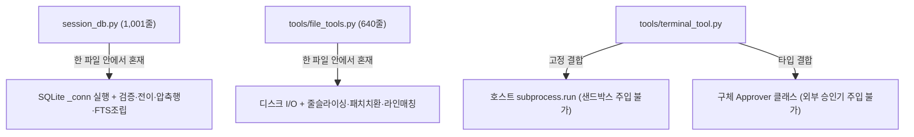
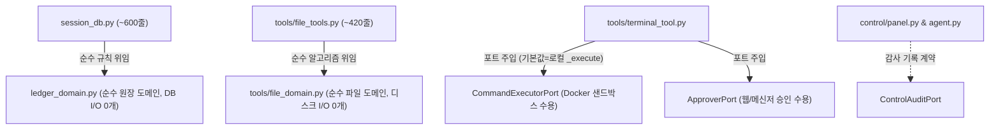
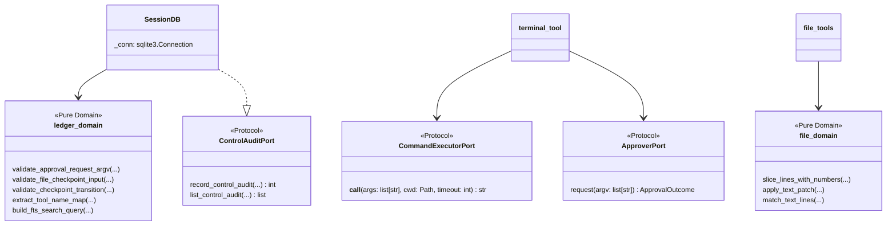
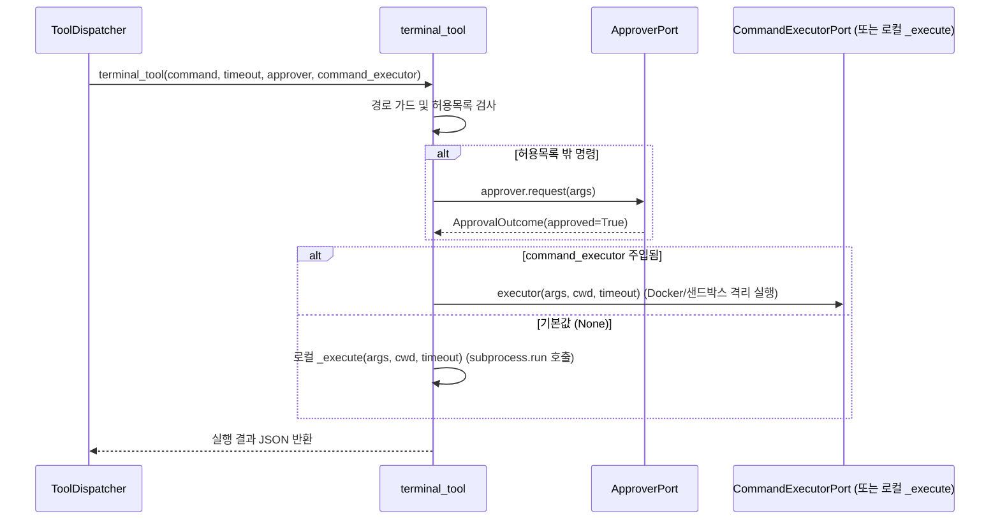
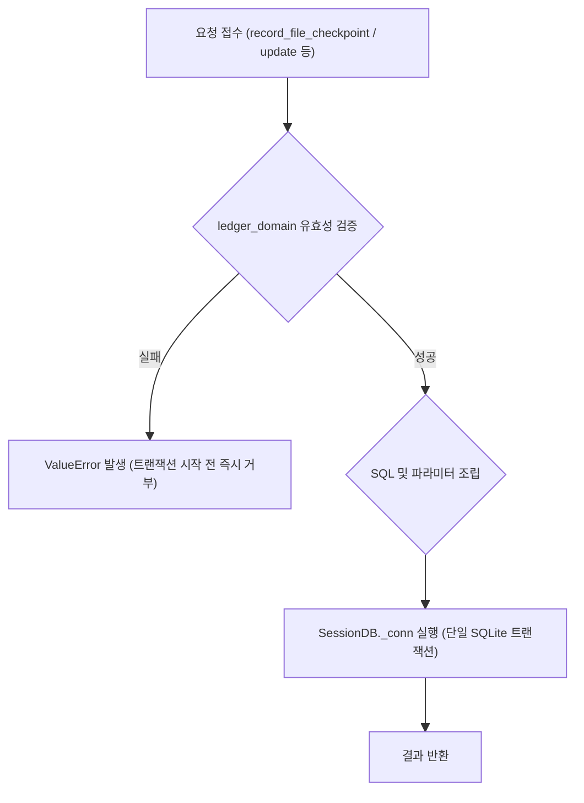

# [마스터 설계도] 21-원장-파일-도메인-분리-및-실행환경-포트-완결-MVP

> **상위**: [대시보드](README.md) | [PLAN.md](PLAN.md) | [WHY.md](WHY.md) | 근거 결정: [ADR-0021](../../adr/0021-원장_파일_도메인_분리_및_실행환경_포트_완결_MVP_범위와_결정.md)  
> **기준**: `main` `032ffb0`. 코드는 20 마감 `281d76f`와 같다(`git log -1 --format=%h -- src tests` = `281d76f`).  
> **이어받는 에이전트는 §9부터 읽는다.**

---

## 1. 배경 및 목적 (Why)

- 쉬운 말 설명은 [WHY.md](WHY.md)에, 결정은 [ADR-0021](../../adr/0021-원장_파일_도메인_분리_및_실행환경_포트_완결_MVP_범위와_결정.md)에 있다. 이 문서는 **어디를 어떻게 바꾸는가**를 다룬다.
- 목표:
  1. `SessionDB`(1,001줄)에서 순수 검증·전이·변환·쿼리 조립 로직을 `ledger_domain.py`로 분리하여 `SessionDB`를 ~600줄로 슬림화하고, 20번의 `_conn` 격리 불변식을 100% 보존한다.
  2. `file_tools.py`(640줄)에서 줄 번호 슬라이싱·패치 치환·라인 검색 순수 알고리즘을 `tools/file_domain.py`로 분리하여 ~420줄로 슬림화한다.
  3. `tools/ports.py`에 `ApproverPort`, `CommandExecutorPort`, `ControlAuditPort` 3종 포트를 신설하고, `terminal_tool` 및 `dispatcher`에 주입을 수용하여 Lv 4 샌드박스(Docker 컨테이너) 및 외부 승인기 수용성을 확보하되, 기존 `subprocess.run` monkeypatch 테스트 계약을 100% 보존한다.
  4. 6대 순수 도메인(`PURE_DOMAIN_MODULES`) 인프라 무의존성 및 전 모듈 단일 파일 800줄 상한(1,000줄 비대 파일 영구 방지)을 테스트로 영구 잠금한다.

---

## 2. As-Is vs To-Be 아키텍처

### 2-1. 폴더 구조 (신규·변경)

```text
src/hermes_core/
├── ledger_domain.py             [신규 010] 순수 원장 도메인 규칙 (검증·전이·압축행·FTS쿼리·스키마 상수, DB I/O 0개)
├── session_db.py                [변경 010] ledger_domain 위임 및 순수 SQLite 트랜잭션 전담 (~600줄로 슬림화)
├── tools/
│   ├── file_domain.py           [신규 020] 순수 파일 도메인 (줄번호슬라이싱·패치치환·라인매칭 알고리즘, 디스크 I/O 0개)
│   ├── file_tools.py            [변경 020] file_domain 위임 및 경로가드·원자적 파일 I/O 조율 (~420줄로 슬림화)
│   ├── ports.py                 [변경 030] ApproverPort, CommandExecutorPort, ControlAuditPort 포트 3종 추가
│   ├── terminal_tool.py         [변경 030] ApproverPort 및 command_executor: Optional[CommandExecutorPort] 주입 수용
│   └── dispatcher.py            [변경 030] create_default_dispatcher에 ApproverPort 및 command_executor 전달
├── kernel/                      (무변경 — WHY 가정 G)
├── agent/                       (무변경)
├── control/                     (무변경)
└── assembly.py                  (무변경)
tests/
├── test_architecture/
│   ├── test_dependency_rules.py [변경 040] PURE_DOMAIN_MODULES 6종 확대, 단일 파일 800줄 상한 잠금 시험 추가
│   └── test_ports_conformance.py [변경 040] ApproverPort, CommandExecutorPort, ControlAuditPort 적합성 잠금 추가
└── test_hermes_core/            [010·020·030 전용 신규 시험 파일 추가, 기존 1,173개 시험 무수정]
```

### 2-2. 구성요소 흐름: As-Is



### 2-3. 구성요소 흐름: To-Be



### 2-4. 클래스·모듈 관계



### 2-5. 실행 순서 (대표 시나리오: 터미널 명령 실행 및 샌드박스 실행기 주입)



### 2-6. 원장 도메인 입력 검증 및 전이 활동 흐름



---

## 3. 파급 범위와 무영향 근거 증명

### 3-1. 수정 대상 컴포넌트
- `src/hermes_core/ledger_domain.py`: 신규 생성 (순수 함수)
- `src/hermes_core/session_db.py`: `ledger_domain` 위임 (기존 메서드 시그니처 100% 불변)
- `src/hermes_core/tools/file_domain.py`: 신규 생성 (순수 함수)
- `src/hermes_core/tools/file_tools.py`: `file_domain` 위임 (기존 함수 시그니처 100% 불변)
- `src/hermes_core/tools/ports.py`: 신규 프로토콜 3종 추가 (기존 5종 프로토콜 불변)
- `src/hermes_core/tools/terminal_tool.py`: `approver: Optional[ApproverPort]`, `command_executor: Optional[CommandExecutorPort]` 추가 (기본값 `None`)
- `src/hermes_core/tools/dispatcher.py`: `create_default_dispatcher`에 `command_executor` 전달

### 3-2. 무영향 대상 컴포넌트
- `src/hermes_core/kernel/`: **완전 무수정 (diff 0줄)**. 18~20번에서 격리된 루프와 포트는 외부 도구 내부의 순수 도메인 분리에 전혀 영향받지 않는다.
- `src/hermes_core/control/`: **완전 무수정 (diff 0줄)**. 단일 제어판은 `ControlAuditPort` 프로토콜을 이미 만족하는 `SessionDB` 인터페이스를 그대로 사용한다.
- `src/hermes_core/agent/`: **완전 무수정 (diff 0줄)**.
- 기존 시험 1,173개: `SessionDB`, `file_tools`, `terminal_tool`, `Checkpointer`의 공개 시그니처가 100% 유지되고, `subprocess.run` 및 `os.replace` monkeypatch 패스 경로가 보존되므로 단 한 줄의 시험도 수정하지 않고 통과한다.

---

## 4. 사전 점검 및 실패 위험 분석 (Pre-Mortem 10건)

1. **`_conn` 격리 시험 깨짐 위험**: `session_db.py`의 SQL 실행 코드를 외부 도메인 모듈로 잘못 옮기면 `test_scenario_r20_no_private_conn_outside_session_db`가 실패한다.  
   → **방어책**: `_conn`을 다루는 `execute`, `commit`, `cursor`는 오직 `session_db.py`에만 남기고, `ledger_domain.py`는 오직 인자 검증과 데이터 변환, SQL 문자열 상수 조립만 수행하는 순수 함수 모듈로 격리한다.
2. **`monkeypatch.setattr(terminal_module.subprocess, "run", ...)` 무력화 위험**: `CommandExecutorPort`를 의무화하여 `terminal_tool`이 다른 객체를 호출하게 바꾸면 기존 20여 개 터미널 테스트의 모의 실행이 무시된다.  
   → **방어책**: `command_executor`의 기본값을 `None`으로 두고, `None`일 때는 기존의 `terminal_tool._execute`(모듈 내부의 `subprocess.run` 호출)를 그대로 타게 한다.
3. **`monkeypatch.setattr("os.replace", ...)` 무력화 위험**: `file_domain.py`로 분리하면서 원자적 쓰기 교체(`os.replace`) 흐름을 건드리면 파일 도구 테스트가 실패한다.  
   → **방어책**: `file_domain.py`는 오직 인메모리 텍스트 가공만 담당하고, 디스크 파일 쓰기/교체(`os.replace`)는 `file_tools.py`의 기존 위치에 그대로 둔다.
4. **마이그레이션 SQL 실행 순서 어긋남 위험**: 스키마 버전에 따른 ALTER TABLE 문이 분리 과정에서 꼬일 위험.  
   → **방어책**: `SCHEMA_SQL`, `FTS_SQL`, `SCHEMA_VERSION`을 `ledger_domain.py`에 그대로 상수로 보존하고 기존 `_init_schema` 흐름을 한 글자도 바꾸지 않는다.
5. **CRLF(`\r\n`) 줄바꿈 정규화 깨짐 위험**: 파일 읽기 시 윈도우 스타일 줄바꿈 파일 읽기 테스트와의 불일치.  
   → **방어책**: 기존 `split_lines` 처리 로직(`line[:-1] if line.endswith("\r") else line`)을 그대로 `file_domain.py`로 옮겨 100% 동일한 출력을 보장한다.
6. **FTS5 검색 랭킹 및 스니펫 포맷 왜곡 위험**: FTS 쿼리 빌더 분리 시 `snippet()` 파라미터나 MATCH 구문 누락.  
   → **방어책**: `build_fts_search_query`의 반환 SQL과 파라미터 튜플을 기존 `search_messages`와 엄격히 일치시키고 기존 전문 검색 시험으로 검증한다.
7. **`ApproverPort` 런타임 검사 실패 위험**: `Approver` 클래스가 신규 `ApproverPort` 프로토콜을 온전히 만족하지 못할 위험.  
   → **방어책**: `Approver.request(self, argv: list[str]) -> ApprovalOutcome`의 시그니처를 `test_ports_conformance.py`에서 `inspect.signature().bind()`로 철저히 검증한다.
8. **단일 파일 크기 상한 초과 위험**: 슬림화 이후에도 파일 크기가 800줄 이하로 내려가지 못할 위험.  
   → **방어책**: `session_db.py`에서 약 400줄 분량의 검증·변환·SQL 상수를 분리하여 600줄 이하로 안정적으로 낮추고, 040 단계에서 AST 기반 줄 수 상한 시험으로 강제한다.
9. **순수 도메인의 인프라 오염 위험**: 신규 도메인 모듈에 무심코 `sqlite3`나 `httpx`를 import할 위험.  
   → **방어책**: `test_scenario_r20_pure_domain_modules_have_no_infra_imports`의 검사 대상 목록에 `ledger_domain`과 `file_domain`을 추가하여 CI에서 즉시 실패하도록 차단한다.
10. **Python 3.12 import 결함 위험**: 신규 모듈의 타입 힌트가 3.12 환경에서 로드 오류를 낼 위험.  
    → **방어책**: 매 단계 완료 시 `uv run --no-project --python 3.12`로 격리 검증을 수행한다.

---

## 5. 4층위 검증망 설계

- **1층위 (수동 반복 배제)**: 유료 LLM 호출이나 수동 입력 없이 MockLLMClient, FakeCommandExecutor, FakeApprover를 통해 100% 자동 검증.
- **2층위 (단위 및 구조 검증)**: `test_ledger_domain.py`와 `test_file_domain.py`를 통해 DB·디스크 없이 인메모리 순수 함수 1ms 단위 검증.
- **3층위 (상태 및 정합성 검증)**: `SessionDB`의 트랜잭션 무결성, FTS5 인덱싱 동기화, `Checkpointer`와의 원장 정합성 검증.
- **4층위 (전체 통합 검증)**: 기존 1,173개 회귀 시험 전수 통과, `test_sandbox_and_approver_ports.py`를 통한 샌드박스 주입 E2E 연동 검증.

---

## 6. 단계별 상세 명세 (010~060)

### 010단계: 원장 순수 도메인 분리와 `SessionDB` 슬림화
- **작업**:
  - `src/hermes_core/ledger_domain.py` 신설 (입력 검증 함수 6종, 변환/조립 함수 5종, 스키마/마이그레이션 SQL 상수).
  - `session_db.py`에서 순수 도메인 로직을 `ledger_domain` 호출로 교체하고 크기를 600줄 이하로 슬림화.
  - `tests/test_hermes_core/test_ledger_domain.py` 신설.
- **완료 기준**: `session_db.py` < 800줄, `_conn` 외부 접근 0건 유지, 기존 1,173개 회귀 시험 통과.

### 020단계: 파일 도구 순수 도메인 분리
- **작업**:
  - `src/hermes_core/tools/file_domain.py` 신설 (`slice_lines_with_numbers`, `apply_text_patch`, `match_text_lines`).
  - `tools/file_tools.py`에서 텍스트 처리를 `file_domain`에 위임하고 크기를 420줄 이하로 슬림화.
  - `tests/test_hermes_core/test_file_domain.py` 신설.
- **완료 기준**: `file_tools.py` < 800줄, 파일 도구 및 체크포인트 시험 100% 통과.

### 030단계: 실행환경 및 승인·감사 포트 확장
- **작업**:
  - `tools/ports.py`에 `ApproverPort`, `CommandExecutorPort`, `ControlAuditPort` 3종 정의.
  - `terminal_tool.py` 및 `create_default_dispatcher`에 `approver: Optional[ApproverPort]`, `command_executor: Optional[CommandExecutorPort]` 수용.
  - `tests/test_hermes_core/test_sandbox_and_approver_ports.py` 신설 (모의 Docker 샌드박스 실행기 주입 검증).
- **완료 기준**: 샌드박스 주입 동작 확인, 기존 `subprocess.run` monkeypatch 시험 100% 통과.

### 040단계: 아키텍처 불변식 최종 총결산 잠금
- **작업**:
  - `tests/test_architecture/test_dependency_rules.py`에 `PURE_DOMAIN_MODULES` 6종 확대 및 `test_scenario_r21_file_size_limits`(전 모듈 800줄 이하) 추가.
  - `tests/test_architecture/test_ports_conformance.py`에 신규 포트 3종 적합성 검증 추가.
- **완료 기준**: 아키텍처 시험 전수 통과, 800줄 초과 모듈 0건.

### 050단계: 작동원리 최종 동기화
- **작업**: `docs/작동원리/` 01·02·03편에 원장·파일 순수 도메인 분리 및 포트 확장 반영.
- **완료 기준**: 사실 검증 4축 매트릭스 갱신, 상대경로 무결성 확인.

### 060단계: 마감 및 종합보고서
- **작업**: `WHY.md` 가정 A~I 대조, 종합보고서(`결과정리및리뷰.md`) 9개 항목 작성, Python 3.12 검증, `Closed` 전이, `roadmap-21-closed` 태그 발행.

---

## 7. 기준 시험 수 및 불변식 잠금 현황

- **착수 기준 시험 수**: **1,173개** (일반 `not pty` 1,162개 + `pty` 11개).
- **잠금 불변식**:
  1. `KNOWN_DEBT == {}` (0건)
  2. `R1 ~ R7` 의존 방향 전수 준수
  3. `session_db.py` 외 `._conn` 접근 0건
  4. `PURE_DOMAIN_MODULES` 6종 인프라 무의존
  5. `src/hermes_core/**` 전 파이썬 파일 800줄 이하 상한

---

## 8. 트러블슈팅 지침

1. **`test_scenario_r20_no_private_conn_outside_session_db`가 실패하면**:
   - `ledger_domain.py` 등 분리된 모듈에서 `._conn` 속성을 참조하고 있는지 AST 스캔 결과를 확인한다. `_conn` 접근은 오직 `session_db.py` 안에만 있어야 한다.
2. **기존 터미널 테스트(`test_terminal_approval.py` 등)가 실패하면**:
   - `terminal_tool`이 기본 실행 시 `terminal_module.subprocess.run`을 호출하는 기존 내부 함수 `_execute`를 우회하지 않았는지 확인한다.

---

## 9. 이어받는 에이전트 안내

- **읽을 순서**:
  1. [`docs/인계/`](../../인계/README.md) 최신 인계 파일
  2. 이 문서([ROADMAP.md](ROADMAP.md)) 및 [대시보드](README.md)
  3. 해당 순번의 구현지시서 (`instructions/NNN_...md`)
- **지시서 작성 규칙**:
  - 인수 테스트 시나리오(입력 → 기대 결과)를 코드 작성 전에 반드시 기술한다.
  - 지시서는 불변 역사이므로 한 번 작성되면 사후 수정하지 않는다.
- **금지 사항**:
  - `src/hermes_core/kernel/` 파일 수정 금지 (diff 0줄 사수).
  - 기존 1,173개 테스트 코드 임의 수정 금지.
  - 해시를 지어내지 않는다.
