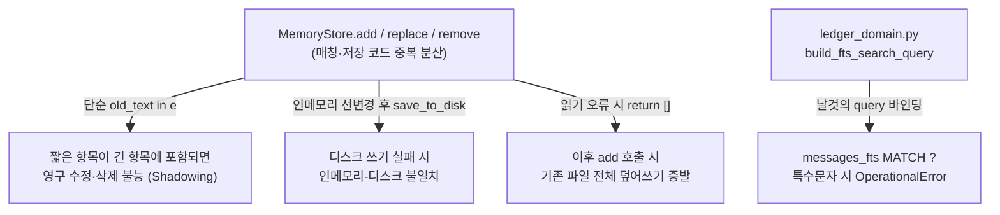
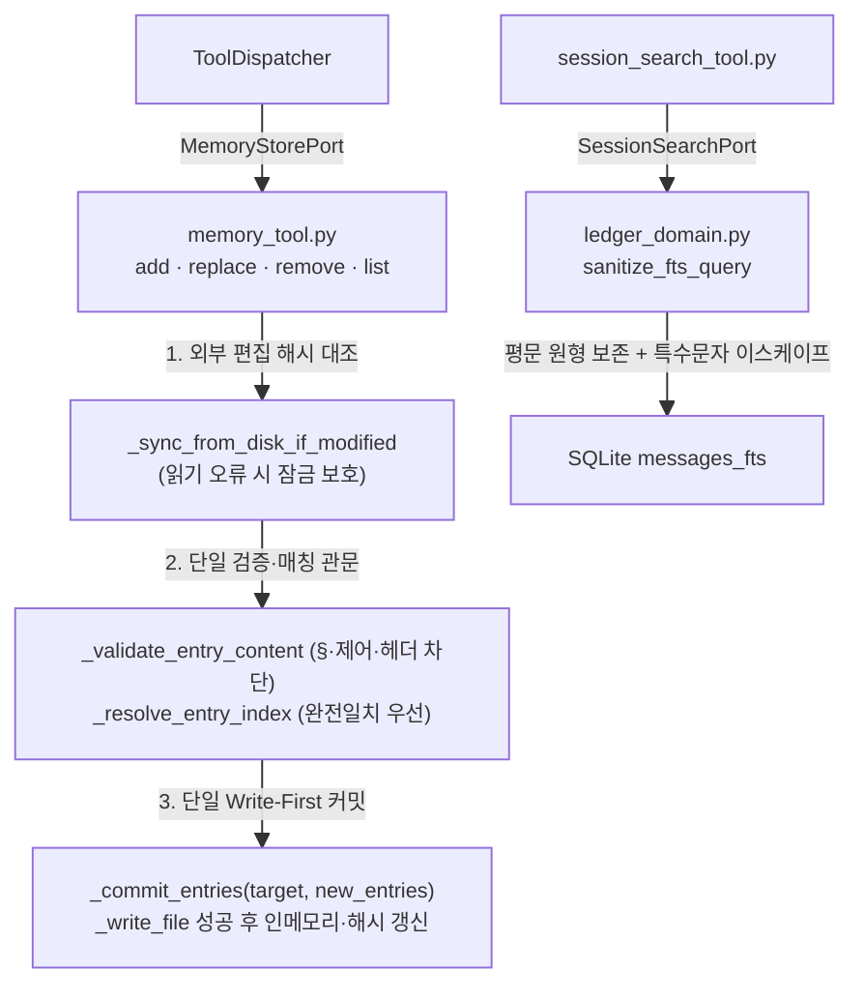
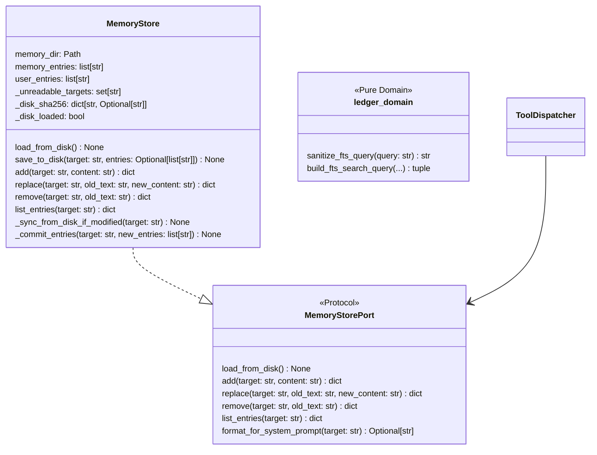
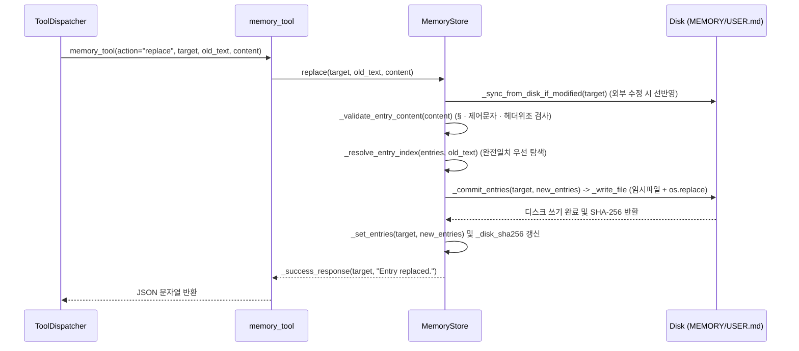
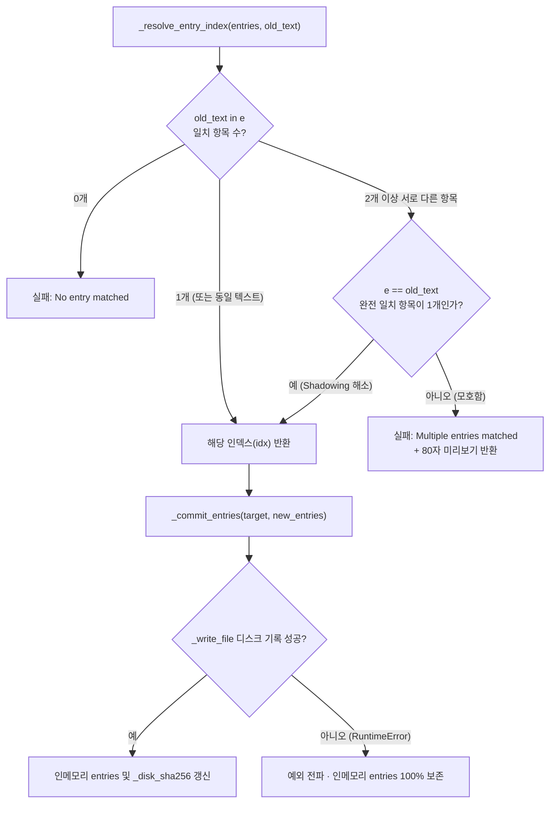

# [마스터 설계도] 22-메모리-개인화-무결성-및-포트-완결-MVP

> **단일 상태 원천 대시보드**: [README.md](README.md)  
> 승인된 계획서: [PLAN.md](PLAN.md) | 의도와 가정: [WHY.md](WHY.md) | 결정 근거: [ADR-0022](../../adr/0022-메모리_개인화_무결성_및_포트_완결_MVP_범위와_결정.md)

---

## 1. 개요 및 5대 구조적 허점 요약

21번 로드맵까지 거치며 31개 파이썬 파일, 6대 순수 도메인, 실행환경 포트 체계가 완성되었습니다.
그러나 핵심 개인화 기억 장치([`memory_tool.py`](../../../src/hermes_core/tools/memory_tool.py))와 과거 대화 검색([`ledger_domain.py`](../../../src/hermes_core/ledger_domain.py))에는 런타임에서 문제를 일으키는 5가지 실제 구조적 결함이 남아 있습니다:

| 번호 | 구조적 허점 (Loophole) | 코드 위치 | 결함 상세 |
|:---:|---|---|---|
| **L-1** | 부분 문자열 가림 함정 (Substring Shadowing) 및 `replace` 중복 | `memory_tool.py` 178~192행, 222~230행 | 짧은 문장(`"User uses Python"`)이 긴 문장(`"User uses Python 3.12"`)에 포함될 때 다중 매칭 에러로 인한 영구 수정·삭제 불능. `replace` 시 중복 항목 생성 허용 |
| **L-2** | 인메모리 선변경 Split-Brain 및 읽기 오류 시 기억 증발 | `memory_tool.py` 162~164행, 209~211행, 287~294행 | 디스크 쓰기 전 인메모리 선변경으로 쓰기 실패 시 상태 불일치. `UnicodeDecodeError` 미포획 크래시 및 읽기 오류 시 빈 목록 반환 후 다음 쓰기에서 원본 덮어써 증발 |
| **L-3** | 구분자(`§`) 분할 오염 및 헤더 위조 무방비 | `memory_tool.py` 140~160행, 299행 | 입력 문자열 내 `"§"` 미차단으로 인한 파싱 분할 깨짐. 시스템 프롬프트 헤더 구분선(`══════`) 위조 차단 부재 |
| **L-4** | `list` 액션 부재 및 `MemoryStorePort` 누락 | `memory_tool.py` 43행, `ports.py`, `dispatcher.py` 339행 | 세션 재개 후 메모장 조회 수단 부재. 도구 포트 중 `MemoryStorePort`만 누락되어 디스패처가 구체 클래스에 결합 |
| **L-5** | 에피소딕 검색(`session_search`) FTS5 특수문자 문법 에러 | `ledger_domain.py` 294행 | `messages_fts MATCH ?`에 날것 바인딩으로 하이픈·따옴표·특수문자 검색 시 SQLite 구문 에러 발생 |

---

## 2. 폴더 구조 (신규 소스 파일 0개 · 31개 소스 파일 100% 유지)

```text
src/hermes_core/                 (전체 31개 파이썬 파일 구조 불변)
├── ledger_domain.py             [변경 020] sanitize_fts_query() 추가 및 build_fts_search_query() 통합
├── agent/
│   └── prompt_builder.py        [변경 020] MEMORY_GUIDANCE에 list 조회 안내 보강
├── tools/
│   ├── memory_tool.py           [변경 010·020] _validate_entry_content, _resolve_entry_index, _commit_entries 통합 및 list 액션 추가
│   ├── ports.py                 [변경 020] MemoryStorePort 프로토콜 추가 (도구 포트 9종 완결)
│   └── dispatcher.py            [변경 020] create_default_dispatcher의 memory_store 타입을 Optional[MemoryStorePort]로 정합
├── kernel/                      (무변경 — diff 0줄)
├── control/                     (무변경)
└── assembly.py                  (무변경)
tests/
├── test_architecture/
│   └── test_ports_conformance.py [변경 030] MemoryStorePort 적합성 및 시그니처 바인딩 검증 추가
└── test_hermes_core/
    ├── test_memory_integrity.py [신규 010·020] 완전일치 우선매칭, §/인젝션/중복치환 거부, Write-First 롤백, 읽기잠금, 외부편집 동기화, list/포트 시험
    └── test_fts_query_safety.py [신규 020] FTS5 평문 보존 및 특수문자 검색어 안전 정규화 시험
```

---

## 3. 구성요소 흐름 및 관계 도해 (5종)

### 3.1 As-Is 흐름 ([그림 1])



### 3.2 To-Be 흐름 ([그림 2])



### 3.3 클래스 및 인터페이스 관계 ([그림 3])



### 3.4 단일 관문 실행 순서 ([그림 4])



### 3.5 상태 및 분기 흐름 ([그림 5])



---

## 4. 파급 범위 및 하위 호환성 증명

1. **패키지 및 파일 구조 100% 불변**: `src/hermes_core/` 하위 31개 파이썬 파일 목록 불변, `kernel/`, `control/`, `assembly.py` diff 0줄.
2. **공개 API 및 시그니처 100% 하위 호환**:
   - `MemoryStore(memory_dir, memory_char_limit, user_char_limit)` 생성자 및 모든 공개 메서드 시그니처 불변.
   - `@staticmethod def _read_file(path: Path) -> list[str]` 및 `@staticmethod def _write_file(path: Path, entries: list[str]) -> None` 시그니처 유지 (`UnicodeDecodeError` 포획 안전망 보강).

---

## 5. 사전 실패 위험 분석 (Pre-Mortem 7건)

1. **위험 1 (`test_ledger_domain.py:159` 단언 깨짐)**: `params == ["error log", ...]` 단언 유지 필요. ➔ **방어**: 일반 평문은 따옴표 없이 원형 보존.
2. **위험 2 (`test_annotations_resolve.py` 타입 주석 해석 실패)**: 미해결 타입 주석 발생 위험. ➔ **방어**: 모든 타입 심볼을 최상위에서 선언.
3. **위험 3 (`load_from_disk()` 미호출 상태의 단위 테스트 호환성)**: `store.add()` 단독 호출 시 미초기화 위험. ➔ **방어**: `self._disk_loaded` 플래그로 보호.
4. **위험 4 (`save_to_disk(target)` 단일 인자 호출 호환성)**: `entries` 기본값 `None` 처리로 기존 호출 100% 호환.
5. **위험 5 (여러 줄 정상 메모의 제어문자 오판)**: `\n`, `\r`, `\t` 허용, C0/DEL만 차단.
6. **위험 6 (수동 작성된 기존 `MEMORY.md` 거부 위험)**: 검증 관문은 모델 쓰기 시에만 적용, 디스크 읽기에서는 미적용.
7. **위험 7 (단일 파일 800줄 상한 초과)**: `memory_tool.py` ~390줄, `ledger_domain.py` ~385줄로 상한의 절반 이하 유지.

---

## 6. 이어받는 에이전트를 위한 인계 지침 (Handover Protocol)

### 6.1 읽을 순서
1. [`AGENTS.md`](../../../AGENTS.md) 및 [`ROADMAP_정책.md`](../ROADMAP_정책.md)
2. [README.md](README.md) (단일 상태 원천 대시보드)
3. 본 마스터 설계도 ([ROADMAP.md](ROADMAP.md)) 및 [ADR-0022](../../adr/0022-메모리_개인화_무결성_및_포트_완결_MVP_범위와_결정.md)
4. 착수 대상 단계의 구현지시서 (`instructions/010_...` 등)

### 6.2 착수 기준선 (Baseline)
- 기준 시험 수: 총 **1,201개** (`not pty` 1,190개 + `pty` 11개) 100% 통과
- 소스 파일 수: `src/hermes_core/` 하위 **31개** 파이썬 파일 불변
- `kernel/` diff 0줄 유지

### 6.3 절대 금지 사항
- `src/hermes_core/` 하위에 신규 `.py` 파일을 추가하여 모듈 구조를 바꾸는 행위 금지.
- 런타임에서 호출되지 않는 죽은 메서드를 추가하는 행위 금지.
- `kernel/` 디렉터리 및 `hermes-agent/` 디렉터리 수정 절대 금지.
- 기존 1,201개 테스트 단언(assertion)을 임의로 완화하거나 삭제하는 행위 금지.
- 커밋 해시를 추측하거나 지어내지 않는다.
