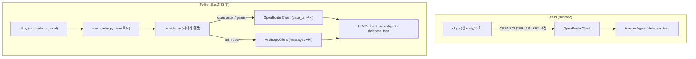
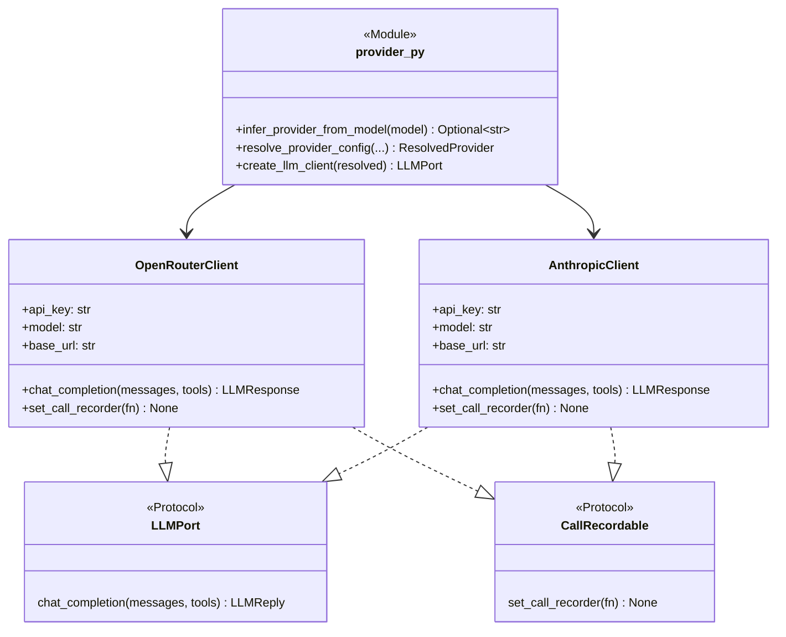
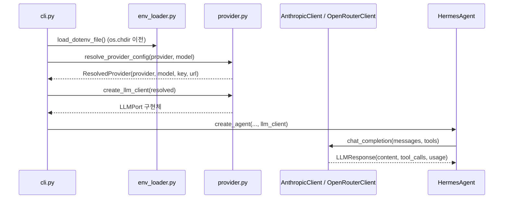
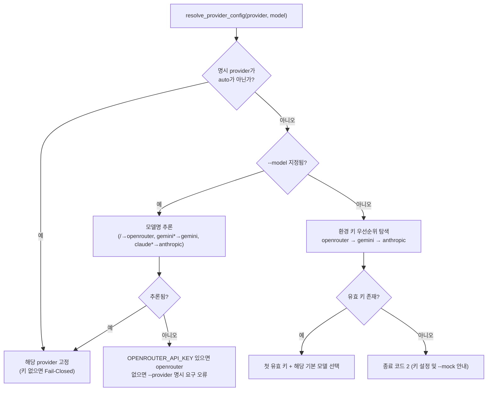

# [마스터 설계도] 23-다중-LLM-프로바이더-MVP

> **단일 상태 원천 대시보드**: [README.md](README.md)  
> 승인된 계획서: [PLAN.md](PLAN.md) | 의도와 가정: [WHY.md](WHY.md) | 결정 근거: [ADR-0023](../../adr/0023-다중_LLM_프로바이더_MVP_범위와_결정.md)  
> **기준 코드**: 커밋 `90defe2` (`src/hermes_core` 파이썬 파일 47개, 전체 테스트 수집 1,219개)

---

## 1. 배경 및 목적

현재 `hermes_core`의 코어 루프(`kernel/loop.py`)와 에이전트(`HermesAgent`)는 [`LLMPort`](../../../src/hermes_core/kernel/ports.py) 추상화에 의존하지만, 진입점인 [`cli.py`](../../../src/hermes_core/cli.py)와 [`constants.py`](../../../src/hermes_core/constants.py)는 OpenRouter 한 곳만 바라보고 있습니다.

| 영역 | 현재 동작 (`90defe2` 확인됨) | 로드맵 23 완료 후 |
|---|---|---|
| `.env` 파일 | 자동 로드 없음 (셸 `export`만 인식) | `env_loader.py`가 `os.chdir` 전 `.env`를 `setdefault`로 안전 로드 |
| Gemini 키 | `GEMINI_API_KEY` 미인식 | Gemini OpenAI 호환 엔드포인트로 `OpenRouterClient` 재사용 호출 |
| Claude 키 | `ANTHROPIC_API_KEY` 미인식 | `AnthropicClient`가 Messages API 형식으로 양방향 변환 호출 |
| 다중 키 선택 | 없음 | `명시 지정 > 모델명 추론 > 키 우선순위` 사다리 + Fail-Closed |
| 보안·격리 | `OPENROUTER_API_KEY`만 제거·검출 | 3종 키 모두 터미널 자식 제거·스냅샷 마스킹·gitleaks·테스트 격리 적용 |

---

## 2. 폴더 및 변경 파일 구조

```text
src/hermes_core/
├── constants.py              [변경 010] 프로바이더/모델/키 상수 및 TERMINAL_STRIPPED_ENV_NAMES 확장
├── env_loader.py             [신규 010] 표준 라이브러리 기반 .env 안전 로더 (load_dotenv_file)
├── llm_client.py             [변경 020] 마스킹 헬퍼 공유 정리 (OpenRouterClient 호환 유지)
├── anthropic_client.py       [신규 020] Anthropic Messages API 어댑터 (AnthropicClient)
├── provider.py               [신규 030] 프로바이더 결정 사다리(resolve_provider_config) 및 팩토리
├── cli.py                    [변경 040] --provider 옵션, .env 로드, 배너 및 delegate_task 연동
├── control/
│   ├── settings.py           [변경 030] Settings.provider 추가 (startup, nullable)
│   └── snapshot.py           [변경 010] mask_secrets() Gemini 키 패턴 보강
└── kernel/                   (무변경 — diff 0줄 유지)
.gitleaks.toml                [변경 010] Anthropic·Gemini 키 규칙 추가
tests/
├── test_architecture/
│   └── test_ports_conformance.py [변경 040] AnthropicClient LLMPort/CallRecordable 적합성 추가
├── test_control/
│   ├── test_settings.py      [변경 030] SETTING_SPECS 수 단언(12→13) 동기화
│   └── test_snapshot.py      [변경 030] SETTING_SPECS 수 단언(12→13) 동기화
├── test_scripts/
│   └── test_gitleaks_config.py [변경 010] Gemini/Anthropic 키 검출·자리표시자 비검출 추가
└── test_hermes_core/
    ├── conftest.py           [변경 010] 3종 키 및 HERMES_PROVIDER 자동 제거
    ├── test_env_loader.py    [신규 010] .env 로더 단위/인수 시험
    ├── test_anthropic_client.py [신규 020] AnthropicClient 변환·루프·오류·보안 인수 시험
    ├── test_provider.py      [신규 030] 사다리 우선순위·Fail-Closed·팩토리 인수 시험
    └── test_cli.py / test_cli_delegate.py [변경 040] 다중 프로바이더 CLI/위임 검증
```

---

## 3. 구성요소 흐름 및 관계 도해

### 3.1 As-Is vs To-Be 흐름 ([그림 1])



### 3.2 클래스 및 모듈 관계 ([그림 2])



### 3.3 한 턴 실행 및 변환 순서 ([그림 3])



### 3.4 프로바이더 결정 사다리 분기 ([그림 4])



---

## 4. 파급 범위와 무영향 근거 증명

1. **커널(`src/hermes_core/kernel/`) 무영향**: `kernel/`은 `LLMPort` 프로토콜에만 의존하므로 diff 0줄을 유지합니다.
2. **도구·원장·확장 파이프라인 무영향**: `ToolDispatcher`, `SessionDB`, `CompressionExtension`, `LoopGuardExtension`은 내부 OpenAI 메시지/응답 규격을 유지한 채 어댑터 경계 밖에서 동작합니다.
3. **기존 `OpenRouterClient` 및 `Settings` 호환**:
   - `OpenRouterClient(api_key, model, base_url=...)`의 기존 생성자와 메서드를 깨뜨리지 않으므로 기존 `test_llm_client.py`가 무수정 통과합니다.
   - `Settings.provider`는 `default=None` (`nullable=True`)이므로 기존 `config.toml`에 `provider` 키가 없어도 100% 호환됩니다.
4. **R1~R7 의존 방향 준수**:
   - `control/settings.py`는 `constants`와 표준 라이브러리만 참조(`R6` 준수).
   - `env_loader.py`, `anthropic_client.py`, `provider.py`는 `cli`를 import하지 않으며(`R2` 준수), `kernel` 내부를 침범하지 않습니다(`R1` 준수).

---

## 5. 사전 실패 위험 분석 (Pre-Mortem 6건)

1. **위험 1 (CLI `os.chdir(workspace)` 이후 `.env` 미발견)**: [`cli.py#L444`](../../../src/hermes_core/cli.py#L444)에서 작업 폴더(`.hermes/workspace`)로 이동한 뒤 `.env`를 찾으면 프로젝트 루트의 `.env`를 못 찾습니다. ➔ **방어**: 반드시 `os.chdir(workspace)` 이전에 `load_dotenv_file()`을 호출합니다.
2. **위험 2 (`--mock` 테스트 또는 비모의 CLI 테스트가 로컬 `.env`로 오염)**: 개발자 로컬 루트에 `.env`가 있으면 `pytest`가 이를 읽을 수 있습니다. ➔ **방어**: `--mock` 모드에서는 `.env`를 로드하지 않으며, `conftest.py`에서 3종 키와 `HERMES_PROVIDER`를 매 테스트 전에 제거하고, CLI 테스트는 `monkeypatch.chdir(tmp_path)` 또는 명시적 인자 주입으로 격리합니다.
3. **위험 3 (`test_settings.py`·`test_snapshot.py`의 항목 수 `12` 하드코딩 실패)**: `SETTING_SPECS`에 `provider` 추가 시 기존 단언 `== 12`가 실패합니다. ➔ **방어**: 030 단계에서 해당 테스트의 기대 항목 수(`13` 또는 `len(SETTING_SPECS)`)를 정식 동기화합니다.
4. **위험 4 (Anthropic API의 연속 `tool` 결과 메시지 거부)**: 여러 도구가 한 턴에 호출되면 내부 `messages`에 `role: "tool"` 메시지가 연속 2개 이상 쌓이는데, Anthropic API는 연속된 `user` 역할을 허용하지 않습니다. ➔ **방어**: `AnthropicClient` 변환 시 연속된 `role == "tool"` 메시지를 단일 `role: "user"` 메시지의 `tool_result` 블록 리스트로 병합합니다.
5. **위험 5 (Anthropic `tool_calls`의 깨진 JSON arguments 및 `compression.py` 호출)**: 직전 턴에서 깨진 JSON 문자열이 `history`에 남아 있거나 `compression.py`가 `tools=None`으로 `[system, user]`만 보낼 때도 `AnthropicClient`가 터지지 않아야 합니다. ➔ **방어**: JSON 파싱 실패 시 원문 보존/빈 dict 안전 폴백을 두고, `tools=None`일 때는 payload에 `tools` 키를 생략합니다.
6. **위험 6 (단일 파일 800줄 상한 초과)**: `cli.py`(현재 688줄)에 로직을 몰아넣으면 800줄을 넘을 수 있습니다. ➔ **방어**: `.env` 로더(`env_loader.py`), Anthropic 어댑터(`anthropic_client.py`), 결정 사다리(`provider.py`)를 별도 모듈로 분리해 모든 파일을 800줄 미만으로 유지합니다.

---

## 6. 4층위 검증 범위 설계

1. **1층위 (수동 반복 배제)**: `httpx.MockTransport`와 `MockLLMClient`로 오프라인 자동 회귀.
2. **2층위 (단위 및 구조 검증)**: `.env` 파싱, `AnthropicClient` 양방향 직렬화·역직렬화, `provider.py` 결정 사다리·Fail-Closed, `mask_secrets()`, `.gitleaks.toml` 규칙.
3. **3층위 (상태 및 정합성 검증)**: `Settings.provider` 계층 로드(`default < file < env < cli`), `ControlSnapshot` 마스킹, `llm_calls` 원장 기록(`on_call`), `delegate_task` 자식 클라이언트 격리.
4. **4층위 (전체 통합 및 아키텍처 검증)**: `tests/test_architecture/`(`R1~R7`, `LLMPort` 적합성, 타입 주석 해석, 800줄 상한), `.venv/bin/python -m pytest -n 4`(pty 포함), 마감 전 실제 `.env` 기반 수동 스모크(사용자 별도 터미널).

---

## 7. 이어받는 에이전트를 위한 인계 지침

1. **읽을 순서**: `AGENTS.md` → `ROADMAP_정책.md` → `README.md`(대시보드) → `ROADMAP.md` → `ADR-0023` → 해당 단계 `instructions/`
2. **착수 기준선**: 기준 커밋 `90defe2` (ADR 커밋 `1fe8323`, WHY 커밋 `b73cceb`), 소스 파이썬 파일 `47개`, 전체 테스트 수집 `1,219개`.
3. **절대 금지 사항**: `kernel/` 및 `hermes-agent/` 수정 금지, API 키 원문·`.env` 파일 읽기/출력 금지, `git add -A` 금지, 한 번에 지시서 2개 이상 구현 금지.
